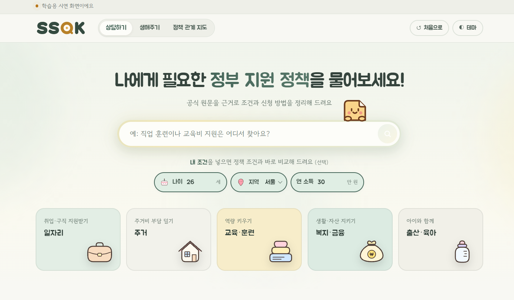
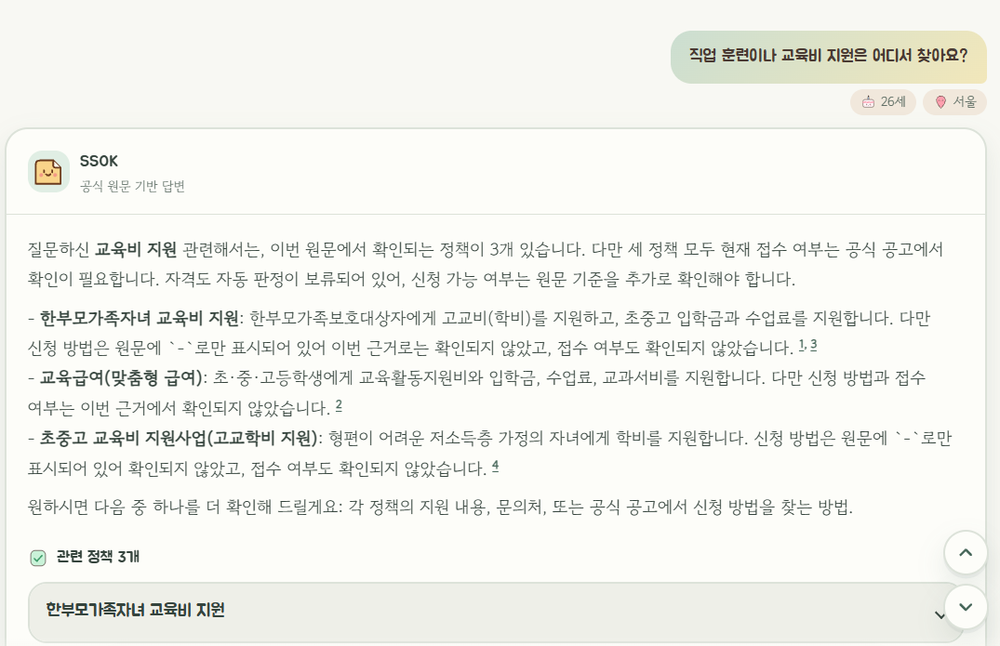
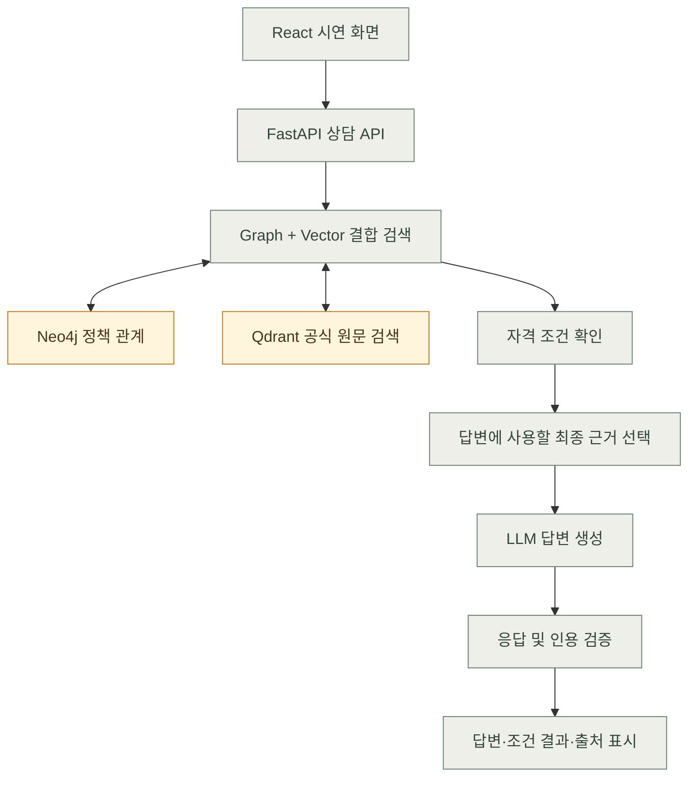

<p align="center">
  
</p>

<h1 align="center">SSOK · 생애주기 맞춤 정책 AI</h1>

<p align="center"><strong>모르면 못 받는 지원금, SSOK이 ‘모르면’을 줄입니다.</strong></p>

**내 상황에 맞는 정부 지원 정책을 찾고, 신청 전에 확인할 조건과 공식 공고를 함께 보여주는 한국어 RAG 서비스입니다.**

SK네트웍스 Family AI 캠프 36기 · 3차 단위 프로젝트(LLM)에서 시작해 4차 단위 프로젝트까지 이어서 개발 · 1팀

<div align="center">

### 한눈에 보기

| 대상 | 데이터 | 검색·답변 | 시연 화면 |
| :---: | :---: | :---: | :---: |
| 청년 취업준비생 | **정책 249개**<br>공식 근거 문서 273개 | Qdrant · Neo4j<br>GPT-5.4 mini | 맞춤 정책 찾기 · 생애주기<br>정책 관계 지도 |

</div>

## 목차

| 섹션 | 내용 |
| --- | --- |
| [프로젝트 개요](#프로젝트-개요) | 서비스 배경과 핵심 기능 |
| [시연 화면](#시연-화면) | 홈 화면과 실제 상담 결과 |
| [기술 스택](#기술-스택) | 프론트엔드·백엔드·AI·DB |
| [아키텍처](#아키텍처) | 검색부터 답변과 출처 표시까지 |
| [데이터와 평가 결과](#데이터와-평가-결과) | 데이터 규모와 검증 범위 |
| [실행 방법](#실행-방법) | 예시 모드와 실제 API 연동 |
| [프로젝트 일정](#프로젝트-일정) | 3차 WBS와 4차 진행 |
| [팀원과 산출물](#팀원과-산출물) | 담당 영역·산출물 01~05·발표 PDF |
| [한계와 후속 계획](#한계와-후속-계획) | 구현 범위와 남은 과제 |
| [데이터 출처와 라이선스](#데이터-출처와-라이선스) | 원문 출처와 이용조건 |

## 프로젝트 개요

정부·지자체 지원 정책은 여러 기관에 흩어져 있고, 같은 분야라도 나이·거주지·신청기간에 따라 자격이 달라집니다. 
SSOK은 자연어 질문과 사용자가 제공한 조건을 바탕으로 관련 정책을 찾고, 확인된 조건과 추가로 확인해야 할 사항을 구분해 보여줍니다. 
3차 프로젝트에서는 **청년 취업준비생**을 주요 사용자로 삼았고, 4차 프로젝트에서 정책 목록·관심 정책·정책 상세 화면과 자녀 월령 조건 등을 더했습니다.

### 핵심 기능

- **정책 검색 및 추천** · 사용자 질문과 관련된 정책과 공식 원문을 찾습니다. 상담 화면에서는 나이·지역·연 소득·자녀 월령을 선택 입력할 수 있습니다.
- **조건 확인과 추가 질문** · 자동 비교가 가능한 자격 조건을 확인하고, 추가 입력이 필요한 경우 입력 항목을 안내합니다. 접수 상태는 자격 확인 결과와 구분해 표시합니다.
- **근거 기반 답변** · 검색된 근거를 바탕으로 신청 절차와 필요 서류를 안내하고 공식 출처를 표시합니다. 근거가 부족하면 별도 안내를 표시합니다.

## 시연 화면

**홈 화면**



**실제 상담 결과**



| 화면           | 시연에서 볼 수 있는 내용                                                                                  |
| -------------- | --------------------------------------------------------------------------------------------------------- |
| 맞춤 정책 찾기 | “직업 훈련이나 교육비 지원은 어디서 찾아요?”라고 질문하고 답변, 조건 확인 결과, 공식 출처를 확인합니다. |
| 생애주기       | 생애단계와 분야를 선택해 정책을 탐색하고, 관심 정책의 요약을 읽거나 상담에서 질문합니다.                  |
| 정책 관계 지도 | 정책을 중심으로 기관·지역·분야·대상·생애단계·근거 문서·자격 조건이 어떻게 연결되는지 살펴봅니다.    |

**대표 시연** · 맞춤 정책 찾기에서 질문을 보낸 뒤 답변의 출처를 열고, 같은 정책을 생애주기 또는 관계 지도에서 이어서 살펴봅니다. 
[화면별 기능 및 시연 방법](frontend/README.md)

## 기술 스택

| 영역                 | 사용 기술                                                                                                                                                                                                                                                                                                                                                                                                   |
| -------------------- | ----------------------------------------------------------------------------------------------------------------------------------------------------------------------------------------------------------------------------------------------------------------------------------------------------------------------------------------------------------------------------------------------------------- |
| **Frontend**   |                                                                                                                                                                                                                |
| **Backend**    |                                                                                                                                                                                                    |
| **AI**         |                                                                             |
| **Database**   |                                                                                                                                                                                                                                      |
| **Dev & Test** |     |

## 아키텍처



Neo4j는 정책에 연결된 대상·생애단계·자격 조건을 조회하고, Qdrant는 질문과 의미상 관련된 공식 원문 청크를 검색합니다. 
검색 결과를 결합한 뒤 조건 확인 모듈이 사용자 입력과 정책 조건을 비교합니다. 답변 생성에는 검색 근거와 조건 확인 결과를 사용합니다.

[상담 API 계약](docs/api/ask_contract.md) · [시연 모델 비교 PR #56](https://github.com/SKNETWORKS-FAMILY-AICAMP/SKN36-3rd-1Team/pull/56)

## 데이터와 평가 결과

온통청년, LH 청약플러스, 복지로, 정부24 등 공식 정책 자료를 바탕으로 데이터셋을 구성했습니다. 
정책 원문의 출처 URL, 수집 시점, 콘텐츠 해시를 보존합니다.

| 항목                       | 결과                                                        |
| -------------------------- | ----------------------------------------------------------- |
| 정책·근거 문서·릴리스 청크 | 249개 · 273개 · 672개 (`v1.4.0-candidate` manifest)        |
| Neo4j                      | 노드 1,147개 · 관계 2,702개 (manifest)                     |
| Qdrant                     | B2 청킹 1,249 Point(서비스 검색) · B3 1,338 Point · 1,024차원 · Cosine |
| DB 검증                    | 2026-11-25 R3D 번들(정책 249개) 새 볼륨 독립 복원 PASS · Qdrant↔Neo4j 교차 검증 18,109건 PASS ([기록](docs/development/ISSUE105_R3_RUNBOOK.md#512-r3d-최종-번들과-독립-복원-검증-현재-권장-번들-2026-11-25-강의실-노트북)). 강의실 노트북 1대 기준이며 다른 PC 재현은 미검증 |
| 검색 평가                  | 55문항 실행 · 52문항 채점 · 최종 Gold 확정 전                                  |

자동 비교에 필요한 조건이 구조화되지 않았거나 공식 근거가 부족하면 해당 조건의 확인을 보류합니다. 거주 지역은 입력할 수 있으며, 지역 범위와 거주 요건은 공식 원문에서 확인하도록 안내합니다.

서비스 기준 데이터는 `data/releases/v1.4.0-candidate/`에 있습니다. 폴더 이름과 manifest 상태는 아직 `CANDIDATE / PENDING_DB_REVIEW`(DB 담당 최종 승인 대기)이며, 서비스와 R3D 복원 번들은 이 후보 데이터를 그대로 사용합니다. [최종 DB 적재 검증 PR #45](https://github.com/SKNETWORKS-FAMILY-AICAMP/SKN36-3rd-1Team/pull/45) · [데이터 계약](docs/data/data_contract.md) · [공식 원문 대조·교정 기록](docs/data/reports/data_corrections_v1.4.0_review.md)

## 실행 방법

### 빠른 시연 · 예시 모드

Node.js 18 이상이 필요합니다. 저장소 루트에서 아래 명령을 실행하고 Vite가 출력하는 로컬 주소를 엽니다. 
`frontend/.env.local`이 있다면 `VITE_ASK_API_URL`을 비워 둡니다. 상담 답변은 화면에 **예시 응답**으로 표시됩니다.

```bash
cd frontend
npm install
npm run dev
```

### 전체 로컬 실행 · 실제 검색과 답변

**별도로 전달되는 최종 DB 복원 ZIP**(R3D 번들 `rag-final-v140-r3-57d90f23308a.zip`), Python, Docker, Ollama의 `qwen3-embedding:0.6b`, OpenAI API 키가 필요합니다. 

> 복원 ZIP과 원본 수집 파일(`data/raw/**`)은 용량·이용조건 때문에 Git에 올리지 않고 팀 내부에서만 전달합니다. 따라서 저장소만 받은 외부 사용자는 아래 전체 실행을 재현할 수 없고, [빠른 시연 · 예시 모드](#빠른-시연--예시-모드)와 DB 없이 동작하는 단위 테스트만 실행할 수 있습니다.

복원 가이드의 검증 환경은 Windows / Python 3.13.15입니다.

1. [R3 통합 복원 Runbook](docs/development/ISSUE105_R3_RUNBOOK.md)에 따라 Python 가상환경을 준비하고 `requirements.txt`의 의존성을 설치합니다. 복원 ZIP으로 Neo4j·Qdrant를 복원하고(절차 §5.7.3~5.7.8, 현재 번들 값은 §5.12) Ollama 임베딩 모델을 준비합니다. 예전 [ISSUE43 복원 가이드](docs/development/ISSUE43_RESTORE_GUIDE.md)는 r2(정책 246개) 이전 기록입니다.
2. 저장소 루트의 `.env.example`을 `.env`로 복사합니다. 복원 환경과 일치하는 Neo4j·Qdrant 접속 정보, Ollama 주소, OpenAI API 설정을 입력합니다. 실제 키가 들어간 `.env`와 `.env.local`은 커밋에서 제외합니다.
3. 가상환경을 활성화한 상태로 저장소 루트에서 백엔드를 실행합니다.

   ```bash
   python -m uvicorn backend.api.main:app --host 127.0.0.1 --port 8000 --env-file .env
   ```
4. 백엔드는 `http://127.0.0.1`과 `http://localhost`의 개발 포트를 자동으로 허용합니다. 그 외 프론트 주소는 백엔드의 `ASK_CORS_EXTRA_ORIGINS`에 쉼표로 구분해 추가하세요. `frontend/.env.local`에 `VITE_ASK_API_URL=http://127.0.0.1:8000/api/ask`를 설정합니다. 새 터미널을 저장소 루트에서 열어 프론트엔드를 실행합니다.

   ```bash
   cd frontend
   npm install
   npm run dev -- --host 127.0.0.1 --port 5173 --strictPort
   ```
5. [상담 화면](http://127.0.0.1:5173/)에서 “직업 훈련이나 교육비 지원은 어디서 찾아요?”를 보내고, 화면의 답변·공식 출처와 백엔드의 `POST /api/ask … 200 OK` 로그를 확인합니다. [API 상태](http://127.0.0.1:8000/health)의 `ready`는 정책 결과가 있는 검색에 처음 성공하기 전까지 `false`일 수 있습니다.

`SEARCH_BACKEND_UNAVAILABLE`(503)·`LLM_UNAVAILABLE`(502) 오류가 나면 Docker 컨테이너의 실제 포트 매핑이 `.env`와 다르거나(로컬 Docker 환경마다 달라질 수 있습니다), Qdrant 인증키가 안 맞거나, DB는 연결됐지만 데이터가 비어 있거나, OpenAI 키가 무효화된 경우가 흔합니다. 연결 성공과 실제 데이터 적재는 별개로 확인하세요. 오류별 확인 순서는 [DB 복원 가이드의 "문제 해결"](docs/development/ISSUE43_RESTORE_GUIDE.md#문제-해결-연결인증-오류)을 참고하세요(번들 버전과 무관하게 적용되는 연결·인증 점검 절차입니다).

### 정책 상세보기 · Django SSR (#120, 선택)

정책 카드의 `정책 상세보기 ↗`는 Django(`web_ssr/`)가 서버에서 렌더링한 페이지를 엽니다. Django는 FastAPI `GET /api/policies`만 호출하며 DB에 직접 접속하지 않습니다. 아래 명령은 모두 저장소 루트에서 실행합니다.

1. Django 의존성(Django 5.2 LTS)을 설치합니다.

   ```powershell
   python -m pip install -r web_ssr/requirements.txt
   ```
2. Django 설정 파일을 만듭니다. 이미 `web_ssr/.env`가 있으면 덮어쓰지 않고 그대로 둡니다.

   ```powershell
   if (-not (Test-Path web_ssr/.env)) { Copy-Item web_ssr/.env.example web_ssr/.env }
   ```
3. `web_ssr/.env`에서 다음 세 값을 확인합니다. `DJANGO_DEBUG`는 로컬 개발이면 `true`로 바꿉니다(비워 두면 `false`라 `DJANGO_SECRET_KEY`가 없을 때 실행되지 않습니다). `true`는 로컬 개발용이며 운영에서는 쓰지 않습니다. `SSR_FASTAPI_BASE_URL`·`SSR_REACT_BASE_URL`은 비워 두면 각각 `http://127.0.0.1:8000`, `http://127.0.0.1:5173/`을 씁니다. 같은 줄에 `#` 주석을 붙이지 마세요. Django는 저장소 루트 `.env`를 읽지 않으며, `web_ssr/.env`도 커밋하지 않습니다.

   ```env
   DJANGO_DEBUG=true
   SSR_FASTAPI_BASE_URL=http://127.0.0.1:8000
   SSR_REACT_BASE_URL=http://127.0.0.1:5173/
   ```
4. FastAPI를 실행합니다. 정책 목록 API는 릴리스 파일만 읽으므로 DB 없이도 응답합니다.

   ```powershell
   python -m uvicorn backend.api.main:app --host 127.0.0.1 --port 8000
   ```
5. 새 터미널에서 Django를 실행하고 <http://127.0.0.1:8001/policies/POL_010/>을 엽니다.

   ```powershell
   python web_ssr/manage.py runserver 127.0.0.1:8001
   ```
6. `frontend/.env.local`에 상세보기 주소를 추가합니다. 비워 두면 카드에 링크가 보이지 않습니다. 정책 목록도 FastAPI에서 받으려면 `VITE_POLICY_API_URL=http://127.0.0.1:8000/api/policies`를 함께 넣습니다.

   ```env
   VITE_POLICY_DETAIL_BASE_URL=http://127.0.0.1:8001/policies/
   ```
7. 새 터미널에서 React를 실행하고(위 실행 방법과 같음) 정책 카드를 펼쳐 `정책 상세보기 ↗`를 누릅니다.

   ```bash
   cd frontend
   npm install
   npm run dev -- --host 127.0.0.1 --port 5173 --strictPort
   ```

자세한 설정·테스트는 [web_ssr/README.md](web_ssr/README.md)를 참고하세요.

### 주요 코드와 개발 문서

| 위치                                       | 내용                               |
| ------------------------------------------ | ---------------------------------- |
| [frontend/](frontend/)                      | 맞춤 정책 찾기, 생애주기, 정책 관계 지도 |
| [backend/](backend/)                        | FastAPI, RAG, 조건 확인, 답변 생성 |
| [web_ssr/](web_ssr/)                        | 정책 상세보기 Django SSR (#120)    |
| [database/](database/)                      | Neo4j·Qdrant 연동 및 결합 검색    |
| [data/](data/) · [collectors/](collectors/) | 데이터 릴리스, 수집 및 전처리      |
| [tests/](tests/) · [scripts/](scripts/)     | 테스트, 데이터 검증 및 적재 도구   |
| [docs/](docs/)                              | 기획, API, 데이터, 개발 문서       |

후보 데이터 재생성은 `scripts/build_incremental_release_candidate.py`를 사용합니다. 변경 근거와 재적재 시 확인할 사항은 [데이터 교정 기록](docs/data/reports/data_corrections_v1.4.0_review.md)과 [후보 검증 보고서](docs/data/reports/pr16_application_url_review.md)를 참고하세요. 전체 회귀 테스트와 원본 본문 검사는 Git에서 제외된 원본 자료를 복원한 환경에서 실행합니다.

## 프로젝트 일정

| 기간 (2026년) | 단계 | 주요 작업 |
| --- | --- | --- |
| 11/03–11/04 | **기획** | 주제·주요 사용자·팀 역할·공식 원문 수집 범위 논의 |
| 11/05–11/06 | **연동 준비** | API·DB·모델 준비, 샘플 데이터로 검색부터 답변까지 연결 |
| 11/07–11/09 | **개발·검증** | 데이터 확대, 기능 구현, React 시연 화면과 백엔드 연동 검증 |
| 11/10 | **산출물 정리** | 기능 보완 및 산출물 01~05 작성 |
| 11/11 | **발표 준비** | README·발표 자료 정리, 시연 리허설 |
| 11/12 | **3차 발표** | SSOK 소개 및 시연 |
| 11/13–11/20 | **4차 · 보완** | 문의처 연결(#77), 노이즈 청크 제외(#81), LLM 비교 평가(#82), r2 DB 복원(#91) |
| 11/21–11/24 | **4차 · 데이터 교정** | 공식 원문 대조 교정(#18·#39·#80·#107), 조건 판정 개선(#40·#78), 정책 목록·관심 저장(#109·#114) |
| 11/25–11/27 | **4차 · 통합·검증** | R3D DB 복원 번들(#105), Django 정책 상세(#120), 자녀 월령 입력(#39), 전체 재검증(#122) |
| 11/28–11/29 | **4차 · 마무리** | 최종 재검증, 첫 화면 개편(#168), 코드 규칙 정리(#165·#170), 테스트 안정화 |
| 12/04 | **4차 발표** | SSOK 최종 시연 |

11/12까지는 3차 프로젝트 개발 계획(WBS), 11/13부터는 4차 프로젝트로 `dev`에 머지된 PR 기준으로 정리했습니다. [세부 일정 및 마일스톤](docs/product/PRD.md#9-일정-및-마일스톤--notion-wbs-반영)

## 팀원과 산출물

| 팀원             | 주요 담당                                                   |
| ---------------- | ----------------------------------------------------------- |
| 장반석           | 정책 데이터 수집·전처리, 데이터 API, 산출물1               |
| 주민혁           | 임베딩, Neo4j·Qdrant 적재 및 검증, 산출물2                 |
| 나지인 · 박소희 | 검색, 조건 확인, 평가, LLM·RAG·API 연동, 산출물4, 산출물5 |
| 강민지           | 팀장, React 시연 UI, 화면 연동·검증, 발표, 산출물3         |

[프로젝트 기획서](docs/product/PRD.md)

| 산출물 | 3차 제출본 |
| --- | --- |
| 01 | [수집 데이터 및 전처리](docs/reports/ssok-deliverables/01%20%C2%B7%20%EC%88%98%EC%A7%91%20%EB%8D%B0%EC%9D%B4%ED%84%B0%20%EB%B0%8F%20%EC%A0%84%EC%B2%98%EB%A6%AC.md) |
| 02 | [시스템 아키텍처](docs/reports/ssok-deliverables/02%20%C2%B7%20%EC%8B%9C%EC%8A%A4%ED%85%9C%20%EC%95%84%ED%82%A4%ED%85%8D%EC%B2%98.md) |
| 03 | [개발된 소프트웨어](docs/reports/ssok-deliverables/03%20%C2%B7%20%EA%B0%9C%EB%B0%9C%EB%90%9C%20%EC%86%8C%ED%94%84%ED%8A%B8%EC%9B%A8%EC%96%B4.md) |
| 04 | [RAG·LLM·DB 연동 코드](docs/reports/ssok-deliverables/04%20%C2%B7%20RAG%C2%B7LLM%C2%B7DB%20%EC%97%B0%EB%8F%99%20%EC%BD%94%EB%93%9C.md) |
| 05 | [테스트 계획 및 결과 보고서](docs/reports/ssok-deliverables/05%20%C2%B7%20%ED%85%8C%EC%8A%A4%ED%8A%B8%20%EA%B3%84%ED%9A%8D%20%EB%B0%8F%20%EA%B2%B0%EA%B3%BC%20%EB%B3%B4%EA%B3%A0%EC%84%9C.md) |

[SSOK 발표 자료 PDF](docs/reports/ssok-deliverables/SSOK%20%EB%B0%9C%ED%91%9C.pdf)

## 한계와 후속 계획

- 정책 정보는 수집 시점 기준입니다. 신청기간·금액·자격의 최신 내용과 실제 접수 여부는 공식 공고에서 확인해야 합니다.
- 공고의 조건이 불명확하거나 구조화된 조건이 부족한 경우 추가 확인을 안내합니다. 최종 신청 자격은 담당 기관의 심사로 결정됩니다.
- React 화면(맞춤 정책 찾기·생애주기·정책 관계 지도)과 Django 정책 상세는 학습용 시연 범위입니다. 로그인·배포 환경은 없고, 관심 정책은 브라우저에만 저장합니다.
- 육아 가구는 자녀 월령(`child_age_months`) 조건까지 반영했습니다. 혼인·가구원 수 등 가구 조건이 중요한 신혼부부·다자녀 가구 맞춤 안내는 관련 조건을 정비한 뒤 확장할 계획입니다.
- 인계 데이터의 Neo4j 문서 노드·Qdrant payload에는 `retrieved_at`이 없고, Qdrant 청크에는 `content_hash`가 없습니다(수집 단계 `data/processed/`에는 있음). PRD §6 데이터 계약과 다르지만 데이터를 다시 만들어야 해서 이번에는 기록만 남깁니다.
- 수집기(`collectors/`)는 동결된 v1.4.0 데이터를 만든 도구입니다. 복지로 `policy_id`는 원본 파일 순서로 매기므로 다시 수집하면 ID가 바뀔 수 있습니다. 재수집은 새 릴리스를 만들 때만 하고 기존 ID 매핑과 대조해야 합니다.
- 전체 실행에 필요한 DB 복원 ZIP은 팀 내부에서만 전달하므로 외부에서는 예시 모드만 재현할 수 있습니다.

## 데이터 출처와 라이선스

- 정책 정보 출처: 온통청년(청년정책 API), 정부24(공공서비스 API), 복지로, LH 청약플러스, 주택도시기금, 고용24, 각 지자체·부처 공고와 법령·조례. 각 정책의 공식 원문 주소는 데이터의 `source_url`과 화면의 출처 링크로 표시합니다.
- 정책 원문과 API 응답의 권리는 각 제공 기관에 있으며, 이용 범위는 각 기관의 이용약관과 공공데이터 이용조건을 따릅니다. 원본 파일은 Git에 올리지 않고(`data/raw/**`) 화면에서는 원문 링크를 우선 안내합니다. 기관별 배포 조건의 최종 확인은 PRD D-09에 **확인 필요**로 남아 있습니다.
- 이 저장소의 코드에는 아직 별도 오픈소스 라이선스를 지정하지 않았습니다(SK네트웍스 Family AI 캠프 학습용 프로젝트).
