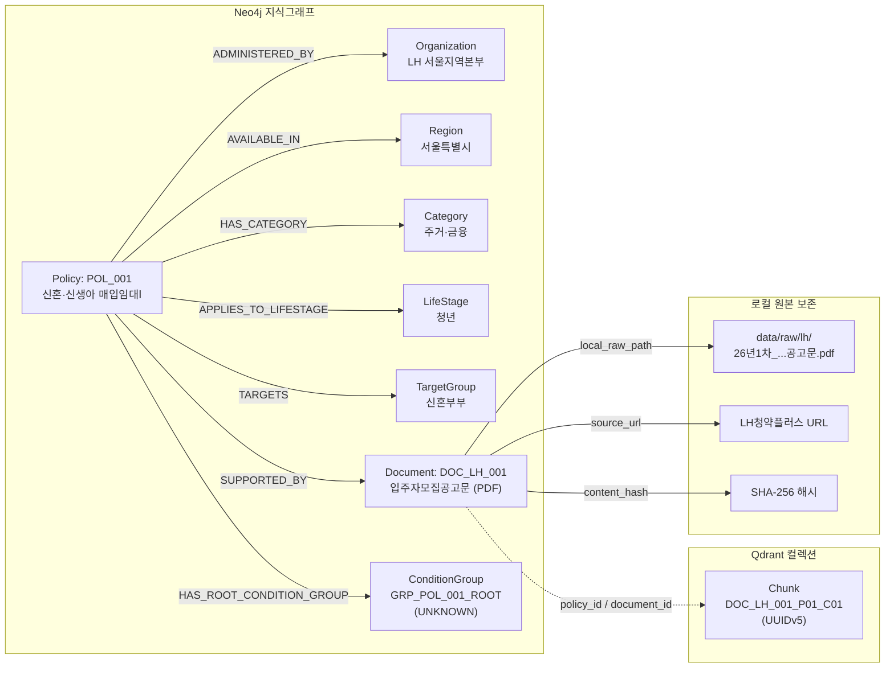
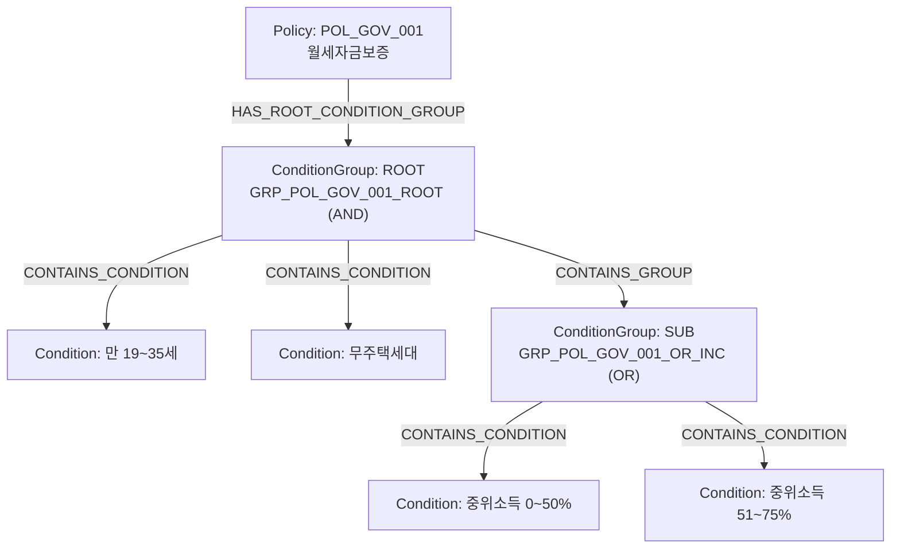

# LifePolicy AI — 데이터 파트 총괄 가이드 (`data/README.md`)

> **문서 버전:** `v1.3.2-verified`  
> **기준일시:** 2026-11-05 (KST)  
> **담당자:** 데이터 / API / 전처리 담당 (장반석)  
> **인계 대상:** DB 엔지니어(주민혁 님), RAG/검색·조건 확인 담당(나지인 님, 박소희 님), React 시연 UI/발표 담당(강민지 님)  
> **상태:** **STEP 1~3 수집·정제·정합성 검증 완료 및 DB 인계 패키지 배포 완료 (파일·참조 무결성 100% PASS, Broken References = 0)**  
> **3차 최종 사용 데이터셋:** `data/releases/v1.4.0-candidate/` (정책 246 · 문서 261 · 인계 청크 599 · Neo4j 노드 1,004 · 관계 2,431). v1.3.2 대비 문서 15건이 추가됐습니다. 서비스 Qdrant에는 B2 청킹 후 1,138개 포인트를 적재해 검증했습니다. [최종 DB 복원 가이드](../docs/development/ISSUE43_RESTORE_GUIDE.md)
> **체크섬 기준:** `data/handoff/`, `data/releases/`는 `.gitattributes`로 줄바꿈 변환을 끄고 저장소 바이트(LF) 기준으로 SHA-256을 기록한다. Windows·Mac·Linux 어디서 내려받아도 `verify_handoff_package.py` 결과가 같다.

---

## 1. 개요 및 핵심 정량 지표

본 문서는 **LifePolicy AI**(생애주기 맞춤형 청년·국민 지원정책 RAG 질의응답 서비스)의 데이터 수집, 정제, 품질 검증, 그리고 Graph DB(Neo4j) 및 Vector DB(Qdrant) 인계 패키지의 전체 아키텍처를 안내하는 총괄 가이드입니다.

2026-11-04 초기 작성 당시의 "미수집·승인 대기·미생성" 상태에서 벗어나, 공식 공공 API 3종 및 공공기관 공고문을 전수 수집·정제하고, 다중 출처 중복 병합 및 계층적 복합 조건 DAG 모델링을 적용하여 **최종 검증 데이터셋(`v1.3.2-verified`)** 구축을 완료하였습니다.

### 1.1 핵심 데이터셋 정량 지표 (v1.3.2-verified)

| 지표 항목 | 최종 완료 수량 | 2차 대비 증감 | 설명 및 품질 기준 |
|---|---:|---:|---|
| **통합 정책 (Policies)** | **237건** | +228건 (+2,533%) | 5대 정책 분야 및 전국 17개 시도 균형 선별·통합 |
| **공식 근거 문서 (Documents)** | **246건** | +232건 (+1,657%) | 디스크 상 로컬 원문 실재 100% (`local_raw_path` 무결성) |
| **Qdrant 검색 청크 (Chunks)** | **557건** | +431건 (+342%) | 600~900자 시맨틱 섹션 분할, **RFC 4122 UUIDv5** Point ID |
| **Neo4j 그래프 노드 (Nodes)** | **1,034개** | - | 9대 노드 라벨 (Policy 237, ConditionGroup 343, Document 246 등) |
| **Neo4j 그래프 관계 (Edges)** | **3,615개** | +3,578개 (+9,670%) | 원천 직접 관계 2,537건 + 계층형 조건 DAG 관계 1,078건 |
| **참조 무결성 (Integrity)** | **100% PASS** | 결함 0건 | Broken Source/Target = 0, 고립 노드(Orphan) = 0 |
| **정책 검증 분류** | **verified 21건<br/>extracted 216건** | - | 공식 원문 1:1 대조 검증(21건) 및 공공 API 파싱 정규화(216건) |

> ⚠️ **'100% PASS' 판정의 기준 및 유의사항:**  
> 상단의 '100% PASS'는 JSONL 파싱, 필수 필드 완결성, ID 유일성, 그리고 노드-관계 간 결함이 없는(Broken References = 0, 고립 노드 = 0) **파일 구조 및 참조 무결성(Referential Integrity) 전수 자동화 검증 결과**입니다.  
> 237개 정책 중 21건은 공식 공고문 원문과 1:1 대조를 마친 `verified` 상태이나, 나머지 216건은 원천 API 파싱에 기반한 `extracted` 상태입니다. 따라서 이는 **모든 개별 정책의 신청 자격·소득 기준·접수 마감 여부 등에 대한 수동 적격성 검증 완료를 의미하지 않으며**, 실제 추천 서비스 제공 시 원문 공고 추가 확인 및 최신 접수기간 모니터링이 필요합니다.

---

## 2. 데이터 디렉터리 전체 구조

프로젝트 루트의 `data/` 디렉터리는 원천 원본 보존(`raw/`), 정제 데이터셋(`processed/`), DB 인계 전용 패키지(`handoff/`), 분석 보고서(`reports/`), 메타데이터(`metadata/`) 등으로 엄격히 격리되어 운영됩니다.

```
data/
├── README.md                           # [본 문서] 데이터 파트 총괄 안내서
│
├── handoff/                            # ★ DB 엔지니어 최종 인계 패키지 (v1.3.2-verified)
│   ├── README.md                       # 원스톱 DB 적재 가이드 및 차이 분석 리포트
│   ├── data_contract.md                # Neo4j - Qdrant 통합 데이터 계약서
│   ├── manifest.json                   # 인계 파일 전수 SHA-256 체크섬 및 파일 명세
│   ├── neo4j/                          # Neo4j Graph DB 적재 모듈 (9대 노드 + 관계 엣지)
│   │   ├── nodes_policy.jsonl          # Policy 노드 (237건)
│   │   ├── nodes_document.jsonl        # Document 노드 (246건)
│   │   ├── nodes_organization.jsonl    # Organization 노드 (116건)
│   │   ├── nodes_region.jsonl          # Region 노드 (18건: 전국 + 17개 시도)
│   │   ├── nodes_category.jsonl        # Category 노드 (5건)
│   │   ├── nodes_lifestage.jsonl       # LifeStage 노드 (6대 표준: 영유아~노년)
│   │   ├── nodes_target_group.jsonl    # TargetGroup 노드 (11건)
│   │   ├── nodes_condition_group.jsonl # ConditionGroup 노드 (343건: DAG 루트 및 서브그룹)
│   │   ├── nodes_eligibility_condition.jsonl # EligibilityCondition 노드 (52건)
│   │   ├── relationships.jsonl         # 11대 관계 엣지 통합본 (3,615건)
│   │   ├── cypher_ddl.cypher           # 유니크 제약조건 및 인덱스 DDL 스크립트 (13개)
│   │   ├── verify_neo4j.cypher         # 적재 후 무결성 검증 Cypher 쿼리문
│   │   └── load_neo4j.py               # 멱등성 보장 9대 노드 및 관계 파이썬 일괄 적재기
│   └── qdrant/                         # Qdrant Vector DB 적재 모듈
│       ├── payload_chunks.jsonl        # 메타데이터 포함 557개 시맨틱 청크 (Point ID: UUIDv5)
│       └── collection_config.json      # Qdrant 컬렉션 및 페이로드 인덱스 스키마 설정
│
├── raw/                                # 원천 수집 원본 (무손실 보존, .gitignore)
│   ├── youthcenter/                    # 온통청년 API 페이지별 원본 JSON (page_0001~0039, 3,861건)
│   ├── gov24/                          # 정부24 공공서비스 목록/상세/조건 원본 JSON (32,826건)
│   ├── bokjiro/                        # 복지로 중앙부처복지서비스 목록/상세 원본 XML (461건 / 99건)
│   ├── lh/                             # LH 청약플러스 공식 입주자모집공고문 (PDF, HWP)
│   ├── nhuf/                           # 주택도시기금 대출안내 웹 원문 및 소득요건 개정 FAQ PDF
│   ├── work24/                         # 고용24 국민내일배움카드 발급안내 공식 웹 HTML
│   └── other/                          # 부처별 추가 공고문 및 안내문
│
├── processed/                          # 중간 정제 및 정규화 데이터셋 (JSONL)
│   ├── policies.jsonl                  # 정규화된 237개 정책 마스터 레코드
│   ├── documents.jsonl                 # 246개 공식 근거 문서 원본 텍스트 및 메타데이터
│   ├── chunks.jsonl                    # 557개 의미 단위 분할 청크 (v1.3.2 최종 동기화 완료)
│   ├── relationships.jsonl             # 원천 직접 관계 엣지 (2,537건 / graph_edges.jsonl 동일; 초기 2,118건 + 생애주기 직결 +419건)
│   ├── youthcenter_policies.jsonl      # 온통청년 전수 정제 레코드 (3,861건)
│   ├── gov24_public_services.jsonl     # 정부24 공공서비스 전수 정제 (10,942건)
│   ├── bokjiro_welfare_services.jsonl  # 복지로 상세 확보분 정제 (99건)
│   └── verification_result.json        # 10대 검사 기준 자동화 검증 리포트 (PASS)
│
├── reports/                            # 데이터 분석 및 품질 검증 보고서
│   ├── collection_summary.md           # 수집 결과 및 온통청년 API 정밀 분석 요약
│   ├── data_quality_report.md          # 10대 전수 품질 검사 및 문제 해결 보고서
│   ├── lifecycle_distribution_report.md # 6대 생애주기별 정책 분포 심층 분석 보고서
│   ├── target_attributes_distribution_report.md # 대상 집단 및 자격조건 속성 통계 보고서
│   └── unresolved_issues.md            # 미해결 이슈 및 팀 간 협의 필요 사항
│
├── metadata/                           # 데이터 레지스트리 및 매핑 메타데이터
│   ├── api_registry.md                 # 공식 API 연계 규격 및 인증 명세서
│   ├── api_metadata.json               # API 서비스 메타데이터 분리 파일
│   ├── source_registry.csv             # 246개 근거 문서 공식 출처 등록부
│   ├── id_mapping.csv                  # 다중 API 중복 정책 통합 매핑표
│   ├── dedup_candidates.json           # 중복 정책 식별 및 병합 상세 근거
│   ├── youthcenter_code_info.xlsx      # 온통청년 최신 공식 코드정의서 원본
│   ├── youthcenter_code_definitions.json # 온통청년 8대 분류 코드 파싱 정의서
│   ├── cross_agency_condition_mapping.md # 기관 간 자격조건 표준화 매핑표
│   └── download_manifest.json          # 원본 다운로드 SHA-256 체크섬 레지스트리
│
├── releases/                           # 불변 릴리스 번들 스냅샷 (`releases/v1/`)
├── backups/                            # 작업 단계별 백업 (`backups/phase2_20261104/`)
├── samples/                            # 형식 설명용 가상 샘플 (실제 DB 적재 금지)
└── schemas/                            # JSONL 필드 계약 및 스키마 정의
```

> 💡 **청크 수량(555건 vs 557건) 차이 원인:**  
> 2026-11-04 초기 정제 시점(`data_quality_report.md` 작성 시점)에는 555건으로 집계되었으나, 장문 PDF 공고문(1,000자 초과) 분할 시 문맥 단절 방지를 위한 100자 오버랩 분할 규칙(`text[:1000]`, `text[900:]`)이 적용되면서 2개 청크가 추가 분할되어 최종 557건으로 확정되었습니다. 현재 `data/processed/chunks.jsonl`과 `data/handoff/qdrant/payload_chunks.jsonl` 모두 557건으로 100% 동기화되어 있습니다.
>
> 💡 **그래프 관계 수량(2,118건 → 2,537건 → 3,615건) 변동 내역 및 근거:**  
> 1. **2026-11-04 초기 정제 시점 (2,118건):** 생애주기 다중 매핑 체계화 이전의 정책 ↔ 기관·지역·분야·대상군·자격조건·문서 간 기본 직접 엣지 집계치 (`data_quality_report.md` 기준).  
> 2. **원천 직접 관계 확충 (+419건 → 2,537건):** 6대 표준 생애단계(영유아~노년) 및 중장년 다중 매핑 체계가 적용되면서 `APPLIES_TO_LIFESTAGE` 직접 엣지 **419건**이 신규 추가되어 `data/processed/relationships.jsonl`이 **2,537건**으로 확정되었습니다 (`2,118건 + 419건 = 2,537건`).  
> 3. **계층형 ConditionGroup DAG 확장 (+1,078건 → 3,615건):** `scripts/build_handoff_package.py` 실행 시 복합 자격요건의 3값 논리(AND/OR/NOT/UNKNOWN) 표현을 위한 계층형 DAG 관계 3종(`HAS_ROOT_CONDITION_GROUP` 237건 + `CONTAINS_GROUP` 106건 + `CONTAINS_CONDITION` 735건 = **1,078건**)이 추가되어 최종 DB 인계 패키지(`data/handoff/neo4j/relationships.jsonl`)는 **3,615건**으로 구축되었습니다 (`2,537건 + 1,078건 = 3,615건`).

---

## 3. 기관별 API 수집 현황 및 원본 보존 정책

### 3.1 원천 출처별 수집 실적

공공데이터포털, 온통청년, 복지로 등 대한민국 대표 3대 복지·청년 행정망 API와 공공기관 공식 공고문을 전수 수집하였습니다.

| 수집 출처 | 대상 기관 | 수집 방식 | 수집 건수 | 통합 반영 건수 | 대표 반영 정책 |
|---|---|---|---:|---:|---|
| **온통청년 API** | 국무조정실 / 한국고용정보원 | REST JSON | **3,861건** (39쪽 전수) | **65건** | 청년도약계좌, 청년취업사관학교, 청년월세 등 |
| **정부24 공공서비스** | 행정안전부 | REST JSON | **10,942건** (목록/상세/조건) | **65건** | 서울 청년월세, 부산 청년 기쁨두배통장 등 전국 17개 시도 |
| **중앙부처복지서비스** | 보건복지부 / 사회보장정보원 | REST XML | **461건** (상세 99건) | **98건** | 부모급여, 첫만남이용권, 아동수당, 청년내일저축계좌 등 |
| **[소계: 공공 API 목록]** | - | - | **15,264건** | **228건** | **3대 공공 행정망 API 단순합 (중복 제거 전)** |
| **공식 웹·공고문 원본** | LH, 주택도시보증공사, 고용노동부 | PDF/HTML/HWP | **14건** (15개 파일) | **9건** (18건 문서) | 신혼매입임대, 버팀목전세대출, 국민내일배움카드 등 |
| **총 수집 합계** | - | - | **15,278건** | **237건** (문서 246건) | **API 15,264건 + 웹·공고문 14건 / MVP 핵심 정책 확정** |

> **수집 수량(15,278건) 계산 근거:**  
> 총 수집 15,278건은 3대 공공 API 목록 단순합 **15,264건**(온통청년 3,861건 + 정부24 10,942건 + 복지로 461건)과 직접 수집한 공식 웹·공고문 원본 **14건**(LH, 기금, 고용24 등 15개 다운로드 파일 중 공고문 단위 14건)을 합산한 수치입니다. (기관 간 중복 정책 선별 및 통합 과정을 거쳐 최종 237개 핵심 정책 및 246개 근거 문서로 정제 완료).

### 3.2 온통청년 Open API 정밀 분석 및 정규화
- **고유성 100%:** 3,861건 전수 수집 결과 고유 `plcyNo` 3,861건 (중복률 0.0%).
- **최신성 보존:** 전 레코드에 최종 수정일자(`lastMdfcnDt`) 100% 보유 확인.
- **8대 코드 정의 100% 변환:** 혼인상태(`mrgSttsCd`), 소득구분(`earnCndSeCd`), 취업상태(`jobCd`), 학력요건(`schoolCd`), 전공분야(`plcyMajorCd`), 특화분야(`sbizCd`), 제공기관(`pvsnInstGroupCd`), 지급방식(`plcyPvsnMthdCd`) 코드를 공식 코드정의서(`youthcenter_code_info.xlsx`)를 기반으로 정규화 완료.
- **이상치 플래그 분리 (`needs_human_review`):** 연령이 0세로 기재된 1,076건, 소득 역전 3건 등 원문 이상치는 임의 추측으로 왜곡하지 않고 `age_review_needed: true` 플래그로 격리.

### 3.3 원본 보존 정책 (Raw Data Preservation Policy)
1. **무손실 원형 보존:** 수집된 모든 API 응답 파일(JSON/XML)과 공고문(PDF/HTML/HWP)은 `data/raw/` 디렉터리에 다운로드 당시 원형 그대로 보관하며, 일체의 전처리 스크립트가 `raw/` 내부 파일을 덮어쓰거나 수정하지 않습니다.
2. **저장소 용량 및 보안 격리:** 대용량 파일 및 원본 응답이 보관된 `data/raw/`는 `.gitignore`를 통해 Git 원격 저장소 커밋 대상에서 제외됩니다.
3. **해시 기반 무결성 추적:** 모든 원본 파일은 SHA-256 체크섬을 생성하여 `data/metadata/download_manifest.json`에 기록 관리되며, 언제든지 재수집 스크립트를 통해 동일한 상태로 재현될 수 있습니다.

---

## 4. 수집·전처리 스크립트 및 실행 파이프라인

데이터 수집부터 정제, 검증, 최종 DB 인계 패키지 빌드까지 전 과정을 재현할 수 있는 표준 파이프라인입니다.

### 4.1 주요 스크립트 명세

| 구분 | 스크립트 경로 | 주요 역할 |
|---|---|---|
| **수집기** | `collectors/api/youthcenter_collector.py` | 온통청년 API 3,861건 전수 수집 및 원본 JSON 저장 |
| | `collectors/api/gov24_collector.py` | 정부24 공공서비스 3종(목록/상세/조건) 일괄 수집 |
| | `collectors/api/bokjiro_collector.py` | 복지로 중앙부처복지서비스 목록/상세 XML 수집 |
| | `scripts/download_raw.py` | LH 공고문 PDF 및 주택도시기금 안내 웹페이지 원본 다운로드 |
| **전처리** | `scripts/build_clean_dataset.py` | 15,264건 원천 데이터 정제, 중복 병합, 237개 핵심 정책 구축 |
| | `scripts/build_handoff_package.py` | Neo4j 9대 노드, 3,615개 관계, Qdrant 557개 청크 생성 및 패키징 |
| **검증** | `scripts/verify_data_quality.py` | 10대 정합성 검사(참조 무결성, 결측치, 이상치 등) 자동 검증 |
| | `scripts/verify_handoff_package.py` | 인계 패키지 파일 크기, 체크섬, UUIDv5 포맷 전수 검증 |
| | `scripts/verify_youth_codes.py` | 온통청년 8대 코드정의서 100% 매핑 정합성 검증 |
| **DB 적재** | `data/handoff/neo4j/load_neo4j.py` | Neo4j 인스턴스에 9대 노드 및 관계 엣지 멱등 일괄 적재 |

### 4.2 실행 파이프라인 명령어 가이드

```bash
# 1. 파이썬 가상환경 활성화 및 의존성 설치
pip install -r requirements.txt

# 2. 공식 원본 파일 다운로드 및 무결성 검증
python scripts/download_raw.py

# 3. 공공 API 수집 (필요 시 개별 실행)
python collectors/api/youthcenter_collector.py
python collectors/api/gov24_collector.py
python collectors/api/bokjiro_collector.py

# 4. 데이터셋 정제 및 정규화 (processed/ 생성)
python scripts/build_clean_dataset.py

# 5. 데이터 품질 및 10대 무결성 전수 검증
python scripts/verify_data_quality.py

# 6. DB 엔지니어 인계 패키지 빌드 (handoff/ 생성: 1,034 노드, 3,615 관계, 557 청크)
python scripts/build_handoff_package.py

# 7. 인계 패키지 최종 무결성 검증
python scripts/verify_handoff_package.py

# 8. [DB 담당자] Neo4j 로컬/원격 인스턴스 일괄 적재
cd data/handoff/neo4j
python load_neo4j.py
```

---

## 5. 식별자(ID) 체계 및 출처 추적(Provenance) 구조

### 5.1 통합 식별자 체계

모든 식별자는 대소문자를 구분(Case-sensitive)하며, 시스템 전역에서 유일(Globally Unique)합니다. 정책 및 문서 식별자는 단순 연속 번호가 아니라 **수집 출처 및 기관별 접두어 규칙**에 따라 체계적으로 부여되어 있습니다.

| 식별자 명칭 | 정규식 패턴 | 설명 및 실제 예시 | 소유 및 참조 주체 |
|---|---|---|---|
| **`policy_id`** | `^POL_[A-Z0-9_]+$` | **프로젝트 전역 정책 기본 키 (총 237건 전수 유일)**<br>• 기존 검증 핵심 정책(9건): `POL_001`, `POL_003`, `POL_009` 등<br>• 정부24 공공서비스(65건): `POL_GOV_001` ~ `POL_GOV_065`<br>• 복지로 복지서비스(98건): `POL_BOK_001` ~ `POL_BOK_098`<br>• 온통청년 청년정책(65건): `POL_YC_001` ~ `POL_YC_065` | Neo4j `(:Policy)` PK, Qdrant Payload FK |
| **`official_id`** | `^[A-Za-z0-9_-]+$` | **원천 기관 공식 고유 식별자 (실시간 갱신 및 대조용)**<br>• 행안부 서비스ID: `161300000099`, `116010000001`<br>• 복지로 복지서비스ID: `WLF00004661`, `WLF00004656`<br>• 온통청년 정책번호: `20260710005400113256`<br>• LH 공고번호: `LH-2015122300019712` | 원천 기관 대조 및 증분 동기화용 |
| **`document_id`** | `^DOC_[A-Z0-9_]+$` | **공식 근거 문서 기본 키 (총 246건 전수 유일)**<br>• LH 공고문(3건): `DOC_LH_001` ~ `DOC_LH_003`<br>• 주택도시기금 안내(10건): `DOC_NHUF_001` ~ `DOC_NHUF_010`<br>• 고용24/부처원문(5건): `DOC_WORK24_001`, `DOC_MOLIT_001`, `DOC_MOEL_001` 등<br>• 정부24 상세원문(65건): `DOC_GOV_001` ~ `DOC_GOV_065`<br>• 복지로 상세원문(98건): `DOC_BOK_001` ~ `DOC_BOK_098`<br>• 온통청년 상세원문(65건): `DOC_YC_001` ~ `DOC_YC_065` | Neo4j `(:Document)` PK, Qdrant Payload FK |
| **`chunk_id`** | `^DOC_[A-Za-z0-9_]+_(P[0-9]+_)?C[0-9]+$` | **벡터 검색용 청크 기본 키 (총 557건 전수 유일)**<br>• PDF 페이지 분할: `DOC_LH_001_P01_C01`, `DOC_LH_001_P01_C02`<br>• API/웹 섹션 분할: `DOC_GOV_001_C01`, `DOC_BOK_001_C01`<br>*(최종 인계본 557건은 전수 `DOC_*` 기반이며 `CHK_*` 미사용)* | Qdrant Payload 식별자 |
| **`point_id`** | `^[0-9a-f]{8}-[0-9a-f]{4}-5[0-9a-f]{3}-[89ab][0-9a-f]{3}-[0-9a-f]{12}$` | **Qdrant 벡터 컬렉션 고유 Point ID (RFC 4122 UUIDv5 표준)**<br>생성 규칙: `uuid5(NAMESPACE_DNS, chunk_id)` 결정론적 1:1 매핑<br>• `be5e1f2f-972e-54d7-806f-1f5af32d242d` (`DOC_LH_001_P01_C01`)<br>• `74e97011-769d-5458-9af1-30e63c6cfaba` (`DOC_GOV_001_C01`) | Qdrant 벡터 포인트 고유 PK |
| **`condition_id`** | `^COND_[A-Z0-9_가-힣]+$` | **52개 원자 자격조건 식별자**<br>• `COND_AGE_19_35`, `COND_HH_무주택세대`, `COND_INC_중위소득_0_50_` 등 | Neo4j `(:EligibilityCondition)` PK |
| **`group_id`** | `^GRP_[A-Za-z0-9_]+$` | **343개 계층형 조건 그룹 식별자**<br>• 루트 조건그룹: `GRP_POL_001_ROOT`, `GRP_POL_GOV_001_ROOT`<br>• 하위 선택그룹: `GRP_POL_GOV_001_OR_INC`, `GRP_POL_GOV_002_OR_HH` | Neo4j `(:ConditionGroup)` PK |
| **기타 메타 ID** | `AGENCY_*`, `CAT_*`, `REGION_*`, `LIFESTAGE_*`, `GROUP_*` | **기준 메타 노드 식별자**<br>• 소관기관(116): `AGENCY_한국토지주택공사_서울지역본부`<br>• 대분류(5): `CAT_HOUSING_FINANCE`<br>• 지역(18): `REGION_SEOUL`, `REGION_NATIONWIDE`<br>• 생애단계(6): `LIFESTAGE_청년`, `LIFESTAGE_중장년` 등 6대 표준<br>• 대상집단(11): `GROUP_NEWLYWED`, `GROUP_YOUTH` 등 | Neo4j 기준 메타 노드 PK |

### 5.2 출처 추적 흐름 (Provenance Tracking)

모든 검색 결과와 추천 정책은 원천 공공데이터와 공고문 원문까지 100% 추적할 수 있도록 설계되었습니다. 아래는 실제 정제 데이터셋(`POL_001`)의 실측 레코드와 관계 엣지를 도식화한 흐름입니다. (Notion 화면 잘림 방지를 위해 노드 명칭을 간결하게 표기함)



- **실제 데이터 매핑 대조 내역 (`POL_001` 실측치):**
  - **정책 ID / 명칭:** `POL_001` (`[정정공고][서울지역본부] 26년 1차 신혼·신생아 매입임대Ⅰ 예비입주자 모집공고`)
  - **소관기관 노드:** `Organization` (`agency_id: AGENCY_한국토지주택공사_서울지역본부`, 명칭: `한국토지주택공사 서울지역본부`)
  - **지역범위 노드:** `Region` (`region_id: REGION_SEOUL`, 명칭: `서울특별시`)
  - **분야 노드:** `Category` (`category_id: CAT_HOUSING_FINANCE`, 명칭: `주거·금융`)
  - **생애단계 노드:** `LifeStage` (`stage_id: LIFESTAGE_청년`, 복수 분류로 `영유아`, `중장년`, `노년` 포함)
  - **대상집단 노드:** `TargetGroup` (`group_id: GROUP_NEWLYWED`, 명칭: `신혼부부`, 출산가구/아동 포함)
  - **연결 근거문서:** `DOC_LH_001`, `DOC_LH_002`, `DOC_LH_003` (도식은 대표 PDF 공고문인 `DOC_LH_001` 기준)
  - **로컬 원문 파일:** `local_raw_path: data/raw/lh/26년1차_신혼·신생아매입임대Ⅰ_입주자모집공고문(서울지역본부)(정정공고).pdf` (SHA-256: `e47e6be0f802c7cb325cf00246bc89334bcb73e828b45701adc109576ea34d25`)
  - **벡터 청크:** `Chunk` (`chunk_id: DOC_LH_001_P01_C01`, Point ID: `be5e1f2f-972e-54d7-806f-1f5af32d242d`, RFC 4122 표준 UUIDv5)
  - **조건그룹 노드:** `ConditionGroup` (`group_id: GRP_POL_001_ROOT`, 속성: `logic: "UNKNOWN"` - 원천 공고문 세부조건 서술형에 따른 3값 논리 UNKNOWN 루트 그룹, 하위 `CONTAINS_CONDITION` 엣지 없음)
- **다중 API 병합 정책 추적:** 복지로, 정부24, 온통청년 등 복수 기관에 등록된 동일 정책(예: 청년월세 `POL_009`, 국민취업지원제도 `POL_010`)은 단일 `policy_id`로 통합하되, 원천 기관별 근거 문서를 각각 `DOC_*`로 생성하여 `[:SUPPORTED_BY]` 관계로 다중 연결하였습니다. 병합 이력은 `data/metadata/id_mapping.csv` 및 `dedup_candidates.json`에 완전 보존됩니다.

### 5.3 계층적 DAG 조건 모델링 및 3값 논리(3-Valued Logic)

원천 공공데이터의 다양한 조건 논리를 지식그래프 상에서 정밀하게 표현하기 위해 계층형 `ConditionGroup` DAG 구조를 적용하였습니다. 아래는 복합 조건(`AND`/`OR`)과 원자 조건(`CONTAINS_CONDITION`)이 실제로 존재하는 정책인 **`POL_GOV_001`(주택금융공사 월세자금보증)**의 실측 도식입니다.



- **AND 루트 그룹 (82건):** 위 `POL_GOV_001` 실측 예시와 같이 모든 요건(연령 AND 거주 AND 소득)을 동시에 충족해야 하는 정책.
- **OR 서브그룹 (106건):** `GRP_POL_GOV_001_OR_INC`처럼 복수 소득구간, 복수 학력, 복수 취업상태 중 하나만 만족해도 되는 예외 요건을 `CONTAINS_GROUP` 관계의 하위 서브그룹으로 연결.
- **NOT 서브그룹:** 국민내일배움카드(`POL_005`) 등 정부 지원사업 참여 배제 조건(`exclusion_criteria`) 모델링.
- **UNKNOWN 루트 그룹 (155건):** `POL_001`처럼 원천 API에서 지원조건이 공란이거나 전 국민 대상인 정책은 임의로 AND 처리하지 않고 `logic: "UNKNOWN"`으로 보존하여, 3값 논리(TRUE / FALSE / UNKNOWN) 평가 엔진에서 탈락되지 않고 사용자에게 "상세 공고 확인 필요"로 투명하게 안내됩니다.

---

## 6. 데이터 품질 검증 결과 및 알려진 한계

### 6.1 10대 정합성 검사 자동화 결과 (`scripts/verify_data_quality.py`)

10대 핵심 검사 기준에 대한 전수 자동화 검증을 수행하였으며, 결함 0건으로 100% 통과하였습니다.

```
=================================================================
      LifePolicy AI 3차 데이터 정합성 및 품질 전수 검증        
=================================================================
[Check 1/10] JSONL Parsing & Schema Loading Check       : PASSED (100%)
[Check 2/10] Required Fields Completeness Check         : PASSED (0 missing)
[Check 3/10] Policy ID Uniqueness Check                 : PASSED (237 unique)
[Check 4/10] Document ID Uniqueness & Reference Check   : PASSED (246 unique, 0 broken)
[Check 5/10] Vector Chunk -> Document/Policy Reference  : PASSED (557 chunks, 0 broken)
[Check 6/10] Graph Relationships Target & Evidence      : PASSED (3,615 edges, 0 broken)
[Check 7/10] Local Raw File Physical Existence Check    : PASSED (0 missing raw files)
[Check 8/10] HTML Login/Session/Error Page Check        : PASSED (0 contaminated)
[Check 9/10] Meaningless Short Text (< 100 chars) Check : PASSED (0 violations)
[Check 10/10] Source URL & Timestamps Integrity Check   : PASSED (0 errors)
=================================================================
  전수 검증 결과: 10대 검사항목 중 10개 통과 / 0개 실패 (ALL PASSED)
=================================================================
```

### 6.2 검증 상태(Verification Status) 분류 체계
- **`verified` (정책 21건 / 문서 30건):** 공식 공고문 원문(PDF/HTML)의 특정 페이지 및 섹션과 1:1 대조하여 자산·소득·대출한도·금리 등 수치 정합성이 검증 완료된 고품질 정책.
- **`extracted` (정책 216건 / 문서 216건):** 공식 공공데이터 API 원문 JSON/XML에서 파싱 및 스키마 정규화가 완료된 정책. 단, 사용자의 개별 자격 적격성 심사는 실시간 공고문 추가 확인이 필요합니다.

### 6.3 데이터 품질 개선 완료 내역 (P0 이슈 해소)
1. **`DOC_NHUF_008`:** 청년전용 보증부월세대출에 혼입되었던 버팀목전세자금 FAQ를 폐기하고, 공식 대출안내(`FP05020701.jsp`, 4,296자) 및 이용절차(`DOC_NHUF_009`)로 전면 교체.
2. **`DOC_MOLIT_001` & `DOC_MOEL_001`:** 존재하지 않던 임의 텍스트 파일 참조를 제거하고, 복지로 상세 XML 및 정부24/온통청년 실제 원문 파일로 복구 완료.
3. **`DOC_LH_003`:** 스크린리더 안내, GNB 사이트맵, 자동로그아웃 모달 등 웹페이지 전역 UI 잡음을 제거하고 639자 순수 모집공고문으로 정제.
4. **`POL_008` 분리:** 정책 목록에 혼재되었던 API 서비스 메타데이터를 `data/metadata/api_metadata.json`으로 완전 분리.

### 6.4 알려진 한계 및 후속 과제
1. **복지로 상세 API 일일 호출 한도에 따른 상세 미확보분:**  
   공공데이터포털 개발계정 1일 100건 호출 제한으로 인해, 461건의 복지서비스 목록 중 99건의 상세 XML만 확보된 상태입니다. 나머지 362건은 기본 메타데이터만 보유하고 있으며, 운영계정 전환 시 즉시 추가 수집 가능합니다.
2. **지자체 서술형 자격요건의 LLM IE(정보추출) 고도화 필요성:**  
   정부24 및 온통청년 지자체 정책 중 신청자격이 줄글로 작성된 항목은 정규식 기반으로 1차 정규화되었습니다. 4차 RAG 파이프라인 단계에서 경량 LLM(gpt-4o-mini 등)을 활용한 정밀 슬롯 추출 배치를 권장합니다.
3. **환경 의존적 라이브 DB 적재 대기 (`NOT_TESTED`):**  
   정적 무결성 및 적재 스크립트(`load_neo4j.py`) 정합성 검증은 완료되었으나, 실제 Neo4j 및 Qdrant 라이브 서버 인스턴스 적재 및 임베딩 생성은 서버 인프라 가동 후 진행됩니다.

---

## 7. 주요 연계 문서 및 산출물 링크

- [DB 엔지니어 인계 가이드 (`data/handoff/README.md`)](handoff/README.md) — 원스톱 적재, 검증 쿼리 및 DAG 모델링 분석
- [통합 데이터 계약서 (`data/handoff/data_contract.md`)](handoff/data_contract.md) — 식별자 체계, 스키마, 3값 논리 공식 규격
- [인계 매니페스트 (`data/handoff/manifest.json`)](handoff/manifest.json) — 전 파일 크기 및 SHA-256 체크섬
- [수집 결과 요약 보고서 (`data/reports/collection_summary.md`)](reports/collection_summary.md) — 2차 대비 성과 및 온통청년 분석
- [품질 검증 보고서 (`data/reports/data_quality_report.md`)](reports/data_quality_report.md) — 10대 검사 결과 및 문제 해결 내역
- [생애주기 분포 분석 보고서 (`data/reports/lifecycle_distribution_report.md`)](reports/lifecycle_distribution_report.md) — 6대 생애주기 매핑 통계
- [미해결 이슈 보고서 (`data/reports/unresolved_issues.md`)](reports/unresolved_issues.md) — 팀 간 협의 및 운영 조율 사항
- [공식 산출물 01: 데이터 수집 및 전처리 검증 보고서](../docs/DATA_COLLECTION_REPORT.md) — 단위 프로젝트 마일스톤 공식 제출 보고서 (원형 15개 파일 및 10대 정책 검증)
- [3차 기술 상세 보고서: 데이터 수집 및 정제 최종 보고서](../docs/data/data_collection_report.md) — 3대 공공 API 전수 수집(15,264건), 237개 정책/246개 문서, 청킹 비교 및 세부 파이프라인 기술 명세서
- [팀 공유 데이터 완료 보고서 (`docs/reports/LifePolicy_AI_팀공유_데이터완료보고서_20261105.md`)](../docs/reports/LifePolicy_AI_팀공유_데이터완료보고서_20261105.md) — 팀 공유용 종합 요약
