# docs/architecture — 시스템 아키텍처 및 데이터 흐름 명세

> **위치**: `LifePolicy AI/docs/architecture/`  
> **역할**: SSOK 서비스의 전체 시스템 구조, 계층별 설계, GraphRAG 하이브리드 검색 및 데이터 파이프라인 아키텍처 관리  
> **상위 가이드**: [docs 전체 인덱스](../README.md) | [PRD](../product/PRD.md) | [CODING_STYLE](../development/CODING_STYLE.md)

---

## 1. 전체 시스템 아키텍처 (High-Level Architecture)

SSOK는 **React 기반 단일 페이지 UI**, **FastAPI 백엔드 서비스**, **Neo4j Graph DB(정량 자격 조건)**, **Qdrant Vector DB(비정형 시맨틱 검색)** 및 **LLM 생성기**로 구성된 3-Tier 하이브리드 RAG 아키텍처를 채택하고 있습니다.

```mermaid
flowchart TD
    subgraph Client ["프론트엔드 (React / TypeScript)"]
        UI["React SPA<br/>(프로필 입력 & 추천 결과 카드)"]
    end

    subgraph Server ["백엔드 (FastAPI)"]
        API["/api/ask, /health Router<br/>(입력 검증 & 응답 조합)"]
        ENGINE["Recommendation & RAG Pipeline<br/>(하이브리드 검색 & 컨텍스트 구성)"]
        CHECKER["Eligibility Checker<br/>(프로필 기반 자격·접수 판정)"]
        LLM["LLM Generator (OpenAI)<br/>(출처 기반 팩트 답변 생성)"]
    end

    subgraph DataStore ["하이브리드 데이터베이스 (Dual Store)"]
        QDRANT[("1. Qdrant Vector DB<br/>(시맨틱 밀집 임베딩 Top-K 검색)")]
        NEO4J[("2. Neo4j Graph DB<br/>(정책 조건·근거 그래프 연결)")]
    end

    UI -->|"POST /api/ask (프로필 & 질문)"| API
    API --> ENGINE
    ENGINE -->|"1. 질의 임베딩 시맨틱 검색"| QDRANT
    QDRANT -->|"후보 policy_id 및 청크 (Hits)"| ENGINE
    ENGINE -->|"2. 정책 식별자 기반 그래프 문맥 조회"| NEO4J
    NEO4J -->|"조건 그룹(ConditionGroup) & 공식 출처(Document)"| ENGINE
    ENGINE -->|"3. 검색 문맥 및 프로필 전달"| CHECKER
    CHECKER -->|"자격 판정(eligible / ineligible / needs_check) & 접수 상태"| LLM
    ENGINE -->|"인용 가능 컨텍스트 전달"| LLM
    LLM -->|"출처 URL 및 인용문 포함 응답"| API
    API -->|"JSON 응답 (Policy Cards + Reasons)"| UI
```

---

## 2. 핵심 계층별 역할 및 기술 스택

| 계층 (Layer) | 주요 기술 | 핵심 책임 |
|---|---|---|
| **Frontend** | React 18, TypeScript, Vite | • 사용자 생애주기 프로필(연령, 소득, 지역, 가구원, 특성) 입력 폼 • 질문 입력 및 추천 정책 카드 실시간 렌더링 • 공식 출처 URL 및 추가 확인 필요 사항(`needs_review`) 배지 표시 |
| **API Gateway** | FastAPI, Pydantic v2, Uvicorn | • `POST /api/ask` 계약([ask_contract.md](../api/ask_contract.md)) 검증 • 헬스체크(`/health`) 및 글로벌 예외 핸들링 |
| **Search & Pipeline** | Python (`database/hybrid_search.py`, `backend/rag/`, `backend/eligibility/`) | • **1. Vector Search**: 질문 임베딩 기반 Qdrant 밀집 벡터 Top-K 시맨틱 검색 • **2. Graph Evidence Linking**: 검색된 정책의 Neo4j 노드·조건그룹·공식근거 연결 • **3. Checker Evaluation**: 사용자 프로필 기반 규칙 엔진(Checker) 자격 및 접수 상태 판정 |
| **Graph Store** | Neo4j 5.26 Community (Bolt) | • `Policy`, `Document`, `ConditionGroup`, `EligibilityCondition`, `Organization`, `Region`, `Category`, `LifeStage`, `TargetGroup` 노드 및 관계 모델링 • 파라미터화된 Cypher 쿼리로 SQL Injection 차단 |
| **Vector Store** | Qdrant 1.12 (REST) | • 서비스 기본: `qwen3-embedding:0.6b`(1024차원)로 색인한 B2 청크(컬렉션 `exp_b2_qwen3emb06b_v140_v1`). 4B는 비교 실험용([run03 분석](../development/ISSUE41_AB_RUN03_ANALYSIS.md)) • payload: `policy_id`, `document_id`, `chunk_id`, `policy_name`, `category`, `region`, `life_stages`, `target_groups`, `source_url` 등 |
| **RAG / LLM** | OpenAI API (코드 기본값 `gpt-5.4-mini`, `LLM_MODEL`로 변경. 운영 모델은 #82에서 결정) | • 프롬프트 인젝션 방어 및 시스템 가드레일 적용 • 검색된 공식 문서 조항 내 팩트 기반 근거 문장 생성 |

---

## 3. 핵심 아키텍처 원칙

1. **Hybrid Pipeline & Deterministic Checker (벡터 검색 → 그래프 연결 → Checker 판정)**:
   - 질문에 가장 부합하는 정책 후보군을 Qdrant 벡터 검색으로 발굴하고, Neo4j Graph DB를 통해 해당 정책의 정형 자격 조건(ConditionGroup) 및 공식 근거(Document)를 연결합니다.
   - 복지 지원 자격(나이, 소득, 거주지)과 신청 상태는 모호한 자연어 생성이 아닌 결정론적 규칙 기반 Checker를 통해 엄격히 판정하며, 판정 결과와 공식 출처만을 LLM 생성기에 전달하여 답변을 생성합니다.
2. **Zero Hallucination Grounding (허위 출처 방지)**:
   - LLM은 사전에 정의된 검색 근거 문서(`Document`)에 명시된 사실만 서술해야 하며, 답변에 첨부되는 `source_url`과 `official_quote`는 수집 원문과 100% 바이트 단위로 일치해야 합니다 ([수집 규정](../data/DATA_COLLECTION_AND_REVIEW_RULES.md)).
3. **Dual-Store Isolation (저장소 독립성 및 복원력)**:
   - Neo4j와 Qdrant는 `policy_id`와 `document_id`를 공통 키로 공유하며, 어느 한쪽 저장소가 재적재되더라도 일관성을 유지할 수 있도록 독립 복원 파이프라인([ISSUE43_RESTORE_GUIDE.md](../development/ISSUE43_RESTORE_GUIDE.md))을 지원합니다.
