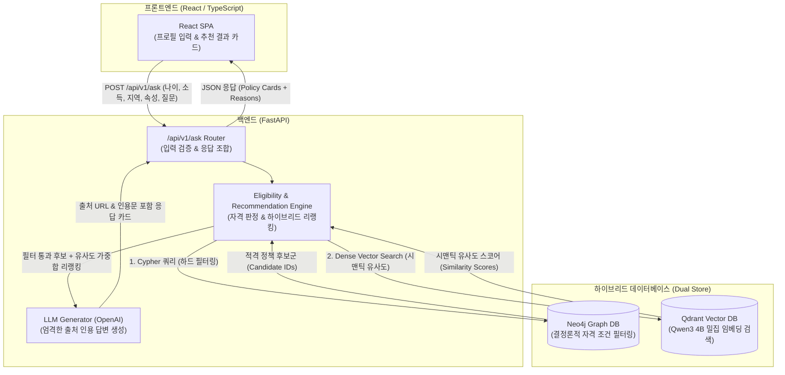

# docs/architecture — 시스템 아키텍처 및 데이터 흐름 명세

> **위치**: `LifePolicy AI/docs/architecture/`  
> **역할**: SSOK 서비스의 전체 시스템 구조, 계층별 설계, GraphRAG 하이브리드 검색 및 데이터 파이프라인 아키텍처 관리  
> **상위 가이드**: [docs 전체 인덱스](../README.md) | [PRD](../product/PRD.md) | [CODING_STYLE](../development/CODING_STYLE.md)

---

## 1. 전체 시스템 아키텍처 (High-Level Architecture)

SSOK는 **React 기반 단일 페이지 UI**, **FastAPI 백엔드 서비스**, **Neo4j Graph DB(정량 자격 조건)**, **Qdrant Vector DB(비정형 시맨틱 검색)** 및 **LLM 생성기**로 구성된 3-Tier 하이브리드 RAG 아키텍처를 채택하고 있습니다.

---

## 2. 핵심 계층별 역할 및 기술 스택

| 계층 (Layer) | 주요 기술 | 핵심 책임 |
|---|---|---|
| **Frontend** | React 18, TypeScript, TailwindCSS, Vite | • 사용자 생애주기 프로필(연령, 소득, 지역, 가구원, 특성) 입력 폼 • 질문 입력 및 추천 정책 카드 실시간 렌더링 • 공식 출처 URL 및 추가 확인 필요 사항(`needs_review`) 배지 표시 |
| **API Gateway** | FastAPI, Pydantic v2, Uvicorn | • `POST /api/v1/ask` 계약([ask_contract.md](../api/ask_contract.md)) 검증 • 헬스체크(`/api/v1/health`) 및 글로벌 예외 핸들링 |
| **Recommendation Engine** | Python 3.11, NetworkX | • **Graph Hard Filtering**: 나이, 소득분위, 거주지 등 수치 기준 불일치 정책 사전 배제 • **Hybrid Score Combination**: 그래프 자격 적합도 + 벡터 유사도 점수 결합 |
| **Graph Store** | Neo4j 5.x Community (Bolt) | • `Policy`, `TargetGroup`, `Condition`, `Document` 노드 및 관계 모델링 • 파라미터화된 Cypher 쿼리로 SQL Injection 차단 |
| **Vector Store** | Qdrant 1.x (gRPC/REST) | • Qwen3 Embedding 4B 모델(2560 차원)로 인덱싱된 정책 요약 및 청크 벡터 • `policy_id`, `lifecycle`, `source_url` 메타데이터 페이로드 필터링 |
| **RAG / LLM** | OpenAI API (GPT-4o-mini / GPT-4o) | • 프롬프트 인젝션 방어 및 시스템 가드레일 적용 • 검색된 공식 문서 조항 내 팩트 기반 근거 문장 생성 |

---

## 3. 핵심 아키텍처 원칙

1. **Deterministic-First (결정론적 필터링 우선)**:
   - 복지 지원 자격(나이, 소득, 거주지)은 모호한 자연어 생성이 아닌 Graph DB의 명확한 조건 검사(AND / OR 로직)를 거쳐 판정합니다. 조건을 만족하지 않는 정책은 벡터 유사도가 높아도 최종 추천에서 엄격히 배제됩니다.
2. **Zero Hallucination Grounding (허위 출처 방지)**:
   - LLM은 사전에 정의된 검색 근거 문서(`Document`)에 명시된 사실만 서술해야 하며, 답변에 첨부되는 `source_url`과 `official_quote`는 수집 원문과 100% 바이트 단위로 일치해야 합니다 ([수집 규정](../data/DATA_COLLECTION_AND_REVIEW_RULES.md)).
3. **Dual-Store Isolation (저장소 독립성 및 복원력)**:
   - Neo4j와 Qdrant는 `policy_id`와 `document_id`를 공통 키로 공유하며, 어느 한쪽 저장소가 재적재되더라도 일관성을 유지할 수 있도록 독립 복원 파이프라인([ISSUE43_RESTORE_GUIDE.md](../development/ISSUE43_RESTORE_GUIDE.md))을 지원합니다.
