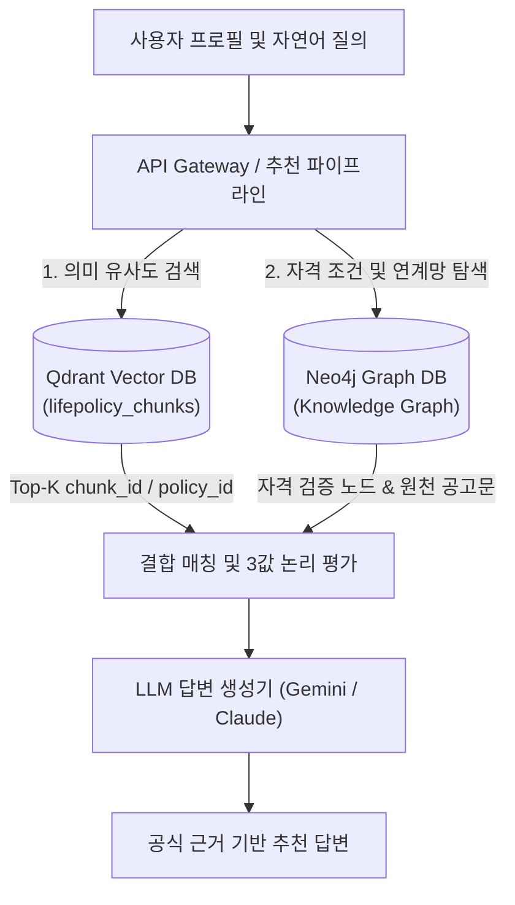

# SSOK — 최종 통합 DB 스키마 설계 명세서 (db_schema.md)

> **문서 코드:** `docs/data/db_schema.md` (공식 기준 정식 설계서)  
> **설계 주체:** 데이터 파이프라인 및 정제 담당 (장반석)  
> **수신 대상:** 주민혁 님 (Neo4j Graph DB & Qdrant Vector DB 구축 담당자), 백엔드 API 개발자  
> **기준일시:** 2026-11-05 (KST)  
> **버전:** `v1.3.0-final-schema`  
> **설계 특징:** 데이터 파트 주도로 확정된 최종 DB 스키마로, `LifeStage` 레이블 단일화 및 중첩 `ConditionGroup` DAG(비순환 방향 그래프)를 통한 완벽한 복합 자격 조건(AND/OR/NOT) 모델링 완비

---

## 1. 데이터베이스 아키텍처 개요

SSOK은 사용자의 자연어 질문과 프로필(나이, 지역, 소득, 혼인, 취업 상태)을 기반으로 정확한 정책을 추천하고 공식 근거를 제시하기 위해 **Hybrid GraphRAG 아키텍처**를 채택합니다.



---

## 2. Neo4j Graph DB 스키마 최종 명세

### 2.1 8대 노드 레이블 (Node Labels)

| 노드 레이블 | 주요 프로퍼티 (타입) | 식별자 (PK) | 역할 및 설명 |
|---|---|---|---|
| **`Policy`** | `policy_id` (String), `official_id` (String), `policy_name` (String), `benefit` (String), `eligibility` (String), `verification_status` (String), `collected_at` (String) | `policy_id` | 정책 핵심 엔티티 노드 |
| **`Organization`** | `agency_id` (String), `name` (String), `type` (String: 중앙부처/지자체/공공기관) | `agency_id` | 정책의 소관 부처 및 시행·운영 기관 |
| **`Region`** | `region_id` (String), `name` (String: 서울특별시, 전국 등) | `region_id` | 정책이 적용되는 관할 행정구역 |
| **`Category`** | `category_id` (String), `name` (String) | `category_id` | 5대 표준 분야 (주거·금융, 일자리, 교육 등) |
| **`LifeStage`** | `stage_id` (String: `LIFESTAGE_청년` 등), `name` (String: 영유아, 아동, 청소년, 청년, 중장년, 노년) | `stage_id` | **생애단계 표준 노드 (LifeStage 단일화)** |
| **`ConditionGroup`** | `group_id` (String), `logic` (String: `AND`, `OR`, `NOT`, `UNKNOWN`), `description` (String), `is_root` (Boolean) | `group_id` | **복합 조건의 계층적 논리 결합 노드 (DAG)** |
| **`EligibilityCondition`** | `condition_id` (String), `type` (String: AGE, INCOME, MARRIAGE, JOB, HOUSING, SPECIAL), `operator` (String: `>=`, `<=`, `==`, `IN`), `value` (String), `unit` (String), `raw_field` (String), `review_status` (String) | `condition_id` | 원자 단위의 세부 자격 요건 |
| **`Document`** | `document_id` (String), `title` (String), `source_url` (String), `local_raw_path` (String), `content_hash` (String), `verification_status` (String) | `document_id` | 법적 증빙 및 근거 공고문 원문 |

---

### 2.2 관계 엣지 및 복합 조건(ConditionGroup DAG) 구조

```mermaid
graph TD
    subgraph Core Graph
        P[Policy: POL_001] -->|ADMINISTERED_BY| Org[Organization: 국토교통부]
        P -->|AVAILABLE_IN| Reg[Region: 서울특별시]
        P -->|HAS_CATEGORY| Cat[Category: 주거·금융]
        P -->|APPLIES_TO_LIFESTAGE| LS1[LifeStage: 청년]
        P -->|APPLIES_TO_LIFESTAGE| LS2[LifeStage: 중장년]
        P -->|SUPPORTED_BY| Doc[Document: DOC_LH_001]
    end

    subgraph Condition Group DAG (복합 조건 계층)
        P -->|HAS_ROOT_CONDITION_GROUP| RootGrp["ConditionGroup: GRP_ROOT<br>(logic: AND)"]
        
        RootGrp -->|CONTAINS_CONDITION| Cond1["EligibilityCondition: COND_HOUS_무주택자<br>(무주택세대구성원)"]
        RootGrp -->|CONTAINS_CONDITION| Cond2["EligibilityCondition: COND_INC_70<br>(소득 70% 이하)"]
        
        RootGrp -->|CONTAINS_GROUP| SubOrGrp["ConditionGroup: GRP_SUB_OR<br>(logic: OR)"]
        SubOrGrp -->|CONTAINS_CONDITION| Cond3["EligibilityCondition: COND_MRG_신혼부부<br>(혼인 7년 이내)"]
        SubOrGrp -->|CONTAINS_CONDITION| Cond4["EligibilityCondition: COND_FAM_신생아<br>(2세 이하 신생아가구)"]
        SubOrGrp -->|CONTAINS_CONDITION| Cond5["EligibilityCondition: COND_FAM_한부모<br>(6세 이하 한부모가족)"]

        RootGrp -->|CONTAINS_GROUP| SubNotGrp["ConditionGroup: GRP_SUB_NOT<br>(logic: NOT)"]
        SubNotGrp -->|CONTAINS_CONDITION| Cond6["EligibilityCondition: COND_EXC_기수혜<br>(타 공공임대 중복입주)"]
    end
```

#### 관계 유형 명세:
1. `(:Policy)-[:HAS_ROOT_CONDITION_GROUP]->(:ConditionGroup {is_root: true})`
   - 각 정책의 자격 요건 평가 진입점 (1 정책당 1 루트 그룹)
2. `(:ConditionGroup)-[:CONTAINS_GROUP]->(:ConditionGroup)`
   - 하위 조건 그룹 결합 (AND 속에 OR, OR 속에 AND 등 중첩 DAG 지원, 순환 금지)
3. `(:ConditionGroup)-[:CONTAINS_CONDITION]->(:EligibilityCondition)`
   - 그룹 내 원자 조건 연결
4. `(:Policy)-[:APPLIES_TO_LIFESTAGE]->(:LifeStage)`
   - 6대 생애단계 직접 쿼리용 엣지 (419건 구축 완료)
5. `(:Policy)-[:ADMINISTERED_BY]->(:Organization)`
6. `(:Policy)-[:AVAILABLE_IN]->(:Region)`
7. `(:Policy)-[:HAS_CATEGORY]->(:Category)`
8. `(:Policy)-[:SUPPORTED_BY]->(:Document)`

#### 3값 논리(3-Valued Logic) 평가 규칙:
- **AND 그룹:** 모든 하위가 TRUE이면 TRUE / 하나라도 FALSE이면 FALSE / 그 외 UNKNOWN
- **OR 그룹:** 하나라도 TRUE이면 TRUE / 모든 하위가 FALSE이면 FALSE / 그 외 UNKNOWN
- **NOT 그룹:** 단일 하위가 TRUE이면 FALSE / FALSE이면 TRUE / UNKNOWN이면 UNKNOWN

---

### 2.3 제약조건 및 인덱스 생성 Cypher DDL

주민혁 님이 DB 초기화 시 실행할 공식 DDL입니다:

```cypher
// 1. 유니크 제약조건 (Unique Constraints)
CREATE CONSTRAINT constraint_policy_id IF NOT EXISTS
FOR (p:Policy) REQUIRE p.policy_id IS UNIQUE;

CREATE CONSTRAINT constraint_document_id IF NOT EXISTS
FOR (d:Document) REQUIRE d.document_id IS UNIQUE;

CREATE CONSTRAINT constraint_lifestage_name IF NOT EXISTS
FOR (s:LifeStage) REQUIRE s.name IS UNIQUE;

CREATE CONSTRAINT constraint_organization_id IF NOT EXISTS
FOR (o:Organization) REQUIRE o.agency_id IS UNIQUE;

CREATE CONSTRAINT constraint_region_name IF NOT EXISTS
FOR (r:Region) REQUIRE r.name IS UNIQUE;

CREATE CONSTRAINT constraint_category_name IF NOT EXISTS
FOR (c:Category) REQUIRE c.name IS UNIQUE;

CREATE CONSTRAINT constraint_group_id IF NOT EXISTS
FOR (g:ConditionGroup) REQUIRE g.group_id IS UNIQUE;

CREATE CONSTRAINT constraint_condition_id IF NOT EXISTS
FOR (e:EligibilityCondition) REQUIRE e.condition_id IS UNIQUE;

// 2. 인덱스 생성 (Indexes for Query Optimization)
CREATE INDEX index_policy_verification IF NOT EXISTS
FOR (p:Policy) ON (p.verification_status);

CREATE INDEX index_condition_type IF NOT EXISTS
FOR (e:EligibilityCondition) ON (e.type);
```

---

### 2.4 데이터 적재 순서 및 검증 Cypher

#### 적재 권장 순서:
1. 마스터 노드 적재: `Region`, `Category`, `LifeStage`, `Organization`
2. 문서 노드 적재: `Document`
3. 조건 노드 적재: `EligibilityCondition`, `ConditionGroup`
4. 정책 노드 적재: `Policy`
5. 관계 엣지 적재: 기본 분류 엣지(`AVAILABLE_IN`, `HAS_CATEGORY`, `APPLIES_TO_LIFESTAGE`, `ADMINISTERED_BY`, `SUPPORTED_BY`) → 조건 계층 엣지(`HAS_ROOT_CONDITION_GROUP`, `CONTAINS_GROUP`, `CONTAINS_CONDITION`)

#### 적재 후 검증 쿼리:
```cypher
// 1. 총 정책 수 및 생애단계별 분포 검증 (237건 / 6대 단계)
MATCH (p:Policy)
OPTIONAL MATCH (p)-[:APPLIES_TO_LIFESTAGE]->(s:LifeStage)
RETURN s.name AS LifeStage, count(DISTINCT p) AS PolicyCount
ORDER BY PolicyCount DESC;

// 2. 중장년 대상 정책 및 복합 조건 탐색 검증
MATCH (p:Policy)-[:APPLIES_TO_LIFESTAGE]->(:LifeStage {name: '중장년'})
MATCH (p)-[:HAS_ROOT_CONDITION_GROUP]->(rg:ConditionGroup)
RETURN p.policy_id, p.policy_name, rg.logic
LIMIT 10;

// 3. 고아 노드 및 깨진 참조 검증 (결과가 0건이어야 정상)
MATCH (p:Policy)
WHERE NOT (p)-[:SUPPORTED_BY]->(:Document)
RETURN count(p) AS PoliciesWithoutDocument;
```

---

## 3. Qdrant Vector DB 스키마 최종 명세

### 3.1 Collection 구성 및 파라미터화 규칙
- **컬렉션 명칭:** `lifepolicy_chunks`
- **임베딩 파라미터화 (설정값 분리):**
  - 임베딩 모델과 벡터 차원은 확정하지 않고 파라미터화하여 전달:
    * `vector_size`: `${EMBEDDING_DIM:1536}` (예: OpenAI `text-embedding-3-small` 1536, `bge-m3` 1024)
    * `distance`: `Cosine`
    * `on_disk_payload`: `true` (대규모 텍스트 메모리 최적화)

### 3.2 Qdrant Payload 필드 명세

```json
{
  "chunk_id": "DOC_WORK24_001_C01",
  "policy_id": "POL_005",
  "document_id": "DOC_WORK24_001",
  "policy_name": "고용24 국민내일배움카드",
  "category": "일자리·취업",
  "region": "전국",
  "life_stages": ["청소년", "청년", "중장년", "노년"],
  "target_groups": ["청년", "구직자·취업준비생", "소상공인·재직자"],
  "family_status": ["해당없음/미확인"],
  "income_level": ["소득무관/미확인"],
  "employment_status": ["제한없음"],
  "special_target": ["해당없음"],
  "housing_status": ["해당없음"],
  "section_title": "지원대상 및 자격요건",
  "text": "[정책명] 고용24 국민내일배움카드 ... 대상연령: 만 15세 ~ 74세 ...",
  "source_url": "https://www.work24.go.kr/...",
  "verification_status": "verified",
  "last_updated": "2026-01-01"
}
```

### 3.3 Payload 필터 인덱스 생성 스크립트 예제
```python
from qdrant_client import QdrantClient
from qdrant_client.http import models

client = QdrantClient(host="localhost", port=6333)

# 1. 컬렉션 생성 (임베딩 차원은 파라미터)
client.create_collection(
    collection_name="lifepolicy_chunks",
    vectors_config=models.VectorParams(size=1536, distance=models.Distance.COSINE),
)

# 2. 페이로드 필터 인덱스 구축 (고속 프리필터링)
filter_fields = [
    ("policy_id", models.PayloadSchemaType.KEYWORD),
    ("category", models.PayloadSchemaType.KEYWORD),
    ("region", models.PayloadSchemaType.KEYWORD),
    ("life_stages", models.PayloadSchemaType.KEYWORD),
    ("verification_status", models.PayloadSchemaType.KEYWORD),
]

for field_name, field_type in filter_fields:
    client.create_payload_index(
        collection_name="lifepolicy_chunks",
        field_name=field_name,
        field_schema=field_type,
    )
```

### 3.4 Hybrid 결합 패턴 (Qdrant + Neo4j)
1. **1단계 (Vector Search):** 사용자의 질의("중장년 일자리 지원")에 대해 Qdrant에서 `life_stages: "중장년"` 프리필터링 적용 후 Top-10 의미 청크 검색 → 매칭된 `policy_id` 집합 추출
2. **2단계 (Graph Traversal):** 추출된 `policy_id`로 Neo4j에서 자격 조건 계층(`ConditionGroup`), 소관기관, 공식 근거 문서(`Document`) 실시간 탐색
3. **3단계 (3-Valued Logic & Context Fusion):** 사용자 프로필과 대조하여 충족/미확인/제외 여부를 판정하고 공고문 본문과 함께 LLM에 증거로 전달

