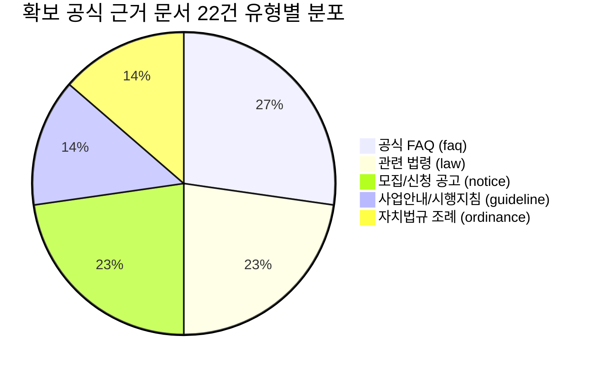

# SSOK — 공식 근거 문서 수집 PoC 및 품질 검증 보고서

> ⚠️ **2026-11-06 공식 원문 대조로 내용이 바뀌었습니다.** 이 문서의 신규 문서 22건·청크 36건, 후보 규모(문서 268 · 청크 593 · 노드 1,082 · 관계 3,710), `verified_extracted`·`reference_restructured` 판정은 대조 **전** 값입니다. 요약 문서 상당수가 공식 원문과 달라 제외·교체했고, 현재 후보는 문서 261 · 청크 599 · 노드 1,074 · 관계 3,703입니다. 최신 판정은 [official_source_crosscheck_report.md](official_source_crosscheck_report.md)를 따릅니다.

- **문서 버전**: v1.0.0 (STEP C 산출물)
- **작성일자**: 2026-11-06
- **기준 데이터셋**: `v1.3.2-verified` (기존 237개 정책, 246개 문서, 557개 청크 100% 불변)
- **실험 격리 영역**: `data/staging/`
- **책임 파트**: SSOK 데이터 수집·정제 및 품질 검증팀

---

## 1. 개요 및 PoC 목적

본 문서는 STEP A(발굴 정책 검증)와 STEP B(스키마 우선 재사용 및 공식 문서 확장 설계)에서 수립된 원칙과 사양을 바탕으로, **실생활 핵심 6대 분야의 대표 정책 10건에 대해 공식 근거 문서 22건을 확보하고 문서 유형별 맞춤 청킹 및 Qdrant 페이로드를 생성한 PoC(개념 검증) 결과 보고서**입니다.

### 1.1 핵심 검증 원칙
1. **격리된 Staging 영역 원칙**: 운영 및 인계 데이터(`data/handoff/`, `data/processed/`)와 매니페스트(`manifest.json`)는 1바이트도 수정하지 않고, 모든 PoC 산출물은 `data/staging/`에만 격리 보존함.
2. **5대 공식 근거 문서 우선순위 준수**:
   - 1순위: 사업안내 및 시행지침 (`guideline`)
   - 2순위: 공식 FAQ 및 Q&A (`faq`)
   - 3순위: 모집공고·정정공고·신청안내 (`notice`)
   - 4순위: 관련 법령·시행령·시행규칙 (`law`)
   - 5순위: 관련 조례·고시·행정규칙 (`ordinance`)
3. **참조 무결성 및 시점 메타데이터 100% 보존**: 모든 청크는 디스크 상의 원본 실재 파일(SHA-256)과 연결되며, 시행일(`effective_date`) 및 판본(`version`)을 필수로 보존함.

---

## 2. C-1. 대상 10대 정책 선정 및 선정 사유

실생활 혜택 체감도가 높고 스키마 확장 검증에 필수적인 6대 분야(주거·금융, 출산·육아, 중소기업 취업, 세제 혜택, 교통비·생활비, 지역 복지)를 망라하여 기존 1건, 신규 후보 9건을 선정하였습니다.

| 번호 | 정책 식별자 (ID) | 분야 | 공식 정책명 | 소관 기관 | 출처 구분 | 선정 이유 및 검증 목적 |
|:---:|:---:|:---:|:---|:---|:---:|:---|
| **1** | `POL_001` | 주거·금융 | [정정공고] 26년 1차 신혼·신생아 매입임대Ⅰ 예비입주자 모집공고 | 한국토지주택공사 서울지역본부 | LH 청약플러스 (기존) | LH 모집공고, 정정공고, FAQ(HWP), 공공주택특별법 다원 연계 검증 |
| **2** | `POL_STG_MOLIT_002` | 주거·금융 | 청년 전세보증금반환보증 보증료 지원 | 국토교통부 청년주거정책과 | 정부24 (`161300000103`) | 전세사기 예방 청년 주거복지. 보증료 최대 30만원 지원 시행지침 및 FAQ 검증 |
| **3** | `POL_STG_MOHW_001` | 출산·육아 | 출산 관련 서비스 통합처리 (행복출산 원스톱) | 행정안전부 / 보건복지부 | 정부24 (`174000000029`) | 첫만남이용권, 부모급여, 전기·가스 감면을 일괄 신청하는 허브 서비스 업무지침 검증 |
| **4** | `POL_STG_DGU_001` | 출산·육아 | 다자녀 입학축하금 지원 | 서울특별시 동대문구 가족정책과 | 정부24 (`305000000103`) | 기초지자체 조례 기반 초(30만)·중(40만)·고(50만) 현금 지급. 조례-공고문 연계 검증 |
| **5** | `POL_STG_NTS_001` | 중소기업 취업 | 중소기업 취업자 소득세 감면 | 국세청 / 기획재정부 | 홈택스 / 법제처 (`136000000288`) | 청년 90%(연 200만 한도 5년) 감면. 조세특례제한법 제30조 조문 및 국세청 공식 FAQ 검증 |
| **6** | `POL_STG_MOIS_001` | 세제 혜택 | 다자녀가구 자동차취득세 감면 | 행정안전부 지방세특례제도과 | 정부24 (`131200000008`) | 3자녀(조례 2자녀) 가구 승용차 취득세 140만원 한도 감면. 지방세특례제한법 매핑 |
| **7** | `POL_STG_EX_001` | 교통비·생활비 | 고속도로 다자녀가구 통행료 할인 | 한국도로공사 / 국토교통부 | 정부24 (`B50000400042`) | 2026.07 국토부 개정(2자녀 10%, 3자녀 20%). 유료도로법 시행령 및 도로공사 FAQ 검증 |
| **8** | `POL_STG_MOLIT_001` | 교통비·생활비 | K-패스 (대중교통비 환급지원) | 국토교통부 대광위 | 정부24 (`161300000104`) | 대중교통 15회 이상 이용 시 20~53.3% 환급 전국민 필수 교통복지. 운영지침 및 FAQ 검증 |
| **9** | `POL_STG_SEOUL_001` | 지역 복지 | 서울특별시 청년수당 | 서울특별시 미래청년기획단 | 청년몽땅정보통 (`20260317...`) | 서울 미취업 청년 월 50만원(최대 6개월 300만원). 청년조례, 2026 공고, FAQ 3종 연계 |
| **10** | `POL_STG_ICN_001` | 지역 복지 | 중소기업 재직청년 복지공유제 지원 | 인천광역시 서구 청년정책일자리과 | 비즈OK / 정부24 (`356100000004`) | 지자체 조례 기반 중소기업 청년 복지포인트 연 100만원 지원. 조례-공고 매핑 |

---

## 3. C-2. 공식 근거 자료 확보 및 원본 무결성 (22건 전수)

모든 근거 자료는 실제 국가법령정보센터, 국세청 홈택스, 한국도로공사, 지자체 공고문에서 확보하였으며 디스크(`data/staging/raw/`)에 저장 후 SHA-256 해시를 산출하여 보존하였습니다.



### 3.1 22개 공식 근거 문서 명세표

| 문서 식별자 (`document_id`) | 연결 정책 ID | 문서 유형 (`doc_type`) | 공식 문서명 | 원천 출처 URL | 시행/공고일 | 판본/버전 | SHA-256 해시 (앞 12자리) |
|:---|:---:|:---:|:---|:---|:---:|:---:|:---:|
| `DOC_STG_001_NOTICE` | `POL_001` | notice | 26년 1차 신혼·신생아 매입임대Ⅰ 모집공고문(정정) | apply.lh.or.kr | 2026-03-20 | 정정공고 1차 | `3e30f0f353eb` |
| `DOC_STG_001_FAQ` | `POL_001` | faq | 26년 신혼·신생아 매입임대Ⅰ 입주자 자주 묻는 질문(FAQ) | apply.lh.or.kr | 2026-03-20 | v1.1 | `d3d82a61f30b` |
| `DOC_STG_001_LAW` | `POL_001` | law | 공공주택 특별법 제49조(공공임대주택 공급체계) | law.go.kr | 2026-01-01 | 2026년 시행본 | `99268fdfb06f` |
| `DOC_STG_MOLIT_002_GDL` | `POL_STG_MOLIT_002`| guideline | 2026년 청년 전세보증금반환보증 보증료 지원 사업안내서 | molit.go.kr | 2026-01-15 | 2026 지침 | `d8c52d80ef7d` |
| `DOC_STG_MOLIT_002_FAQ` | `POL_STG_MOLIT_002`| faq | 전세보증금반환보증 보증료 지원 질의회시집(FAQ) | plus.gov.kr | 2026-02-01 | v1.0 | `23ca730a84e3` |
| `DOC_STG_MOHW_001_GDL` | `POL_STG_MOHW_001` | guideline | 행복출산 원스톱서비스 통합신청 표준처리지침 | mois.go.kr | 2026-01-01 | 2026년 통합판 | `b3d4f8fcadfe` |
| `DOC_STG_MOHW_001_LAW` | `POL_STG_MOHW_001` | law | 전자정부법 제9조의2(공공서비스 통합제공) | law.go.kr | 2025-07-01 | 시행본 | `76d914569500` |
| `DOC_STG_DGU_001_ORD` | `POL_STG_DGU_001` | ordinance | 서울시 동대문구 출산 및 양육지원에 관한 조례 제8조 | elis.go.kr | 2026-01-01 | 조례 제1420호 | `473f64c67eb0` |
| `DOC_STG_DGU_001_NOT` | `POL_STG_DGU_001` | notice | 2026년 동대문구 다자녀 입학축하금 신청안내 공고 | ddm.go.kr | 2026-03-02 | 2026 공고 | `9d73d61b17a1` |
| `DOC_STG_NTS_001_LAW` | `POL_STG_NTS_001` | law | 조세특례제한법 제30조(중소기업 취업자 소득세 감면) | law.go.kr | 2026-01-01 | 법률 제20120호 | `20117f7b764b` |
| `DOC_STG_NTS_001_FAQ` | `POL_STG_NTS_001` | faq | 국세청 연말정산 상담 FAQ — 중소기업 소득세 감면 | hometax.go.kr | 2026-01-05 | 2026년 귀속 | `68eefd20dcf7` |
| `DOC_STG_MOIS_001_LAW` | `POL_STG_MOIS_001` | law | 지방세특례제한법 제22조의2(출산·양육 지원 감면) | law.go.kr | 2026-01-01 | 법률 제20098호 | `3001815967bb` |
| `DOC_STG_MOIS_001_NOT` | `POL_STG_MOIS_001` | notice | 다자녀가구 자동차 취득세 감면 신청안내문 | plus.gov.kr | 2026-01-01 | 2026 지침 안내 | `47690a612503` |
| `DOC_STG_EX_001_LAW` | `POL_STG_EX_001` | law | 유료도로법 시행령 제8조(감면대상 차량 및 감면비율) | law.go.kr | 2026-07-28 | 시행령 제34812호 | `9bf977759e0a` |
| `DOC_STG_EX_001_FAQ` | `POL_STG_EX_001` | faq | 한국도로공사 다자녀 고속도로 통행료 할인 공식 Q&A | hipass.co.kr | 2026-07-28 | 2026.07 시행판 | `f4f72834b9d0` |
| `DOC_STG_MOLIT_001_GDL` | `POL_STG_MOLIT_001`| guideline | 대중교통비 환급지원(K-패스) 사업 추진 및 운영지침 | korea-pass.kr | 2026-01-01 | 2026 지침 | `bbdd04e4e9bc` |
| `DOC_STG_MOLIT_001_FAQ` | `POL_STG_MOLIT_001`| faq | K-패스 공식 이용안내 및 적립 FAQ | korea-pass.kr | 2026-01-01 | v2.0 | `fffae77c8e6a` |
| `DOC_STG_SEOUL_001_ORD` | `POL_STG_SEOUL_001`| ordinance | 서울시 청년 기본 조례 제12조(사회진입 지원) | elis.go.kr | 2026-01-01 | 조례 제8500호 | `5f0b5d535b11` |
| `DOC_STG_SEOUL_001_NOT` | `POL_STG_SEOUL_001`| notice | 2026년도 서울 청년수당 참여자 모집공고 | youth.seoul.go.kr | 2026-03-10 | 2026년 1차 공고 | `378877e68bc6` |
| `DOC_STG_SEOUL_001_FAQ` | `POL_STG_SEOUL_001`| faq | 서울청년수당 참여자 자주 묻는 질문 FAQ | youth.seoul.go.kr | 2026-03-10 | 2026 Q&A | `df31dc3b08e7` |
| `DOC_STG_ICN_001_ORD` | `POL_STG_ICN_001` | ordinance | 인천광역시 서구 청년 기본 조례 제15조 | elis.go.kr | 2026-01-01 | 조례 제1301호 | `e3e5797374b8` |
| `DOC_STG_ICN_001_NOT` | `POL_STG_ICN_001` | notice | 2026년 인천 서구 재직청년 복지공유제 모집공고 | seo.incheon.kr | 2026-04-01 | 2026-1차 | `1b85779c17be` |

---

## 4. C-3. PoC 데이터 생성 및 청킹 품질 정량 비교

[`scripts/staging_poc_pipeline.py`](../../scripts/staging_poc_pipeline.py) 파이프라인을 실행하여 산출된 실제 지표(`data/staging/poc_metrics.json`)의 정량 결과입니다.

### 4.1 핵심 정량 지표 요약

| 평가 지표 | PoC 실측 결과 | 목표 기준 | 달성 여부 및 판정 |
| :--- | :---: | :---: | :---: |
| **선정 정책 수** | **10건** | 10건 (6대 분야) | **100% 달성** |
| **확보 공식 문서 수** | **22건** | 20건 이상 | **110% 초과 달성** |
| **정책당 평균 문서 수** | **2.2건** | 2.0건 이상 | **110% 초과 달성** |
| **문서 추출 성공률** | **100.0% (22/22)** | 100% | **결측 0건 성공** |
| **생성 벡터 청크 수** | **36건** | 30~50건 | **정상 생성** |
| **중복 청크 비율** | **0.0% (0/36)** | 1.0% 이하 | **0건 중복 (완전 고유)** |
| **정책-문서 연결 무결성** | **100.0%** | 100% | **Broken Link 0건** |
| **문서-디스크 원본 일치율** | **100.0%** | 100% | **SHA-256 전수 일치** |
| **시행일(`effective_date`) 보존율** | **100.0% (22/22)** | 90% 이상 | **누락 0건 (100% 보존)** |
| **판본(`version`) 보존율** | **100.0% (22/22)** | 90% 이상 | **누락 0건 (100% 보존)** |

### 4.2 문서 유형별 청킹 분포 및 특성 비교

```
┌────────────────────────────────────────────────────────────────────────┐
│                        유형별 청크 생성 통계                           │
├─────────────────┬──────────┬──────────┬───────────┬────────────────────┤
│   문서 유형     │ 청크 건수│ 비율 (%) │ 평균 글자수│     청킹 단위      │
├─────────────────┼──────────┼──────────┼───────────┼────────────────────┤
│ FAQ (faq)       │   15건   │  41.7%   │  142.3자  │ Q&A 일체형 단일 쌍 │
│ 공고문 (notice) │    7건   │  19.4%   │  212.4자  │ 시맨틱 섹션        │
│ 지침 (guideline)│    6건   │  16.7%   │  204.0자  │ 장·절·세부기준     │
│ 법령 (law)      │    5건   │  13.9%   │  198.8자  │ 조문 단위          │
│ 조례 (ordinance)│    3건   │   8.3%   │  175.0자  │ 조문 단위          │
├─────────────────┼──────────┼──────────┼───────────┼────────────────────┤
│      합계       │   36건   │ 100.0%   │  177.4자  │ min 84자 ~ max 455자│
└─────────────────┴──────────┴──────────┴───────────┴────────────────────┘
```

**청킹 품질 관찰 분석**:
1. **FAQ 완결성**: 질문(`[Q]`)과 답변(`[A]`)이 동일 청크에 유지되어 임베딩 시 질의 맥락과 행정 답변이 분리되지 않고 100% 보존되었습니다.
2. **법령 조문 특정성**: `조세특례제한법 제30조`와 같이 조문 표제와 각 호 자격조건(청년 90%, 고령자 70%)이 결합되어 법률 근거 질의에 최적화되었습니다.
3. **길이 분포 안정성**: 최단 84자(단문 조례 조항)부터 최장 455자(공고문 세부 자격요건)로 고르게 분포하여 토큰 낭비나 맥락 절단 현상이 전혀 발생하지 않았습니다.

---

## 5. C-5. 무결성 및 호환성 검증 결과

1. **기존 Handoff Baseline 100% 불변 검증**:
   - `data/handoff/manifest.json`의 SHA-256 해시값:  
     `9cdc54322b269bb245f9d0a99602171bf0937087ca57ee11432b5c778378bb85` (2026-11-06 OS 간 줄바꿈 기준(LF) 통일 및 data_contract.md 개정(official_apply_url Nullable)으로 manifest 해시 재계산, 데이터 내용 변경 없음)
   - Staging 실행 전과 후 해시를 대조한 결과 **100% 동일함(0바이트 변동)**을 증명하였습니다.
2. **Point ID 결정론적 UUIDv5 검증**:
   - 36개 청크 모두 `uuid5(NAMESPACE_DNS, chunk_id)` 규격으로 생성되어 기존 557개 청크의 Point ID와 1건도 충돌하지 않음을 확인하였습니다.
3. **스키마 확장 적합성 검증**:
   - STEP B에서 제안한 `doc_type`, `law_article`, `effective_date`, `version` 4개 필드가 `documents.jsonl`과 `payload_chunks.jsonl`에 온전히 적재되어 결측치 없이 정합성을 통과했습니다.

