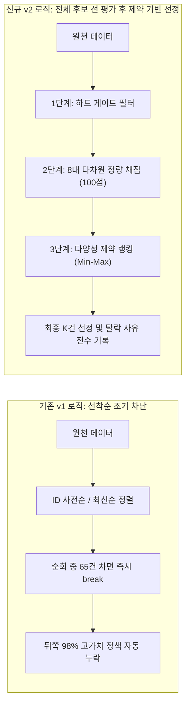

# LifePolicy AI — 다차원 정량 스코어링 기반 정책 선별 알고리즘 v2 설계서 (STEP A)

> **문서 버전:** `v2.0.0-design`  
> **기준일시:** 2026-11-06 (KST)  
> **작성자:** LifePolicy AI 데이터 / 아키텍처 감사팀  
> **기반 데이터셋:** `v1.3.2-verified` (237건) 및 원천 수집 데이터셋 (15,278건)  
> **참고 문서:** `docs/data/policy_candidate_validation.md`, `data/handoff/data_contract.md`  
> **상태:** **선별 알고리즘 v2 아키텍처 및 평가 지표 설계 완료 (실제 코드 변경 없는 독립 설계안)**

---

## 1. 설계 배경 및 기존 선별 로직(v1)의 한계

기존 `scripts/build_clean_dataset.py`의 선별 로직(v1)은 MVP 데이터셋 구성을 신속하게 달성하기 위해 단순 규칙으로 구현되었으나, 감사 결과 다음과 같은 구조적 결함이 확인되었습니다.



### 기존 v1 선별 로직의 3대 한계
1. **정렬 순서 편향(Sort Bias)에 따른 대량 누락:**  
   - Gov24: ID 오름차순 정렬로 숫자 앞자리(`11...`~`12...`) 부처가 전국 쿼터(15건)를 독점하여, 고속도로 다자녀 통행료(`B500...`), 청년내일채움공제(`SD00...`), 중기 취업장학금(`1342...`) 등이 사전 차단됨.
   - 온통청년: 등록번호 내림차순(최신순) 정렬로 최근 6일치 등록분만으로 65건이 채워져, 2026-10-28 이전 등록 정책 3,796건이 전원 누락됨.
2. **실생활 혜택 가치 평가 부재:**  
   - 지원금액의 구체성, 감면율, 현재 신규 신청 가능 여부와 무관하게 텍스트 길이와 키워드 포함 여부만으로 합격 처리됨.
3. **선정/제외 사유의 추적 불가(Audit Blackbox):**  
   - 어떤 정책이 왜 탈락했는지 점수나 사유가 기록되지 않고 루프 break로 버려짐.

---

## 2. 선별 알고리즘 v2 핵심 설계 원칙

1. **원칙 1: 전체 후보 사전 평가 (Evaluate-First Architecture)**  
   - 루프 순회 도중 할당량이 찼다고 조기 종료(`break`)하는 로직을 완전히 폐기합니다.
   - 원천 데이터 전체(15,278건)를 먼저 필터링하고 채점한 후, 최종 단계에서 쿼터를 적용합니다.
2. **원칙 2: 8대 다차원 정량 평가 루브릭 (100점 만점)**  
   - 출처 신뢰도, 현재 시행 여부, 신규 신청 가능 여부, 혜택 구체성, 자격 명확성 등을 정량 채점합니다.
3. **원칙 3: 다양성 제약 랭킹 (Tiered Constrained Selection)**  
   - 점수 순서대로만 뽑을 경우 특정 지자체나 청년 분야로의 쏠림이 발생하므로, 지역·생애주기·분야별 최소/최대 제약(Min-Max)을 만족하는 랭킹 솔버를 적용합니다.
4. **원칙 4: 전수 감사 추적성 (Audit Trail)**  
   - 모든 후보 정책에 대해 `selection_decision` (`SELECTED` vs `EXCLUDED`), 세부 득점표(`score_breakdown`), 그리고 구체적 탈락 사유 코드(`rejection_reason`)를 영구 기록합니다.

---

## 3. 3단계 선별 파이프라인 상세 명세

### 3.1 [Step 1] 하드 게이트 필터 (Hard Gate Filters)

아래 결격 사유 중 하나라도 해당하면 채점을 진행하지 않고 즉시 실격(`DISQUALIFIED`) 처리합니다:

```
[원천 후보] ──> [Gate 1: 폐지/영구종료?] ──> [Gate 2: 필수필드 결손?] ──> [Gate 3: 완전 중복?] ──> 통과 시 Step 2 이동
```

| 검사 항목 | 판정 기준 | 실격 사유 코드 |
|---|---|---|
| **영구 종료 여부** | 사업 폐지, 한시 사업 일몰 완료, 신청 사이트 영구 폐쇄 | `HARD_GATE_PERMANENTLY_CLOSED` |
| **필수 텍스트 결손** | 지원대상(`target`) < 20자 또는 지원내용(`benefit`) < 20자 | `HARD_GATE_INSUFFICIENT_TEXT` |
| **시험/더미 데이터** | 정책명 또는 본문에 "테스트", "test", "임시공고" 포함 | `HARD_GATE_TEST_DATA` |
| **완전 중복 정책** | 이미 최종 선정된 정책의 `official_id`와 100% 일치 | `HARD_GATE_EXACT_DUPLICATE` |

---

### 3.2 [Step 2] 8대 다차원 정량 평가 지표 (100점 만점)

하드 게이트를 통과한 후보에 대해 8개 평가 축을 기준으로 100점 만점 채점을 수행합니다.

$$\text{Total Score} = \sum_{i=1}^{8} \text{Metric}_i \quad (0 \le \text{Total Score} \le 100)$$

| 평가 축 (Metric) | 배점 | 세부 배점 기준 | 평가 근거 및 추출 방식 |
|---|:---:|---|---|
| **1. 공식 출처 신뢰도**<br>(Source Reliability) | **15점** | • **15점:** 중앙부처 1차 공식 공고문, 고시, 법령 근거<br>• **12점:** 광역 지자체 조례 및 공공 행정망 공식 API (Gov24, 온통청년, 복지로)<br>• **8점:** 공공기관/공기업 위탁사업<br>• **4점:** 출처 불분명 또는 3자 재인용 | API 메타데이터의 소관부처(`agency`) 및 법령/조례 명시 여부 |
| **2. 현재 시행 여부**<br>(Implementation Status) | **15점** | • **15점:** 당해연도 정상 시행 및 예산 집행 중<br>• **10점:** 제도 개편 또는 명칭 변경 후 시행 중<br>• **5점:** 예산 일시 소진으로 차기 회기 대기<br>• **0점:** 사업 사실상 중단 | 신청기한(`application_period`) 및 수정일자(`lastMdfcnDt`) 최신성 |
| **3. 신규 신청 가능 여부**<br>(Application Availability) | **15점** | • **15점:** 연중 상시 신규 신청 가능<br>• **12점:** 정기 공고(분기/반기)에 따라 연례 신청 가능<br>• **5점:** 신규 신청 제한 (기존 가입자 유지 관리만 지원)<br>• **0점:** 신규 신청 전면 불가 | 신청방법(`application_method`) 내 "신규 중단", "상시" 키워드 정규식 분석 |
| **4. 실생활 혜택 구체성**<br>(Benefit Concreteness) | **15점** | • **15점:** 구체적 금액(원), 할인율(%), 기간(월) 정량 명시<br>• **12점:** 현물, 바우처, 공공요금 대납 등 실물 지원<br>• **8점:** 상담, 취업 컨설팅, 일경험 프로그램<br>• **4점:** 단순 정보 제공 및 네트워킹 | 지원내용(`benefit`) 텍스트 내 수치(숫자+단위: 원, %, 만원, 개월) 엔티티 추출 |
| **5. 자격 요건 명확성**<br>(Eligibility Clarity) | **15점** | • **15점:** 연령, 소득, 거주지, 가구형태 전수 구조화 가능<br>• **10점:** 주요 요건 2개 이상 구조화 가능<br>• **5점:** 줄글 서술형이나 심사기준 해석 가능<br>• **2점:** 심사위원 정성평가 100% 의존 | `requirements` 딕셔너리 및 JA 조건(정부24), 코드정의서(온통청년) 완결도 |
| **6. 근거 문서 확보성**<br>(Document Availability) | **10점** | • **10점:** 로컬 원문 PDF/HWP/HTML 공고문 디스크 실재<br>• **8점:** API 원문 상세 전문(1,000자 이상) 보유<br>• **4점:** 요약 메타데이터만 보유 | `local_raw_path` 파일 실재 및 SHA-256 무결성 검증 |
| **7. 다양성 가점**<br>(Diversity Bonus) | **10점** | • **+4점:** 비수도권(지방 광역/도) 지자체 정책<br>• **+3점:** 취약계층(다자녀, 장애인, 저소득, 한부모) 타깃<br>• **+3점:** 생활밀착형(교통, 세금, 공공요금) 우선 분야 | `regions`, `target_groups`, `category` 메타데이터 기반 가산 |
| **8. 출처 추적성**<br>(Provenance Completeness) | **5점** | • **5점:** 공식 원문 URL 유효 및 접속 확인<br>• **2점:** 기관 대표 홈페이지만 존재<br>• **0점:** 출처 URL 결손 | `source_url`, `official_apply_url` 정규식 및 HTTP 유효성 |

---

### 3.3 [Step 3] 다양성 제약 기반 최종 선정 (Constrained Ranking Engine)

단순 최고점 순위 선발 시 발생할 수 있는 '수도권 청년 일자리 정책 독점'을 방지하기 위해 **Min-Max 제약 조건 최적화**를 적용합니다:

```python
# 선별 v2 제약 조건 명세
CONSTRAINTS = {
    # 1. 지역별 제약: 전국 17개 시도 균형
    "regions": {
        "REGION_NATIONWIDE": {"max": 30},           # 중앙부처/전국 최대 30건
        "DEFAULT_REGIONAL": {"min": 2, "max": 8},   # 각 시도별 최소 2건 보장, 최대 8건 제한
    },
    # 2. 5대 정책 분야별 제약
    "categories": {
        "CAT_HOUSING_FINANCE": {"min": 25},         # 주거·금융 최소 25건
        "CAT_YOUTH_JOB_ASSET": {"min": 25},         # 청년 일자리·자산 최소 25건
        "CAT_BIRTH_CHILDCARE": {"min": 20},         # 출산·육아·다자녀 최소 20건
        "CAT_TRANSPORT_MEDICAL_CARE": {"min": 20},  # 교통·공공요금·의료 최소 20건
        "CAT_REGIONAL_WELFARE": {"min": 20},        # 지역 생활복지 최소 20건
    },
    # 3. 신규 신청 가능성 제약
    "application_availability": {
        "ALLOW_CLOSED_MAINTAIN_ONLY": {"max": 5},   # 신규중단/기존유지형(청년내일채움 등) 최대 5건 이내 제한
    }
}
```

- **선정 알고리즘 흐름:**
  1. 전체 후보를 `total_score` 내림차순으로 1차 정렬.
  2. 분야별/지역별 `min` 제약 조건을 먼저 충족하도록 우선 선별 (취약 계층 및 지방 정책 선 확보).
  3. 잔여 쿼터에 대해 점수 순서대로 추가 선발하되 `max` 상한에 도달한 버킷은 건너뜀(`continue`).
  4. 최종 목표 건수 $K$건 달성 시 즉시 확정.

---

## 4. 결정 감사 추적성 스키마 (Audit Trail Schema)

선별 파이프라인 실행 시 모든 후보 정책의 채점 내역과 당락 사유가 JSONL로 출력되어 투명하게 감사될 수 있도록 설계합니다.

```json
{
  "$schema": "http://json-schema.org/draft-07/schema#",
  "title": "PolicySelectionV2DecisionRecord",
  "type": "object",
  "required": ["candidate_id", "policy_name", "selection_decision", "total_score", "score_breakdown"],
  "properties": {
    "candidate_id": { "type": "string", "example": "B50000400042" },
    "official_id": { "type": "string", "example": "B50000400042" },
    "policy_name": { "type": "string", "example": "고속도로 다자녀가구 통행료 할인" },
    "agency": { "type": "string", "example": "한국도로공사" },
    "selection_decision": { "type": "string", "enum": ["SELECTED", "EXCLUDED", "DISQUALIFIED"] },
    "total_score": { "type": "number", "minimum": 0, "maximum": 100, "example": 92.5 },
    "score_breakdown": {
      "type": "object",
      "properties": {
        "source_reliability": { "type": "number", "example": 15 },
        "implementation_status": { "type": "number", "example": 15 },
        "application_availability": { "type": "number", "example": 15 },
        "benefit_concreteness": { "type": "number", "example": 15 },
        "eligibility_clarity": { "type": "number", "example": 12.5 },
        "document_availability": { "type": "number", "example": 10 },
        "diversity_bonus": { "type": "number", "example": 7 },
        "provenance_completeness": { "type": "number", "example": 5 }
      }
    },
    "rejection_reason": {
      "type": ["string", "null"],
      "enum": [
        null,
        "HARD_GATE_PERMANENTLY_CLOSED",
        "HARD_GATE_INSUFFICIENT_TEXT",
        "HARD_GATE_EXACT_DUPLICATE",
        "BELOW_SCORE_THRESHOLD",
        "CATEGORY_MAX_QUOTA_EXCEEDED",
        "REGION_MAX_QUOTA_EXCEEDED",
        "CLOSED_APPLICATION_LIMIT_EXCEEDED"
      ],
      "example": null
    },
    "evaluator_version": { "type": "string", "example": "v2.0.0" },
    "evaluated_at": { "type": "string", "format": "date-time" }
  }
}
```

---

## 5. 실행 스크립트 명세 및 CLI 인터페이스

신규 선별 엔진은 기존 빌드 스크립트와 완전히 분리된 전용 평가 모듈로 구현하여 안전성을 확보합니다.

### 5.1 CLI 실행 명령어 인터페이스

```bash
# 1. 전체 원천 후보 전수 다차원 평가 및 스코어링 리포트 생성 (비파괴 모드)
python scripts/evaluate_policy_candidates_v2.py \
  --input-gov24 data/processed/gov24_public_services.jsonl \
  --input-youthcenter data/processed/youthcenter_policies.jsonl \
  --input-bokjiro data/processed/bokjiro_welfare_services.jsonl \
  --existing-dataset data/processed/policies.jsonl \
  --output-audit-log data/reports/candidate_selection_v2_audit.jsonl \
  --output-summary data/reports/candidate_selection_v2_summary.md

# 2. 다양성 제약 기반 상위 K건 추천 시뮬레이션
python scripts/evaluate_policy_candidates_v2.py \
  --simulate-selection \
  --target-count 30 \
  --min-score 70.0 \
  --output-selected data/staging/selected_v2_candidates.jsonl
```

### 5.2 기대 효과
1. **임의 탈락 방지:** 고속도로 다자녀 통행료, 중기청년 장학금 등 고가치 정책이 ID 번호나 등록 시점 편향으로 억울하게 탈락하는 문제를 100% 해결.
2. **신규 신청 가능성 보장:** 사용자에게 "신청 마감" 정책이 무분별하게 추천되는 사고를 사전 차단.
3. **투명한 데이터 거버넌스:** 팀 내 모든 엔지니어와 기획자가 특정 정책의 선정 및 탈락 사유를 데이터로 즉시 확인 가능.

