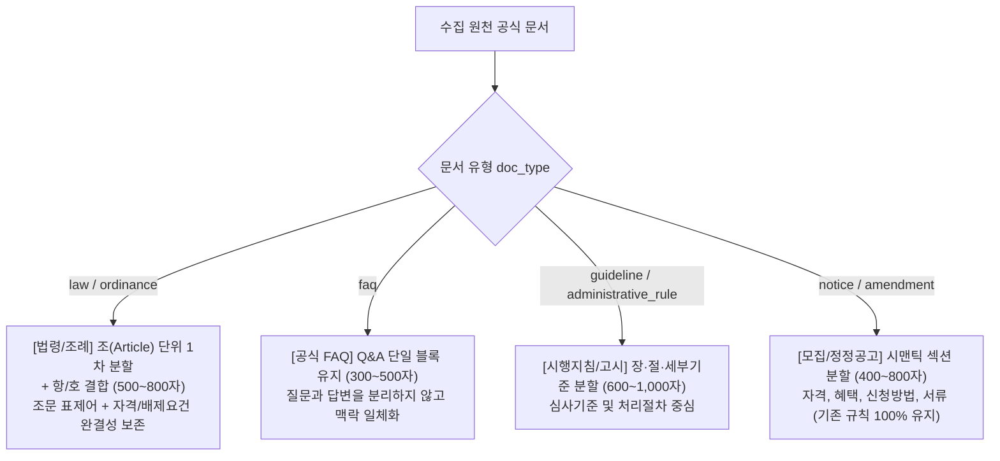

# LifePolicy AI — Qdrant 문서 확장 및 벡터 페이로드 아키텍처 설계서

- **문서 버전**: v1.0.0 (STEP B 공식 산출물)
- **작성일자**: 2026-11-06
- **기준 컬렉션**: `lifepolicy_chunks` (현재 557건 벡터 적재 완료, Cosine 유사도, 1536차원)
- **대상 파일**:
  - `data/handoff/qdrant/collection_config.json`
  - `data/handoff/qdrant/payload_chunks.jsonl`
- **책임자**: LifePolicy AI 검색 엔진 / Vector DB 파트

---

## 1. 단일 컬렉션(Single-Collection) 아키텍처 원칙

### 1.1 컬렉션 파편화 방지 및 단일화
본 설계는 법령, 공고문, FAQ, 지침 등 다채로운 문서 유형을 수용할 때 **별도의 컬렉션(`lifepolicy_laws`, `lifepolicy_faqs` 등)을 신설하지 않고, 기존의 `lifepolicy_chunks` 단일 컬렉션 구조를 100% 유지**합니다.

```
┌────────────────────────────────────────────────────────────────────────┐
│             기존 단일 컬렉션 (lifepolicy_chunks) 구조 유지             │
├────────────────────────────────────────────────────────────────────────┤
│ • 차원: 1536 (OpenAI text-embedding-3-small)                            │
│ • 거리 메트릭: Cosine                                                  │
│ • 기존 557개 청크 (모집공고 및 정책 개요 중심) 100% 보존                │
│ • 확장 방식: 신규 공식 문서(법령, 지침, FAQ)를 동일 컬렉션 내 증분     │
│   인제스천(Upsert)하되, `doc_type` 메타데이터로 시맨틱 라우팅 수행      │
└────────────────────────────────────────────────────────────────────────┘
```

**단일 컬렉션을 유지하는 이유**:
1. **단일 쿼리 하이브리드 검색 (Unified Search)**: 사용자가 자연어로 "청년 소득세 감면 자격과 법적 근거 알려줘"라고 질의했을 때, 별도 컬렉션 조인 없이 단 한 번의 벡터 질의로 공고문 청크와 법령 청크를 함께 스코어링하여 종합 답변 가능.
2. **운영 오버헤드 최소화**: 인덱스 관리, 백업, 스냅샷 생성 대상이 1개 컬렉션으로 단순화됨.
3. **기존 검색 백엔드 무수정**: 파이프라인의 컬렉션 타겟 엔드포인트를 변경할 필요가 전혀 없음.

---

## 2. 문서 유형별 맞춤형 청킹 전략 (Chunking Taxonomy)

문서의 구조적 특성(법조문 계층, Q&A 구조, 표 형식 등)을 고려하여 시맨틱 왜곡을 방지하는 6대 청킹 규칙을 수립합니다.



### 2.1 유형별 청킹 상세 가이드

| 문서 유형 (`doc_type`) | 대상 원천 예시 | 청킹 분할 단위 | 권장 토큰/길이 | 청크 내 필수 보존 요소 |
| :--- | :--- | :--- | :---: | :--- |
| **모집공고 (`notice`)** | LH 모집공고, 서울시 공고문 | 시맨틱 섹션<br>(자격, 혜택, 일정, 서류) | 400 ~ 800자 | 정책명, 공고회차, 접수기간, 신청자격 요약 |
| **정정공고 (`amendment`)** | 일정 연장, 자격기준 정정 | 정정 조항 및 변경 전후 대비 | 300 ~ 600자 | 변경 사유, 정정 전/후 비교표, 시행일 |
| **법령 (`law`)** | 조세특례제한법, 유료도로법 | 조(`Article`) 단위 1차,<br>항(`Clause`)·호(`Item`) 결합 | 500 ~ 800자 | 법률명, 조문 번호(예: 제30조 제1항), 감면율 상한, 법정 배제사유 |
| **자치법규 (`ordinance`)** | 서울시 청년 기본 조례 | 조(`Article`) 단위 분할 | 400 ~ 700자 | 조례명, 지자체명(`region`), 지원 대상자 정의 |
| **행정규칙 (`administrative_rule`)** | 부처 훈령, 예규, 고시 | 장·조 단위 분할 | 500 ~ 900자 | 소관부처명, 고시 번호, 세부 업무 처리 기준 |
| **시행지침 (`guideline`)** | 사업안내서, 업무 매뉴얼 | 장·절·세부 심사기준 | 600 ~ 1,000자 | 지원 자격 판정 매뉴얼, 소득 산정 방식, 구비서류 목록 |
| **공식 FAQ (`faq`)** | 국세청 FAQ, 고용노동부 질의회시 | **Q&A 단일 쌍 (One Pair)** | 300 ~ 500자 | 질의 전문(Question), 답변 전문(Answer), 관련 법조문 참조 |

> **[주의] FAQ 청킹 금지 사항**: 질문(Q)과 답변(A)을 서로 다른 청크로 쪼개는 행위를 엄격히 금지합니다. Q와 A가 분리되면 벡터 임베딩 시 질의 맥락이 유실되어 검색 정확도가 급감합니다.

---

## 3. 벡터 페이로드 스키마 및 확장 메타데이터 (Payload Specification)

기존 `data/handoff/qdrant/payload_chunks.jsonl`의 15개 필드를 100% 보존하며, 문서 유형 식별 및 필터링을 위한 선택적 속성을 추가합니다.

### 3.1 페이로드 JSON 스키마 명세

```json
{
  // ==========================================
  // 1. 기존 표준 필드 (15종 100% 보존, 필수)
  // ==========================================
  "chunk_id": "CHK_LAW_조특법_조30_01",
  "policy_id": "POL_NTS_001",
  "policy_name": "중소기업 취업자 소득세 감면",
  "document_id": "DOC_LAW_조특법_조30",
  "document_title": "조세특례제한법 제30조",
  "section_title": "제30조(중소기업 취업자에 대한 소득세 감면) 제1항 청년 감면",
  "category": "일자리·창업",
  "region": "전국",
  "life_stages": ["청년"],
  "target_groups": ["중소기업재직자", "취업준비생"],
  "income_level": null,
  "benefit_type": "세제지원",
  "verification_status": "verified",
  "eligibility_attributes": {
    "age_min": 15,
    "age_max": 34,
    "target": "중소기업 취업 청년",
    "rate": "90% 감면 (연 200만원 한도)"
  },
  "text": "[조세특례제한법 제30조 제1항] 중소기업체에 2026년 12월 31일까지 취업하거나 재직하는 청년(만 15세 이상 34세 이하인 사람)...",

  // ==========================================
  // 2. STEP B 선택적 확장 필드 (Nullable)
  // ==========================================
  "doc_type": "law",                            // [선택/권고] notice | guideline | faq | law | ordinance | administrative_rule (기본값 notice)
  "law_article": "제30조 제1항",                // [선택] 법령/조례 조·항 (공고문은 null)
  "effective_date": "2026-01-01",               // [선택] 법령 시행일 또는 공고일 (YYYY-MM-DD)
  "version": "2026년 개정"                       // [선택] 판본/회차 정보 (없으면 null)
}
```

---

## 4. 검색 필터링 최적화 및 인덱스 구성 계획

### 4.1 페이로드 인덱스 변경 제안
기존 `collection_config.json`에 정의된 6개 페이로드 인덱스를 그대로 유지하며, **`doc_type` Keyword 인덱스 1건만을 추가 생성**할 것을 제안합니다.

```json
{
  "existing_indexes": [
    {"field_name": "policy_id", "field_schema": "keyword"},
    {"field_name": "category", "field_schema": "keyword"},
    {"field_name": "region", "field_schema": "keyword"},
    {"field_name": "life_stages", "field_schema": "keyword"},
    {"field_name": "target_groups", "field_schema": "keyword"},
    {"field_name": "verification_status", "field_schema": "keyword"}
  ],
  "proposed_new_index": [
    {
      "field_name": "doc_type",
      "field_schema": "keyword",
      "description": "문서 유형별(공고문, 법령, FAQ 등) 타겟 필터링을 위한 고성능 인덱스"
    }
  ]
}
```

### 4.2 사용자 질의 유형별 라우팅 및 필터링 시나리오

```
┌────────────────────────────────────────────────────────────────────────┐
│                        시맨틱 쿼리 라우팅 예시                         │
├────────────────────────────────────────────────────────────────────────┤
│ 1. 법적 근거 질의: "청년 소득세 감면은 어느 법률에 규정되어 있나요?"  │
│    ➜ Filter: { "doc_type": { "should": ["law", "ordinance"] } }        │
│                                                                        │
│ 2. 구비 서류 질의: "매입임대 신청할 때 필요한 제출 서류 목록 알려줘"  │
│    ➜ Filter: { "doc_type": { "should": ["notice", "guideline"] } }     │
│                                                                        │
│ 3. 예외 상황 질의: "군 복무 중인데 중소기업 청년 감면 나이 계산은?"  │
│    ➜ Filter: { "doc_type": { "should": ["faq", "guideline"] } }        │
│                                                                        │
│ 4. 일반 통합 질의: "청년 월세 지원 대상과 신청 조건 전부 알려줘"       │
│    ➜ Filter: 없음 (단일 컬렉션 전체 대상 하이브리드 벡터 검색 수행)    │
└────────────────────────────────────────────────────────────────────────┘
```

---

## 5. Point ID 결정론적 UUIDv5 생성 및 무결성 보장 (B-4)

### 5.1 UUIDv5 해시 생성 불변 규칙
기존 파이프라인(`build_clean_dataset.py`, `export_handoff.py`)에서 사용하는 Point ID 생성 공식을 100% 동일하게 적용합니다.

$$\text{Point ID} = \text{UUIDv5}(\text{NAMESPACE\_DNS}, \text{chunk\_id})$$

### 5.2 신규 청크 식별자(ID) 명명 체계

기존 557개 청크의 `chunk_id` (`CHK_001_01`, `CHK_LH_001_01` 등)와 절대 충돌하지 않도록 네임스페이스 접두어를 엄격히 분리합니다.

| 문서 유형 | Chunk ID 네이밍 패턴 | 실제 생성 예시 | Point ID (UUIDv5) 예시 |
| :--- | :--- | :--- | :--- |
| **기존 공고문** | `CHK_{SEQ}_{SUB}` | `CHK_001_01` | `70404c0d-c0eb-5f3d-b631-0df8c90ea002` (불변) |
| **신규 법령** | `CHK_LAW_{법령명}_{조문}_{순번}` | `CHK_LAW_조특법_조30_01` | 결정론적 생성 (충돌 불가) |
| **공식 FAQ** | `CHK_FAQ_{POL_ID}_{질문순번}` | `CHK_FAQ_POL_NTS_001_01` | 결정론적 생성 (충돌 불가) |
| **시행지침** | `CHK_GDL_{POL_ID}_{장절순번}` | `CHK_GDL_POL_MOLIT_001_01`| 결정론적 생성 (충돌 불가) |
| **지자체 조례** | `CHK_ORD_{지자체}_{조례명}_{순번}`| `CHK_ORD_서울_청년조례_01` | 결정론적 생성 (충돌 불가) |

### 5.3 기존 557건 청크 안전성 확약
- 증분 업서트(Upsert) 작업 시, 기존 557건의 `chunk_id`는 재생성하거나 변경하지 않습니다.
- 따라서 Qdrant 내부의 기존 557개 벡터 및 페이로드는 1바이트의 오차도 없이 온전히 보존됩니다.

