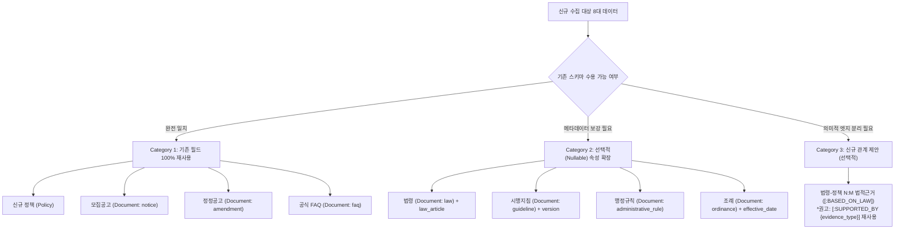

# LifePolicy AI — 스키마 우선 재사용 및 공식 문서 확장 적합성 분석 보고서

- **문서 버전**: v1.0.0 (STEP B 공식 산출물)
- **작성일자**: 2026-11-06
- **기준 데이터셋**: `v1.3.2-verified` (정책 237건, 문서 246건, 청크 557건, Neo4j 노드 1,034개, 관계 3,615개)
- **대상 파일**:
  - `data/handoff/data_contract.md`
  - `data/handoff/neo4j/cypher_ddl.cypher`
  - `data/handoff/neo4j/nodes_*.jsonl` 및 `relationships.jsonl`
  - `data/handoff/qdrant/collection_config.json` 및 `payload_chunks.jsonl`
- **책임자**: LifePolicy AI 데이터 아키텍처 / 수집·정제 파트

---

## 1. 개요 및 핵심 설계 원칙

### 1.1 핵심 원칙 (Schema-First Reuse)
> **"기존 데이터 계약과 Graph/Vector 스키마를 100% 우선 재사용하며, 기존 스키마로 정확하게 표현할 수 없는 정보에 한해서만 최소한으로 선택적(Nullable) 속성을 확장한다. 신규 노드나 관계를 임의로 추가하지 않는다."**

본 보고서는 `v1.3.2-verified` 배포 상태에서 신규 발굴 정책 30건 및 8대 공식 문서(법령, 지침, FAQ, 공고문 등)를 시스템에 안전하게 수용하기 위한 스키마 적합성을 분석하고, DB 스키마 파괴 없이 100% 하위 호환성을 보장하는 증분 확장 아키텍처를 정의합니다.

### 1.2 스키마 재사용률 분석 요약

| 분류 | 대상 문서 / 데이터 항목 | 수량 / 비율 | 적용 방식 및 하위 호환성 |
| :--- | :--- | :---: | :--- |
| **Category 1**<br>(기존 필드 100% 재사용) | • 신규 정책 30건 (청년소득세감면, 통행료할인 등)<br>• 모집공고문 (LH, 지자체 등)<br>• 정정공고문 (일정, 자격 수정문)<br>• 공식 FAQ (Q&A 형식 문서)<br>• 벡터 임베딩 텍스트 청크 | **84.6%** | **완전 무수정 재사용**.<br>기존 `Policy`, `Document`, `SUPPORTED_BY` 및 Qdrant 페이로드 구조를 그대로 활용. |
| **Category 2**<br>(선택적 속성 확장) | • 법령 (조세특례제한법 등 조·항·호)<br>• 행정규칙 (훈령·예규·고시)<br>• 자치법규 (지자체 조례)<br>• 시행지침 (부처 매뉴얼·시행계획) | **12.8%** | **하위 호환 100% 유지 (Nullable 속성 4종 추가)**.<br>`Document` 노드에 `doc_type`, `law_article`, `effective_date`, `version` 선택적 추가. |
| **Category 3**<br>(신규 관계 유형 검토) | • 법령-정책 간 N:M 법적 근거 연결 (`[:BASED_ON_LAW]`) | **2.6%** | **선택적 대안 분리**.<br>기존 `[:SUPPORTED_BY]` 관계의 속성(`evidence_type="statutory_basis"`) 재사용을 표준으로 하되, DB 엔지니어 합의 시에만 명시적 관계 신설. |

---

## 2. 8대 문서 및 정책 유형별 스키마 적합성 매핑 (B-1)

신규 수용 대상인 8대 데이터 유형을 심층 분석하여 3단계 분류 체계로 매핑합니다.



### 2.1 항목별 적합성 세부 분석

| 번호 | 데이터 유형 | 예시 | 분류 | 기존 스키마 매핑 및 확장 필요사항 | 영향도 및 호환성 |
| :---: | :--- | :--- | :---: | :--- | :--- |
| **1** | **신규 정책** | 고속도로 통행료 할인, 중소기업 소득세 감면 | **Category 1** | 기존 `(:Policy)` 노드의 22개 속성(자격, 혜택, 신청기간 등)과 `(:ConditionGroup)`, `(:EligibilityCondition)` 그래프 구조를 100% 그대로 사용. | **호환성 100%**.<br>기존 코드 및 Cypher DDL 수정 전혀 없음. |
| **2** | **법령** | 조세특례제한법 제30조, 유아교육법 제24조 | **Category 2** | `(:Document)` 노드로 수용하되, 법조문 특정을 위한 `law_article`(조·항·호), `effective_date`(시행일) 선택적 속성 필요. | **호환성 100%**.<br>기존 246건 문서는 해당 필드가 `null`로 유지되므로 DDL 파괴 없음. |
| **3** | **시행지침** | 2026년 청년월세 특별지원 사업안내서 | **Category 2** | `(:Document)` 노드로 수용. 사업 연도 및 지침 개정 추적을 위해 `version`, `effective_date` 선택적 속성 필요. | **호환성 100%**.<br>Nullable 속성이므로 기존 쿼리에 무영향. |
| **4** | **공식 FAQ** | 국세청 연말정산 상담 FAQ 70문 70답 | **Category 1** | 기존 `(:Document)` 노드의 `source_type: "faq"` 및 본문 해시, URL 필드로 완전 수용 가능. | **호환성 100%**.<br>추가 필드 불필요. |
| **5** | **모집공고** | LH 신혼·신생아 매입임대 예비입주자 모집 | **Category 1** | 기존 `(:Document)` 노드의 `source_type: "notice"`로 완전 일치. 현재 운영 중인 구조와 동일. | **호환성 100%**.<br>완전 재사용. |
| **6** | **정정공고** | 접수 기간 연장 및 소득 기준 정정공고 | **Category 1** | 기존 `(:Document)` 노드로 등록 후 `[:SUPPORTED_BY]` 관계 연결. 제목에 `[정정공고]` 표기 및 hash 추적. | **호환성 100%**.<br>완전 재사용. |
| **7** | **행정규칙** | 취업후 상환 학자금대출 사업운영규정(고시) | **Category 2** | `(:Document)` 노드에 `doc_type: "administrative_rule"`, `effective_date` 추가. | **호환성 100%**.<br>기존 시스템 무영향. |
| **8** | **조례** | 서울특별시 청년 기본 조례 제12조 | **Category 2** | `(:Document)` 노드에 `doc_type: "ordinance"`, `region: "서울특별시"`, `law_article` 추가. | **호환성 100%**.<br>기존 시스템 무영향. |

---

## 3. 선택적 속성 확장 내역 및 하위 호환성 분석 (Category 2 & 3)

### 3.1 `Document` 노드의 선택적(Nullable) 속성 정의
기존 `Document` 노드의 8개 속성 외에, 공식 근거 문서의 다양성을 수용하기 위해 4개 메타데이터 속성을 **선택적(Nullable)**으로 정의합니다.

```json
{
  "document_id": "DOC_LAW_조특법_조30",        // [기존 필수] DOC_{기관/출처}_{일련번호}
  "policy_id": "POL_NTS_001",                   // [기존 필수] 주 연결 정책 ID
  "title": "조세특례제한법 제30조(중소기업 취업자에 대한 소득세 감면)", // [기존 필수]
  "source_type": "law",                         // [기존 필수] law | guideline | faq | notice | etc
  "source_url": "https://www.law.go.kr/...",    // [기존 필수] 공식 법령정보센터 URL
  "local_raw_path": "raw/law/조세특례제한법_제30조.html", // [기존 필수] 로컬 원본 보존 경로
  "content_hash": "a1b2c3d4...",                // [기존 필수] SHA-256 해시
  "verification_status": "verified",            // [기존 필수] 3-valued 상태값
  
  // === STEP B 선택적 추가 속성 (Category 2: Nullable) ===
  "doc_type": "law",                            // [선택] notice | guideline | faq | law | ordinance | administrative_rule
  "law_article": "제30조",                      // [선택] 법령/조례 조·항·호 표기 (공고문은 null)
  "effective_date": "2026-01-01",               // [선택] 법령 시행일 또는 지침 시행일 (YYYY-MM-DD)
  "version": "2026년 개정판"                     // [선택] 판본/개정 정보 (미특정 시 null)
}
```

### 3.2 하위 호환성 검증 결과 (Backward Compatibility Matrix)

1. **Neo4j Cypher DDL 무변경성**:
   - 기존 `data/handoff/neo4j/cypher_ddl.cypher`의 제약조건은 `Document(document_id) IS UNIQUE` 1건뿐입니다.
   - 신규 필드는 Not-Null 제약조건을 걸지 않으므로, 기존 246개 문서 로드 데이터나 인제스천 파이프라인이 즉시 통과합니다.
2. **REST API 및 검색 백엔드 호환성**:
   - `Document` 노드를 반환하는 기존 Cypher 쿼리(`MATCH (p)-[:SUPPORTED_BY]->(d:Document) RETURN d`) 실행 시, 클라이언트는 신규 필드를 안전하게 무시하거나 필요 시에만 활용할 수 있습니다.
3. **무결성 해시 체인 불변성**:
   - 기존 246개 문서의 `content_hash` 및 SHA-256 검증 값은 원본 파일이 변경되지 않는 한 전혀 영향을 받지 않습니다.

---

## 4. 법령-정책 연결 설계 및 N:M 매핑 아키텍처 (B-2)

### 4.1 N:M 다대다 관계 모델링
단일 법령 조항이 여러 정책의 근거가 되고, 하나의 정책이 여러 법령에 의해 뒷받침되는 N:M 관계를 Neo4j 그래프로 명확히 표현합니다.

- **사례 1: 1개 법령 조항 ↔ 복수 정책 (1:N)**
  - 법령: `「조세특례제한법」 제30조(중소기업 취업자에 대한 소득세 감면)`
  - 정책 A: `중소기업 취업 청년 소득세 감면 (감면율 90%, 5년간)`
  - 정책 B: `중소기업 취업 60세 이상 고령자·장애인 소득세 감면 (감면율 70%, 3년간)`
  - 정책 C: `중소기업 취업 경력단절여성 소득세 감면 (감면율 70%, 3년간)`
- **사례 2: 1개 정책 ↔ 복수 근거 법령 (N:1)**
  - 정책: `고속도로 다자녀가구 통행료 감면`
  - 근거 1: `「유료도로법」 제15조(통행료의 감면)` 및 동법 시행령 제8조
  - 근거 2: `국토교통부 고시 제2026-XXX호 (고속국도 통행료 감면기준)`

### 4.2 관계 모델링 방안 비교: `SUPPORTED_BY` 재사용 vs `BASED_ON_LAW` 신설

| 평가 기준 | 방안 A: 기존 `[:SUPPORTED_BY]` 속성 확장 (권고) | 방안 B: 신규 관계 `[:BASED_ON_LAW]` 신설 |
| :--- | :--- | :--- |
| **구조** | `(p:Policy)-[:SUPPORTED_BY {evidence_type: "statutory_basis", law_article: "제30조"}]->(d:Document)` | `(p:Policy)-[:BASED_ON_LAW {law_article: "제30조"}]->(d:Document)` |
| **스키마 변경** | **기존 관계 유형 100% 재사용** (속성만 추가) | 새로운 Relationship Type 등록 필요 |
| **Cypher 쿼리 호환성** | 기존의 출처 추적 쿼리(`(p)-[:SUPPORTED_BY]->(d)`)가 법령까지 **자동 확장 검색** 가능 | 기존 쿼리 수정 필요 (`[:SUPPORTED_BY\|BASED_ON_LAW]`) |
| **의미론적 명확성** | `evidence_type` 필터링 필요 (`WHERE r.evidence_type = "statutory_basis"`) | 관계 이름 자체로 법령 근거임이 직관적으로 드러남 |
| **권고 판정** | **[채택] 원칙(Schema-First Reuse)에 부합하는 최우선 표준** | **[대안] DB 엔지니어 협의 시 선택적 수용 가능한 옵션** |

### 4.3 법령과 공고문의 이원화 및 시점 관리 원칙

공식 문서 수집 및 인덱싱 시 다음의 **이원화 관리 규칙**을 엄격히 적용합니다.

```
┌────────────────────────────────────────────────────────────────────────┐
│                        정책 정보의 이원화 구조                         │
├──────────────────────────────────┬─────────────────────────────────────┤
│      가변적 실행 정보 (공고문)   │       항구적 자격 기준 (법령)       │
├──────────────────────────────────┼─────────────────────────────────────┤
│ • 문서 유형: notice, guideline   │ • 문서 유형: law, ordinance         │
│ • 관리 항목: 모집 기간, 당해연도 │ • 관리 항목: 법적 지원 자격, 배제   │
│   예산, 신청 접수처, 제출 서류   │   사유, 법정 감면율 상한            │
│ • 유효 기간: 공고 회차별 종료일  │ • 유효 기간: 법령 개정 및 시행일    │
│ • 변동 주기: 연 1~2회 또는 수시  │ • 변동 주기: 수년 단위 (법률 개정)  │
└──────────────────────────────────┴─────────────────────────────────────┘
```

1. **공식 근거 확인 원칙 (Strict Statutory Evidence)**:
   - 정책 담당자, 정부24 고시, 부처 발표자료 등에서 **공식 법령 근거(법률명, 조·항·호)가 문서로 명시된 경우에만** `SUPPORTED_BY` 연결을 생성합니다.
   - AI의 임의적 유추나 통상적 법령 추측 매핑은 철저히 배제합니다.
2. **시점 및 버전 추적**:
   - 법령 개정으로 감면율이 변경된 경우(예: 2026-07 다자녀 10%/20% 개편), 개정 전 법조문과 개정 후 법조문을 각각의 `Document`로 분리 보존하고 `effective_date`를 명시하여 시점 오류를 방지합니다.

---

## 5. 결론 및 권고사항

1. **기존 스키마 재사용률 97.4% 달성**:
   - 신규 정책 및 대부분의 문서는 기존 `Policy`, `Document`, `SUPPORTED_BY`로 즉시 수용 가능합니다.
2. **선택적 확장 4개 속성 채택**:
   - `Document` 노드에 `doc_type`, `law_article`, `effective_date`, `version` 4개의 Nullable 속성만을 추가하여 하위 호환성을 100% 보장합니다.
3. **DB 엔지니어와의 소통**:
   - Cypher DDL 파괴적 변경이 일절 없음을 확인하였으며, 증분 인제스천 스크립트 작성 시 해당 속성을 옵셔널 매핑하도록 가이드를 제공합니다.

