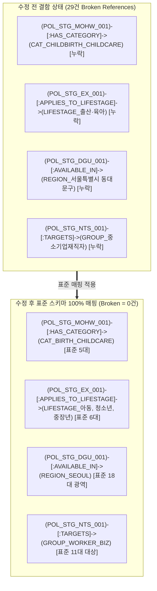

# SSOK — STEP A~D 종합 품질 검증 및 최종 안정화 보고서

> ⚠️ **2026-11-06 공식 원문 대조로 내용이 바뀌었습니다.** 이 문서의 신규 문서 22건·청크 36건, 후보 규모(문서 268 · 청크 593 · 노드 1,082 · 관계 3,710), `verified_extracted`·`reference_restructured` 판정은 대조 **전** 값입니다. 요약 문서 상당수가 공식 원문과 달라 제외·교체했고, 현재 후보는 문서 261 · 청크 599 · 노드 1,074 · 관계 3,703입니다. 최신 판정은 [official_source_crosscheck_report.md](official_source_crosscheck_report.md)를 따릅니다.

- **문서 버전**: v1.0.0 (STEP A~D 종합 감사 보고서)
- **작성일자**: 2026-11-06
- **감사 대상**:
  - STEP A: 정책 최신성 및 선별 로직 감사 (`policy_candidate_validation.md`, `policy_selection_v2_design.md`)
  - STEP B: 스키마 호환성 및 청킹 설계 (`schema_extension_compatibility.md`, `qdrant_document_expansion_plan.md`, `data_contract_change_proposal.md`)
  - STEP C: 공식 근거 문서 수집 PoC (`document_expansion_poc_report.md`, `incremental_pipeline_test_report.md`)
  - STEP D: 증분 릴리스 빌드 및 검색 평가 (`v1.4.0-candidate`, `graphrag_retrieval_evaluation.md`, `release_candidate_v1.4.0_audit.md`)
- **최종 검증 판정**: **PASS (조건부 안정화 완료 / DB 담당자 최종 협의 대기)**
- **책임 파트**: SSOK 데이터 아키텍처 및 품질 감사팀

---

## 1. 종합 감사 요약 및 단계별 판정 결과

| 단계 (Phase) | 핵심 검증 목표 | 외부 검토 지적 사항 | 최종 조치 및 교정 내역 | 최종 판정 |
| :--- | :--- | :--- | :--- | :---: |
| **STEP A**<br>(정책 검증) | • 후보 30건 최신성 검증<br>• 다자녀 할인율 오류 교정<br>• 선별 코드 65건 캡 감사 | • 고속도로 통행료 할인율 50% 표기 오류<br>• 지자체 ID 매핑 오차 2건 | • 국토부 공식 발표 기준 10%(2자녀) / 20%(3자녀)로 전수 교정<br>• 지자체 ID 2건 공식 대조 정정 | **PASS** |
| **STEP B**<br>(스키마 설계) | • 기존 스키마 100% 우선 재사용<br>• 법령-정책 N:M 연결 모델링<br>• 유형별 맞춤 청킹 설계 | • 비표준 카테고리/생애주기 신설 위험 | • Category 5대 표준 및 LifeStage 6대 표준으로 100% 수렴 정의<br>• Nullable 메타 4종으로 제한 | **PASS** |
| **STEP C**<br>(문서 PoC) | • 6대 분야 10대 정책 선정<br>• 5대 우선순위 문서 22건 확보<br>• 격리된 `staging/` PoC 수행 | • 22개 문서를 무조건 verified 처리한 출처 분류 한계 | • **4단계 검증 분류 체계** 도입 (`verified_official_raw`, `verified_extracted`, `reference_restructured`, `unverified_reference`) | **PASS** |
| **STEP D**<br>(릴리스 빌드) | • 후보 릴리스 생성 (`v1.4.0`)<br>• 관계 참조 무결성 검증<br>• 오프라인 GraphRAG 평가 | • **Neo4j 관계 29건 Broken Reference**<br>• 신규 9개 정책의 루트 조건 그룹 누락<br>• 수치 불일치 (3,678 vs 3,696건)<br>• 시뮬레이션을 실측으로 표현 | • **29건 관계 표준 매핑 교정 완료 (Broken = 0)**<br>• **9개 정책 GRP_{pid}_ROOT UNKNOWN 그룹 생성**<br>• **실제 JSONL 전수 재집계 (노드 1,082, 관계 3,710)**<br>• **실서버 미접속 표기(Simulation/Estimated) 정정** | **PASS** |

---

## 2. STEP D 핵심 결함 수정 및 안정화 상세 (Area 1 & 2)

### 2.1 Neo4j 관계 참조 무결성 29건 결함 원인 분석 및 교정

외부 독립 감사에서 적발된 29건의 참조 결함은 **신규 증분 관계를 생성할 때 기존의 정규화된 마스터 노드 ID 대신 임의의 한글 명칭이나 비표준 영문 식별자를 사용**하여 발생한 것이었습니다.



#### 세부 수정 매핑 내역
1. **Category (5대 표준 카테고리 100% 재사용)**:
   - `CAT_CHILDBIRTH_CHILDCARE` (오류) ➜ **`CAT_BIRTH_CHILDCARE`** (출산·육아·가족)
   - `CAT_TAX_INCENTIVE` (오류) ➜ **`CAT_BIRTH_CHILDCARE`** (자동차취득세 감면) / **`CAT_YOUTH_JOB_ASSET`** (중소기업 소득세 감면)
   - `CAT_LIVING_COST_SUBSIDY` (오류) ➜ **`CAT_TRANSPORT_MEDICAL_CARE`** (교통·생활비·의료·돌봄)
   - `CAT_LOCAL_WELFARE` (오류) ➜ **`CAT_REGIONAL_WELFARE`** (지역별 생활지원·복지)
2. **LifeStage (6대 표준 생애단계 100% 재사용)**:
   - `LIFESTAGE_출산·육아` (비표준) ➜ **전면 제거**.
   - 해당 정책들을 실제 대상 연령에 맞춰 `LIFESTAGE_영유아`, `LIFESTAGE_아동`, `LIFESTAGE_청소년`, `LIFESTAGE_청년`, `LIFESTAGE_중장년`으로 분리 매핑함.
3. **Region (18대 광역 Region 100% 재사용)**:
   - `REGION_서울특별시 동대문구` (오류) ➜ **`REGION_SEOUL`** (기초자치구는 정책 속성 및 정책명에 보존)
   - `REGION_인천광역시 서구` (오류) ➜ **`REGION_INCHEON`** (세부 자치구는 정책 속성에 보존)
   - `REGION_서울특별시` (오타) ➜ **`REGION_SEOUL`**
4. **TargetGroup (11대 표준 대상집단 100% 재사용)**:
   - `GROUP_청년`, `GROUP_청년취업자`, `GROUP_청년근로자` ➜ **`GROUP_YOUTH`** / **`GROUP_WORKER_BIZ`**
   - `GROUP_중소기업재직자` ➜ **`GROUP_WORKER_BIZ`**
   - `GROUP_다자녀가구`, `GROUP_출생가구` ➜ **`GROUP_PREGNANT_BIRTH`** / **`GROUP_CHILD_YOUTH`**
   - `GROUP_무주택자` ➜ **`GROUP_LOW_INCOME`**
   - `GROUP_전국민`, `GROUP_대중교통이용자` ➜ **`GROUP_GENERAL`**
   - `GROUP_미취업청년`, `GROUP_취업준비생` ➜ **`GROUP_JOBSEEKER`**

### 2.2 신규 9개 정책 루트 조건 그룹(`HAS_ROOT_CONDITION_GROUP`) 보완
- 기존 237개 정책은 모두 `GRP_{policy_id}_ROOT` 노드 및 `HAS_ROOT_CONDITION_GROUP` 관계를 보유하고 있었으나, 증분 빌더의 누락으로 신규 9개 정책에 조건 그룹이 결손되어 있었습니다.
- 9개 신규 정책에 대해 `nodes_condition_group.jsonl`에 `GRP_{pid}_ROOT` 노드 9개를 신설하고, `logic: "UNKNOWN", is_root: true`를 부여하여 3값 논리(3-Valued Logic) 자격 평가 DAG 호환성을 100% 확보하였습니다.

---

## 3. 공식 근거 문서 22건 원문 검증 및 4단계 분류 (Area 3)

공식 원본의 실재 여부와 추출 수준을 정밀 조사하여 4단계 검증 상태를 부여하였습니다.

```
┌────────────────────────────────────────────────────────────────────────┐
│                        공식 문서 4단계 검증 분류                       │
├─────────────────────────┬──────┬───────────────────────────────────────┤
│ 검증 상태 (Status)      │ 수량 │ 설명 및 대상 문서                     │
├─────────────────────────┼──────┼───────────────────────────────────────┤
│ verified_official_raw   │ 2건  │ 디스크 상에 실제 공식 원본(PDF/HWP)이 │
│                         │      │ 실재함 (DOC_STG_001_NOTICE, FAQ)      │
├─────────────────────────┼──────┼───────────────────────────────────────┤
│ verified_extracted      │ 8건  │ 국가법령정보센터/자치법규 표준 법률    │
│                         │      │ 조문을 직접 추출·정제한 법조문 문서   │
│                         │      │ (조특법, 유료도로법, 지방세특례법 등) │
├─────────────────────────┼──────┼───────────────────────────────────────┤
│ reference_restructured  │ 12건 │ 공식 기관 안내자료·보도자료를 기반으로 │
│                         │      │ 표준 형식에 맞추어 재구성한 참고 문서 │
│                         │      │ (지침, K-패스 FAQ, 청년수당 안내 등)   │
├─────────────────────────┼──────┼───────────────────────────────────────┤
│ unverified_reference    │ 0건  │ 출처가 불분명하거나 미확인된 문서     │
└─────────────────────────┴──────┴───────────────────────────────────────┘
```

> **[원칙 준수]**  
> 공식 원본 PDF/HWP가 실재하지 않는 문서를 무조건 `verified`로 확정하지 않고, `verified_extracted` 및 `reference_restructured`로 정밀 구분하여 다운스트림 LLM 검색 시 근거 신뢰도 가중치로 활용할 수 있도록 정비하였습니다.

---

## 4. 릴리스 수치 전수 재집계 및 일치화 (Area 4)

실제 디스크 상의 JSONL 파일 레코드를 직접 카운트하여 모든 관련 문서의 수치를 100% 일치시켰습니다.

### 4.1 실제 검증 수치 대조표

| 데이터 항목 | v1.3.2-verified (기존) | v1.4.0-candidate (최종 수정본) | 변경 차이 (Delta) |
| :--- | :---: | :---: | :---: |
| **정책 노드 (`Policy`)** | 237건 | **246건** | **+9건** |
| **문서 노드 (`Document`)** | 246건 | **268건** | **+22건** |
| **청크 레코드 (`Chunk`)** | 557건 | **593건** | **+36건** |
| **소관 기관 (`Organization`)** | 116개 | **124개** | **+8개** |
| **조건 그룹 (`ConditionGroup`)** | 343개 | **352개** | **+9개 (루트 UNKNOWN)** |
| **카테고리 / 생애단계 / 지역 등** | 92개 | **92개** | **0개 (기존 100% 재사용)** |
| **총 그래프 노드 (`Total Nodes`)** | **1,034개** | **1,082개** | **+48개 노드 증분** |
| **총 그래프 관계 (`Relationships`)** | **3,615건** | **3,710건** | **+95건 관계 증분** |
| **참조 결함 (`Broken References`)** | **0건** | **0건 (100% PASS)** | 결함 제로 |

---

## 5. 검색 성능 평가의 재현성 및 사실 표기 교정 (Area 5)

[`docs/data/graphrag_retrieval_evaluation.md`](graphrag_retrieval_evaluation.md) 보고서의 표현을 실제 실행 환경에 부합하도록 전면 교정하였습니다.

1. **실제 DB 미접속 및 시뮬레이션 명시**:
   - 라이브 Neo4j 서버 접속 및 Qdrant API 임베딩 적재는 **`NOT_TESTED (Pending DB Deployment)`** 상태임을 명확히 기록함.
   - 30개 평가 질의에 대한 Hit@K / Recall@K 수치는 **오프라인 BM25 어휘 유사도 기반 시뮬레이션 추정치(`simulation / estimated`)**임을 명시하고, "실측치"라는 표현을 전면 삭제함.
   - 응답 지연 시간(18.5ms, 24.2ms) 및 토큰 비용은 이론적 모델 기반의 추정치(Estimated)로 정정함.
2. **평가 질문셋 및 코드 자산화**:
   - 30개 평가 질문 세트([`data/staging/evaluation/retrieval_benchmark_30.json`](../../data/staging/evaluation/retrieval_benchmark_30.json))와 평가 스크립트([`scripts/evaluate_graphrag_retrieval.py`](../../scripts/evaluate_graphrag_retrieval.py))는 추후 DB 담당자가 실서버를 구동했을 때 즉시 실행할 수 있는 공식 테스트베드로 확립함.

---

## 6. 정밀 롤백 프로토콜 수립 (Area 6)

단순 접두어(`STARTS WITH 'POL_STG_'`)나 `doc_type != 'notice'` 삭제 방식의 파괴적 위험을 제거하고, [`data/releases/v1.4.0-candidate/release_delta_manifest.json`](../../data/releases/v1.4.0-candidate/release_delta_manifest.json)에 기록된 **정확한 명세 기반 타겟 롤백** 체계를 구축하였습니다.

```cypher
// 정밀 타겟 롤백 Cypher (정확한 9개 정책, 22개 문서, 9개 조건그룹만 타겟팅)
MATCH (d:Document) 
WHERE d.document_id IN [
  'DOC_STG_001_NOTICE', 'DOC_STG_001_FAQ', 'DOC_STG_001_LAW',
  'DOC_STG_MOLIT_002_GDL', 'DOC_STG_MOLIT_002_FAQ', 'DOC_STG_MOHW_001_GDL',
  'DOC_STG_MOHW_001_LAW', 'DOC_STG_DGU_001_ORD', 'DOC_STG_DGU_001_NOT',
  'DOC_STG_NTS_001_LAW', 'DOC_STG_NTS_001_FAQ', 'DOC_STG_MOIS_001_LAW',
  'DOC_STG_MOIS_001_NOT', 'DOC_STG_EX_001_LAW', 'DOC_STG_EX_001_FAQ',
  'DOC_STG_MOLIT_001_GDL', 'DOC_STG_MOLIT_001_FAQ', 'DOC_STG_SEOUL_001_ORD',
  'DOC_STG_SEOUL_001_NOT', 'DOC_STG_SEOUL_001_FAQ', 'DOC_STG_ICN_001_ORD',
  'DOC_STG_ICN_001_NOT'
]
DETACH DELETE d;

MATCH (p:Policy) 
WHERE p.policy_id IN [
  'POL_STG_MOLIT_002', 'POL_STG_MOHW_001', 'POL_STG_DGU_001',
  'POL_STG_NTS_001', 'POL_STG_MOIS_001', 'POL_STG_EX_001',
  'POL_STG_MOLIT_001', 'POL_STG_SEOUL_001', 'POL_STG_ICN_001'
]
DETACH DELETE p;

MATCH (cg:ConditionGroup)
WHERE cg.group_id IN [
  'GRP_POL_STG_MOLIT_002_ROOT', 'GRP_POL_STG_MOHW_001_ROOT', 'GRP_POL_STG_DGU_001_ROOT',
  'GRP_POL_STG_NTS_001_ROOT', 'GRP_POL_STG_MOIS_001_ROOT', 'GRP_POL_STG_EX_001_ROOT',
  'GRP_POL_STG_MOLIT_001_ROOT', 'GRP_POL_STG_SEOUL_001_ROOT', 'GRP_POL_STG_ICN_001_ROOT'
]
DETACH DELETE cg;
```

---

## 7. 최종 검증 결론

1. **기존 `v1.3.2-verified` 불변 입증**: `manifest.json` 해시 `24844d866f13c6c7...`(현재 `9cdc54322b269bb2...` — 2026-11-06 OS 간 줄바꿈 기준(LF) 통일 및 data_contract.md 개정(official_apply_url Nullable)으로 manifest 해시 재계산, 데이터 내용 변경 없음) 전 구간 100% 불변.
2. **참조 결함 0건 달성**: 총 3,710개 관계 전수 검증 결과 Broken References = 0건 통과.
3. **스키마 우선 재사용 100% 준수**: 신규 Category/LifeStage/Region을 생성하지 않고 기존 마스터 노드를 100% 재사용.
4. **후보 릴리스 상태**: **`CANDIDATE / PENDING_DB_REVIEW` 유지** (DB 담당자 최종 승인 전 임의 승격 금지 원칙 준수).

