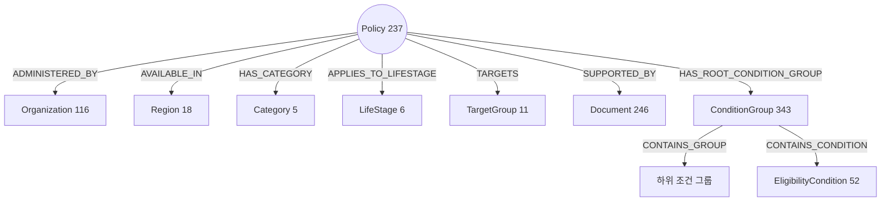
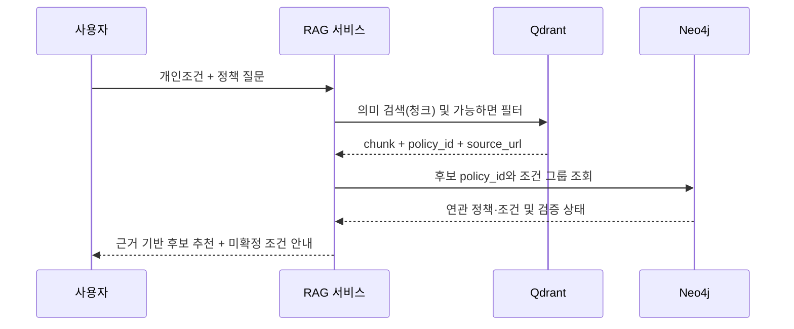

# SSOK — 주민혁 님 DB 구축·적재 기술 인계서

> **수신:** 주민혁 님 (Neo4j / Qdrant 담당)  
> **자료 기준:** 2026-11-05 최종 `data(6).zip`, 인계 manifest `v1.3.2`  
> **상태:** 파일 단위 인계 준비 완료 / **라이브 DB 적재는 NOT_TESTED**  
> **이 문서 역할:** 데이터 계약과 실제 적재 순서를 빠르게 파악하기 위한 기술 인계 요약. 상세 규격의 기준은 `data/handoff/data_contract.md`와 프로젝트의 `docs/data/db_schema.md`(별도 존재 시)입니다.

## 0. 인수 시점에서 확정 / 미확정

| 분류 | 항목 | 상태 |
|---|---|---|
| 확정 | Policy 237 / Document 246 / Chunk 557 | 최신 파일 기준 |
| 확정 | Neo4j 노드 1,034 / 관계 3,615 | JSONL 실파일 집계 |
| 확정 | `LifeStage` 레이블, `ConditionGroup` 구조 | 실제 노드 파일 확인 |
| 확정 | Qdrant Point ID = UUIDv5(`NAMESPACE_DNS`, `chunk_id`) | 557개 파일 검증 결과 |
| 파일 검사 | 관계 참조 무결성·체크섬 | 관계 참조 누락 0건. 체크섬은 현재 파일 기준 재검증. 원본 246개는 별도 배치 필요 |
| 미확정 | 임베딩 모델 및 컬렉션 벡터 차원 | **담당자 결정 필요** |
| 미실행 | Neo4j 실서버 적재·Qdrant 임베딩 색인·실검색 | **NOT_TESTED** |

## 1. 인계 파일 구조

```text
data/handoff/
├─ README.md
├─ data_contract.md
├─ manifest.json
├─ neo4j/
│  ├─ nodes_policy.jsonl                 (237)
│  ├─ nodes_document.jsonl               (246)
│  ├─ nodes_organization.jsonl           (116)
│  ├─ nodes_region.jsonl                 (18)
│  ├─ nodes_category.jsonl               (5)
│  ├─ nodes_lifestage.jsonl              (6)
│  ├─ nodes_target_group.jsonl           (11)
│  ├─ nodes_condition_group.jsonl        (343)
│  ├─ nodes_eligibility_condition.jsonl  (52)
│  ├─ relationships.jsonl                (3,615)
│  ├─ cypher_ddl.cypher
│  ├─ load_neo4j.py
│  └─ verify_neo4j.cypher
└─ qdrant/
   ├─ payload_chunks.jsonl              (557)
   └─ collection_config.json
```

> `data(6).zip`에는 인계용 `data/`만 포함됩니다. 별도 프로젝트 문서인 `docs/data/db_schema.md`, `docs/data/data_schema.md`가 존재한다면 함께 받아야 합니다. 예전 `data/reports/collection_summary.md`의 555청크·2,118관계는 **최종 인계값이 아닙니다**.

## 2. Neo4j 노드 구성

| 노드 파일(`nodes_*.jsonl`) | 건수 |
|---|---:|
| `category` | 5 |
| `condition_group` | 343 |
| `document` | 246 |
| `eligibility_condition` | 52 |
| `lifestage` | 6 |
| `organization` | 116 |
| `policy` | 237 |
| `region` | 18 |
| `target_group` | 11 |
| **합계** | **1,034** |

### 관계 종류별 최종 수량

| 관계 | 건수 |
|---|---:|
| `REQUIRES_CONDITION` | 735 |
| `CONTAINS_CONDITION` | 735 |
| `TARGETS` | 424 |
| `APPLIES_TO_LIFESTAGE` | 419 |
| `SUPPORTED_BY` | 246 |
| `AVAILABLE_IN` | 238 |
| `ADMINISTERED_BY` | 237 |
| `HAS_CATEGORY` | 237 |
| `HAS_ROOT_CONDITION_GROUP` | 237 |
| `CONTAINS_GROUP` | 106 |
| `MODIFIES_CONDITION_OF` | 1 |
| **합계** | **3,615** |

### Graph 구조도



**조건 그룹 논리 분포:** AND **82** / OR **105** / NOT **1** / UNKNOWN **155** (총 343).

- `AND`: 확인된 모든 하위 조건 필요
- `OR`: 확인된 하위 대안 중 하나 이상
- `NOT`: 하위 조건을 부정
- `UNKNOWN`: 원천 조건 논리 불명확. 적격 확정 금지; 상세 공고 확인 필요
- 생애단계는 `LifeStage`만 사용. `LifeCycle` 동의어 레이블을 생성하지 않음.
- `REQUIRES_CONDITION`은 직접 탐색을 위한 엣지, `HAS_ROOT_CONDITION_GROUP`/`CONTAINS_*`는 논리 평가를 위한 계층 구조이므로 용도를 구분해야 함.

## 3. 적재 순서 — Neo4j

1. **깨끗한 개발 DB**를 준비하고 버전·접속 정보·자격증명은 로컬 환경변수로 관리. 운영 DB에 먼저 적재하지 않음.
2. `data/handoff/manifest.json`의 파일 크기·SHA-256을 확인하고, ZIP을 프로젝트 루트에 풀었을 때 상대 경로가 유지되는지 확인.
3. `data/handoff/neo4j/cypher_ddl.cypher`의 **13개 DDL**(고유성 제약조건 9개·인덱스 4개) 실행 또는 로더의 DDL 단계 사용.
4. **9개 노드 파일 먼저 적재**하고 라벨별 건수를 확인.
5. `relationships.jsonl`의 **3,615개 관계**를 적재. 관계 source_id/target_id를 기존 노드 고유 키와 매칭. 없는 노드를 무조건 생성하는 방식은 금지.
6. `verify_neo4j.cypher` 및 자체 쿼리로 노드·관계 수, 타입별 건수, orphan, 누락 및 재실행 결과 점검.

### 제공 로더

```bash
# 프로젝트 루트에서 실행한다고 가정, Python 의존성 및 접속 환경변수 사전 설정
cd data/handoff/neo4j
python load_neo4j.py
```

**주의:** 이는 제공된 로더의 진입 명령 예시이며, 실제 Neo4j 서버 연결/적재 테스트는 아직 실행되지 않았습니다. 실행 전 상단 import, 환경변수, Python 패키지 및 현재 DB 상태를 점검하세요. 예상 건수는 **빈 개발 DB** 기준입니다.

### 필수 검증 Cypher 예시

```cypher
// 라벨별 전체 노드 수
MATCH (n)
RETURN labels(n) AS labels, count(*) AS count
ORDER BY count DESC;

// 관계 유형별 건수
MATCH ()-[r]->()
RETURN type(r) AS relationship_type, count(*) AS count
ORDER BY count DESC;

// 정책별 루트 조건 그룹 존재 확인: 결과 0건 기대
MATCH (p:Policy)
WHERE NOT EXISTS { MATCH (p)-[:HAS_ROOT_CONDITION_GROUP]->(:ConditionGroup) }
RETURN p.policy_id;

// 전체 수량 확인 (빈 DB에 1회 적재한 경우)
MATCH (n) RETURN count(n) AS total_nodes;  // 1034 기대
MATCH ()-[r]->() RETURN count(r) AS total_relationships; // 3615 기대
```

별도 순서·하위 그룹의 관계 방향 및 필수 제약조건은 `data_contract.md`, `cypher_ddl.cypher`를 기준으로 해석하세요.

## 4. Qdrant 컬렉션 설계 및 적재

- 컬렉션 이름: **`lifepolicy_chunks`**
- 벡터 거리: **Cosine**
- 벡터 차원: **미확정(`size: null`)**. 실제 모델 선택 결과로 채워야 함.
- `payload_chunks.jsonl`: **557개** JSONL. 메타데이터와 `text` 제공; **벡터 값은 포함되지 않으므로 임베딩 생성 필요**.
- 포인트 ID: `UUIDv5(NAMESPACE_DNS, chunk_id)`로 결정론적 생성. 서버에 같은 ID로 upsert 시 기존 포인트를 갱신 가능.
- 주요 Payload: `point_id`, `chunk_id`, `policy_id`, `document_id`, `policy_name`, `category`, `region`, `life_stages`, `target_groups`, `eligibility_attributes`, `text`, `source_url`, `verification_status` 등.
- Payload 필터 인덱스 제안: `policy_id`, `category`, `region`, `life_stages`, `target_groups`, `verification_status` (실제 설정 `collection_config.json` 참고).

### 임베딩 모델 선택 후 순서

1. 한국어 정책 문서에 적합한 임베딩 모델 선택 후 벡터 차원 결정. 예: BGE-M3 1,024 / `text-embedding-3-small` 1,536 (예시이지 확정이 아님).
2. 실제 임베딩 벡터 길이가 컬렉션 `size`와 일치하는지 테스트.
3. 컬렉션 생성 및 Payload 인덱스 구성.
4. 각 `text`를 임베딩해 원본 `point_id`와 payload로 upsert.
5. 업로드된 Point 개수 **557개** 확인, 필터 검색 및 샘플 의미 검색.
6. 이후에도 **Neo4j `Policy.policy_id` = Qdrant `payload.policy_id`** 유지.

### 권장 검증 코드 패턴 (예시)

```python
import json
from pathlib import Path
from uuid import NAMESPACE_DNS, uuid5

path = Path("data/handoff/qdrant/payload_chunks.jsonl")
rows = [json.loads(s) for s in path.read_text(encoding="utf-8").splitlines() if s.strip()]
assert len(rows) == 557
assert len({r["point_id"] for r in rows}) == 557
assert all(r["point_id"] == str(uuid5(NAMESPACE_DNS, r["chunk_id"])) for r in rows)
assert all(r["policy_id"] and r["document_id"] and r["text"] for r in rows)
```

## 5. 데이터 계약 핵심 요약

- `Policy.policy_id`는 `POL_*`, `Document.document_id`는 `DOC_*` 형식.
- `Chunk.chunk_id`는 `DOC_*_C*` 또는 `DOC_*_P*_C*` 등 계약 규칙 준수; Qdrant `point_id`는 **UUIDv5**.
- 공식 API `official_id`는 내부 `policy_id`와 **다른 식별자**. 다른 기관에서 정책명이 같다는 이유만으로 자동 통합 금지.
- 신청 자격 평가 시 **TRUE/FALSE/UNKNOWN**을 구분. 텍스트 원문에서 복합논리를 추론해 사실처럼 저장하지 않음.
- `life_stages`는 다중 태그이며 `unknown`은 미확정 표시. 신혼·임신·저소득 등은 별도의 자격/대상 속성.
- `verification_status`: 실제 통합 정책은 `verified` **21건**, `extracted` **216건**. 추출 상태와 공식 조건 검증을 구별.
- `source_url`, `document_id`, `verification_status`를 검색 결과에 연결하여 답변 근거를 표기할 수 있게 유지.

## 6. 검색/RAG 담당과 통합 시 연결 방식



**검색 설계 주의:** 지역·생애주기 태그는 후보 발굴 필터에 유용하지만, 조건이 미기재된 정책을 모두 탈락시키는 강한 필터는 재현율을 낮출 수 있습니다. `UNKNOWN` 정책을 최종 적격자로 확정해서도 안 됩니다. 문서의 예시 코드가 실제 정책의 적격 판정 로직을 완성해 주는 것은 아닙니다.

## 7. 민혁 님 인수 체크리스트

- [ ] `data/handoff/` 전체 및 공식 `docs/data/` 설계 문서 인수
- [ ] ZIP과 매니페스트 체크섬 확인
- [ ] Neo4j 개발 DB 연결/버전 확인
- [ ] DDL 13개 실행 및 제약조건 확인
- [ ] 노드 1,034개 적재 후 라벨별 수치 검증
- [ ] 관계 3,615개 적재 후 관계 타입별 수치 검증
- [ ] 멱등 재실행으로 중복 생성 여부 확인
- [ ] `ConditionGroup` AND/OR/NOT/UNKNOWN 샘플 테스트
- [ ] 임베딩 모델 및 차원 확정
- [ ] Qdrant Point 557개 임베딩·업로드·검증
- [ ] Qdrant Payload 필터 및 한국어 의미 검색 테스트
- [ ] Neo4j 정책 ID와 Qdrant Payload ID 조인 검증
- [ ] 인프라·적재 테스트 결과를 PASS/FAIL/NOT_TESTED로 기록
- [ ] 문제 발견 시 데이터 담당자에게 정책 ID·문서 ID·재현 로그와 함께 공유

## 8. 인계 후 남은 이슈와 적용 경계

1. **복지서비스 상세 조회 미수집분:** 목록 461건 중 상세 99건만 확보. 남은 362건 추가 수집 가능.
2. **실행 환경 미확정:** Neo4j와 Qdrant 실제 버전·접속 정보·임베딩 모델을 담당자가 정해야 합니다.
3. **신청 기간·정책 최신성:** 일부 정책은 특정 시점의 공고문을 근거로 함. 사용자에게 현재 신청 가능 여부를 알릴 때에는 마감·개정 여부 재검증 필수.
4. **자격 조건 의미적 정확성:** 데이터 참조 무결성 100%와 모든 정책의 자격 조건 정확성은 별개.
5. **문서 스코프:** 사용자 지정 Notion 링크는 연결된 Notion에서 `NOT_FOUND`로 확인 불가. 문서의 항목은 최신 인계 패키지 기준이며 Notion 산출물 페이지 양식과의 일치 여부는 미확인.
6. **과거 보고서 수치 유의:** `collection_summary.md`의 초기 수치(555/2,118 등)는 최종 인계용 557/3,615로 대체하여 이해할 것.

## 9. 필수 참고 자료

- `data/handoff/README.md`: 원본 DB 인계 가이드
- `data/handoff/data_contract.md`: 정식 ID/필드/상태 데이터 계약
- `data/handoff/neo4j/load_neo4j.py`, `cypher_ddl.cypher`, `verify_neo4j.cypher`
- `data/handoff/qdrant/collection_config.json`, `payload_chunks.jsonl`
- `data/handoff/manifest.json`: manifest `v1.3.2` / SHA-256 `9cdc54322b269bb245f9d0a99602171bf0937087ca57ee11432b5c778378bb85` (2026-11-06 OS 간 줄바꿈 기준(LF) 통일 및 data_contract.md 개정(official_apply_url Nullable)으로 manifest 해시 재계산, 데이터 내용 변경 없음) (2026-11-05 문서 정합성 수정 후 파일 크기·체크섬 갱신, 데이터 내용 변경 없음)
- `data/reports/lifecycle_distribution_report.md`: 생애주기 상세 분석

**인계 판정:** 정제·인계 파일 준비 및 관계 참조 검사는 통과. 현재 로컬은 참조 원본 246개가 없어 전체 검증은 실패합니다. `data/handoff/README.md` §7에 따라 원본을 별도 배치하고 재검증해야 합니다. 실제 DB 적재·임베딩 검증은 NOT_TESTED이며 인수 담당자가 환경·실행 시점·결과를 기록합니다.
