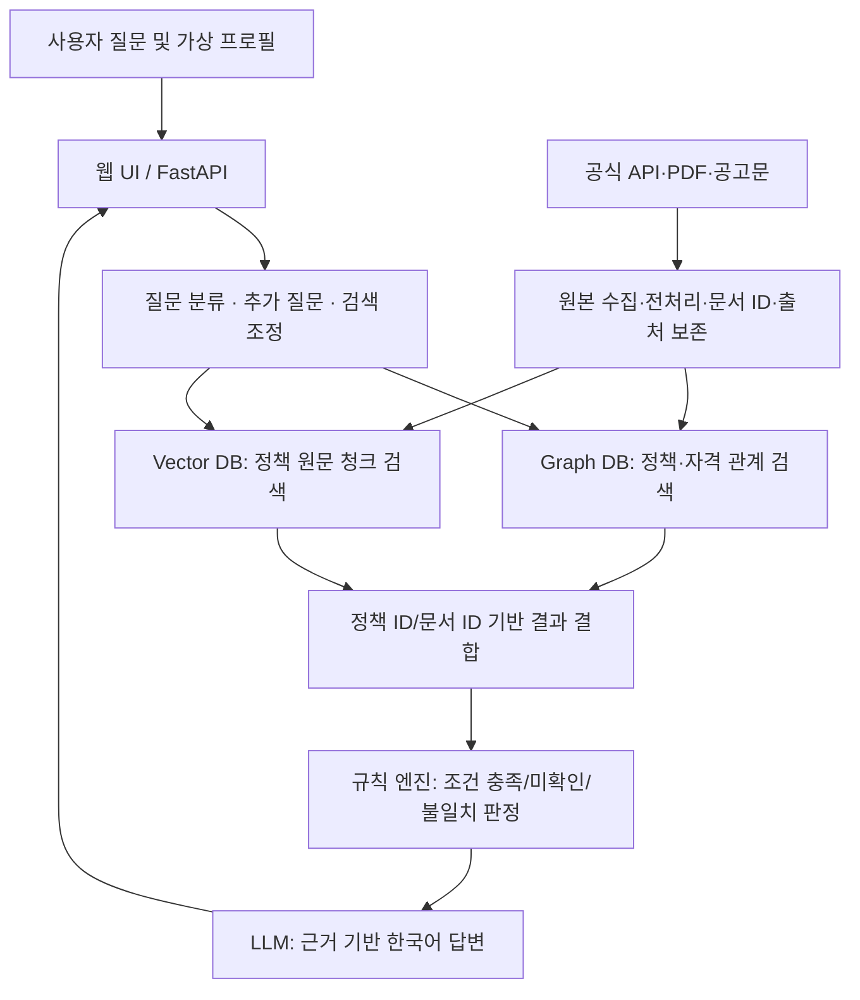

# LifePolicy AI — 생애주기 맞춤형 지원 정책 질의응답 서비스

> **팀 공유용 PRD v1.0 / 초안**  
> 작성 기준일: 2026-11-04 (KST)  
> 교과목: LLM  
> 프로젝트 주제: LLM을 연동한 내·외부 문서 기반 질의응답 시스템  
> 원본 일정 및 역할: [Notion WBS · 일정 관리](https://app.notion.com/p/40e8fc09deb980508fb7c9130e25017c)  
> 문서 상태: **검토 필요** — 아래 '미확정 사항'은 회의에서 확정 후 변경 이력 기록

---

## 1. 프로젝트 한눈에 보기

### 1.1 서비스 정의

사용자가 나이, 거주 지역, 소득 및 취업·혼인·가구 상태 등을 입력하면 공식 정책 자료를 바탕으로 관련 정부·지자체 지원 정책을 검색하고, **자격 충족 여부와 추가 확인 사항을 구분**하여 신청 절차·필요 서류·공식 링크·근거 출처를 제시하는 한국어 RAG 질의응답 서비스.

**핵심 가치:** 정책을 여러 사이트에서 직접 찾는 부담을 줄이고, “나에게 관련 있는 정책과 그 이유”를 출처와 함께 이해하도록 돕는다.

### 1.2 해결할 문제

- 정책이 기관별로 분산되어 있고 정책명·자격 조건을 이해하기 어렵다.
- 일반 검색이나 범용 챗봇은 최신 공고·신청 기간·제외 조건을 정확히 반영하지 못할 수 있다.
- 사용자별 연령·지역·가구 조건과 정책 문서의 복잡한 조건을 연결하기 어렵다.

### 1.3 성공 기준 (2026-11-08 개발 목표)

1. 실제 확보한 공식 원문으로 질문 → 관련 문서 검색 → LLM 답변 → UI 출처 표시까지 동작.
2. **Graph DB와 Vector DB 두 종류가 각각 독립적인 실질 기능**을 수행하며 공통 ID로 연결됨.
3. 시연 질문 10개에서 기대 근거·출처 및 '모르는 것은 모른다' 처리 결과를 기록.
4. 시작부터 재실행할 수 있는 수집·전처리·DB 적재·서비스 실행 절차가 문서화됨.
5. 수집 데이터와 전처리 문서, 아키텍처, 소프트웨어, RAG 연동 코드, 테스트 계획·결과 보고서가 확보됨.

> **서비스 성격:** 학습용 MVP. 행정기관의 최종 자격 심사나 법적·금융적 조언을 대체하지 않는다.

---

## 2. 대상 사용자 및 대표 시나리오

| 페르소나 | 상황 | 대표 질문 | 예상 사용자 가치 |
|---|---|---|---|
| 청년 취업준비생 | 29세, 경기도 거주, 구직 중 | “교육비·구직·교통 지원 정책이 있나요?” | 관련 정책·확인할 자격 조건 파악 |
| 신혼 무주택 가구 | 혼인 2년, 무주택 | “신혼부부 임대주택은 어떤 서류가 필요하나요?” | 모집공고의 신청 조건과 서류 안내 |
| 출산·육아 가구 | 영유아 자녀 보유 | “자녀 관련 복지 지원은 어디서 확인하나요?” | 정책 분류 및 공식 신청 경로 안내 |

> **MVP 우선 사용자:** 청년 취업준비생 + 신혼 무주택 가구. 육아·중장년·노후 정책은 데이터 확보 상황에 따라 확장.

### 2.1 사용자 여정

1. 사용자 프로필 입력: 생년월일/연령, 지역, 취업 상태, 혼인 상태, 소득 범위(가능한 최소 정보).
2. 사용자가 자연어로 질문하거나 카테고리를 선택.
3. 정책 후보 조회 및 문서 근거 검색.
4. 조건 판정: `조건상 적합`, `추가 확인 필요`, `조건 불일치`, `접수 대기/마감`을 별도 필드로 제공.
5. AI가 지원 내용·신청 절차·서류·정책 원문을 인용.
6. 부족한 조건은 후속 질문으로 묻고, 사용자는 공식 신청 사이트로 이동.

---

## 3. 범위 관리

### 3.1 필수 MVP (11/08까지)

- [ ] 공식 정책 원문 또는 API 데이터 확보·전처리 및 출처 추적
- [ ] 프로필 기반의 기본 조건 조회(연령·지역·주제 등)
- [ ] Neo4j의 정책-기관-대상-자격요건-출처 관계 저장 및 조회
- [ ] Qdrant의 원문 청크 임베딩·의미 검색
- [ ] 정책/문서 공통 ID를 사용한 Graph + Vector 결합 조회
- [ ] LLM 한국어 답변 + 출처 문서/링크 제시
- [ ] 근거 부재 시 임의 생성 금지, 정보 부족 시 추가 질문
- [ ] 질문 입력/답변/출처/로딩/오류 표시 UI
- [ ] 평가 질문 10개와 결과 기록
- [ ] 필수 산출물 문서화 및 실행 재현성

### 3.2 확장 (시간이 남을 때)

- [ ] 실제 정책 수 확대 및 정기 갱신
- [ ] 사용자 계정 및 프로필 지속 저장
- [ ] 생애주기 이벤트 기반 재추천
- [ ] 정책 신청 마감일·자동차세 등의 알림
- [ ] 관리자 검수 화면 및 정책 변경 감지
- [ ] MCP 외부 도구, Multi-Agent 실험, Fine-tuning 비교

### 3.3 제외 (이번 학습용 MVP)

- 정부 사이트 로그인 대행, 인증 우회, CAPTCHA 해결
- 사용자 동의 없는 신청서 제출·금융 거래·납부 실행
- 실제 소득 증빙/주민등록번호/민감 서류 서버 업로드
- 정책 수급 가능성을 보증하는 '확정 판정'
- 전국 모든 정책의 완전한 수집 및 최신성 보증

**범위 축소 원칙:** 일정 압박 시 알림·자동 갱신·신청 자동화부터 제외하고 **문서 기반 답변·출처·검증**을 우선한다.

---

## 4. 데이터 출처 및 수집 원칙

| 우선 | 출처 | URL | 수집 후보 | 접근/확인 사항 |
|---|---|---|---|---|
| P0 | 온통청년 | https://www.youthcenter.go.kr/cmnFooter/openapiIntro/oaiGuide | 청년 정책 API 및 안내 | 회원가입·인증키·승인·호출 제한 확인 |
| P0 | LH청약플러스 | https://apply.lh.or.kr/ | 신혼·청년 주거 공고 PDF | 실제 상세공고 첨부·정정공고·이용조건 확인 |
| P1 | 복지로 | https://www.bokjiro.go.kr/ | 복지 정책 안내 | 공개 데이터 수집 방식 검증 |
| P1 | 정부24 | https://www.gov.kr/ | 혜택·신청 안내 | 이용 가능한 연계 범위 확인 |
| P2 | 공공데이터포털 | https://www.data.go.kr/ | 기관별 공개 정책 데이터 | 개별 데이터셋/라이선스 검토 |
| P2 | 주택도시기금 | https://nhuf.molit.go.kr/ | 주거대출 안내 | 최신 조건·상품별 원문 확인 |

**실데이터 확보는 완료로 간주하지 않는다:** 링크 확인, API 키 발급, API 호출 성공, 원문 다운로드, 추출 성공을 별도의 상태로 관리.

**MVP 권장량:** 통합 성공을 위한 실제 정책 10~20건 및 관련 원문 청크 우선. 11/07 데이터 확대는 통합 안정성에 따라 결정. 수량은 목표치이며 확보 실적이 아님.

### 4.1 데이터 품질 원칙

- 공식 원문 URL, 수집 일시, 공고/개정 일시, 원본 파일명, 콘텐츠 해시 보존.
- 정책명 동일해도 연도·지역·공고 차이가 있으면 구별.
- 원본(raw)과 정제본(processed)을 분리, 원문 텍스트 임의 요약으로 대체하지 않음.
- 정책 조건 추출은 불확실할 수 있으므로 **검토 상태(`review_status`)**를 둔다.
- 결측값을 임의로 '해당 없음'으로 채우지 않음. `unknown`과 `not_applicable` 구별.
- 표/주석/예외조항/정정공고를 누락하지 않도록 샘플 검수.

---

## 5. 기술 아키텍처

### 5.1 권장 구성

- Frontend: React 기반 웹 UI (최종 선택은 UI 담당 확정)
- Backend: FastAPI/Python
- Workflow: LangGraph(선택) + RAG 체인
- **Graph DB: Neo4j** — 정책 관계/조건/기관/근거 구조화
- **Vector DB: Qdrant** — 정책 원문 청크 임베딩·유사도 검색
- Embedding: 한국어 지원 임베딩 모델(선정 및 차원 DB 담당 확정)
- LLM: 한국어 답변 가능한 API 또는 로컬 모델(LLM 담당 확정)

> Neo4j + Qdrant는 **제안안**이다. WBS는 'Graph DB + Vector DB 2종' 요구만 확인되었으며 제품명은 팀에서 확정해야 한다.

### 5.2 논리 흐름



### 5.3 책임 구분

| 부분 | 책임 | 하지 않는 일 |
|---|---|---|
| Graph DB | 정책과 기관·지역·대상·자격·서류·문서 관계 저장 | 비정형 PDF 전체 의미 검색을 대체하지 않음 |
| Vector DB | 질문과 의미가 유사한 원문 단락 검색 | 자격을 최종 확정하지 않음 |
| 규칙 엔진 | 날짜/연령/지역/수치 등 명시 규칙 판단 | 원문에 없는 예외 규정을 추정하지 않음 |
| LLM | 검색 결과를 이해하기 쉽게 설명하고 부족한 정보를 질문 | 지원 가능성을 보증하거나 정책 내용을 만들어내지 않음 |

---

## 6. 데이터 모델 및 팀 간 계약

### 6.1 ID 및 버전 원칙

- `policy_id`: 정책을 식별하는 내부 고유 ID (같은 정책의 공고 개정은 버전으로 구분)
- `document_id`: 실제 원문 파일/웹 문서 단위 고유 ID
- `chunk_id`: 원문 내 단락 고유 ID (`document_id` + 일관된 순번 또는 해시)
- `source_url`: 사람이 직접 열 수 있는 공식 링크
- `content_hash`: 원문 변경 여부 검증
- `retrieved_at`: 수집 시점 (ISO 8601)

### 6.2 데이터 전달 파일

```text
data/
  raw/                    # 내려받은 원문 원본, 이용약관 범위 내 관리
  processed/
    policies.jsonl        # 정책 기본정보/조건
    documents.jsonl       # 원문 단위 텍스트/출처
    relationships.jsonl   # 정책-대상-기관-조건-문서 관계
    chunks.jsonl          # 청킹 기준 합의 후 선택적으로 제공
  metadata/
    sources.csv           # 출처/접근/라이선스/최신확인
    api_status.csv        # 신청/승인/키 관리 상태 (키 값 저장 금지)
  README.md
```

### 6.3 최소 스키마 (예시 값은 가상)

**policies.jsonl**

```json
{"policy_id":"POL_001","policy_name":"예시 청년 정책","category":"취업·교육","agency":"예시 기관","regions":["경기도"],"requirements":{"min_age":19,"max_age":34,"employment":"unemployed","income_rule":null},"eligibility_review_status":"unverified","application_start":null,"application_end":null,"official_apply_url":null,"source_document_ids":["DOC_001"],"retrieved_at":"2026-11-04T14:00:00+09:00"}
```

**documents.jsonl**

```json
{"document_id":"DOC_001","policy_id":"POL_001","title":"예시 정책 공고","source_type":"pdf","source_url":"https://example.org/notice.pdf","published_at":null,"retrieved_at":"2026-11-04T14:00:00+09:00","content_hash":"EXAMPLE_HASH","text":"원문에서 추출한 텍스트","review_status":"unverified"}
```

**relationships.jsonl**

```json
{"source_id":"POL_001","relation":"SUPPORTED_BY","target_id":"DOC_001","evidence_document_id":"DOC_001","evidence_location":"p.2","review_status":"unverified"}
```

**검색 결과 계약 (DB/검색 담당 ↔ RAG 담당)**

```json
{"query":"신혼부부 임대주택 제출 서류는?","results":[{"policy_id":"POL_001","document_id":"DOC_001","chunk_id":"DOC_001_C003","text":"검색된 원문 단락","source_url":"https://example.org/notice.pdf","page_number":3,"score":0.82}],"eligibility":{"status":"needs_more_info","missing_fields":["household_income"],"failed_conditions":[]}}
```

> 위 JSON은 인터페이스 설계 예시로 실제 정책/검색 결과가 아니다. `score`는 검색 방식별 척도가 다르므로 UI에 확률처럼 표시하지 않는다.

### 6.4 Graph DB 노드·관계 최소안

- 노드: `Policy`, `Agency`, `Region`, `TargetGroup`, `Requirement`, `SourceDocument`, `DocumentType`
- 관계: `ADMINISTERED_BY`, `AVAILABLE_IN`, `TARGETS`, `HAS_REQUIREMENT`, `SUPPORTED_BY`, `REQUIRES_DOCUMENT`
- 모든 `Requirement`는 조건 타입·값·비교연산·기준일·근거문서 위치·검수 상태를 가짐.
- OR/AND 복합 요건은 단순 관계 다중 연결로 해석하지 말고 조건 그룹 속성을 정의하거나 MVP에서는 `needs_more_info`로 보류.

### 6.5 전처리 책임 경계

- **데이터 담당:** 원본 수집, 원문 텍스트 추출, 제목/문단/페이지 보존, 정책 메타데이터 및 조건 후보 추출, 품질·출처 문서화.
- **DB 담당:** 청킹 파라미터 결정·임베딩·DB 적재·재적재·색인 및 검색 접속.
- 원문 청크를 데이터 담당이 먼저 생성할 경우, 버전과 청킹 규칙을 DB 담당과 합의한 뒤 전달.

---

## 7. 기능 요구사항 및 수용 기준

| ID | 요구사항 | 우선 | 수용 기준 |
|---|---|---|---|
| FR-01 | 사용자가 자연어로 정책 관련 질문 | Must | 질문을 입력하면 응답/오류 상태 표시 |
| FR-02 | 가상 프로필 기반 검색 | Must | 최소 연령·지역·상태 값을 입력/전달할 수 있음 |
| FR-03 | Graph 관계 조회 | Must | 질문에 대응하는 정책-조건/기관 관계 조회 결과 확인 |
| FR-04 | Vector 원문 검색 | Must | 관련 원문 청크와 문서 ID·출처 반환 |
| FR-05 | 근거 기반 답변 | Must | 답변 내 원문 링크 및 가능하면 페이지/문단 표시 |
| FR-06 | 추가 질문/근거 없음 | Must | 조건 부족 시 질문, 근거 없음 시 무근거 답변 억제 |
| FR-07 | 신청 절차·서류 안내 | Must | 공식 문서에 있는 경우에만 안내, 없는 경우 확인 필요 명시 |
| FR-08 | 중복·결측/정정공고 관리 | Must | 동일 문서 재수집 및 개정 여부 구별 가능 |
| FR-09 | 정책 상세/카테고리 분류 | Should | 카테고리·담당 기관·링크 표시 |
| FR-10 | 조건 변화 재추천 | Could | 가상 이벤트 변경 후 후보 결과 비교 가능 |
| FR-11 | 일정/세금 알림 | Could | 모의 데이터로 일정 알림 시연 가능 |
| FR-12 | 신청 자동화 | Won't | 이번 MVP 개발하지 않음 |

### 7.1 비기능 요구사항

- **정확성:** 근거 문서가 없으면 정답으로 단정하지 않는다.
- **최신성:** 응답에 수집/확인 시점과 공식 확인 필요성을 노출한다.
- **보안:** 실사용자 개인정보·API 키를 Git에 커밋하지 않는다.
- **재현성:** README만으로 개발 환경·수집 샘플·DB 적재·시연을 복원할 수 있다.
- **추적성:** 정책 ID ↔ 원문 문서 ID ↔ 청크 ID ↔ UI 출처까지 연결 가능하다.
- **운영:** API 승인 지연 시 확보된 공식 PDF와 로컬 정적 데이터로 데모 가능.

---

## 8. 팀 역할 및 협업 — Notion WBS 기준

> 아래 인원/업무는 노션 WBS에서 확인한 배정이다. 동일 인원이 검색·평가와 LLM·RAG에 중복 배정되어 있으므로 **세부 코드 소유권은 추가 합의 필요**.

| 역할 | 담당 | 핵심 소유 업무 | 주요 산출물 |
|---|---|---|---|
| 데이터 / API / README | **장반석** | 원문 링크·API 키 발급 총괄, 데이터 수집·전처리, 출처·건수·방법 기록, README 취합 | **01 수집 데이터 및 전처리 문서**, README |
| 임베딩 / DB | **주민혁** | DB 2종 설계·설치·적재, 임베딩·청킹, 아키텍처 | **02 아키텍처** |
| 검색 / 평가 | **나지인, 박소희** | 평가 질문·정답 근거, 검색·필터, 비교 평가 및 재시험 | **05 테스트 계획 및 결과 보고서** |
| LLM / RAG | **나지인, 박소희** | LLM·프롬프트·RAG 연결, 답변 형식, 근거 없음/오류/후속 질문 | **04 RAG-LLM 및 DB 연동 코드 정리** |
| UI / 운영 / 발표 | **강민지** | UI, 저장소·일정/통합 확인, 실행·시연 및 발표 | **03 개발 소프트웨어 실행·시연 정리**, 발표 자료 |

### 8.1 주요 인수인계

| 보낸 사람 → 받은 사람 | 전달 내용 | 완료 정의 |
|---|---|---|
| 데이터 → DB | `policies/documents/relationships` 및 ID·출처 규칙 | 최소 샘플을 적재하고 재조회 가능 |
| 데이터 → 검색/평가 | 정책별 공식 링크·정답 근거 위치 | 평가 질문의 기대 근거를 찾을 수 있음 |
| DB → 검색/평가 | 그래프·벡터 검색 함수, 점수·메타데이터 | 동일 ID로 결과 결합 가능 |
| 검색/평가 → LLM/RAG | 검색 결과 계약, 점수/근거/필터 | 답변 프롬프트에 연결 가능 |
| LLM/RAG → UI | `answer`, `citations`, `status`, `follow_up_question`, `error` | 정상·추가 질문·근거 없음·오류 UI 시연 |
| 전원 → 데이터 담당 | 설치·실행 및 문서 작성분 | 최종 README 링크/명령 취합 |

---

## 9. 일정 및 마일스톤 — Notion WBS 반영

| 날짜 | 팀 전체 목표 | 데이터 담당 체크포인트 |
|---|---|---|
| **11/03~11/04** | 주제·타깃·역할·원문 수집 가능성 합의 | 원문 후보/공식 링크 조사 |
| **11/05** | API·DB·모델·UI 사전 준비 | API 신청 필요 목록, 원문 확보 시도 |
| **11/06** | 소량 데이터 → DB → 검색 → 답변 → 화면 연결 | 실제 소량 원문 수집·정제, ID·출처 포함 샘플 전달 |
| **11/07** | 기능 구현 및 데이터 확대 | 중복·결측/문단 정리, 산출물 01 전후 건수 기록 |
| **11/08** | **개발 완료 목표** | 누락/출처 점검, 데이터 버전 동결, 산출물 01 초안 |
| **11/09** | 개발 예비일·최종 종료 | 수집/정제 오류, 재적재 대상 전달 |
| **11/10** | 수정·보완·산출물 01~05 완료 | 산출물 01 확정, README 데이터 설명 취합 |
| **11/11** | README/발표자료/시연 리허설 | README 최종 취합, 데이터 관련 Q&A |
| **11/12** | 발표 | 데이터 출처 및 전처리 질의응답 지원 |

> **참고:** WBS 하단에는 '공식 프로젝트 기간 11/11~11/12'라고 표시되어 있고, 실제 개발 계획은 11/03~11/10에 배치되어 있다. 본 문서는 **WBS의 상세 개발 일정**을 따른다.

### 9.1 데이터 담당 선행 작업 (11/04 조기 완료 목표)

- [ ] 공식 정책 원문 링크 직접 확인 및 PDF 다운로드 가능 여부 기록
- [ ] 온통청년 API 가입/키 신청 상태·심사 기간·요금·제한 확인
- [ ] 다른 팀원으로부터 모델/DB API 추가 요청 목록 수령
- [ ] 스키마 및 공통 ID·출처 규칙 합의
- [ ] 실제 정책 원문 소량 확보 → raw 보존 → processed JSONL 생성
- [ ] 샘플 누락/중복 검사, 수집·정제 전후 건수 기록
- [ ] DB·검색·LLM 담당에 버전/사용법/샘플 전달

---

## 10. 테스트 및 평가 전략

### 10.1 평가 질문 범주 (검색·평가 담당 10개 작성)

- 정책 탐색: 청년 취업준비생의 지원 정책 조회
- 정책 조건: 연령/지역 조건 포함 문의
- 신청 방법: 신청 링크, 절차, 서류 질문
- 근거 위치: 특정 모집공고 페이지/항목 참조
- 조건 불충분: 소득·가구원 정보가 없을 때 추가 질문
- 부정 사례: 원문에 없는 정책/서류/기간에 대한 질문
- 개정 사례: 정정공고와 이전 공고의 불일치
- 복합 사례: 주거 + 취업 관련 문의
- 만료 사례: 신청 기간이 지난 공고
- 오류 사례: API·DB 접속 실패 및 화면 상태

### 10.2 수용 테스트

| 항목 | 판정 방식 |
|---|---|
| 수집/정제 | 원문 파일 수, 문서 추출 성공 수, 제외/중복/결측 수와 사유 기록 |
| 그래프 적재 | 정책 노드 수·관계 수·ID 연결 누락 수 확인 |
| 벡터 적재 | 청크 수·임베딩 차원·메타데이터·동일 검색 재현 |
| 검색 | 10개 질문의 정답 원문 검색 성공 여부 및 출처 일치 |
| 답변 | 근거 없는 내용의 생성 여부, 정보 부족 시 질문, 인용 링크 작동 |
| 통합 | 질문 입력 → API → 검색 → LLM → UI 시연 |

**보고 원칙:** 성능 목표와 실제 측정치를 혼동하지 않는다. 미실행·실패·원인 불명 결과도 보고서에 남긴다.

---

## 11. 보안·정책·운영 리스크

| 리스크 | 대응 |
|---|---|
| 정책이 개정됨 | `retrieved_at`, `published_at`, 정정 여부·공식 URL 표시; 데이터 동결 시점 명시 |
| API 승인 지연 | 공식 PDF/HWPX 등 확보 가능한 문서로 독립 데모 구축 |
| PDF 표/주석 추출 실패 | 표/조건 원문 대조, 수작업 검수 대상 분리 |
| 복합 자격 조건 오류 | 규칙 단순화 범위 명시, 미검증 판정은 `needs_more_info` |
| 비공개 API 키 유출 | `.env`, `.gitignore`, 비밀정보 별도 채널 공유; Git 커밋 금지 |
| 개인정보 유출 | 허구/가상 프로필 사용, 실사용자 민감 서류 수집 제외 |
| Graph·Vector 불일치 | 공통 ID, 데이터 버전, 적재 검증 스크립트 사용 |
| 팀 간 통합 지연 | JSONL 및 검색/응답 계약 조기 확정, 샘플 먼저 전달 |
| 신청/수급 오인 | 공식 신청 안내 링크 제공 및 최종 판단은 담당 기관 확인 명시 |

---

## 12. 교과목 산출물 매핑

| 번호 | 산출물 | 담당 | 포함 내용 |
|---|---|---|---|
| **01** | 수집 데이터 및 전처리 문서 | 장반석 | 출처, 원문/정제, 전처리 규칙, 전후 건수, 데이터 사전, 한계 |
| **02** | 시스템 아키텍처 | 주민혁 | Graph·Vector 구성, DB 스키마, 데이터 흐름, 재현 방법 |
| **03** | 개발 소프트웨어 | 강민지 | 실행·UI·시연·설치·구현 범위 |
| **04** | RAG-LLM / DB 연동 구현 코드 | 나지인·박소희 | 검색→LLM 프롬프트→답변/출처, 모델·설정·코드 설명 |
| **05** | 테스트 계획 및 결과 보고서 | 나지인·박소희 | 10개 질문·기대 근거, 검색/생성 결과, 실패/개선/재시험 |

---

## 13. 지금 팀이 확정해야 할 결정 사항

> 문서 작성을 막는 항목은 아니지만, **개발 전에 합의해야 연동 비용이 줄어드는 항목**이다.

| ID | 결정 | 권장 기본안 | 결정 책임/시점 |
|---|---|---|---|
| D-01 | 필수 정책 범위 | 청년·신혼/주거 중심, 실데이터 10~20건부터 | 전체 / 11/04~05 |
| D-02 | DB 제품 | Neo4j + Qdrant | DB 담당 / 11/05 |
| D-03 | 공통 식별자·파일 스키마 | `policy_id`, `document_id`, `chunk_id`, 출처 URL, JSONL | 데이터+DB+검색 / 즉시 |
| D-04 | 청킹 책임/모델·차원 | 데이터는 원문/페이지 보존, DB 담당 청킹·임베딩 | 데이터+DB / 11/05 |
| D-05 | Graph 자격 판정 범위 | 연령·지역·기본 상태만 규칙화, 복잡한 조건은 추가 확인 | DB+검색+LLM / 11/05 |
| D-06 | LLM/API 선택·예산 | 기한 내 접근 가능한 모델 1종 및 예산 상한 | LLM 담당+데이터 / 11/05 |
| D-07 | 결과 전달 계약 | `answer`, `citations`, `status`, `follow_up_question`, `error` | LLM+UI / 11/05 |
| D-08 | 담당 세부 분할 | 검색·평가와 LLM·RAG의 코드 소유권 구체화 | 나지인·박소희 / 11/05 |
| D-09 | 외부 문서 저장·배포 조건 | 이용 가능 범위만 저장·공유, 원문 링크 우선 | 데이터+운영 / 수집 전 |
| D-10 | MVP 인증/계정 | 가상 프로필 기반 무로그인 데모 | 전체 / 11/05 |

---

## 14. 변경 이력 및 출처

### 변경 이력

| 버전 | 날짜 | 변경 내용 |
|---|---|---|
| v1.0 | 2026-11-04 | 서비스 요구사항·Graph/Vector 설계·Notion WBS 역할 및 일정 통합 초안 |

### 참고 원문

- [Notion 팀 WBS 및 역할 분담](https://app.notion.com/p/40e8fc09deb980508fb7c9130e25017c)
- [온통청년 공식 사이트](https://www.youthcenter.go.kr/)
- [온통청년 Open API 안내](https://www.youthcenter.go.kr/cmnFooter/openapiIntro/oaiGuide)
- [LH청약플러스](https://apply.lh.or.kr/)
- [복지로](https://www.bokjiro.go.kr/)
- [정부24](https://www.gov.kr/)
- [공공데이터포털](https://www.data.go.kr/)
- [주택도시기금](https://nhuf.molit.go.kr/)

> 이 PRD에 기재한 정책명·스키마 예시·목표 데이터 수는 기획안이며, 실제 확보된 데이터나 확정된 기관별 이용 권한으로 간주하지 않는다.
