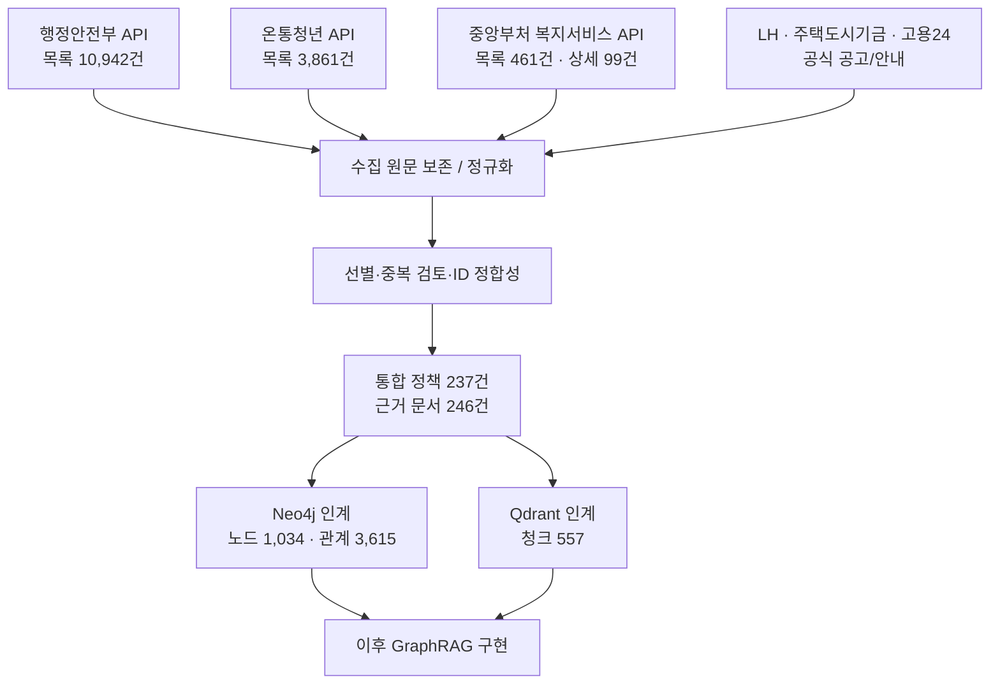
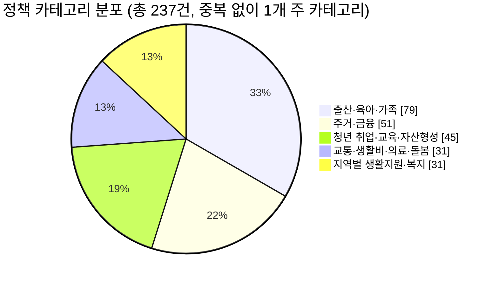
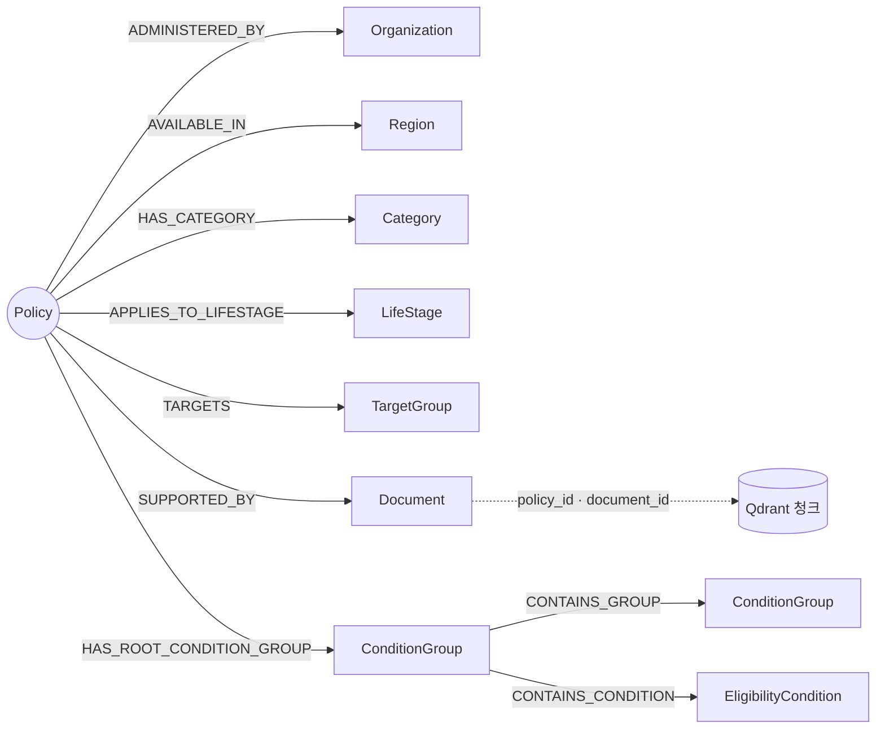

# LifePolicy AI — 데이터 파트 완료 및 팀 공유 보고서

> **현재 로컬 재검증 안내 (2026-11-05):** 아래 수집·검증 실적은 기존 보고 기록입니다. 현재 로컬에서는 참조 원본 246개가 없어 최종 인계 검증이 실패합니다. 정제·인계 파일 준비와 원본 확보·DB 실적재는 구분합니다. 원본 별도 전달·복원 및 재검증 절차는 `data/handoff/README.md` §7을 따릅니다.

> **공유 대상:** LifePolicy AI 프로젝트 전체 팀  
> **기준:** 2026-11-05 · 최종 전달본 `data(6).zip` · handoff manifest `v1.3.2`  
> **작성 범위:** 프로젝트의 데이터 수집·정제·Graph/Vector 인계 준비 완료 현황  
> **주의:** 아래 숫자는 **최신 인계 파일 직접 집계값**을 기준으로 하며, 수집 보고서 일부에 남은 과거 수치와 구별합니다.

## 1. 한눈에 보는 결과

| 지표 | 완료 수량 | 의미 |
|---|---:|---|
| 통합 정책 | **237건** | GraphRAG MVP에 사용할 선별·통합 정책 |
| 근거 문서 | **246건** | 정책별 공식 원문·설명 문서 |
| Qdrant 검색 청크 | **557건** | 임베딩 생성 대상 텍스트 |
| Neo4j 노드 | **1,034개** | 정책·기관·지역·조건 등 9종 |
| Neo4j 관계 | **3,615개** | 정책 연결 및 조건 그룹 관계 |
| 관계 양 끝 참조 누락 | **0건** | 파일 단위 참조 무결성 검사 |
| 정책 검증 상태 | 검증 완료 **21건**, 추출 **216건** | `extracted`는 신청 자격의 수동 검증 완료가 아님 |

**상태 판단:** 데이터팀의 STEP 1~3 산출물을 DB 담당자에게 **인계할 준비가 끝났습니다.** 단, 실제 Neo4j·Qdrant 서버 적재, 임베딩 생성, 검색 성능 평가, 공식 요건의 의미적 확인은 후속 작업입니다.

## 2. 공식 데이터 수집 범위와 최종 사용 범위

| 출처 | 원천 수집 현황 | 통합 237건 중 반영 |
|---|---:|---:|
| 행정안전부 공공서비스(혜택) | 목록 **10,942건** | **65건** |
| 온통청년 청년정책 | 목록 **3,861건** | **65건** |
| 한국사회보장정보원 중앙부처복지서비스 | 목록 **461건**, 상세 **99건** | **98건** |
| 기존 LH·주택도시기금·고용24 등 | 개별 공식 공고·안내 자료 | **9건** |
| **합계** | **API 목록 15,264건**(기관별 단순 합, 중복 제거 전) | **237건** |

> 데이터가 15,264건 전부 DB에 들어간다는 뜻은 아닙니다. 현재 실제 GraphRAG 인계용은 **237개 정책**입니다. 복지서비스의 목록 중 상세 미확보분 **362건**은 확장 수집 후보입니다.

### 데이터 처리 흐름

## 3. 정책 카테고리 구성

| 카테고리 | 정책 수 | 구성비 |
|---|---:|---:|
| 출산·육아·가족 | 79 | 33.3% |
| 주거·금융 | 51 | 21.5% |
| 청년 취업·교육·자산형성 | 45 | 19.0% |
| 교통·생활비·의료·돌봄 | 31 | 13.1% |
| 지역별 생활지원·복지 | 31 | 13.1% |
| **합계** | **237** | **100%** |

## 4. 생애주기별 정책 분포

생애주기 태그는 **한 정책이 둘 이상의 단계에 속할 수 있는 복수 분류**입니다. 따라서 이 표의 비율 합계는 100%가 아닙니다. `unknown`은 생애주기 판단 근거 미확정이며, 별도의 `LifeStage` 노드가 아닙니다.

| 생애주기 태그 | 간이 막대 (청년=최대) | 정책 수 |
|---|---|---:|
| 청년 | ████████████████████████ | 161 |
| 청소년 | ██████████ | 66 |
| 아동 | █████████ | 61 |
| 노년 | ███████ | 48 |
| 중장년 | ███████ | 44 |
| 영유아 | ██████ | 39 |
| unknown | ████ | 27 |

| 생애주기 태그 | 정책 수 | 전체 237건 대비 |
|---|---:|---:|
| 청년 | 161 | 67.9% |
| 청소년 | 66 | 27.8% |
| 아동 | 61 | 25.7% |
| 노년 | 48 | 20.3% |
| 중장년 | 44 | 18.6% |
| 영유아 | 39 | 16.5% |
| unknown | 27 | 11.4% |

**개선 성과:** 기존에 분리되지 않았던 **중장년 44건**을 식별했고, 임신·출산·혼인·저소득·장애 등은 연령 기반 생애단계와 구별하여 자격 속성으로 관리합니다.

## 5. Graph / Vector 데이터 구조

복합 조건은 `ConditionGroup`을 통해 **AND / OR / NOT / UNKNOWN**으로 표현하고, 원문에서 논리가 확인되지 않는 경우 **UNKNOWN**을 유지합니다. 생애단계 노드 표준 레이블은 **`LifeStage`**로 통일했습니다.

## 6. 완료 검증과 아직 남은 검증

| 구분 | 상태 | 세부 사항 |
|---|---|---|
| JSONL 파싱 / ID 고유성 | 완료 | 최종 인계 파일 검사 |
| 관계 참조 무결성 | 완료 | 3,615개 관계의 source/target 연결 누락 0건 |
| Qdrant Point ID | 완료 | 557개 결정론적 UUIDv5 |
| 매니페스트 | 완료 | 파일 크기·SHA-256 검증 |
| Neo4j 적재 스크립트 | 정적 검토 완료 | 누락 import와 건수 불일치 처리 보완 |
| 실제 Neo4j 서버 적재 | **NOT_TESTED** | 민혁님 진행 |
| 실제 Qdrant 임베딩/색인 | **NOT_TESTED** | 모델·차원 확정 후 진행 |
| 모든 정책의 실제 신청 적격성 | **미보증** | 공식 공고, 기간, 예외, 검증 상태 추가 확인 필요 |

> 데이터 내 `verified`는 21건, `extracted`는 216건입니다. "수집 성공"과 "모든 신청 조건의 적격 판정 검증 완료"는 다릅니다.

## 7. 팀원별 후속 작업 연결

| 담당 | 인계 이후 주요 작업 | 데이터팀 전달물 |
|---|---|---|
| **주민혁 (DB)** | Neo4j 적재·제약조건/관계 검증, 임베딩 모델 결정, Qdrant 적재·검색 | `data/handoff/`, 데이터 계약 및 최종 DB 스키마 문서 |
| **나지인·박소희 (RAG/평가)** | Graph+Vector 검색 결합, 조건 확인 결과 기반 답변·추가 질문, 근거 제시 및 UNKNOWN 처리, A/B 비교·테스트 | 공식 출처·검증 상태·Qdrant 청크·ConditionGroup |
| **나지인·박소희 (조건 확인 공동 담당)** | 사용자 입력 검증, 연령·지역·신청기간 조건 확인 기능 개발 | 정책 `region`·`application_period`·`eligibility`, EligibilityCondition·ConditionGroup, 출처 정보 |
| **강민지 (React 시연 UI/산출물 03·발표)** | 질문·선택 조건 입력과 답변·공식 출처 표시, 산출물 03 실행·시연 정리 및 발표 | 답변·공식 출처·추가 확인 항목 |
| **장반석 (데이터)** | 인계 지원, 데이터 문의, 후속 증분 수집 대응 | 수집 원본, 매핑표, 품질/인계 패키지 |

## 8. 팀이 합의하면 좋은 사항

1. **추천 결과의 표현:** `UNKNOWN` 또는 `extracted` 정책은 '신청 가능 확정'이 아니라 '공식 공고에서 확인 필요'로 안내.
2. **신청 마감 처리:** 정책의 접수 기간과 기준연도를 조회 시점에 재검증. 과거 공고를 현재 신청 가능으로 표기하지 않기.
3. **임베딩 모델 선정:** 한국어 정책 문서 검색 성능·비용·속도 기준을 정하고 Qdrant 벡터 차원을 동기화.
4. **테스트 기준:** 정책명 검색뿐 아니라 연령/지역/소득 및 복합조건(AND/OR/NOT/UNKNOWN) 사례로 검증.
5. **확장 수집:** 상세 미수집 복지서비스 362건, 기관 간 동일 정책 중복 처리 및 갱신 계획 별도 합의.

## 9. 산출물 및 확인 경로

- **DB 인계 패키지:** `data/handoff/README.md`, `data/handoff/manifest.json`, `data/handoff/data_contract.md`
- **Neo4j 파일:** `data/handoff/neo4j/`
- **Qdrant 파일:** `data/handoff/qdrant/`
- **분석 보고서:** `data/reports/lifecycle_distribution_report.md`, `data/reports/target_attributes_distribution_report.md`
- **최종 설계 문서:** 프로젝트에서 별도로 관리하는 `docs/data/db_schema.md`, `docs/data/data_schema.md`가 있으면 함께 공유
- **공식 Notion 산출물 참고 링크:** https://app.notion.com/p/01-40c896a638728177bd92c91b11bb0562?source=copy_link

**Notion 확인 한계:** 위 링크는 연결된 Notion 환경에서 `NOT_FOUND`로 반환되어 페이지 본문/산출물 요구사항을 읽지 못했습니다. 따라서 해당 페이지 요구사항의 충족 여부는 별도 확인이 필요합니다.

---

**문서 근거:** 사용자 제공 `data(6).zip` 내부 실제 JSONL·manifest·handoff README·보고서. 일부 과거 보고서의 청크/관계 개수는 최종 인계본과 다르므로 **최신 실파일 557청크·3,615관계**를 기준으로 작성했습니다.
