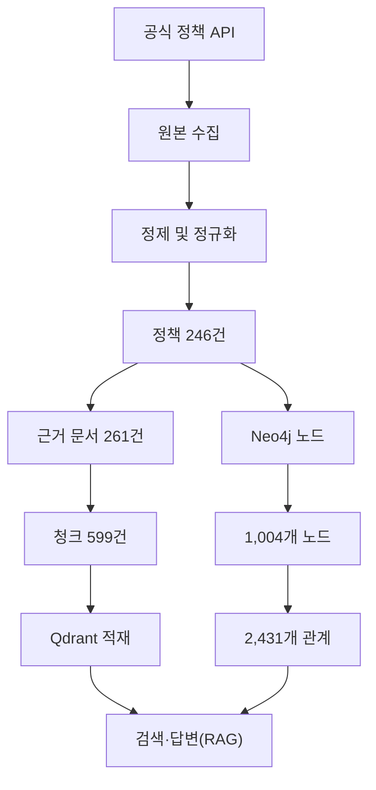
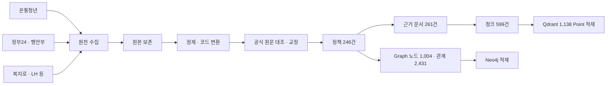

# 📄 산출물 01 · 수집 데이터 및 전처리 문서

<table header-row="true">
<colgroup>
<col />
<col width="568.0000152587891" />
</colgroup>
<tr>
<td>
항목
</td>
<td>
내용
</td>
</tr>
<tr>
<td>
프로젝트명
</td>
<td>
SSOK
</td>
</tr>
<tr>
<td>
작성자
</td>
<td>
장반석
</td>
</tr>
<tr>
<td>
문서 버전
</td>
<td>
v1.4 — 3차 최종 데이터(v1.4.0-candidate) 기준
</td>
</tr>
<tr>
<td>
작성 기준일
</td>
<td>
2026-11-10
</td>
</tr>
<tr>
<td>
작업 범위
</td>
<td>
정책 데이터 수집·전처리·정규화·품질 검증 및 DB 인계
</td>
</tr>
<tr>
<td>
진행 상태
</td>
<td>
v1.4.0-candidate 공식 원문 대조·교정 완료, 최종 DB 재적재 검증 완료(#45, 2026-11-10)
</td>
</tr>
<tr>
<td>
기준 문서
</td>
<td>
[서비스 요구사항 정의서(PRD)](https://app.notion.com/p/PRD-40c896a6387281d6a7a6efad1f900978?pvs=21)
</td>
</tr>
</table>

# 산출물 01 · 수집 데이터 및 전처리 문서

<b>적용 프로젝트:</b> SSOK · 생애주기 맞춤 정책 AI — AI 기반 생애주기 맞춤형 정부 지원 정책 추천 및 질의응답 서비스

## 1. 데이터 개요 및 선정 이유

### 1.1 해결하려는 질문

SSOK은 사용자가 자신의 나이, 거주지, 소득, 혼인 상태, 가족 구성, 취업 상태 등의 정보를 입력하면 신청 가능한 정부 지원 정책을 탐색하고, 정책의 지원 내용과 자격 조건을 근거 문서에 기반하여 설명하는 서비스이다.

기존 정부 지원 정책 정보는 기관별로 분산되어 있고, 정책마다 대상자 조건과 신청 방법이 다르다. 사용자가 자신에게 적합한 정책을 직접 비교하고 확인하려면 여러 기관의 정보를 탐색해야 한다.

이를 해결하기 위해 공공기관의 정책 정보를 수집하고 공통 데이터 구조로 정규화하였다.

주요 목표는 다음과 같다.

1. 여러 기관의 정책을 통합 검색할 수 있는 데이터 확보
2. 생애주기와 개인별 자격 조건을 구조화한 추천 데이터 구축
3. 정책 설명과 근거 문서를 활용한 RAG 질의응답 지원
4. 정책 ID와 문서 ID를 이용한 출처 추적
5. 향후 정책 갱신 및 데이터 확장을 고려한 데이터 구조 설계

### 1.2 데이터 선정 기준

PRD에서는 온통청년과 LH를 P0, 복지로와 정부24를 P1, 공공데이터포털 및 주택도시기금 등을 P2 수집 대상으로 구분하였다.

이번 작업에서는 초기 권장 목표인 정책 10\~20건을 넘어, 실제 확보 가능한 공식 API 데이터를 기반으로 수집 범위를 확장하였다.

선정 기준은 다음과 같다.

- 공식 기관에서 제공하는 정책 또는 공고 데이터
- 정책명과 지원 내용이 식별 가능한 자료
- 지원대상·선정기준·신청 방법 등이 포함된 자료
- 원본 출처를 추적할 수 있는 자료
- Graph DB와 Vector DB에 활용 가능한 자료
- 정제 및 검증이 가능한 구조의 자료

### 1.3 수집 데이터 현황

<table header-row="true">
<colgroup>
<col />
<col />
<col width="133" />
<col />
<col />
<col />
</colgroup>
<tr>
<td>
데이터 ID
</td>
<td>
데이터명
</td>
<td>
제공기관
</td>
<td>
형식
</td>
<td>
원천 수집 규모
</td>
<td>
활용 목적
</td>
</tr>
<tr>
<td>
D-01
</td>
<td>
청년정책
</td>
<td>
온통청년
</td>
<td>
API JSON/XML
</td>
<td>
3,861건
</td>
<td>
청년 대상 정책 및 자격 조건
</td>
</tr>
<tr>
<td>
D-02
</td>
<td>
공공서비스·혜택
</td>
<td>
행정안전부·정부24
</td>
<td>
API JSON
</td>
<td>
10,942건
</td>
<td>
정부 지원 정책·지원조건
</td>
</tr>
<tr>
<td>
D-03
</td>
<td>
중앙부처 복지서비스
</td>
<td>
한국사회보장정보원·복지로
</td>
<td>
API XML
</td>
<td>
목록 461건, 상세 99건
</td>
<td>
복지서비스 상세 정보
</td>
</tr>
<tr>
<td>
D-04
</td>
<td>
기존 정책·공고 자료
</td>
<td>
LH·주택도시기금 등
</td>
<td>
웹 문서·정제 데이터
</td>
<td>
기존 정책 9건
</td>
<td>
주거·금융 정책 및 근거 보강
</td>
</tr>
<tr>
<td>
D-05
</td>
<td>
신규 정책(v1.4.0 추가)
</td>
<td>
정부24·온통청년·법령 원문
</td>
<td>
API JSON·법령 조문
</td>
<td>
신규 정책 9건
</td>
<td>
교통·세금·다자녀 등 생활 혜택 보강
</td>
</tr>
</table>

※ 수집 건수는 API별 원천 목록 또는 기존 확보 데이터의 수치다. 서로 다른 기관의 정책이 중복될 수 있으며 최종 통합 정책 건수와는 다르다.

<b>원천 API 목록 수집 합계: 15,264건</b>

- 행정안전부: 10,942건
- 온통청년: 3,861건
- 한국사회보장정보원 목록: 461건

이후 상세 정보 확보, 대표 정책 선별, 데이터 정규화 및 검증 과정을 거쳐 v1.3.2에서 통합 정책 237건을 구성하였다. v1.4.0에서 신규 정책 9건을 더해 <b>최종 통합 정책 246건</b>을 DB 적재 대상으로 확정하였다.

### 1.4 공식 데이터 출처

- [온통청년 Open API](https://www.youthcenter.go.kr/cmnFooter/openapiIntro/oaiDoc)
- [행정안전부 공공서비스 API — 공공데이터포털](https://www.data.go.kr/data/15113968/openapi.do)
- [한국사회보장정보원 중앙부처복지서비스 API](https://www.data.go.kr/data/15090532/openapi.do)
- [LH 한국토지주택공사](https://www.lh.or.kr/)
- [주택도시기금](https://nhuf.molit.go.kr/)

원천 자료는 정책 API 응답과 공고·안내 문서를 구분하여 관리하였다. 각 정책의 출처 URL, 원본 식별자, 검증 상태는 추후 원문 재확인에 활용할 수 있도록 보존하였다.

### 1.5 포함 및 제외 범위

<b>포함 범위</b>

- 정책명 및 정책 설명
- 지원 내용
- 대상자·선정기준
- 연령·소득·지역 등 구조화 가능한 자격 조건
- 신청 방법 및 신청 기간
- 제출 서류 및 관련 자료
- 정책 제공기관과 출처
- 생애주기·정책 분야·대상자 특성
- 정규화된 정책·문서·관계 데이터

<b>제외 또는 제한 범위</b>

- 출처가 불명확하거나 의미 확인이 어려운 정보의 확정적 사용
- 개인정보를 활용한 실제 자격 승인 판정
- 실제 정책 접수 및 신청 처리
- 공식 근거가 확인되지 않은 자격 조건의 임의 생성
- 수집한 원천 정책 전체의 즉시 DB 적재

일부 조건은 API에서 코드 또는 자연어로 제공되므로 완전한 자동 자격 판정을 보장하지 않는다.

---

## 2. 수집 및 원본 보관

### 2.1 수집 방식

공식 Open API를 우선 사용하고, API만으로 정보가 부족한 정책은 기존에 확보한 공식 공고·안내 자료로 보완하였다.

기관마다 API 구조가 다르므로 개별 수집 과정과 공통 정규화 단계를 분리하였다.

| 수집 대상 | 수집 방법 | 원본 데이터 | 주요 식별자 | 갱신 방식 |
| --- | --- | --- | --- | --- |
| 온통청년 | REST API 페이지 조회 | 정책 응답 JSON/XML | <code>plcyNo</code> | API 재조회 및 변경일 비교 |
| 행정안전부 | REST API 목록·상세·지원조건 조회 | API JSON | 서비스 ID | 정책별 상세·조건 재조회 |
| 중앙부처복지서비스 | REST API 목록·상세 조회 | API XML | <code>servId</code> | 목록 갱신 후 상세 재조회 |
| LH·주택도시기금 등 | 공식 공고·안내 자료 수집 | 원본 문서 및 정제 본문 | 기관별 원본 ID | 공식 공고 재확인 |

원본 수집 결과와 정제 데이터를 분리 보관하여 필요할 때 정규화 과정을 재실행할 수 있도록 설계하였다.

### 2.2 데이터 저장 구조

프로젝트 루트:

<code>SKN36-3rd-1Team/</code>

주요 데이터 관리 영역:

```txt
data/
├── raw/                  # API 원본·공고 원본
├── processed/            # 정제·정규화 데이터
├── reports/              # 수집·품질·분포 분석 보고서
└── handoff/              # DB 담당자 인계 데이터
    ├── data_contract.md
    ├── manifest.json
    ├── README.md
    ├── neo4j/
    │   ├── nodes_*.jsonl
    │   ├── relationships.jsonl
    │   ├── load_neo4j.py
    │   └── *.cypher
    └── qdrant/
        ├── payload_chunks.jsonl
        └── collection_config.json
```

### 2.3 수집 실패 및 누락 처리

수집 단계에서 원본 응답과 정제 데이터를 별도로 관리하여 <br />실패 또는 누락 발생 시 재확인할 수 있도록 하였다.

주요 검토 대상은 다음과 같다.

- API 호출 실패 또는 인증 오류
- 목록 조회와 상세 조회 건수 차이
- 정책 필수 정보 누락
- 원본 문서 연결 실패
- 잘못된 코드값 및 조건값
- 정책명·설명·근거 문서 간 불일치

한국사회보장정보원 API는 목록 461건 중 상세 99건을 확보하였다. 나머지 362건은 상세 정보 미확보 범위로 구분한다.

<b>이를 오류 362건으로 단정하지 않고, 추가 수집이 필요한 범위로 관리한다.</b>

기관별 호출 실패 횟수, 재시도 횟수 및 오류 코드별 상세 집계는 실제 실행 로그와 <code>api_status.csv</code>가 있는 경우 해당 파일을 기준으로 별도 기재한다.

### 2.4 보안 및 재현성

API 인증키는 프로젝트 <code>.env</code>에서 관리한다.

- 행정안전부·한국사회보장정보원: 공공데이터포털 인증키 활용
- 온통청년: 별도 발급 인증키 활용

인증키는 정제 데이터·인계 파일·README에 직접 기록하지 않는다.

최종 인계 파일은 <code>manifest.json</code>에 기록된 SHA-256 체크섬과 파일 크기를 기준으로 무결성을 확인하였다.

---

## 3. 데이터 구조

### 3.1 통합 데이터 모델

기관별로 다른 필드명을 공통 정책 모델로 정규화하였다.

핵심 데이터는 정책(Policy), 근거 문서(Document), 생애주기(LifeStage), 자격 조건(EligibilityCondition), 조건 그룹(ConditionGroup), 기관(Organization), 지역(Region), 분야(Category)로 구성된다.

| 필드 또는 개념 | 자료형 | 설명 | 활용 구분 |
| --- | --- | --- | --- |
| <code>policy_id</code> | String | 내부 정책 고유 ID | 공통 식별자 |
| <code>document_id</code> | String | 근거 문서 고유 ID | 문서 연결 |
| <code>chunk_id</code> | String | 검색 청크 고유 ID | Vector 연결 |
| 정책명 | String | 서비스·지원 정책의 이름 | 본문·메타데이터 |
| 정책 설명 | String | 정책 목적과 개요 | 본문 |
| 지원 내용 | String | 실제 지원 혜택 | 본문 |
| 생애주기 | Array/String | 영유아·아동·청소년·청년·중장년·노년 | Graph·메타데이터 |
| 지역 | String/Array | 정책 적용 지역 | Graph·필터 |
| 자격 조건 | Object/Array | 연령·소득·혼인·취업 등 | Graph·메타데이터 |
| 검증 상태 | String | 검증 완료·추출 완료·검토 필요 등 | 메타데이터 |
| 출처 URL | String | 근거 자료 위치 | 출처 추적 |
| 신청 기간 | String/Date | 신청 가능 기간 정보 | 본문·메타데이터 |
| 기준일·변경일 | String/Date | 정책의 기준 및 갱신 정보 | 메타데이터 |

※ 표는 핵심 개념을 설명한 요약이며, 실제 필드명·자료형·필수 여부의 최종 기준은 <code>data_contract.md</code>와 최종 DB 스키마 문서를 따른다.

### 3.2 생애주기와 자격 속성 분리

초기 수집 데이터에는 청년·저소득·장애인·신혼부부 등이 같은 대상자 그룹에 포함될 수 있었다.

정규화 과정에서는 다음처럼 분류하였다.

<b>생애주기(LifeStage)</b>

- 영유아
- 아동
- 청소년
- 청년
- 중장년
- 노년

<b>별도 자격·가구 속성</b>

- 소득 수준
- 혼인 상태
- 임신·출산
- 자녀 양육
- 취업·구직 상태
- 장애 여부
- 주거 상태
- 지역

이를 통해 한 정책이 여러 생애주기에 적용되거나 다양한 조건을 동시에 요구할 수 있도록 설계하였다.

### 3.3 복합 자격 조건 구조

정책의 자격 조건은 단순한 태그만으로 판정하기 어려우므로 <code>ConditionGroup</code>을 사용하여 조건 간 논리를 구조화하였다.

- <code>AND</code>: 여러 조건을 모두 충족
- <code>OR</code>: 여러 조건 중 하나 이상 충족
- <code>NOT</code>: 제외 조건
- <code>UNKNOWN</code>: 논리 관계를 확정하지 못함

<b>원문에서 관계를 확인할 수 없는 경우 임의로 AND/OR를 적용하지 않는다.</b>

불확실한 자격 판정은 TRUE/FALSE/UNKNOWN의 3값 평가 방식으로 처리할 수 있도록 데이터 구조를 설계하였다.

### 3.4 데이터 구성도



Neo4j·Qdrant 실제 적재와 검증은 DB 담당(주민혁)이 최종 재적재(#45, 2026-11-10)에서 완료하였다.

---

## 4. 전처리 과정

### 4.1 전처리 단계

| 단계 | 처리 대상 및 규칙 | 적용 이유 | 결과 |
| --- | --- | --- | --- |
| 원본 수집 | 기관별 API·공고 조회 | 공식 데이터 확보 | 원천 API 목록 15,264건 |
| 텍스트·구조 추출 | XML·JSON·공고 본문 | 정책 내용과 필드 추출 | 통합 가능한 원천 데이터 확보 |
| 노이즈 정리 | 메뉴·버튼·반복 문구 | 검색 품질 개선 | 문서 UI 노이즈 정제 |
| 중복·결측 검사 | 정책 ID 및 필수 필드 | 중복·잘못된 데이터 방지 | 검증 상태 관리 |
| 필드 정규화 | 기관별 API 코드와 명칭 | 공통 데이터 모델 적용 | 정책 246건 |
| 생애주기 분류 | 연령대·가구·조건 분리 | 개인 맞춤형 추천 지원 | LifeStage 및 조건 데이터 |
| 관계 데이터 생성 | 정책·기관·지역·조건 연결 | Graph 검색 지원 | 노드 1,004개, 관계 2,431개 |
| 문서·청크 생성 | 근거 문서와 검색 단위 연결 | Vector 검색 지원 | 문서 261건, 청크 599건 |
| 메타데이터 구성 | 정책·문서·출처·검증 상태 | 출처 추적 및 필터링 | 릴리스 인계용 payload 599건 |
| 공식 원문 대조·교정 | 조건·지역·소득·연령·신청기간 | 잘못된 자격 판정 방지 | 교정 파일 1개로 기록(아래 4.2 사례 6\~9) |
| 품질 검증 | 파싱·ID·참조·해시 검증 | DB 인계 안정성 확보 | 파일 검증 통과, 실제 DB 적재 검증 통과 |

### 4.2 주요 정제 사례

<b>사례 1 — 정책 설명과 근거 문서 불일치 수정</b>

초기 데이터에서 청년전용 보증부월세대출 문서에 다른 주거금융 상품 설명이 혼재된 사례를 발견하였다.

상품명과 설명 본문을 대조해 해당 정책에 맞는 내용을 반영하였다.

<b>사례 2 — 원본 문서 누락 보완</b>

일부 문서의 원천 자료 연결이 불완전했던 문제를 확인하고, 공식 API 원본 데이터와 출처 연결을 보완하였다.

<b>사례 3 — UI 노이즈 제거</b>

LH 문서의 '당첨자조회', '점자뷰어', '바로보기' 등 정책 본문과 직접 관련이 없는 화면 문구를 정리하였다.

<b>사례 4 — Graph 관계 ID 불일치 수정</b>

초기 DB 인계 데이터에서는 관계가 참조하는 노드 ID와 실제 노드 ID 생성 규칙이 일치하지 않았다.

최종 수정 과정에서 노드 및 관계 ID 생성 규칙을 정비하여 누락 참조를 0건으로 개선하였다.

<b>사례 5 — 조건 논리 개선</b>

초기에는 조건 그룹이 AND 중심으로 생성되어 복합 조건의 의미를 정확히 표현하기 어려웠다.

이후 AND/OR/NOT/UNKNOWN을 구분하도록 개선하고, 확인되지 않은 논리 관계를 별도로 관리하였다.

<b>사례 6 — 신규 문서 공식 원문 대조 (PR #16)</b>

신규 근거 문서 22건이 공식 원문이 아니라 스크립트에 적힌 요약문이었다. 조문 오인용, 존재하지 않는 조례(출처 404), LH 공고 수치 오류를 확인하고 원문으로 교체하였다. 원문이 확인된 15건만 남겼다.

<b>사례 7 — 조건·지역·설명 수치 교정 (PR #29)</b>

정부24 API에서 가구 항목을 모두 선택한 정책 46건이 "무주택 필수 + 7개 유형 OR"로 잘못 만들어져 있었다. 45건의 가구 조건을 제거하고, 연령 조건 4건, 지역 4건, 설명 수치 6건을 원문 값으로 고쳤다.

<b>사례 8 — 소득·연령·표기·신청기간 교정 (PR #33)</b>

소득 5구간을 모두 선택한 45건 중 39건은 소득 조건을 제거하고 6건은 UNKNOWN으로 두었다. 원문 근거가 없는 연령 조건 23건을 제거하고, 분야·대상 표기와 생애단계를 표준값으로 통일하였다. 신청기간이 분명한 44건은 ISO 날짜로 넣었다.

<b>사례 9 — 신청 시작일 정정과 상시 접수 표시 (PR #37)</b>

POL\_002의 신청 시작일을 공식 공지 기준 2026-10-19로 고쳤다. 원문에서 상시 접수가 확인된 39건에만 application\_is\_ongoing=true를 넣었다. 소득 기준이 불명확한 6건은 원문을 다시 확인해 결과를 남겼다.

교정 전 값과 근거는 모두 <code>data/metadata/data_corrections_v1.4.0.json</code>에 기록하였다. 고정 인계본 <code>data/handoff</code>(v1.3.2)는 수정하지 않았다.

<p />

<b>중복·오류·누락 처리 기준과 실제 사례</b>

<table header-row="true">
<colgroup>
<col width="70" />
<col width="231.2062530517578" />
<col width="375" />
</colgroup>
<tr>
<td>
항목
</td>
<td>
처리 기준
</td>
<td>
실제 사례
</td>
</tr>
<tr>
<td>
중복
</td>
<td>
소관 부처와 사업명이 같으면 같은 사업으로 보고, 공식 근거 문서가 있는 정책 하나로 합친다. 병합 내역은 <code>data/metadata/dedup_candidates.json</code>에 남긴다
</td>
<td>
국민취업지원제도는 정부24(149200005007), 온통청년(20260710005400113256), 복지로(WLF00003245)에 같은 이름으로 있었다. 세 기록 모두 고용노동부 사업이라 같은 사업으로 판단하고 POL\_010 하나로 합쳤다. 모두의카드(POL\_BOK\_075)와 K-패스(POL\_STG\_MOLIT\_001)는 같은 사업으로 확인했지만 아직 합치지 않아 4차 검토 대상으로 기록했다
</td>
</tr>
<tr>
<td>
오류
</td>
<td>
관계가 가리키는 노드가 실제로 있어야 한다. 최종 검사에서 참조 대상이 없는 관계는 0건이어야 한다
</td>
<td>
초기 인계 데이터는 관계가 참조하는 노드 ID와 실제 노드 ID의 생성 규칙이 달랐다(사례 4). 노드·관계 ID 생성 규칙을 정비한 뒤, 최종 검사에서 참조 대상이 없는 관계가 0건임을 확인했다
</td>
</tr>
<tr>
<td>
누락
</td>
<td>
공식 원문에 요건이 있어도 구조화된 조건이 없으면 조건을 지어내지 않는다. 원문은 문서·청크에 남기고 자동 판정은 "확인 필요"로 둔다
</td>
<td>
국민취업지원제도(POL\_010)는 공식 원문에 나이·소득·재산·취업경험 요건이 있지만, 서술형이라 그래프에 연결된 자격 조건이 없었다. 서술형 요건은 공식 원문에 남겼고, 구조화된 자격 조건이 없어 자동 판정은 "확인 필요"로 표시했다
</td>
</tr>
</table>

#### 처리 기준 요약

<table header-row="true">
<colgroup>
<col />
<col width="677" />
</colgroup>
<tr>
<td>
항목
</td>
<td>
처리 기준과 확인 방법
</td>
</tr>
<tr>
<td>
중복
</td>
<td>
정책·문서 ID 중복을 검사하고, 같은 사업이 여러 출처에 있으면 원문과 정책 범위를 대조합니다. 원천 목록과 최종 정책의 건수 차이에는 수집 범위와 선별 기준도 반영됩니다.
</td>
</tr>
<tr>
<td>
오류
</td>
<td>
ID 생성과 관계 참조를 점검합니다. 최종 Graph 데이터의 관계 대상 ID 누락은 0건입니다. 신청 주소와 자격 조건은 공식 원문 대조 결과를 기준으로 교정합니다.
</td>
</tr>
<tr>
<td>
누락
</td>
<td>
수집 실패나 필수 정보 누락은 보관한 원본과 대조합니다. 공식 근거를 확인하기 어려운 자격 조건은 확인 필요로 관리합니다. 남은 원문·조건 대조 범위는 §9에 기록합니다.
</td>
</tr>
</table>

### 4.3 검토 상태 관리

수집 및 정제 성공과 실제 정책 자격 검증은 구분하였다.

특히 온통청년 원천 데이터에서 이전 검토 당시 3,861건 중 1,079건에 추가 검토 플래그가 있었다.

이 수치는 원천 데이터 검토 대상 수치이며, 최종 통합 정책 246건 중 검증 미완료 정책 수와 동일하지 않다.

최종 정책 246건의 검증 상태는 <code>verified</code> 21건, <code>extracted</code> 225건이다.

소득·가구 조건은 정책마다 원문 확인 결과를 남겼다.

| 값 | 뜻 | 소득 | 가구 |
| --- | --- | --- | --- |
| <code>not_specified</code> | 공고에 별도 기준 없음 | 42 | 39 |
| <code>specified</code> | 공고와 데이터가 일치 | 1 | 1 |
| <code>needs_review</code> | 기준이 있으나 불명확 | 10 | 7 |
| <code>not_reviewed</code> | 아직 개별 대조 전 | 193 | 199 |

<code>not_reviewed</code> 정책 대부분은 그래프에 소득·가구 조건이 연결되어 있지 않아, 그 조건으로 자동 판정하지 않는다. 조건이 실제로 연결된 채 아직 원문과 대조하지 않은 정책은 소득 12건, 가구 9건이다. 조건이 연결되지 않은 정책의 처리 방식은 6.8절 3번(자동 자격 판정 범위)에 정리하였다.

원문 근거가 불충분한 자격 조건은 임의로 적격 또는 부적격으로 확정하지 않는 것이 원칙이다.

---

## 5. 청킹 전략 및 비교

### 5.1 청킹 목적

정책 문서의 내용을 임베딩 및 의미 검색에 활용할 수 있도록 문서 단위보다 작은 검색 청크로 구성하였다.

정책 문서는 지원대상, 선정기준, 지원 내용, 신청 절차 등 서로 다른 의미 영역을 포함하므로, 검색 시 필요한 내용을 근거와 함께 반환할 수 있어야 한다.

청킹 과정에서는 다음 항목을 중요하게 고려하였다.

- 정책명 및 근거 문서와의 연결 유지
- 의미가 다른 정책 내용의 혼합 방지
- 원문 출처 추적 가능성
- 지나치게 짧거나 빈 청크 방지
- 중복 내용 및 UI 노이즈 최소화

### 5.2 청킹 결과

| 항목 | 결과 |
| --- | --- |
| 근거 문서 | 261건 |
| 최종 청크 | 599건 |
| 문서당 평균 청크 | 약 2.30건 |
| Qdrant Payload | 599건 |
| Point ID | UUIDv5 기반 결정론적 생성 |
| 참조 검증 | 정책·문서 연결 검증 통과 |

문서당 평균 청크 수는 <code>599 ÷ 261</code>으로 계산하였다.

<b>실제 청크 예시 — 교육급여(맞춤형 급여)</b>

교육급여(맞춤형 급여)의 릴리스 인계용 청크 예시입니다. 청크 ID와 문서 ID를 통해 출처를 추적할 수 있습니다.

```txt
[서비스명] 교육급여(맞춤형 급여) (WLF00001089)

[소관부처] 교육부 학생지원총괄과

[선정기준]
소득인정액이 기준중위소득의 50% 이하인 가구의 초·중·고등학생을 지원합니다.교육급여는 부양의무자 기준을 적용하지 않습니다.
```

<table header-row="true">
<colgroup>
<col />
<col width="573" />
</colgroup>
<tr>
<td>
필드
</td>
<td>
값
</td>
</tr>
<tr>
<td>
<code>policy_id</code>
</td>
<td>
<code>POL_BOK_020</code>
</td>
</tr>
<tr>
<td>
<code>document_id</code>
</td>
<td>
<code>DOC_BOK_020</code>
</td>
</tr>
<tr>
<td>
<code>chunk_id</code>
</td>
<td>
<code>DOC_BOK_020_C01</code>
</td>
</tr>
<tr>
<td>
<code>source_url</code>
</td>
<td>
[https://www.bokjiro.go.kr/ssis-tbu/twataa/wlfareInfo/moveTWAT52011M.do?wlfareInfoId=WLF00001089](https://www.bokjiro.go.kr/ssis-tbu/twataa/wlfareInfo/moveTWAT52011M.do?wlfareInfoId=WLF00001089)
</td>
</tr>
</table>

### 5.3 청킹 방식 및 비교 실험 기록

| 실험 ID | 분할 방식 | 크기·단위 | Overlap | 평가 항목 | 결과 |
| --- | --- | --- | --- | --- | --- |
| CH-01 | 릴리스 청크(데이터 담당) | 문서 단위, 1,000자 초과 시 분할 | 100자 | 빈 청크·중복·ID 무결성 | 599건 생성, 구조 검증 통과 |
| CH-02 | B2 구조 기반 청킹(DB 담당) | 필드·제목 경계, 100자 미만 조각은 이웃과 병합 | 긴 구간만 분할 | 검색 근거 포함·실제 적재 | 1,138건 적재, qwen3-embedding 0.6B 1,024차원 |

CH-01은 <code>scripts/build_clean_dataset.py</code>의 설정(1,000자 초과 시 <code>text[:1000]</code>, <code>text[900:]</code>)을 기준으로 기록하였다. 단위는 문자다.

<b>실제 검색에는 DB 담당이 릴리스 청크를 다시 나눈 B2 청킹</b>(<code>database/chunking.py</code>)을 사용한다. 원문 텍스트는 바꾸지 않고 원문 위치(char\_start/char\_end)를 보존한다.

B2와 B3의 탐색적 비교(85문항 + 지역 8사례)는 진행했지만, 사람이 검수한 정답이 없어 공식 Hit/Recall/MRR은 아직 산출하지 않았다. 따라서 최적 청킹 전략은 확정하지 않았다.

<b>후속 비교 (2026-11-10):</b> 0.6B 모델과 같은 52문항·Top-5 조건에서 B2(1,138청크)와 B3(1,220청크)를 비교했다. Recall@5는 둘 다 46/52, MRR@5는 B2 0.7468, B3 0.7234로 B2를 유지했다. 정답 근거의 최종 검수 전이라 예비 결과다(산출물 05).

<b>후속 검증 — Qwen3 0.6B·4B 임베딩 비교 (PR #51, 2026-11-10 이후)</b>

동일한 v1.4.0 B2 청크 1,138개를 0.6B·4B 모델별 독립 Qdrant 컬렉션에 적재하고, 동일한 질문·Top-5·필터 조건으로 벡터 검색 예비 평가를 수행하였다. 모델별 Point 1,138개 정합성 확인을 완료하였다.

| 평가 항목 | Qwen3 Embedding 0.6B | Qwen3 Embedding 4B |
| --- | --- | --- |
| 임베딩 차원 | 1,024 | 2,560 |
| Qdrant Point | 1,138개 | 1,138개 |
| 예비 Recall@5 | 88.46% (46/52) | 94.23% (49/52) |
| 예비 MRR@5 | 0.7458 | 0.7609 |
| 정답 근거 Top-1 | 34/52 | 33/52 |
| 평균 임베딩+검색 | 954ms | 998ms |
| 관측 모델 VRAM | 4.32GiB | 7.25GiB |

평가 질문은 55개이며 이 중 52개를 채점하였다. Recall@5는 모든 필수 정답 근거 구간을 Top-5 청크가 포함한 질문 비율로, 일반적인 정책 단위 Recall과 구분한다. <b>정답의 최종 사람 검수가 완료되지 않았으므로 위 값은 공식 검색 성능이 아닌 예비 평가 결과다.</b> 또한 양자화·실행 환경·측정 순서 등 조건 차이가 있어 모델 파라미터 크기만의 효과로 단정하지 않는다.

4B는 예비 Recall@5가 5.77%p 높았으나, 운영 자원·기존 RAG 호환성·안정성을 종합하여 <b>최종 적용 임베딩 모델은 0.6B로 선정</b>하였다. 이는 임베딩 모델 비교 결과이며 앞서 기록한 B2/B3 청킹 전략의 공식 성능 확정과는 별개의 평가다.

위 표는 run03(GPU, 1회) 기준이다. 로컬 CPU·실제 Qdrant 재실행에서는 MRR@5가 0.6B 0.7468, 4B 0.7561, 워밍업 후 평균 검색 시간이 0.6B 201ms, 4B 701ms였다(산출물 05).

근거: [PR #51](https://github.com/SKNETWORKS-FAMILY-AICAMP/SKN36-3rd-1Team/pull/51), [A/B 결과 분석](https://github.com/SKNETWORKS-FAMILY-AICAMP/SKN36-3rd-1Team/blob/main/docs/development/ISSUE41_AB_RUN03_ANALYSIS.md), [실험 요약 원본](https://github.com/SKNETWORKS-FAMILY-AICAMP/SKN36-3rd-1Team/blob/main/docs/development/experiments/issue41_ab_run03/summary.json)

### 5.4 청킹·임베딩 책임 구분

<b>데이터 담당 — 장반석</b>

- 정책 및 근거 문서 확보
- 원문 정제 및 메타데이터 구성
- 청크 생성 결과와 참조 무결성 검증
- 인계 데이터 계약 및 파일 제공

<b>DB 담당 — 주민혁</b>

- 임베딩 모델 선택
- 임베딩 차원 및 모델 버전 확정
- Qdrant Collection 생성
- 벡터 생성 및 적재
- Neo4j 노드·관계 적재
- 실제 DB 적재 건수 검증

<b>검색·RAG 담당</b>

- 검색 정확도 및 응답 품질 평가
- Graph·Vector 검색 결과 결합
- 근거 문서 인용 및 자격 조건 처리
- 필요 시 청킹 전략 재평가

---

## 6. 전처리 전후 비교 및 최종 데이터

### 6.1 전체 데이터 규모

| 구분 | 데이터 규모 | 비고 |
| --- | --- | --- |
| 원천 API 목록 | 15,264건 | 기관 간 중복 제거 전 |
| 최종 통합 정책 | 246건 | v1.3.2 237건 + 신규 9건 |
| 근거 문서 | 261건 | 정책 관련 문서 |
| 릴리스 청크 | 599건 | 데이터 담당 생성 |
| Qdrant Point | 1,138개 | B2 청킹 후 적재 |
| Neo4j 노드 | 1,004개 | 정책·문서·조건 등 |
| Neo4j 관계 | 2,431개 | 노드 간 연결(REQUIRES\_CONDITION 136) |

v1.3.2(노드 1,034 / 관계 3,615)보다 노드·관계 수가 줄어든 것은 원문 근거가 없는 조건 노드와 관계를 교정으로 제거했기 때문이다.

원천 API 목록 15,264건에서 최종 정책 246건으로 감소한 것은 전부 중복 제거에 따른 결과가 아니다.

상세 정보 확보 범위, 대표 정책 선별, 기존 데이터 결합, 정규화 및 검증 등 여러 단계를 거쳐 최종 DB 인계 대상을 구성한 결과다.

<b>따라서 두 숫자의 차이를 '제거된 중복 정책 수'로 해석해서는 안 된다.</b>

### 6.2 정책 카테고리 분포

최종 통합 정책 246건의 카테고리별 구성은 다음과 같다.

| 정책 분야 | 정책 수 | 비율 |
| --- | --- | --- |
| 출산·육아·가족 | 82 | 33.33% |
| 주거·금융 | 52 | 21.14% |
| 청년 취업·교육·자산형성 | 47 | 19.11% |
| 교통·생활비·의료·돌봄 | 33 | 13.41% |
| 지역별 생활지원·복지 | 32 | 13.01% |
| <b>합계</b> | <b>246</b> | <b>100%</b> |

이 분포는 실제 정부 지원 정책 전체의 분포가 아니라, 이번 프로젝트에서 선별한 통합 데이터셋의 분포를 의미한다.

### 6.3 생애주기별 정책 분포

최종 생애주기 분류 결과는 다음과 같다.

| 생애주기 | 정책 수 | 전체 246건 대비 |
| --- | --- | --- |
| 청년 | 168 | 68.3% |
| 청소년 | 68 | 27.6% |
| 아동 | 63 | 25.6% |
| 중장년 | 49 | 19.9% |
| 노년 | 48 | 19.5% |
| 영유아 | 41 | 16.7% |
| 미확정 | 26 | 10.6% |

<b>한 정책이 여러 생애주기에 해당할 수 있어 중복 집계를 허용하였다.</b> 따라서 비율 합계가 100%를 초과한다.

특히 초기 데이터에 별도 분류가 없던 중장년을 최종 생애주기 분류 체계에 반영하였다.

<b>단, 생애주기 태그와 정책의 모든 신청 자격 충족 여부는 서로 다른 개념이다.</b>

### 6.4 Graph 데이터 구성

최종 Neo4j 데이터에는 총 1,004개 노드와 2,431개 관계가 포함된다.

노드 구성: Policy 246, ConditionGroup 265, Document 261, Organization 123, EligibilityCondition 69, Region 18, TargetGroup 11, LifeStage 6, Category 5.

주요 노드 개념:

- Policy
- Document
- Organization
- Region
- Category
- LifeStage
- TargetGroup
- EligibilityCondition
- ConditionGroup

<code>LifeStage</code>를 표준 노드 레이블로 사용하며 <code>LifeCycle</code>을 별도 동의어 레이블로 사용하지 않는다.

조건 그룹은 AND/OR/NOT/UNKNOWN을 구분하여 표현한다.

<b>최종 파일 기준 Graph 관계의 Source/Target 노드 참조 오류는 0건이다.</b>

### 6.5 Vector 데이터 구성

Qdrant 인계 데이터는 총 599개 릴리스 청크로 구성하였다. DB 담당이 B2 청킹으로 다시 나누어 1,138개 Point로 적재하였다.

각 청크는 정책과 근거 문서의 식별자를 연결하고, 검색 필터 및 출처 추적에 필요한 메타데이터를 포함하도록 설계하였다.

Point ID는 결정론적 UUIDv5 규칙을 사용한다.

임베딩은 qwen3-embedding 0.6B(1,024차원, Cosine)를 기본값으로 사용한다. 컬렉션은 <code>exp_b2_qwen3emb06b_v140_v1</code>이다. 0.6B와 4B 비교(#41, PR #51)를 마치고 0.6B를 최종 적용 모델로 선정했다(5.3절).

### 6.6 최종 파일 및 검증 결과

최종 기준: <code>data/releases/v1.4.0-candidate/</code> (main 브랜치, PR #45 적재·복원 검증 기준)

<table header-row="true">
<colgroup>
<col />
<col width="457" />
</colgroup>
<tr>
<td>
검증 항목
</td>
<td>
결과
</td>
</tr>
<tr>
<td>
JSONL 파싱
</td>
<td>
통과
</td>
</tr>
<tr>
<td>
노드 고유 ID 중복
</td>
<td>
0건
</td>
</tr>
<tr>
<td>
관계 대상 ID 누락
</td>
<td>
0건
</td>
</tr>
<tr>
<td>
후보 패키지 테스트(<code>test_candidate_release</code>)
</td>
<td>
25개 통과
</td>
</tr>
<tr>
<td>
매니페스트 파일 크기·SHA-256
</td>
<td>
일치
</td>
</tr>
<tr>
<td>
Neo4j DDL(제약·인덱스)
</td>
<td>
13개 적용
</td>
</tr>
<tr>
<td>
실제 Neo4j 적재
</td>
<td>
노드 1,004 / 관계 2,431 / REQUIRES\_CONDITION 136, 전체 속성 일치
</td>
</tr>
<tr>
<td>
실제 Qdrant 적재
</td>
<td>
1,138 Point / 1,024차원 / Cosine
</td>
</tr>
<tr>
<td>
Neo4j–Qdrant 교차 검증
</td>
<td>
1,138/1,138 통과(ID·content\_hash·SUPPORTED\_BY)
</td>
</tr>
<tr>
<td>
빈 DB 복원 검증
</td>
<td>
통과(#45)
</td>
</tr>
<tr>
<td>
독립 환경 테스트
</td>
<td>
411개 중 409개 통과(실패 1·오류 1은 Git 제외 원본 누락 때문)
</td>
</tr>
<tr>
<td>
검색 정확도 공식 평가
</td>
<td>
예비 평가 완료(Recall@5 0.6B 46/52·4B 49/52, B2·B3 모두 46/52). 정답 근거 최종 검수 전이라 공식 평가는 아님
</td>
</tr>
</table>

<b>매니페스트의 일부 비JSONL 파일에서</b> <code>record_count</code>와 물리적 줄 수가 다를 수 있으므로, 해당 값은 파일별 집계 의미를 확인해야 한다. 이는 파일 해시 불일치와는 별개의 사항이다.

<b>후속 검증 기록 — 최종 DB 적재·복원 상태 (PR #45)</b>

PR #45는 병합되어 현재 <code>main</code> 브랜치에 포함되어 있다. 저장소의 실제 복원 검증 기록에서 빈 DB 복원 및 읽기 전용 재검증이 PASS로 기록되어 있으며, 정책 246건·문서 261건·릴리스 청크 599건·B2 Point 1,138개·Neo4j 노드 1,004개·관계 2,431개·REQUIRES\_CONDITION 136개의 수치가 일치한다. 모든 1,138개 Point에 대해 Point ID, 문서·정책 존재, SUPPORTED\_BY, content\_hash 등을 포함한 7개 교차 DB 검사 통과가 기록되어 있다. 복원 패키지 안전 테스트는 24/24 통과하였다.

<b>상태 표시 유의:</b> 이 검증 완료 기록과 별개로, <code>data/releases/v1.4.0-candidate/manifest.json</code>의 <code>release_status</code>는 <code>CANDIDATE / PENDING_DB_REVIEW</code>, <code>db_review_status</code>는 <code>PENDING_APPROVAL_FROM_MINHYEOK_JU</code>로 남아 있다. 따라서 <b>실제 DB 적재·복원 검증 완료</b>와 <b>매니페스트에 기록된 공식 승인 상태</b>를 구별한다. 승인 상태값의 갱신 여부는 추가 확인이 필요하다.

검증 범위는 동일한 Windows PC의 별도 소스 폴더·빈 DB 볼륨이다. 타 PC/OS의 신규 설치 및 실제 LLM·HTTP/UI E2E까지 통과한 것으로 해석하지 않는다. 독립 작업 환경 테스트 411개 중 409개 통과, 실패 1건·오류 1건은 원본 증거 파일 누락으로 기록되어 있다.

근거: [PR #45](https://github.com/SKNETWORKS-FAMILY-AICAMP/SKN36-3rd-1Team/pull/45), [복원 검증 JSON](https://github.com/SKNETWORKS-FAMILY-AICAMP/SKN36-3rd-1Team/blob/main/docs/development/ISSUE43_RESTORE_VALIDATION_20261110.json), [패키지 검증 JSON](https://github.com/SKNETWORKS-FAMILY-AICAMP/SKN36-3rd-1Team/blob/main/docs/development/PR45_PACKAGE_VALIDATION_20261110.json), [릴리스 매니페스트](https://github.com/SKNETWORKS-FAMILY-AICAMP/SKN36-3rd-1Team/blob/main/data/releases/v1.4.0-candidate/manifest.json)

### 6.7 데이터 처리 파이프라인



### 6.8 주요 한계 및 후속 작업

1. <b>전체 원천 정책의 즉시 활용 한계</b>
   <p>
   원천 목록 15,264건이 모두 통합 DB에 적재되는 구성은 아니다. 현재 적재 대상은 대표 정책 246건이다.
   </p>
2. <b>복지서비스 수집 범위</b>
   <p>
   상세를 확보한 99건 중 98건이 최종 데이터에 포함되었고, 이 98건은 상세 원본을 모두 확보하였다. 목록 461건 중 상세를 받지 않은 362건은 이번 데이터에 포함하지 않은 서비스로, 데이터 결함이 아니라 4차 수집 확장 후보다.
   </p>
3. <b>자동 자격 판정 범위</b>
   <p>
   자격 조건은 API가 코드로 제공한 조건(정부24 지원조건 코드, 온통청년 코드값)만 그래프에 연결하였다. 정제본의 자유 서술 기준과 복지로 대상 문장은 조건으로 변환하지 않았다. 그 결과 v1.4.0 기준 UNKNOWN 그룹을 포함하는 정책은 187건이다. 루트가 UNKNOWN인 180건과 루트가 AND이고 하위에 UNKNOWN 그룹이 있는 7건을 합한 수치다. 나머지 59건에는 UNKNOWN 그룹이 없다.
   </p>

   <p>
   UNKNOWN은 "자격 요건이 없다"가 아니라 "구조화된 조건이 없어 자동 판정에 연결하지 못했다"는 뜻이다. 예를 들어 국민취업지원제도(POL\_010)는 정제본에 나이·소득·재산·취업경험 기준이 있지만 자유 서술이라 연결되지 않았다. checker는 UNKNOWN 정책을 "확인 필요"로 안내하고 자격을 확정하지 않는다.
   </p>

   <p>
   연결된 조건 중 아직 원문과 개별 대조하지 않은 것은 소득 조건 12건, 가구 조건 9건이다. 자격 설명에 신청자 연령 요건이 있지만 구조화된 나이 조건이 누락된 경우, checker가 연령 요건을 추가로 확인하도록 안내한다(#44).
   </p>
4. <b>정책 최신성 관리 필요</b>
   <p>
   정책의 시행 여부, 신청 기간, 자격 요건은 변경될 수 있으므로 정기적인 갱신 및 원문 확인이 필요하다.
   </p>
5. <b>신청 주소 정확도</b>
   <p>
   신청 주소(official\_apply\_url)가 기록된 정책은 22건이며, 실제 접수 화면 연결 여부는 별도 확인이 필요하다. 2026-11-10 점검에서 고쳐야 할 주소는 2건(접속 불가 1, 대상 지역 불일치 1)이다. 18건은 틀린 주소는 아니지만 기관 첫 화면이라, 정책 상세는 source\_url로 안내한다.
   </p>
6. <b>검색 품질 공식 평가 미완료</b>
   <p>
   0.6B·4B 임베딩과 B2·B3 청킹 비교는 예비 평가로 마쳤다(5.3절). 공식 검색 품질 평가는 사람이 검수한 정답이 확정된 뒤 진행한다.
   </p>

---

## 7. 산출물 및 협업 인계

### 7.1 최종 데이터 산출물

| 산출물 | 위치 | 용도 |
| --- | --- | --- |
| 원천 데이터 | <code>data/raw/</code> | API·공고 원문 보존 |
| 통합 정제 데이터 | <code>data/processed/</code> | 정책·문서·관계 정규화 결과 |
| 수집·품질 보고서 | <code>data/reports/</code> | 수집량·검증·분포 결과 |
| 데이터 계약서 | <code>docs/data/data_contract.md</code> | 필드·ID·검증 규칙 |
| 최종 데이터 패키지 | <code>data/releases/v1.4.0-candidate/</code> | Neo4j·Qdrant 적재 데이터(최종) |
| 데이터 매니페스트 | <code>data/releases/v1.4.0-candidate/manifest.json</code> | 파일 건수·해시·버전 |
| 원문 대조 교정 기록 | <code>data/metadata/data_corrections_v1.4.0.json</code> | 교정 전 값·근거 |
| 교정 보고서 | <code>docs/data/data_corrections_v1.4.0_review.md</code> | 교정 내용 설명 |
| v1.3.2 고정 인계본 | <code>data/handoff/</code> | 기준선(수정하지 않음) |
| DB 복원 안내 | <code>docs/development/ISSUE43_RESTORE_GUIDE.md</code> | 팀원용 DB 복원 절차 |

<b>프로젝트에 별도로 정리된 최종 DB 스키마 및 데이터 구조 명세도 DB 담당자에게 함께 전달한다.</b>

### 7.2 DB 담당(주민혁) 인계 내용

인계 범위:

- 최종 통합 정책 246건
- 근거 문서 261건
- 릴리스 청크 599건
- Neo4j 노드 1,004개 및 관계 2,431개
- 데이터 계약 및 매니페스트
- Neo4j 적재 스크립트와 Cypher 명세
- Qdrant Collection 설정 및 Payload
- 생애주기·자격 조건 정규화 규칙
- 검증 상태 및 미해결 문제

DB 담당 진행 결과(PR #22·#32·#45):

1. Neo4j·Qdrant 로컬 환경 구성 및 제약조건·인덱스 생성 — 완료
2. 노드·관계 실제 적재 및 속성 대조 — 완료
3. B2 청킹과 qwen3-embedding 0.6B 벡터 적재 — 완료
4. Neo4j–Qdrant 교차 검증과 빈 DB 복원 검증 — 완료
5. 0.6B와 4B 임베딩 비교 — 완료(#41, PR #51)

### 7.3 제출 확인

- [x] 공식 출처와 정책·문서 식별 구조 확보
- [x] 원본과 정제 데이터 분리
- [x] 정책·문서·청크 ID 연결 구조 확보
- [x] 데이터 수량 및 단계별 규모 명시
- [x] 생애주기 및 자격 조건 정규화
- [x] Neo4j 노드·관계 인계 데이터 생성
- [x] Qdrant 청크·Payload 인계 데이터 생성
- [x] 관계 참조 무결성 검증
- [x] 파일 매니페스트 및 해시 검증
- [x] DB 담당자 인계 가이드 준비
- [ ] API 실패·재시도 상세 통계 확인 및 기입
- [x] 청킹 크기·Overlap·단위 실제 설정값 최종 기입
- [x] 공식 원문 대조·교정 및 교정 근거 기록
- [x] 실제 Neo4j·Qdrant 적재 검증(#45)
- [ ] 서로 다른 청킹 전략의 공식 검색 성능 비교
- [ ] 실제 RAG 검색·추천 품질 평가

---

## 8. 최종 결론

SSOK 데이터 파트는 공식 정책 API 및 공고 자료를 수집하고, 기관별 데이터 구조를 통합하여 Neo4j·Qdrant 검색 기반 정책 추천 서비스에 필요한 데이터셋을 준비하였다.

PRD의 초기 권장 목표인 정책 10\~20건을 넘어 <b>통합 정책 246건, 근거 문서 261건, 청크 599건</b>을 확보하였다.

또한 개인별 정책 탐색에 필요한 생애주기·대상자·자격 조건을 구조화하고, Neo4j용 노드 1,004개와 관계 2,431개를 만들었다. 자동 생성된 조건은 공식 원문과 대조해 근거가 없는 조건을 제거하거나 원문 값으로 고쳤다.

최종 데이터는 실제 Neo4j·Qdrant 적재, 교차 검증, 빈 DB 복원 검증을 통과하였다(#45).

<b>데이터 수집·전처리·정규화·원문 대조와 DB 적재 검증을 완료하였다. 검색 품질 공식 평가와 남은 조건 대조는 아래 9절의 4차 계획으로 이어진다.</b>

따라서 본 산출물은 데이터팀의 최종 작업 결과이자 DB 담당자 및 검색·RAG 담당자의 후속 구현에 사용되는 기준 자료이다.

---

## 9. 4차 프로젝트 진행 계획 (데이터)

3차 마감 이후 데이터 파트에서 이어갈 작업이다. 3차 최종 데이터(v1.4.0)는 바꾸지 않고, 4차에서 새 버전으로 반영한다.

### 9.1 자격 조건 보강

| 작업 | 현황(2026-11-10) | 4차 계획 |
| --- | --- | --- |
| 나이 조건 추가 | 나이 조건이 없는 정책 205건을 원문과 대조함. 신청자 나이 조건 후보 21건 확인(온통청년 3, 복지로 11, 추가 정책 7). 온통청년 API 나이 37건은 별도 | 확인된 조건만 교정 파일에 추가하고 재적재 |
| 대상자 나이 구분 | 아동·장애아동 등 혜택받는 사람의 나이가 조건인 정책 30건 이상 확인(복지로 26, 추가 정책 4) | 신청자 나이와 대상자 나이를 따로 표현하는 방식을 팀에서 정함(자녀 개월 수 조건과 같은 방식) |
| 유형별로 다른 조건 | 청년내일저축계좌, 노인일자리, 소득세 감면 등 | 유형별 조건 그룹으로 표현할지 결정 |
| 자동 판정 범위 확대 | UNKNOWN 그룹 포함 정책 187건(루트 UNKNOWN 180건, AND 루트의 하위 UNKNOWN 7건). 신규 정책 9건(이슈 #18) 포함. UNKNOWN 그룹이 없는 정책은 59건 | 확인된 조건만 넣는 부분 판정 도입(checker 담당과 합의), 정제본의 자유 서술 기준과 원본 문장을 근거 대조 후 조건으로 변환. "자동 판정 정책 수"를 목표 지표로 둠 |
| 소득·가구 원문 대조 | 연결된 조건 중 미대조 소득 12건, 가구 9건 | 원문과 대조해 유지·수정·제거 |
| 전화 확인 | POL\_GOV\_054(취약가구 정의), POL\_GOV\_016(거주시설 소득 기준) | 확인 결과 반영 |

### 9.2 데이터 범위 정리

- <b>생활 정책 제외 기준 마련</b>: 개인이 신청하지 않는 정책(대학·기업·시설 지원, 행사 개최 등) 약 9건을 확인함. 기준을 정한 뒤 제외
- <b>중복 정책 정리</b>: 모두의카드(POL\_BOK\_075)와 K-패스(POL\_STG\_MOLIT\_001)가 같은 사업임
- <b>정책명·내용 최신화</b>: K-패스는 2026년 모두의카드로, 청년월세 한시 특별지원은 청년월세 지원사업으로 바뀜
- <b>FAQ 원문 수집</b>: K-패스(모두의카드), 서울청년수당, 한국도로공사, 국세청, 주택도시보증공사 5건(이슈 #18)

### 9.3 신청 주소·출처 품질

- 신청 주소 22건 중 18건이 기관 첫 화면이다. "신청 주소"와 "기관 홈"을 구분해 표시하는 방식을 정함
- 접속 불가(POL\_YC\_011)와 대상 지역이 맞지 않는 주소(POL\_STG\_MOLIT\_002)를 정리함
- 근거 기록이 원천 API가 아닌 파일로 남은 신청 주소 5건의 근거를 다시 기록함
- 링크는 시간이 지나면 깨지므로 재적재 전에 접속 확인을 다시 함

### 9.4 수집 범위 확장 후보

- 한국장학재단(국가장학금, 학자금대출): 현재 데이터에 없음
- 수집은 됐지만 최종 목록에서 빠진 학자금 정책(희망사다리 장학금, 경북 학자금 대출이자 지원 등)
- 기업마당, 정책브리핑, 지자체 열린데이터 등. 새 API는 키 발급과 약관 확인 후 사용
- 복지로 상세 미확보 362건

### 9.5 작업 방식

- AI 조사 결과는 원문 저장을 요구하고, 근거 문장을 원문과 대조한 뒤에만 반영한다. 3차에서 AI가 만든 근거 주소와 인용 문장 중 원문과 다른 경우가 여러 번 있었다.
- 원본이 저장된 출처(복지로 등)는 원본에서 직접 추출한다.
- 데이터 변경은 교정 파일과 테스트로 남기고, 재적재가 필요하면 DB 담당과 일정을 맞춘다.

---

<p />
