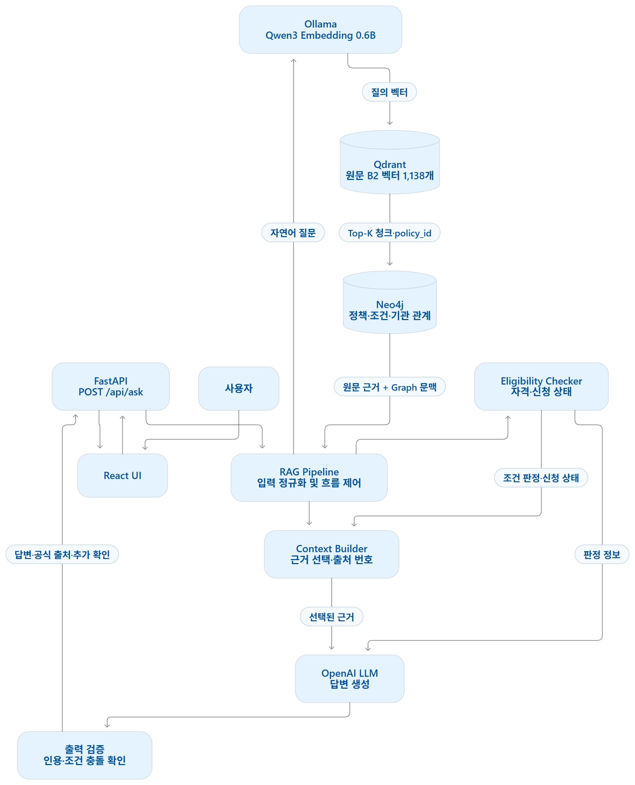
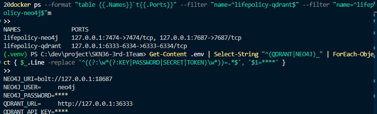
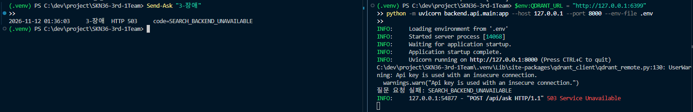
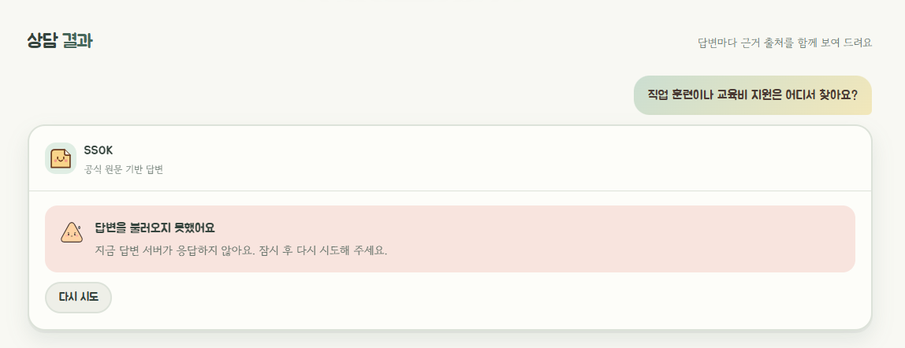
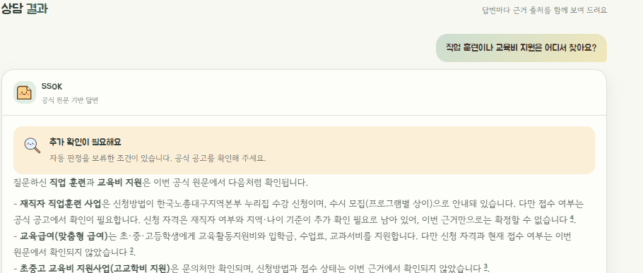

# 🏗️ 산출물 02 · 시스템 아키텍처

<b>적용 프로젝트:</b> AI 기반 생애주기 맞춤형 정부 지원 정책 추천 및 질의응답 서비스

| 프로젝트명 | 작성자 | 버전 | 최종 수정일 |
| --- | --- | --- | --- |
| SSOK | 주민혁 | V 1.0 | 2026/11/12 |

## 1. 시스템 목적 및 범위

SSOK는 사용자의 나이, 거주 지역, 소득 정보와 자연어 질문을 입력받아 관련 정부·지자체 지원 정책을 검색하고, 공식 원문에 근거한 답변을 제공하는 RAG 기반 서비스이다.

단순히 유사한 정책을 검색하는 것을 넘어, 정책에 연결된 자격 조건과 신청기간을 확인하고 사용자에게 <b>조건 충족, 불일치, 추가 확인 필요</b> 상태를 구분하여 안내한다.

시스템은 다음 기능을 중심으로 구성한다.

- 공식 정책 데이터 수집·정제 및 문서 청킹
- Neo4j 기반 정책·기관·자격 조건 관계 관리
- Qdrant 기반 공식 원문 청크 의미 검색
- Graph + Vector 결합 검색
- 사용자 프로필 기반 자격 조건 및 신청 상태 확인
- LLM을 활용한 근거 기반 한국어 답변 생성
- 공식 출처 인용, 후속 질문 및 오류 안내

본 서비스는 정책 탐색을 지원하는 학습용 MVP이며, 행정기관의 최종 자격 심사를 대체하지 않는다.

## 2. 전체 아키텍처

<b>실행 환경:</b>

- <b>사용자 인터페이스:</b> React 시연 화면(실제 API 연결 및 상담 화면 수동 검수 확인, 제출 버전 전체 회귀 검증은 별도)
- <b>애플리케이션:</b> Python, FastAPI
- <b>검색·조건 판정:</b> Python 기반 Hybrid Search 및 Eligibility Checker
- <b>답변 생성:</b> OpenAI API 기반 LLM Generator
- <b>데이터 저장소:</b> Neo4j + Qdrant
- <b>질의 임베딩:</b> Ollama 기반 Qwen3 Embedding 0.6B
- <b>로컬 인프라:</b> Docker 컨테이너, Python 가상환경
- <b>GPU 실험 환경:</b> RunPod RTX 4090(4B A/B 실험용, 기본 서비스 환경과 구분)

<b>데이터 저장소:</b>

<b>Neo4j</b>

정책, 제공 기관, 자격 조건, 조건 그룹, 지역, 생애주기, 문서 등의 관계를 저장한다.

최종 검증 결과:

- 노드 1,004개
- 관계 2,431개
- <code>REQUIRES_CONDITION</code> 관계 136개

<b>Qdrant</b>

공식 원문을 청크로 분할하고 임베딩한 벡터와 출처 정보를 저장한다.

최종 서비스 기준:

- B2 청크 1,138개
- Qwen3 Embedding 0.6B
- 벡터 차원 1,024
- 유사도: Cosine

<b>기준 데이터:</b> 

- 데이터 버전: <code>v1.4.0-candidate</code>
- 정책: 246개
- 문서: 261개
- 원본 청크: 599개
- B2 색인 청크: 1,138개

데이터는 <code>data/releases/v1.4.0-candidate/</code>에 저장된 릴리스 기준으로 관리한다.

<b>검색 기본 프로필:</b> 

<code>b2_06b_v140</code>

Qdrant 벡터 검색을 수행한 뒤, 검색 결과의 <code>policy_id</code>를 이용해 Neo4j의 정책 관계를 조회한다.

서비스용 임베딩 모델은 Qwen3 Embedding 0.6B로 선정했다. 4B는 A/B 성능 비교 목적으로 별도 컬렉션에 저장했으며 기본 서비스 검색에는 사용하지 않는다.

<b>현재 Hybrid 구현 특성:</b> 

1. 사용자 질문을 임베딩 벡터로 변환한다.
2. Qdrant에서 의미적으로 유사한 공식 원문 청크를 Top-K 검색한다.
3. 검색된 청크의 <code>policy_id</code>를 이용해 Neo4j에서 정책·조건·기관 등의 관계를 조회한다.
4. Vector 근거와 Graph 문맥을 정책별로 결합한다.
5. 조건 판정 및 답변 생성 단계에 전달한다.

현재 Hybrid는 <b>Vector 검색으로 후보를 찾고 Graph 정보를 결합하는 구조</b>이다. Graph가 독립적으로 전체 정책을 탐색하고 Vector 결과와 점수를 융합하는 방식과는 구분된다.

### Graph DB를 함께 쓰는 이유

<b>Vector DB</b>는 자연어 질문과 의미가 유사한 원문을 검색하는 데 적합하지만, 정책 자격의 논리적 관계를 정확하게 표현하기에는 한계가 있다.

예를 들어 연령·거주 지역·소득 조건이 AND/OR/NOT 관계로 결합된 정책은 단순 유사도만으로 자격을 판단할 수 없다.

<b>Neo4j</b>를 사용하면 정책과 조건, 기관, 문서 사이의 구조화된 관계를 조회할 수 있다. 이를 Qdrant의 공식 원문 근거와 결합함으로써 검색 결과의 의미적 관련성과 정책 자격 판단을 분리할 수 있다.

## 3. 구성 요소 및 선정 이유

<table header-row="true">
<colgroup>
<col />
<col />
<col />
<col />
<col />
<col width="140" />
</colgroup>
<tr>
<td>
구성 요소
</td>
<td>
선정 기술·버전
</td>
<td>
역할
</td>
<td>
입력
</td>
<td>
출력
</td>
<td>
선정 이유
</td>
</tr>
<tr>
<td>
 UI
</td>
<td>
React
</td>
<td>
질문·프로필 입력 및 답변 표시
</td>
<td>
질문, 나이, 지역, 소득
</td>
<td>
답변, 공식 출처, 조건 안내
</td>
<td>
최소 웹 시연
</td>
</tr>
<tr>
<td>
API 서버
</td>
<td>
FastAPI
</td>
<td>
HTTP 요청 검증 및 RAG 호출
</td>
<td>
AskRequest
</td>
<td>
AskResponse
</td>
<td>
Python RAG 모듈 연동
</td>
</tr>
<tr>
<td>
데이터 수집·정제
</td>
<td>
Python, Requests, BeautifulSoup 등
</td>
<td>
정책 API·공식 문서 처리
</td>
<td>
공식 정책 원본
</td>
<td>
정제 데이터
</td>
<td>
출처 추적 및 구조화
</td>
</tr>
<tr>
<td>
청킹
</td>
<td>
database/chunking.py
</td>
<td>
원문을 검색 단위로 분할
</td>
<td>
정책 문서
</td>
<td>
B2 청크
</td>
<td>
긴 문서의 세부 조건 검색
</td>
</tr>
<tr>
<td>
임베딩
</td>
<td>
Ollama, Qwen3 Embedding 0.6B
</td>
<td>
텍스트의 벡터 변환
</td>
<td>
질문 및 청크
</td>
<td>
1,024차원 벡터
</td>
<td>
한국어 검색 성능과 운영 자원 균형
</td>
</tr>
<tr>
<td>
Graph DB
</td>
<td>
Neo4j 5.26 Community
</td>
<td>
정책·조건·기관·문서 관계 저장
</td>
<td>
구조화 데이터
</td>
<td>
정책 관계 정보
</td>
<td>
복합 조건 관계 보존
</td>
</tr>
<tr>
<td>
Vector DB
</td>
<td>
Qdrant 1.12.4
</td>
<td>
공식 원문 벡터 저장·검색
</td>
<td>
임베딩 및 payload
</td>
<td>
관련 청크 Top-K
</td>
<td>
의미 기반 원문 검색
</td>
</tr>
<tr>
<td>
Hybrid 검색기
</td>
<td>
database/hybrid\_search.py
</td>
<td>
Vector·Graph 결합
</td>
<td>
질문, 검색 필터
</td>
<td>
정책별 근거·Graph 정보
</td>
<td>
원문과 구조화 조건 연결
</td>
</tr>
<tr>
<td>
조건 판정
</td>
<td>
backend/eligibility/checker.py
</td>
<td>
사용자 프로필과 자격 조건 비교
</td>
<td>
프로필, 정책
</td>
<td>
조건별 상태·사유·신청 상태
</td>
<td>
근거 없는 자격 확정 방지
</td>
</tr>
<tr>
<td>
Context Builder
</td>
<td>
backend/rag/context\_builder.py
</td>
<td>
검색 근거 정리 및 출처 번호 부여
</td>
<td>
검색 결과
</td>
<td>
LLM Context
</td>
<td>
중복 제거 및 인용 관리
</td>
</tr>
<tr>
<td>
RAG Pipeline
</td>
<td>
backend/rag/pipeline.py
</td>
<td>
검색·조건 판정·생성 연결
</td>
<td>
질문, 프로필, 이력
</td>
<td>
통합 응답
</td>
<td>
기능별 책임 분리
</td>
</tr>
<tr>
<td>
LLM Generator
</td>
<td>
backend/llm/generator.py, OpenAI API
</td>
<td>
공식 근거 기반 답변 생성
</td>
<td>
질문, Context, Checker 결과
</td>
<td>
답변·후속 질문
</td>
<td>
한국어 근거 기반 응답
</td>
</tr>
<tr>
<td>
테스트
</td>
<td>
unittest, pytest 기반 테스트
</td>
<td>
단위·통합·DB·API 검증
</td>
<td>
테스트 입력
</td>
<td>
검증 결과
</td>
<td>
회귀 및 무결성 확인
</td>
</tr>
</table>

Context Builder·Pipeline·FastAPI와 LLM 응답 보완은 main에 병합됐다. [PR #46](https://github.com/SKNETWORKS-FAMILY-AICAMP/SKN36-3rd-1Team/pull/46) · [PR #50](https://github.com/SKNETWORKS-FAMILY-AICAMP/SKN36-3rd-1Team/pull/50)

## 4. 데이터 구축 흐름

<table header-row="true">
<colgroup>
<col width="41" />
<col width="132.203125" />
<col />
<col />
<col />
</colgroup>
<tr>
<td>
순서
</td>
<td>
처리 단계
</td>
<td>
입력·출력
</td>
<td>
담당 모듈
</td>
<td>
저장 위치
</td>
</tr>
<tr>
<td>
1
</td>
<td>
원본 수집
</td>
<td>
정부·공공기관 API 및 공식 원문 → 수집 데이터
</td>
<td>
collectors/, scripts/fetch\_\*, scripts/download\_raw.py 등
</td>
<td>
data/raw/, data/staging/, data/metadata/
</td>
</tr>
<tr>
<td>
2
</td>
<td>
정제·구조화
</td>
<td>
수집 데이터 → 정책·문서·관계 데이터
</td>
<td>
scripts/build\_processed\_dataset.py, scripts/build\_incremental\_release\_candidate.py 등
</td>
<td>
data/processed/, data/releases/v1.4.0-candidate/
</td>
</tr>
<tr>
<td>
3
</td>
<td>
청킹
</td>
<td>
공식 문서 → 검색용 B2 청크
</td>
<td>
database/chunking.py
</td>
<td>
청크 데이터 및 Qdrant payload
</td>
</tr>
<tr>
<td>
4
</td>
<td>
Graph 적재
</td>
<td>
정책·기관·조건·문서 관계 → 노드·관계
</td>
<td>
database/neo4j/load\_graph.py
</td>
<td>
Neo4j
</td>
</tr>
<tr>
<td>
5
</td>
<td>
임베딩·Vector 적재
</td>
<td>
B2 청크 → 1,024차원 벡터·출처 정보
</td>
<td>
database/embedding.py, database/vector\_index.py, database/full\_index.py
</td>
<td>
Qdrant
</td>
</tr>
<tr>
<td>
6
</td>
<td>
정합성 검증
</td>
<td>
두 DB의 정책·문서 ID 및 해시 대조
</td>
<td>
scripts/restore\_final\_v140.py 등
</td>
<td>
검증 로그 및 보고서
</td>
</tr>
</table>

정제 데이터의 <code>policy_id</code>, <code>document_id</code>, <code>chunk_id</code>는 검색 결과와 정책 관계, 공식 출처를 연결하는 식별자로 사용한다.

## 5. 질문·답변 흐름

<table header-row="true">
<colgroup>
<col width="35" />
<col width="136.1875" />
<col />
<col width="175.9375" />
<col width="167.9375" />
</colgroup>
<tr>
<td>
순서
</td>
<td>
처리 단계
</td>
<td>
입력·출력
</td>
<td>
담당 모듈
</td>
<td>
예외 처리
</td>
</tr>
<tr>
<td>
1
</td>
<td>
질문 수신·검증
</td>
<td>
질문, 나이·지역·소득, 대화 이력 → 검증된 요청
</td>
<td>
backend/api/main.py, schemas.py
</td>
<td>
잘못된 입력 HTTP 422
</td>
</tr>
<tr>
<td>
2
</td>
<td>
프로필 정규화
</td>
<td>
지역명 등 사용자 입력 → 정규화 프로필
</td>
<td>
backend/rag/pipeline.py, database/region\_search.py
</td>
<td>
미확인 조건은 자동 확정하지 않음
</td>
</tr>
<tr>
<td>
3
</td>
<td>
Hybrid 검색
</td>
<td>
질문 → Qdrant 원문 청크 및 Neo4j 정책 관계
</td>
<td>
database/hybrid\_search.py
</td>
<td>
연결 실패·타임아웃 구분
</td>
</tr>
<tr>
<td>
4
</td>
<td>
후보 근거 정리·조건 판정
</td>
<td>
검색 정책·프로필 → 조건별 상태·신청기간
</td>
<td>
backend/rag/context\_builder.py, backend/eligibility/checker.py
</td>
<td>
불확실한 조건은 needs\_check
</td>
</tr>
<tr>
<td>
5
</td>
<td>
Context 선택
</td>
<td>
근거 청크·정책별 상태 → 인용 가능한 Context
</td>
<td>
backend/rag/pipeline.py
</td>
<td>
마감 정책 후순위, 근거 없으면 생성 생략
</td>
</tr>
<tr>
<td>
6
</td>
<td>
LLM 답변 생성
</td>
<td>
질문·근거·조건 판정·이력 → 답변과 후속 질문
</td>
<td>
backend/llm/generator.py
</td>
<td>
생성 장애·타임아웃 처리
</td>
</tr>
<tr>
<td>
7
</td>
<td>
출력 검증·조립
</td>
<td>
생성 답변·출처 번호 → 인용·조건·안내 포함 응답
</td>
<td>
backend/rag/pipeline.py
</td>
<td>
유효하지 않은 인용·출력 차단
</td>
</tr>
<tr>
<td>
8
</td>
<td>
결과 표시
</td>
<td>
AskResponse → 사용자 화면
</td>
<td>
React UI
</td>
<td>
오류 안내 표시(§6.2에서 확인)
</td>
</tr>
</table>

### 핵심 응답 항목

- <code>status</code>: <code>answered</code>, <code>no_evidence</code>, <code>info</code>
- <code>answer</code>: 한국어 답변
- <code>citations</code>: 출처 제목·URL·문서 ID·페이지
- <code>policy_checks</code>: 정책별 자격 조건 판정 및 신청 상태
- <code>follow_up_questions</code>: 추가 질문
- <code>notice</code>: 추가 확인·주의 안내

### 조건 판정 원칙

<b>조건별 결과</b>는 <code>eligible</code>, <code>ineligible</code>, <code>needs_check</code>로 구분한다.

<b>신청 상태</b>는 <code>before</code>, <code>open</code>, <code>closed</code>, <code>unknown</code>으로 분리한다.

조건의 일부를 충족했다고 해서 전체 정책 신청 자격을 보장하지 않는다. 신청기간과 자격 판정도 별개로 관리한다.

LLM이 Checker 결과와 충돌하는 신청 가능·자격 충족 표현을 생성하면, Pipeline은 검증된 판정에 따라 보수적으로 처리한다.

## 6. 실행·배포 환경과 설계 판단

<table header-row="true">
<colgroup>
<col />
<col width="799" />
</colgroup>
<tr>
<td>
항목
</td>
<td>
작성 내용
</td>
</tr>
<tr>
<td>
로컬·서버 구분
</td>
<td>
MVP는 로컬 Python/FastAPI와 Docker 기반 DB 실행. RunPod은 별도 GPU 실험 환경이며 운영 배포 서버가 아님
</td>
</tr>
<tr>
<td>
외부 모델·API 호출 위치
</td>
<td>
질의 임베딩은 Ollama, 답변 생성은 OpenAI API. 데이터 수집 시 공공기관 API·원문 접근
</td>
</tr>
<tr>
<td>
데이터·인덱스 보관 위치
</td>
<td>
릴리스 데이터는 data/releases/, Graph는 Neo4j, 원문 벡터·payload는 Qdrant, DB 데이터는 Docker 볼륨
</td>
</tr>
<tr>
<td>
API 키 설정 방식
</td>
<td>
.env 환경변수 사용. 키와 비밀번호는 Git에 포함하지 않음
</td>
</tr>
<tr>
<td>
접근 권한·민감 정보 보호
</td>
<td>
모든 구성 요소를 로컬 주소(127.0.0.1)에 바인딩하고, Qdrant는 API 키, Neo4j는 사용자명·비밀번호로 인증한다. 상세 근거는 §6.1
</td>
</tr>
<tr>
<td>
검색 실패·모델 오류 대응
</td>
<td>
검색 장애 HTTP 503, 검색·LLM 타임아웃 504, LLM 장애·출력 오류 502, 입력 오류 422, 일반 서버 오류 500
</td>
</tr>
<tr>
<td>
장애 대응·복구
</td>
<td>
검색 DB 연결 실패 시 API는 HTTP 503(SEARCH\_BACKEND\_UNAVAILABLE)을 반환하고 React는 오류 안내와 재시도를 제공한다. 연결 복구 후 같은 질문의 정상 응답을 확인했다(§6.2, 그림 6-1). Qdrant 연결 실패 시 HTTP 503과 <code>ready=false</code>를 확인한 별도 사례는 <mention url="https://app.notion.com/p/40c896a638728112a582d1400094ef8b">산출물 05 · 테스트 계획 및 결과 보고서</mention>의 TC-ERR-01(<code>qdrant_unreachable</code>)에 기록되어 있다. HTTP 504는 타임아웃 응답 계약이며, §6.2의 실측은 HTTP 503과 수동 복구 범위다.
</td>
</tr>
<tr>
<td>
확장 가능성
</td>
<td>
데이터 갱신 시 변경된 정책·문서·청크 기준으로 재적재 범위를 정하고 Graph·Vector 정합성을 검증한다. 임베딩 모델은 모델별 컬렉션과 검색 프로필로 분리해 교체한다. 절차와 사례는 §6.3
</td>
</tr>
<tr>
<td>
선택한 구조의 장점
</td>
<td>
원문과 자격 조건 분리, 공식 출처 추적, 조건별 미확인 상태 표현, DB 및 기능별 독립 검증
</td>
</tr>
<tr>
<td>
선택한 구조의 한계
</td>
<td>
Vector 후보 검색에 따른 누락 가능성, 불완전한 조건 데이터, 외부 LLM 의존성, 로컬 환경의 재현성 제약
</td>
</tr>
</table>

### 6.1 접근 범위·인증 근거

| 구성 요소 | 접속 주소 | 인증·제한 방식 | 설정 근거 | 실행 확인 (2026-11-12) |
| --- | --- | --- | --- | --- |
| React | 127.0.0.1:5173 | 로컬 바인딩 | frontend/vite.config.ts | Vite 실행 로그 "Local: [http://127.0.0.1:5173/](http://127.0.0.1:5173/)" |
| FastAPI | 127.0.0.1:8000 | 로컬 바인딩, CORS 허용 출처 [http://127.0.0.1:5173](http://127.0.0.1:5173/) | [README.md](https://github.com/SKNETWORKS-FAMILY-AICAMP/SKN36-3rd-1Team/blob/d63e3b39e194d16aaeb15efcd3d44773a9108c68/README.md) 실행 명령, [backend/api/main.py](https://github.com/SKNETWORKS-FAMILY-AICAMP/SKN36-3rd-1Team/blob/main/backend/api/main.py#L101-L104) L101-104 | uvicorn 로그 "Uvicorn running on [http://127.0.0.1:8000](http://127.0.0.1:8000/)" |
| Qdrant | 127.0.0.1:6333 / 6334 | API Key | docker-compose.yml L29-37 | docker ps 포트 127.0.0.1:6333-6334 |
| Neo4j | 127.0.0.1:7474 / 7687 | 사용자명·비밀번호 | docker-compose.yml L13-22 | docker ps 포트 127.0.0.1:7474, 7687 |

<i>그림 6-0. 실행 중 바인딩(docker ps·uvicorn·Vite)과 비밀값을 가린 접속 설정</i>

<ul>
<li>
비밀값은 .env로 주입하며 Git에 포함하지 않는다. 캡처에는 실제 값을 노출하지 않는다.
</li>
<li>
CORS는 브라우저의 요청 출처를 제한하는 장치이며, DB 접속 인증을 대신하지 않는다.
</li>
<li>
답변 생성 시 OpenAI에 질문, 공식 근거, 판정 결과, 최근 대화 최대 10개와 입력된 나이·지역·소득을 전달한다. 시연에는 가상 프로필을 사용한다.
</li>
<li>
React는 프로필과 대화를 화면 상태로 관리하고, 브라우저 로컬 저장소에는 테마만 저장한다.
</li>
<li>
애플리케이션 오류 로그는 오류 코드 또는 예외 유형을 기록한다. 외부 제공자의 데이터 보관 설정은 확인 범위에 포함되지 않았다.
</li>
<li>
 DB 연결은 로컬 주소에서 TLS 없이(http) 사용한다. 외부 네트워크로 공개하려면 TLS 적용이 필요하다.
</li>
</ul>

### 6.2 장애 대응 검증

<b>방법:</b> 기존 DB와 .env는 변경하지 않고, 테스트용 백엔드 프로세스에서만 Qdrant 접속 주소(QDRANT\_URL)를 사용하지 않는 포트(127.0.0.1:6399)로 지정해 검색 연결 실패를 재현했다. 같은 질문 "직업 훈련이나 교육비 지원은 어디서 찾아요?"(가상 프로필: 25세, 서울특별시)를 각 단계에서 보냈다.

| 단계 | 조작 | 기대 결과 | 실제 결과 (2026-11-12) |
| --- | --- | --- | --- |
| 1. 정상 | 정상 설정 API로 질문 | 200, 답변·출처 표시 | 01:40:18 HTTP 200, 공식 출처 3건·정책 판정 3건 포함 응답 |
| 2. 장애 발생 | 테스트 백엔드의 Qdrant 주소만 미사용 포트로 지정 | 서버 기동 | 서버 정상 기동 (연결은 첫 질문 시 시도) |
| 3. 오류 확인 | 같은 질문 | HTTP 503, code=SEARCH\_BACKEND\_UNAVAILABLE | 01:41:35 HTTP 503, SEARCH\_BACKEND\_UNAVAILABLE. 서버 로그에 "질문 요청 실패: SEARCH\_BACKEND\_UNAVAILABLE" |
| 4. 화면 확인 | React에서 같은 질문 | 오류 안내 + 다시 시도 버튼 | "답변을 불러오지 못했어요 / 지금 답변 서버가 응답하지 않아요. 잠시 후 다시 시도해 주세요." 안내와 다시 시도 버튼 표시 |
| 5. 복구 | 정상 설정으로 재실행 후 같은 질문 | 200, 정상 답변 | 01:42:28 HTTP 200, 공식 출처 3건 포함 응답. 화면에서 다시 시도 시 답변 표시 |

<i>그림 6-1. 장애 응답(503)과 복구 후 정상 응답</i>

- <b>장애 응답 (01:41:35, HTTP 503)</b>

- <b>복구 후 정상 응답 (01:42:28, HTTP 200)</b>

<b>실행 기록:</b> docs/development/experiments/arch02\_failure\_recovery\_20261112/ (ask\_log.txt, request.json, response\_\*.json) — 저장소·첨부에는 포함되지 않음

- <b>정상 응답의 status</b>는 answered(01:35:16 첫 진행) 또는 info(01:40:18 이후)로 나타났다. 같은 질문이라도 LLM 생성 결과에 따라 답변 형태가 달라질 수 있으며, 두 경우 모두 공식 출처를 포함한 HTTP 200 정상 응답이다.
- <b>로그의 01:38:59 HTTP 000 기록</b>은 백엔드를 재시작하는 동안 보낸 요청으로, 연결이 성립하지 않아 시나리오에서 제외했다.

<b>검증 범위:</b> 검색 DB 연결 실패 시의 오류 처리(HTTP 503·화면 안내)와 수동 복구 후 같은 질문의 정상 응답을 확인했다. 컨테이너 장애 후 자동 복구와 LLM 타임아웃(504)은 검증 범위에 포함되지 않는다. Neo4j·LLM 장애는 아래 추가 장애 검증에서 확인했다.

<b>추가 장애 검증 (2026-11-12):</b> 기존 DB·.env는 변경하지 않고, 테스트용 백엔드(127.0.0.1:8011)에서 환경변수 하나씩만 바꿔 같은 질문을 보냈다.

| 장애 | 조작 | 기대 결과 | 실제 결과 |
| --- | --- | --- | --- |
| Qdrant 연결 실패 | QDRANT\_URL을 미사용 포트로 지정 | HTTP 503 | HTTP 503, ready=false |
| Neo4j 연결 실패 | NEO4J\_URI를 미사용 포트로 지정 | HTTP 503 | HTTP 503, ready=false |
| LLM 인증 실패 | OPENAI\_API\_KEY를 유효하지 않은 값으로 지정 | HTTP 502 | HTTP 502 (검색은 성공해 ready=true) |
| 복구 | 정상 설정 백엔드에 같은 질문 | HTTP 200 | HTTP 200, answered, 공식 출처 5건 |

<b>실행 기록:</b> <code>docs/reports/ssok-deliverables/assets/2-6-failure_tests_20261112.json</code>

### 6.3 임베딩 모델 교체 절차 (0.6B·4B 비교 사례)

1. 문서 청크와 사용자 질문에 같은 모델을 적용해 재임베딩한다.
2. 기존 컬렉션을 덮어쓰지 않고 모델별 새 Qdrant 컬렉션을 구축한다.
3. 같은 평가 질문으로 검색 품질과 응답 시간을 비교한다.
4. 결과를 확인한 뒤 검색 프로필만 전환한다. (현재 기본 프로필: b2\_06b\_v140)

<b>run03 · 질의 임베딩 + 검색 시간</b>

| 모델 | Recall@5 | MRR@5 | 평균 응답(ms) | p95(ms) |
| --- | --- | --- | --- | --- |
| Qwen3 Embedding 0.6B | 88.46% | 0.746 | 954.46 | 1,133.03 |
| Qwen3 Embedding 4B | 94.23% | 0.761 | 997.75 | 996.37 |

<ul>
<li>
평가: 질문 55개 중 채점 대상 52개. 사람 검수 전 예비 지표다.
</li>
<li>
응답 시간은 질의 임베딩+검색 합계. 초기 로딩 영향이 있어 속도 차이를 일반화하지 않는다. 로컬 CPU에서 워밍업 후 3회 반복 측정한 평균은 0.6B 201ms, 4B 701ms다(산출물 05 E4, 발표 자료 기준값).
</li>
<li>
4B는 품질이 높았지만 운영 자원을 고려해 서비스 기본은 0.6B로 유지하고, 4B는 별도 컬렉션에 보관했다.
</li>
<li>
 근거: docs/development/experiments/issue41\_ab\_run03/summary.json, 테스트 보고서([산출물 05 링크](https://app.notion.com/p/40c896a638728112a582d1400094ef8b))
</li>
</ul>

### 테스트 및 검증

- 최종 Neo4j 1,004노드·2,431관계, Qdrant B2 1,138 Points, Graph·Vector 교차 정합성 통과, 최종 DB 스모크 테스트 통과 (근거: docs/development/FINAL\_DB\_RELOAD\_20261110.md)
- DB 복원 절차와 스모크 테스트 명령·결과: docs/development/ISSUE43\_RESTORE\_GUIDE.md
- PR #46 기준 RAG/API 테스트 59건 통과, 실제 OpenAI API 호출 및 FastAPI E2E 검증 (근거: PR #46 본문 링크)

### 아키텍처 관련 제한 사항

<b>현재 구조는 완전한 자동 자격 심사 시스템이 아니다.</b> 소득의 개인·가구 기준 차이, 원문이 불완전한 조건, UNKNOWN 논리 그룹 등은 자동으로 적격 처리하지 않는다.

<b>Graph와 Vector를 함께 사용하더라도 검색 후보에서 누락된 정책까지 모두 검토했다고 보장할 수는 없다.</b>

또한 현재 구현은 함수 기반 RAG Pipeline이며, LangGraph를 필수 실행 엔진으로 사용한다고 표기하지 않는다.

---
