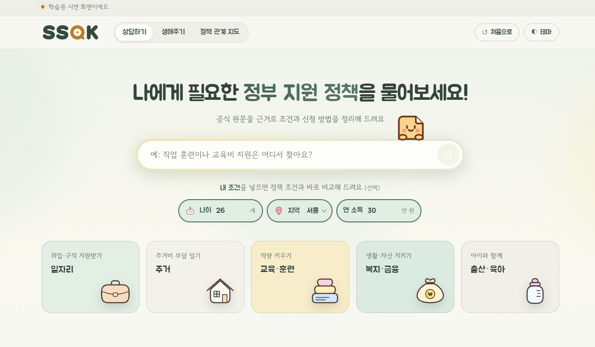
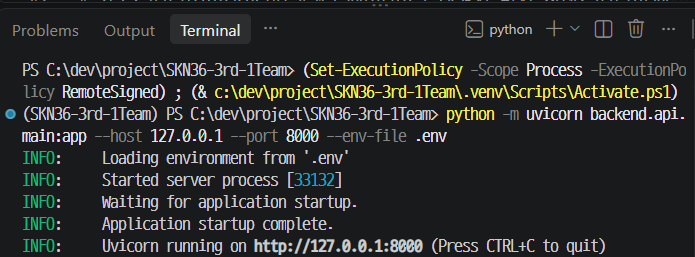
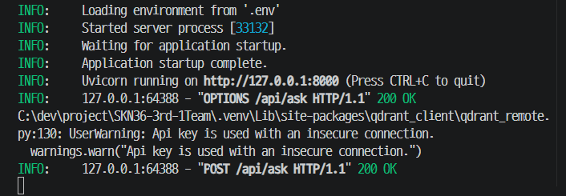
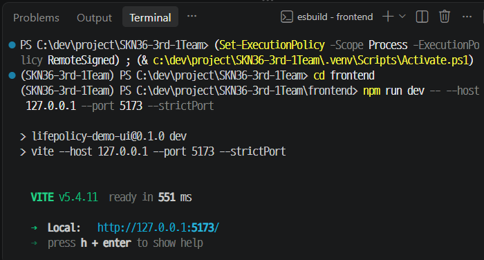
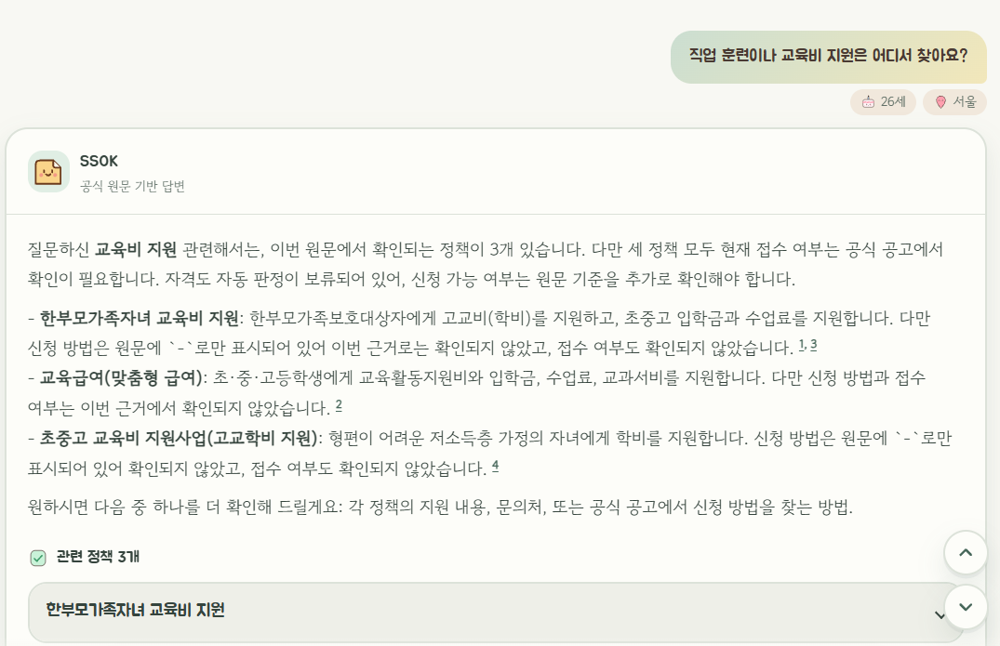
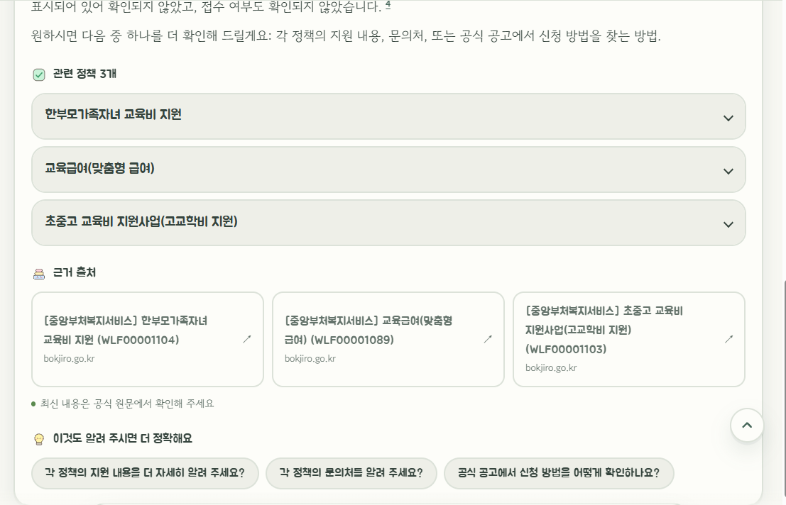
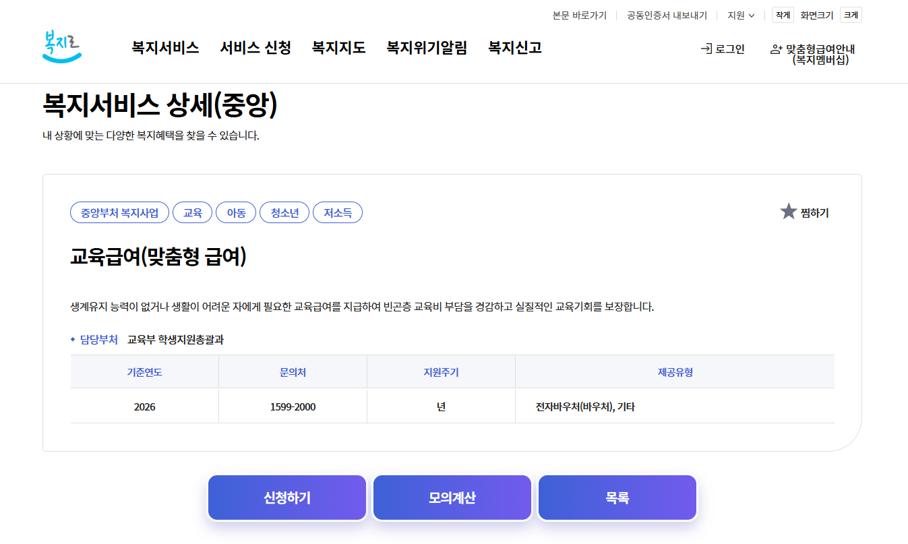
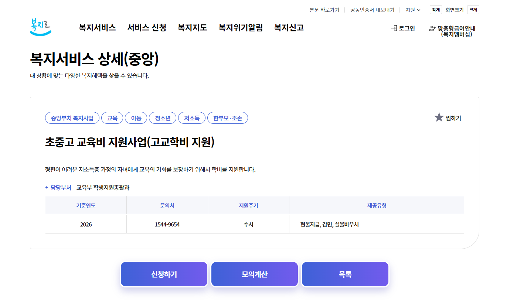

# 💻 산출물 03 · 개발된 소프트웨어

<table-of-contents color="gray" />

| 프로젝트명 | 작성자 | 버전 | 최종 수정일 |
| --- | --- | --- | --- |
| SSOK | 강민지 | 3차 제출 준비 · <code>d63e3b3</code> | 2026/11/12 |

## 1. 소프트웨어 개요

- <b>서비스</b> — SSOK은 생애주기별 지원 정책을 탐색하고, 공식 원문을 근거로 정책 질문에 답하는 서비스입니다.
- <b>사용자와 시나리오</b> — 취업·주거·돌봄 지원 정보를 찾는 사람이 질문과 선택 조건을 입력하고, 답변·출처·관련 정책을 확인합니다. 생애주기와 관계 지도에서도 정책을 탐색할 수 있습니다.
- <b>검토·기록 기준</b> — <code>main</code>의 <code>d63e3b3</code>(PR #65 머지). [GitHub 저장소](https://github.com/SKNETWORKS-FAMILY-AICAMP/SKN36-3rd-1Team) · [기준 커밋](https://github.com/SKNETWORKS-FAMILY-AICAMP/SKN36-3rd-1Team/commit/d63e3b39e194d16aaeb15efcd3d44773a9108c68)
- <b>실행 진입점</b> — React [<code>frontend/src/main.tsx</code>](https://github.com/SKNETWORKS-FAMILY-AICAMP/SKN36-3rd-1Team/blob/d63e3b39e194d16aaeb15efcd3d44773a9108c68/frontend/src/main.tsx) · FastAPI [<code>backend/api/main.py</code>](https://github.com/SKNETWORKS-FAMILY-AICAMP/SKN36-3rd-1Team/blob/d63e3b39e194d16aaeb15efcd3d44773a9108c68/backend/api/main.py)

## 2. 기능 및 구현 현황

강민지는 React 시연 화면과 실행·검증 기록을 담당합니다. <br />나지인은 RAG Pipeline·API 연동, <br />박소희는 Checker·답변 생성, <br />주민혁은 검색·DB, <br />장반석은 원문·데이터를 담당합니다.

### 기능 구현 요약

| 기능 ID | 기능명 | 입력 | 처리·출력 | 구현 상태 | 테스트 ID |
| --- | --- | --- | --- | --- | --- |
| FR-01·02 | 질문·가상 프로필 입력 | 질문, 선택 조건(나이·지역·연 소득) | 입력 검증, 상담 요청 및 오류 표시 | 구현 완료 | TC-01·02 |
| FR-03·04 | 정책 관계와 공식 원문 검색 | 질문·조건 | Qdrant 검색과 Neo4j 정책 관계 조회, 공통 ID로 정책과 근거 연결 | 구현 완료 | TC-02·09 |
| FR-05·07 | 근거 기반 답변 및 출처 | 검색 근거·Checker 결과 | 답변, 인용 번호와 공식 링크, 정책 카드 | 구현 완료 | TC-03·04 |
| FR-06 | 추가 질문·근거 없음 | 부족한 조건 또는 근거 없는 질문 | 나이·지역·소득 추가 입력, 대화로 답한 나이·지역·소득 반영, 근거 없음 안내, 동일 질문 재확인 | 구현 완료 · 근거 없음과 추가 조건 입력의 사용자 확인은 §5 참조. 대화로 입력한 조건의 반영은 프론트 단위 테스트와 PR #65 리뷰 당시 로컬 실제 API 화면 확인 참조 | TC-05·06 |
| FR-08 | 정정·중복 관리 | 원문·문서 ID·릴리스 데이터 | 데이터 교정·증분 릴리스·품질 검증 | 데이터 작업 도구 제공 · 제품 화면의 관리 기능은 범위 밖 | TC-07·10 |
| — | 생애주기 탐색·정책 관계 지도 | 단계·분야·정책 선택 | 관련 정책 탐색, 관계 및 근거 확인, 상담 연결 | 구현 완료 | 프론트 그래프 테스트 |

### 기능별 구현 코드

| 기능 ID | 코드 경로 |
| --- | --- |
| FR-01·02 | [<code>frontend/src/App.tsx</code>](https://github.com/SKNETWORKS-FAMILY-AICAMP/SKN36-3rd-1Team/blob/d63e3b39e194d16aaeb15efcd3d44773a9108c68/frontend/src/App.tsx) · [<code>frontend/src/api/client.ts</code>](https://github.com/SKNETWORKS-FAMILY-AICAMP/SKN36-3rd-1Team/blob/d63e3b39e194d16aaeb15efcd3d44773a9108c68/frontend/src/api/client.ts) |
| FR-03·04 | [<code>database/hybrid_search.py</code>](https://github.com/SKNETWORKS-FAMILY-AICAMP/SKN36-3rd-1Team/blob/d63e3b39e194d16aaeb15efcd3d44773a9108c68/database/hybrid_search.py) · [<code>backend/rag/pipeline.py</code>](https://github.com/SKNETWORKS-FAMILY-AICAMP/SKN36-3rd-1Team/blob/d63e3b39e194d16aaeb15efcd3d44773a9108c68/backend/rag/pipeline.py) |
| FR-05·07 | [<code>backend/llm/generator.py</code>](https://github.com/SKNETWORKS-FAMILY-AICAMP/SKN36-3rd-1Team/blob/d63e3b39e194d16aaeb15efcd3d44773a9108c68/backend/llm/generator.py) · [<code>frontend/src/components/TurnView.tsx</code>](https://github.com/SKNETWORKS-FAMILY-AICAMP/SKN36-3rd-1Team/blob/d63e3b39e194d16aaeb15efcd3d44773a9108c68/frontend/src/components/TurnView.tsx) |
| FR-06 | [<code>backend/rag/pipeline.py</code>](https://github.com/SKNETWORKS-FAMILY-AICAMP/SKN36-3rd-1Team/blob/d63e3b39e194d16aaeb15efcd3d44773a9108c68/backend/rag/pipeline.py) · [<code>frontend/src/components/TurnView.tsx</code>](https://github.com/SKNETWORKS-FAMILY-AICAMP/SKN36-3rd-1Team/blob/d63e3b39e194d16aaeb15efcd3d44773a9108c68/frontend/src/components/TurnView.tsx) · [<code>frontend/src/lib/parseProfile.ts</code>](https://github.com/SKNETWORKS-FAMILY-AICAMP/SKN36-3rd-1Team/blob/d63e3b39e194d16aaeb15efcd3d44773a9108c68/frontend/src/lib/parseProfile.ts) · [<code>frontend/src/lib/profileReply.ts</code>](https://github.com/SKNETWORKS-FAMILY-AICAMP/SKN36-3rd-1Team/blob/d63e3b39e194d16aaeb15efcd3d44773a9108c68/frontend/src/lib/profileReply.ts) |
| FR-08 | [<code>scripts/build_incremental_release_candidate.py</code>](https://github.com/SKNETWORKS-FAMILY-AICAMP/SKN36-3rd-1Team/blob/d63e3b39e194d16aaeb15efcd3d44773a9108c68/scripts/build_incremental_release_candidate.py) · [<code>scripts/verify_data_quality.py</code>](https://github.com/SKNETWORKS-FAMILY-AICAMP/SKN36-3rd-1Team/blob/d63e3b39e194d16aaeb15efcd3d44773a9108c68/scripts/verify_data_quality.py) |
| — | [<code>frontend/src/components/LifeTimeline.tsx</code>](https://github.com/SKNETWORKS-FAMILY-AICAMP/SKN36-3rd-1Team/blob/d63e3b39e194d16aaeb15efcd3d44773a9108c68/frontend/src/components/LifeTimeline.tsx) · [<code>frontend/src/components/PolicyMap.tsx</code>](https://github.com/SKNETWORKS-FAMILY-AICAMP/SKN36-3rd-1Team/blob/d63e3b39e194d16aaeb15efcd3d44773a9108c68/frontend/src/components/PolicyMap.tsx) |

## 3. 실행 환경 및 설치

| 항목 | 버전·설정 |
| --- | --- |
| OS·Python | DB 복원 검증 환경 Windows / Python 3.13.15 |
| Node.js | 18 이상. 프론트 README 개발 확인 환경 Node 24.20.0 / npm 11.19.0 |
| 의존성 | Python <code>requirements.txt</code>, React <code>frontend/package.json</code>, DB 복원용 Docker Desktop |
| 모델·DB | Ollama <code>qwen3-embedding:0.6b</code>, 답변 생성 <code>gpt-5.4-mini</code>, Qdrant·Neo4j |
| 데이터 | <code>data/releases/v1.4.0-candidate/</code>. 백엔드 DB와 프론트 관계 지도에 동일 릴리스 사용 |
| CPU·GPU·메모리 | 최소 사양 미측정 |

1. GitHub 저장소를 내려받고 기준 커밋 <code>d63e3b3</code>(main)을 체크아웃합니다. [저장소](https://github.com/SKNETWORKS-FAMILY-AICAMP/SKN36-3rd-1Team)
2. Python 가상환경을 만들고 <code>requirements.txt</code>를 설치합니다. 복원 ZIP으로 Qdrant·Neo4j를 복원하고 Ollama 임베딩 모델을 준비합니다. ZIP 위치와 복원 검증 절차는 가이드를 따릅니다. [DB 복원 가이드](https://github.com/SKNETWORKS-FAMILY-AICAMP/SKN36-3rd-1Team/blob/d63e3b39e194d16aaeb15efcd3d44773a9108c68/docs/development/ISSUE43_RESTORE_GUIDE.md)
3. 저장소 루트의 <code>.env</code>에 복원 환경과 일치하는 DB 주소·인증 정보, Ollama 주소와 답변 생성 설정을 입력합니다. 가상환경을 활성화한 뒤 루트에서 백엔드를 실행합니다.

```powershell
python -m pip install -r requirements.txt
python -m uvicorn backend.api.main:app --host 127.0.0.1 --port 8000 --env-file .env
```

4. 별도 터미널에서 <code>frontend/.env.local</code>에 <code>VITE_ASK_API_URL=http://127.0.0.1:8000/api/ask</code>를 지정하고 아래 명령을 실행합니다. 백엔드 포트를 바꾸면 이 주소도 함께 바꿉니다. [프론트 실행 안내](https://github.com/SKNETWORKS-FAMILY-AICAMP/SKN36-3rd-1Team/blob/d63e3b39e194d16aaeb15efcd3d44773a9108c68/frontend/README.md)

```powershell
cd frontend
npm install
npm run dev -- --host 127.0.0.1 --port 5173 --strictPort
```

5. <code>http://127.0.0.1:8000/health</code>에서 API 기동을 확인합니다. 검색 결과가 처음 반환되기 전에는 <code>ready: false</code>일 수 있습니다. 브라우저에서 <code>http://127.0.0.1:5173/</code>를 열고 상담 질문을 보내 답변·공식 출처와 백엔드 <code>POST /api/ask</code>의 성공 응답까지 확인합니다.
6. 예시 모드는 <code>VITE_ASK_API_URL</code>을 비우고 프론트 개발 서버를 시작합니다. 화면의 ‘예시 응답’ 표기로 모드를 확인할 수 있습니다.

[루트 README · 로컬에서 전체 실행하기](https://github.com/SKNETWORKS-FAMILY-AICAMP/SKN36-3rd-1Team/blob/d63e3b39e194d16aaeb15efcd3d44773a9108c68/README.md#%EB%A1%9C%EC%BB%AC%EC%97%90%EC%84%9C-%EC%A0%84%EC%B2%B4-%EC%8B%A4%ED%96%89%ED%95%98%EA%B8%B0)

## 4. 폴더·모듈 구성

| 경로 | 역할 | 실행 여부·순서 |
| --- | --- | --- |
| <code>data/releases/v1.4.0-candidate/</code> | 정책·원문·관계 데이터와 매니페스트 | DB 복원과 프론트 관계 지도에 사용 |
| <code>database/</code> | Qdrant 원문 검색·Neo4j 관계 조회 | DB 복원 후 상담 요청 시 사용 |
| <code>backend/api/</code> | FastAPI 진입점, 상태 확인·질문 API, 요청·응답 검증 | 프론트 연결 전에 실행 |
| <code>backend/rag/</code> · <code>backend/eligibility/</code> · <code>backend/llm/</code> | 근거 선택, 조건 판정, 답변 생성 | 질문 API가 호출 |
| <code>frontend/</code> | 상담·생애주기·관계 지도와 출처·후속 질문 표시 | 실제 API 모드는 백엔드 기동 후 실행. 예시 모드는 독립 실행 |
| <code>scripts/</code> · <code>tests/</code> | 데이터 검증·평가·회귀 테스트 | 검증할 때 별도 실행 |

### 4-1. RAG 구현 단계 및 코드 근거

사용자 질문을 임베딩한 후 Qdrant의 공식 원문 청크를 검색하고, 공통 정책 ID로 Neo4j 관계·자격 조건 문맥을 조회합니다. 이후 Checker 결과와 출처 가능한 근거를 LLM에 전달해 답변을 생성합니다. 아래는 기준 커밋 <code>d63e3b3</code>에서 확인한 구현 위치입니다.

| 단계 | 구현 내용 | 코드 근거 |
| --- | --- | --- |
| 문서 청킹 | 정책 원문을 청크로 구성하고 <code>chunk_id</code>·<code>point_id</code>로 식별 | [<code>database/chunking.py</code>](https://github.com/SKNETWORKS-FAMILY-AICAMP/SKN36-3rd-1Team/blob/d63e3b39e194d16aaeb15efcd3d44773a9108c68/database/chunking.py) |
| 임베딩 | Ollama 임베딩 API(<code>/api/embed</code>)를 사용해 문서·질의 텍스트를 벡터화 | [<code>database/embedding.py</code>](https://github.com/SKNETWORKS-FAMILY-AICAMP/SKN36-3rd-1Team/blob/d63e3b39e194d16aaeb15efcd3d44773a9108c68/database/embedding.py) |
| 벡터 저장 | <code>execute_full_index</code>가 청크를 배치 임베딩하고 Qdrant에 <code>upsert</code>; 저장 후 색인 검증 | [<code>database/full_index.py</code>](https://github.com/SKNETWORKS-FAMILY-AICAMP/SKN36-3rd-1Team/blob/d63e3b39e194d16aaeb15efcd3d44773a9108c68/database/full_index.py) · [<code>database/qdrant/store.py</code>](https://github.com/SKNETWORKS-FAMILY-AICAMP/SKN36-3rd-1Team/blob/d63e3b39e194d16aaeb15efcd3d44773a9108c68/database/qdrant/store.py) |
| 검색·관계 결합 | Qdrant Top-K 청크 검색 → <code>policy_id</code> 기준 Neo4j 문맥 조회·결합 | [<code>database/hybrid_search.py</code>](https://github.com/SKNETWORKS-FAMILY-AICAMP/SKN36-3rd-1Team/blob/d63e3b39e194d16aaeb15efcd3d44773a9108c68/database/hybrid_search.py) |
| 근거 선택·조건 판정 | 인용 가능한 원문만 선택하고 Checker 판정을 연결; 근거가 없으면 <code>no_evidence</code> 반환 | [<code>backend/rag/context_builder.py</code>](https://github.com/SKNETWORKS-FAMILY-AICAMP/SKN36-3rd-1Team/blob/d63e3b39e194d16aaeb15efcd3d44773a9108c68/backend/rag/context_builder.py) · [<code>backend/rag/pipeline.py</code>](https://github.com/SKNETWORKS-FAMILY-AICAMP/SKN36-3rd-1Team/blob/d63e3b39e194d16aaeb15efcd3d44773a9108c68/backend/rag/pipeline.py) |
| 답변·출처 | LLM 답변 생성과 출처 번호 검증, <code>citations</code>·<code>policy_checks</code> 응답 구성 | [<code>backend/llm/generator.py</code>](https://github.com/SKNETWORKS-FAMILY-AICAMP/SKN36-3rd-1Team/blob/d63e3b39e194d16aaeb15efcd3d44773a9108c68/backend/llm/generator.py) · [<code>backend/rag/pipeline.py</code>](https://github.com/SKNETWORKS-FAMILY-AICAMP/SKN36-3rd-1Team/blob/d63e3b39e194d16aaeb15efcd3d44773a9108c68/backend/rag/pipeline.py) · [<code>backend/api/schemas.py</code>](https://github.com/SKNETWORKS-FAMILY-AICAMP/SKN36-3rd-1Team/blob/d63e3b39e194d16aaeb15efcd3d44773a9108c68/backend/api/schemas.py) |

<ul>
<li>
<b>색인 안전성:</b> <code>execute_full_index</code>는 명시적 쓰기 승인(<code>confirm_write=True</code>)이 없으면 DB를 변경하지 않으며, 기존 컬렉션과 충돌하면 중단합니다. 기존 Point가 있으면 누락분만 저장하도록 구현되어 있습니다.
</li>
<li>
<b>검색 안전성:</b> Hybrid 검색은 읽기 전용으로 설계되어 있으며, 사용자 입력을 Cypher 문자열에 직접 결합하지 않고 파라미터와 제한된 필터 필드를 사용합니다.
</li>
<li>
<b>검증 기준:</b> [<code>docs/development/ISSUE43_RESTORE_GUIDE.md</code>](https://github.com/SKNETWORKS-FAMILY-AICAMP/SKN36-3rd-1Team/blob/d63e3b39e194d16aaeb15efcd3d44773a9108c68/docs/development/ISSUE43_RESTORE_GUIDE.md)에는 v1.4.0 복원 기준으로 Qdrant 1,138 Point(1,024차원·Cosine), Neo4j 1,004노드·2,431관계 및 복원 환경에서의 DB 스모크 18개·안전 테스트 8개 통과가 기록되어 있습니다. 
</li>
</ul>

### 4-2. 예외 처리 및 비밀정보 관리

| 평가 항목 | 코드에서 확인한 처리 |
| --- | --- |
| 입력값 검증 | Pydantic으로 질문 길이, 나이 범위, 소득값, 응답 구조 등을 검증; 잘못된 요청은 422 반환 |
| 검색·LLM 오류 | 검색 서비스 미가용(503), 검색 시간 초과(504), LLM 미가용(502), LLM 시간 초과(504), 출력 검증 실패(502) 등을 오류 코드와 사용자용 메시지로 구분 |
| 근거 없음 | 인용 가능한 공식 원문이 없으면 생성기 호출 없이 <code>no_evidence</code> 응답 |
| 환경변수 | 루트 <code>.env</code>와 <code>frontend/.env.local</code> 설정을 통해 DB·모델·API 주소 관리 |
| 비밀정보 파일 제외 | <code>.gitignore</code>에서 <code>.env</code>, <code>.env.*</code>(예시 파일 제외), <code>*.pem</code>, <code>*.key</code>, <code>secrets/</code>, 인증정보 파일 패턴 등을 Git 추적에서 제외하도록 설정 |

<b>구현 근거:</b> [<code>backend/api/main.py</code>](https://github.com/SKNETWORKS-FAMILY-AICAMP/SKN36-3rd-1Team/blob/d63e3b39e194d16aaeb15efcd3d44773a9108c68/backend/api/main.py) · [<code>backend/api/schemas.py</code>](https://github.com/SKNETWORKS-FAMILY-AICAMP/SKN36-3rd-1Team/blob/d63e3b39e194d16aaeb15efcd3d44773a9108c68/backend/api/schemas.py) · [<code>backend/rag/pipeline.py</code>](https://github.com/SKNETWORKS-FAMILY-AICAMP/SKN36-3rd-1Team/blob/d63e3b39e194d16aaeb15efcd3d44773a9108c68/backend/rag/pipeline.py) · [<code>.gitignore</code>](https://github.com/SKNETWORKS-FAMILY-AICAMP/SKN36-3rd-1Team/blob/d63e3b39e194d16aaeb15efcd3d44773a9108c68/.gitignore)

<b>검증 범위:</b> 파일 제외 규칙이 존재한다는 사실은 확인했으나, 과거 커밋까지 포함한 실제 비밀키 유출 여부의 전체 감사는 수행하지 않았습니다. <br />외부 배포 시에는 별도 점검이 필요합니다.

## 5. 최소 실행 및 시연 결과

### 시연 결과 요약

| 실행·시나리오 | 입력 예시 | 기대 기능 | 실제 결과·근거 |
| --- | --- | --- | --- |
| 기본 질문·공식 출처 | 청년월세 한시 특별지원 | 마감·추가 확인 안내 및 공식 출처 표시 | PR #46 검토 커밋 <code>1b9fa52</code> 백엔드와 로컬 React에서 마감·안내 및 정부24·복지로 링크 수동 확인 |
| 카드에서 이어서 질문 | 국민내일배움카드의 ‘이 정책 물어보기’ | 같은 사용자 조건으로 질문 전송, 중복 클릭 방지 | #62 리뷰 당시 실연동 브라우저에서 확인. 연속 클릭 시 요청 1건 |
| 오류·재시도 | 백엔드 중단 후 질문, 서버 복구 후 ‘다시 시도’ | 오류 안내 후 같은 질문과 조건으로 복구 | #62 리뷰 당시 실연동 브라우저에서 확인 |
| 근거 없음 | 공식 근거가 없는 질문 | 근거 없음 안내 | 사용자 최종 확인 완료 · 별도 캡처·로그 근거는 문서에 미기재 |
| 추가 조건 입력 | 비교에 필요한 조건을 비운 질문 | 정보 요청 후 입력값을 포함해 원래 질문 재전송 | 사용자 최종 확인 완료 · 별도 캡처·로그 근거는 문서에 미기재 |
| 대화로 조건 답하기 | 질문 뒤 “난 26살이야”처럼 나이·지역·소득만 입력 | 내 조건에 넣고 앞 질문을 바뀐 조건으로 다시 확인. 월급 같은 월 단위 금액은 연 소득으로 넣지 않음 | 프론트 단위 테스트 통과 · [PR #65](https://github.com/SKNETWORKS-FAMILY-AICAMP/SKN36-3rd-1Team/pull/65) 리뷰 당시 로컬 브라우저 확인 |
| 제출 코드 실연동 E2E | “서울 사는 청년인데 월세 지원 받을 수 있는 정책이 있나요?”(26세), “햄버거 먹고 싶어” | React→API→DB→OpenAI 답변·공식 출처·정책 카드 표시 | 2026-11-12 <code>d63e3b3</code> 코드로 2건 모두 HTTP 200. 답변·공식 출처 5건·정책 카드 5개 표시, 관련 없는 질문은 자격을 단정하지 않고 근거 범위 안에서 안내 · 기록 <code>docs/reports/ssok-deliverables/assets/3-14-e2e_20261112.json</code> |

### 시연 항목별 관련 코드

| 실행·시나리오 | 관련 코드 |
| --- | --- |
| 기본 질문·공식 출처 | <code>backend/api/main.py</code> · <code>frontend/src/App.tsx</code> |
| 카드에서 이어서 질문 | <code>frontend/src/App.tsx</code> · <code>frontend/src/components/TurnView.tsx</code> |
| 오류·재시도 | <code>frontend/src/api/client.ts</code> · <code>frontend/src/App.tsx</code> |
| 근거 없음 | <code>frontend/src/lib/answerView.ts</code> |
| 추가 조건 입력 | <code>frontend/src/components/TurnView.tsx</code> · <code>frontend/src/App.tsx</code> |
| 대화로 조건 답하기 | <code>frontend/src/lib/parseProfile.ts</code> · <code>frontend/src/lib/profileReply.ts</code> · <code>frontend/src/App.tsx</code> |

- <b>기준 커밋에서 실행한 자동 검증</b> — 프론트 <code>npm test</code> 13개 파일·102개 테스트 통과, <code>npm run typecheck</code> 통과(2026-11-12, <code>d63e3b3</code>).
- <b>발표 환경 기능 확인 완료</b> — 사용자 확인에 따라 정상 답변·출처, 근거 없음, 추가 입력, 오류·재시도 항목의 확인 상태를 완료로 기록했습니다. 별도 증빙이 없는 항목의 실행 로그·캡처는 추가 기록이 필요합니다.
- 브라우저 수동 확인은 당시 검토 범위를 기록한 것입니다. [PR #46](https://github.com/SKNETWORKS-FAMILY-AICAMP/SKN36-3rd-1Team/pull/46) · [PR #62](https://github.com/SKNETWORKS-FAMILY-AICAMP/SKN36-3rd-1Team/pull/62) · [PR #65](https://github.com/SKNETWORKS-FAMILY-AICAMP/SKN36-3rd-1Team/pull/65)

## 6. 주요 설계와 개선 기록

| 문제 | 원인 | 변경 사항 | 검증 결과·근거 | 남은 한계 |
| --- | --- | --- | --- | --- |
| 공식 기준을 다시 찾아야 함 | 정책 카드에는 개인 판정과 확인 안내 위주로 표시 | 답변 본문에서 공식 기준과 출처를 안내 | [PR #61](https://github.com/SKNETWORKS-FAMILY-AICAMP/SKN36-3rd-1Team/pull/61) | 항목별 공식 기준의 카드 표시는 4차 |
| 제외 조건을 일반 충족으로 해석할 수 있음 | 조건 목록에서 그룹과 제외 여부를 구분하기 어려움 | 카드에서 불확실한 그룹의 결과를 ‘개별 비교’로 표시 | [PR #61](https://github.com/SKNETWORKS-FAMILY-AICAMP/SKN36-3rd-1Team/pull/61) | Checker·API에서 제외 구조를 전달하고 답변까지 보완하는 작업은 4차 |
| 판정 근거가 없는 정책의 문구가 불명확함 | 구조화된 비교 조건이 없는 경우에도 일반 확인 안내 표시 | ‘자동 판정 안 함’ 표시와 공식 원문 안내 | 프론트 테스트 통과 · [PR #62](https://github.com/SKNETWORKS-FAMILY-AICAMP/SKN36-3rd-1Team/pull/62) | 공식 원문에서 자격 요건 확인 필요 |
| 카드에서 정책을 다시 검색해야 함 | 다음 질문에 정책을 직접 입력해야 함 | ‘이 정책 물어보기’ 버튼 추가 | #62 실연동 브라우저에서 조건 전달과 중복 전송 방지 확인. [PR #62](https://github.com/SKNETWORKS-FAMILY-AICAMP/SKN36-3rd-1Team/pull/62) | 예시 모드에서는 버튼 숨김 |
| 나이를 대화로 다시 말해도 앞 질문을 다시 확인하지 않음 | “난 26살이야”가 새 질문으로 전송됨. 백엔드는 현재 질문 문장으로만 검색 | 조건만 담은 답이면 내 조건에 넣고 앞 질문을 바뀐 조건으로 다시 보냄. 새 질문이 섞인 문장과 월 단위 금액은 제외 | 프론트 테스트 통과 · [PR #65](https://github.com/SKNETWORKS-FAMILY-AICAMP/SKN36-3rd-1Team/pull/65)(#64) | 백엔드가 대화 맥락을 검색에 쓰는 방식은 4차 |
| 문의처가 본문에 섞여 있음 | 응답에 정책별 문의처 필드가 없음 | 확인된 문의처를 출처와 함께 분리 표시하는 작업을 4차로 이관 | [4차 작업 계획](https://app.notion.com/p/415896a638728147ad78c1ff2346a92c) | 정책별 원문 대조와 API 연동 필요 |

### 시연 화면 및 실행 증빙 · 총 8장

<b>① 서비스 실행 화면 및 구동 확인 · 4장</b>



실행 · SSOK 상담 첫 화면



실행 · FastAPI 기동 · 로컬 8000번 포트



실행 · 질문 API 응답 · POST /api/ask 200 OK



실행 · Vite 기동 · 로컬 5173번 포트

<b>② 상담 결과 및 관련 정책 출처 · 2장</b>

<p>
“직업 훈련이나 교육비 지원은 어디서 찾아요?” 질문에 교육비 지원 정책 3건과 출처가 표시됐습니다. 복지로의 교육급여 및 초중고 교육비 지원사업 상세 페이지가 열렸으며, 백엔드 로그에서 <code>POST /api/ask</code>의 <code>200 OK</code>를 확인했습니다. 
</p>



상담 · 질문과 교육비 지원 정책 3건 답변



상담 · 관련 정책과 근거 출처 목록

<b>③ 공식 원문 검증 · 2장</b>



공식 원문 · 복지로 공식 원문 · 교육급여



공식 원문 · 복지로 공식 원문 · 초중고 교육비 지원사업

### 제출 확인

- [ ] README를 따라 새 환경에서 처음부터 실행
- [x] 데이터·모델 준비 방법과 DB 복원 가이드 연결
- [x] 기준 코드·의존성·환경변수 설정 위치 기록
- [x] 구현·검증 범위와 4차 작업 기록
- [x] 최종 발표 환경의 실연동 결과 및 캡처 첨부

---
