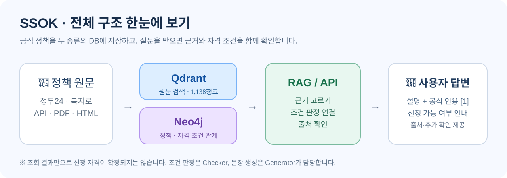
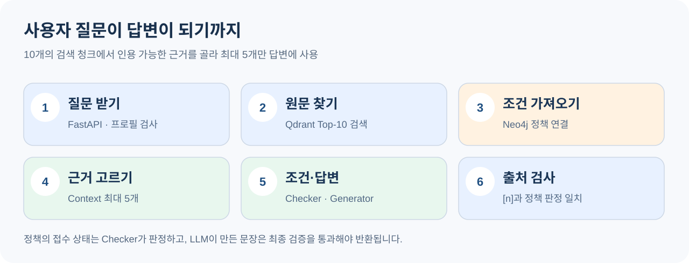
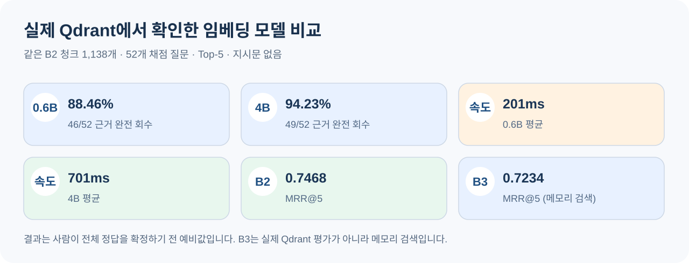
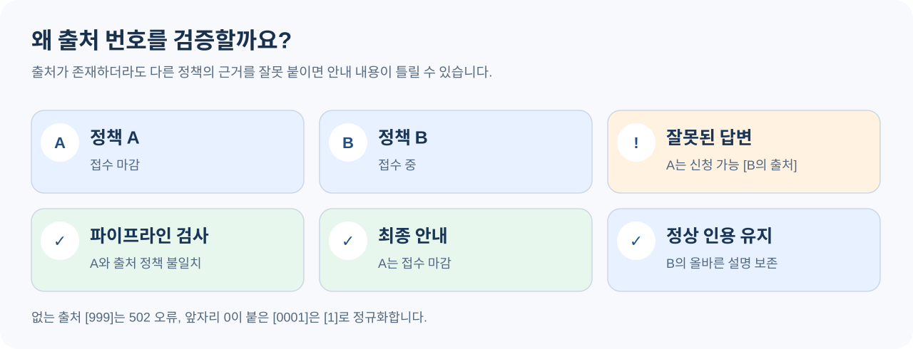

# 🔗 산출물 04 · RAG·LLM·벡터 DB 연동 구현 코드

<callout icon="📘" color="gray_bg">
<b>SSOK — 산출물 04 · RAG·LLM·벡터 DB 연동 코드</b>

먼저 <b>그림과 요약</b>으로 이해하고, 자세한 코드는 <b>접기 섹션</b>에서 확인합니다.
</callout>

| 항목 | 내용 |
| --- | --- |
| 프로젝트 | AI 기반 생애주기 맞춤형 정부 지원 정책 추천 및 질의응답 |
| 기존 문서·실험 참조 기준 | [c50b31b](https://github.com/SKNETWORKS-FAMILY-AICAMP/SKN36-3rd-1Team/tree/c50b31b) |
| 제출 구현 기준 | [d63e3b3](https://github.com/SKNETWORKS-FAMILY-AICAMP/SKN36-3rd-1Team/commit/d63e3b39e194d16aaeb15efcd3d44773a9108c68) · PR #65의 대화형 조건 입력 반영은 산출물 03 참조 |
| 데이터 | v1.4.0-candidate: 정책 246개, 문서 261개, B2 청크 1,138개 |
| 담당 | 나지인: RAG/API / 소희언니: Checker·Generator |
| 검증 | RAG/API 통합 검증은 실제 Qdrant·Neo4j·Checker와 고정 Generator 응답 사용. 실제 상담 화면 수동 검수와 모델 비교는 산출물 05에 별도 기록 |

<table-of-contents />

## 🌈 0. 전체 구조 한눈에 보기



<i>그림 1. SSOK 시스템 전체 아키텍처</i>

<b>Qdrant:</b> 질문과 뜻이 비슷한 공식 문장을 검색하는 서랍.

<b>Neo4j:</b> 정책과 나이·소득·지역 등 조건 관계를 저장하는 지도.

<b>Checker(박소희 담당):</b> 해당 정책의 조건과 접수 상태를 규칙으로 판정.

<b>Generator(박소희 담당):</b> 공식 근거와 Checker 판정에 기반해 설명하는 LLM.

<b>RAG/API(나지인 담당):</b> 검색·판정·LLM을 연결하고, 답변에 잘못된 정책 상태나 출처가 없는지 최종 검사.

---

## 1. 질문을 받으면 어떻게 동작할까요?



<i>그림 2. 질문 입력부터 답변 반환까지의 처리 흐름</i>

| 순서 | 설명 | 코드 |
| --- | --- | --- |
| 1 | 질문·프로필 검증 | <code>POST /api/ask</code> |
| 2 | Qdrant 원문 10개 검색 | <code>search_policy_context(k=10)</code> |
| 3 | Neo4j 정책 관계 조회 | <code>get_policy_graph_context()</code> |
| 4 | 유효한 인용 후보 정리 | <code>rank_citable_contexts()</code> |
| 5 | 조건 트리 기반 자격 판정 후 공식 근거·판정 결과를 활용한 LLM 답변 생성 | <code>check_eligibility()</code>, <code>generate_answer()</code> |
| 6 | 신청 가능·출처 오류 검사 후 반환 | <code>_align_answer_with_checks()</code>, <code>_citations()</code> |

<callout icon="💡" color="yellow_bg">
API는 우선 청크 <b>Top-10</b>을 검색한 다음 최종 공식 인용을 <b>최대 5개</b>로 줄입니다. A/B 실험의 Recall@5와는 구분해야 합니다.
</callout>

---

## 2. 📁 제출 코드와 실행 순서 — 원본 양식 1절

<b>데이터 준비는 한 번</b>, 사용자가 질문할 때마다 하는 것은 <b>이미 저장된 DB 검색</b>입니다.

| 단계 | 파일·함수 (GitHub) | 입력 | 출력·실행 방식 |
| --- | --- | --- | --- |
| ① 문서 로딩 | [load\_documents() / verify\_manifest\_checksums()](https://github.com/SKNETWORKS-FAMILY-AICAMP/SKN36-3rd-1Team/blob/c50b31b/database/handoff_data.py) | 승인 데이터셋 | 공식 문서 261개 / 해시 검증 |
| ② 청킹 | [chunk\_document() / chunk\_document\_b3()](https://github.com/SKNETWORKS-FAMILY-AICAMP/SKN36-3rd-1Team/blob/c50b31b/database/chunking.py) · [build\_config\_chunks()](https://github.com/SKNETWORKS-FAMILY-AICAMP/SKN36-3rd-1Team/blob/c50b31b/database/full_index.py) | 공식 문서 | B2 1,138청크 / DB 없는 청크 계획 확인 가능 |
| ③ 임베딩·DB | [execute\_full\_index()](https://github.com/SKNETWORKS-FAMILY-AICAMP/SKN36-3rd-1Team/blob/c50b31b/database/full_index.py) · [make\_ollama\_embedder()](https://github.com/SKNETWORKS-FAMILY-AICAMP/SKN36-3rd-1Team/blob/c50b31b/database/embedding.py) · [store](https://github.com/SKNETWORKS-FAMILY-AICAMP/SKN36-3rd-1Team/blob/c50b31b/database/qdrant/store.py) | 청크·정책 정보 | Qdrant 벡터+출처 저장 |
| ④ 정책 Graph | [load\_graph()](https://github.com/SKNETWORKS-FAMILY-AICAMP/SKN36-3rd-1Team/blob/c50b31b/database/neo4j/load_graph.py) | 정책·조건 구조 | Neo4j 노드·관계 |
| ⑤ 검색 | [search\_policy\_context()](https://github.com/SKNETWORKS-FAMILY-AICAMP/SKN36-3rd-1Team/blob/c50b31b/database/hybrid_search.py) | 질문·지역·k=10 | Qdrant 원문 + Neo4j 정책 정보 |
| ⑥ Context | [rank\_citable\_contexts()](https://github.com/SKNETWORKS-FAMILY-AICAMP/SKN36-3rd-1Team/blob/c50b31b/backend/rag/context_builder.py) · [select\_contexts()](https://github.com/SKNETWORKS-FAMILY-AICAMP/SKN36-3rd-1Team/blob/c50b31b/backend/rag/context_builder.py#L73) | 검색 결과 | 공식 출처 최대 5개 |
| ⑦ 조건·LLM | [Checker](https://github.com/SKNETWORKS-FAMILY-AICAMP/SKN36-3rd-1Team/blob/c50b31b/backend/eligibility/checker.py) · [Generator](https://github.com/SKNETWORKS-FAMILY-AICAMP/SKN36-3rd-1Team/blob/c50b31b/backend/llm/generator.py) | Context·프로필·정책 조건 | 자격 조건 판정·LLM 답변 생성 |
| ⑧ 응답 | [run\_ask\_pipeline()](https://github.com/SKNETWORKS-FAMILY-AICAMP/SKN36-3rd-1Team/blob/c50b31b/backend/rag/pipeline.py) · [ask()](https://github.com/SKNETWORKS-FAMILY-AICAMP/SKN36-3rd-1Team/blob/c50b31b/backend/api/main.py) · [AskResponse](https://github.com/SKNETWORKS-FAMILY-AICAMP/SKN36-3rd-1Team/blob/c50b31b/backend/api/schemas.py) | 답변·인용·판정 | JSON/오류 코드 반환 |

<toggle heading="h3">
📚 코드 파일별 역할 자세히 보기

<table header-row="true">
<colgroup>
<col />
<col width="343.00001525878906" />
</colgroup>
<tr>
<td>
파일
</td>
<td>
설명
</td>
</tr>
<tr>
<td>
<code>database/handoff_data.py</code>
</td>
<td>
승인 릴리스의 문서 로딩·SHA-256 검사
</td>
</tr>
<tr>
<td>
<code>database/chunking.py</code>
</td>
<td>
B2/B3 청크 생성·원문 문자 위치 기록
</td>
</tr>
<tr>
<td>
<code>database/full_index.py</code>
</td>
<td>
색인 계획·실행·중복/충돌 검증
</td>
</tr>
<tr>
<td>
<code>database/embedding.py</code>
</td>
<td>
정책명+섹션+본문을 임베딩 입력으로 변환
</td>
</tr>
<tr>
<td>
<code>database/qdrant/store.py</code>
</td>
<td>
Qdrant 저장·유사 문서 검색
</td>
</tr>
<tr>
<td>
<code>database/neo4j/load_graph.py</code>
</td>
<td>
정책·문서·기관·조건 관계 적재
</td>
</tr>
<tr>
<td>
<code>database/hybrid_search.py</code>
</td>
<td>
Qdrant + Neo4j의 결과 결합
</td>
</tr>
<tr>
<td>
<code>backend/rag/context_builder.py</code>
</td>
<td>
원문·URL 검증, 중복 제거, 정책 균형 정렬
</td>
</tr>
<tr>
<td>
<code>backend/rag/pipeline.py</code>
</td>
<td>
검색→조건→답변→검증 전체 연결
</td>
</tr>
<tr>
<td>
<code>backend/api/main.py</code>
</td>
<td>
FastAPI /health, /api/ask 및 장애 코드
</td>
</tr>
<tr>
<td>
<code>backend/api/schemas.py</code>
</td>
<td>
요청·응답 데이터 규격(Pydantic)
</td>
</tr>
<tr>
<td>
<code>backend/eligibility/checker.py</code>
</td>
<td>
조건 트리 기반 자격 판정·불확실 조건 처리
</td>
</tr>
<tr>
<td>
<code>backend/llm/generator.py</code>
</td>
<td>
검색 근거·자격 판정 기반 LLM 답변 생성·출처 인용
</td>
</tr>
<tr>
<td>
<code>ai/prompts/system_prompt.py</code>
</td>
<td>
근거 기반 답변·자격 확정 방지·인용 및 후속 질문 규칙
</td>
</tr>
</table>
</toggle>

<toggle heading="h3">
⚠️ DB 적재 및 재현 명령 — 쓰기 실행 시 주의

```powershell
# DB에 쓰지 않고 청크 계획만 확인
python -m database.full_index --config A_B2_V140 --no-db

# 아래 명령은 기존 데이터/권한 확인 및 팀 승인 후에만 실행
python -m database.full_index --config A_B2_V140 --execute --confirm-write
python scripts/restore_final_v140.py --bundle <복원폴더> --apply
```

서비스 질문 처리 시에는 <b>임베딩·Graph를 다시 적재하지 않고</b> <b>읽기 전용 조회</b>만 수행합니다.
</toggle>

---

## 3. 🧠 벡터 DB 및 검색 설정 — 원본 양식 2절

| 항목 | 🟦 서비스 기본값 | 🟪 A/B 비교용 4B |
| --- | --- | --- |
| 임베딩 모델 | <code>qwen3-embedding:0.6b</code> Q8\_0 | <code>qwen3-embedding:4b</code> Q4\_K\_M |
| 벡터 길이(차원) | <b>1,024</b> | <b>2,560</b> |
| Qdrant 컬렉션 | <code>exp_b2_qwen3emb06b_v140_v1</code> | <code>exp_b2_qwen3emb4b_v140_v1</code> |
| 원문 조각 수 | B2 <b>1,138개</b> | B2 <b>1,138개</b> |
| 거리/유사도 | Cosine | Cosine |
| 질의 지시문 | 없음 | 없음 |
| 서비스 사용 | <code>b2_06b_v140</code> 기본 프로필 | <b>별도 실험용, API 기본값 아님</b> |

<callout icon="🛡️" color="gray_bg">
<b>4B는 기존 0.6B에 덮어쓰지 않았습니다.</b>

4B 스냅샷을 <b>새 Qdrant 컬렉션</b>에 복원했으며, 두 컬렉션의 공통 청크·본문·출처 위치가 같고 모델·벡터 차원 등이 다름을 검증했습니다. 0.6B digest는 복원 전후 그대로입니다.
</callout>



<i>그림 3. 임베딩 모델 0.6B·4B 검색 품질 비교</i>

<toggle heading="h3">
⚙️ 검색 설정: 평가와 실제 서비스를 구분해 보기

- Qdrant <b>1.12.4</b>, Neo4j <b>5.26.32</b>, Ollama <b>0.40.15</b> (2026-11-10 로컬 검증 환경)
- 로컬 Docker 및 <code>.env</code> 기반 접속: <code>QDRANT_URL</code>, <code>QDRANT_API_KEY</code>, Neo4j 환경변수
- 거리·유사도는 <b>Cosine</b>, 평가 당시 <code>indexed_vectors_count=0</code>으로 기록됨
- 임베딩 입력 규칙: <code>policy_section_body_v2</code> = 정책명·섹션 제목+본문
- 질문 지시문 추가 없음 (같은 평가 조건 유지)
- 지역 필터: <code>region</code>의 시·도 표준값. 애매한 지역은 확인 필요 표시
- API 검색 청크 <b>k=10</b> → 최종 Context <b>최대 5</b>, A/B 테스트는 <b>Top-5</b>로 별도 측정
- 별도 학습형 재정렬 모델이나 고정 점수 임계값 대신 규칙 기반 정책 균형·마감 정책 후순위
- 동일 <code>chunk_id</code>에 기초한 UUIDv5 point ID로 중복 방지; 충돌 데이터 발견 시 중단
</toggle>

### 🔗 출처를 끝까지 추적하기 위한 세 가지 ID

| ID | 쉬운 뜻 | 실제 예시 |
| --- | --- | --- |
| <code>policy_id</code> | 어느 <b>정책</b>인가? | <code>POL_009</code> |
| <code>document_id</code> | 어느 <b>공식 문서</b>인가? | <code>DOC_MOLIT_002</code> |
| <code>chunk_id</code> | 문서의 어느 <b>문단 조각</b>인가? | <code>CHK_B2_DOC_MOLIT_002_C001</code> |

<toggle heading="h3">
📦 Qdrant payload(메타데이터) 상세

<table header-row="true">
<colgroup>
<col />
<col width="502.00001525878906" />
</colgroup>
<tr>
<td>
정보 종류
</td>
<td>
저장 필드
</td>
</tr>
<tr>
<td>
정책
</td>
<td>
<code>policy_id</code>, <code>policy_name</code>, <code>region</code>, <code>category</code>, <code>life_stages</code>, <code>target_groups</code>
</td>
</tr>
<tr>
<td>
원문/출처
</td>
<td>
<code>document_id</code>, <code>chunk_id</code>, <code>text</code>, <code>source_url</code>, <code>section_title</code>, <code>char_start/end</code>, <code>page_start/end</code>
</td>
</tr>
<tr>
<td>
검증·재현
</td>
<td>
<code>content_hash</code>, <code>chunking_version</code>, <code>embedding_model</code>, <code>embedding_dim</code>, <code>index_run_id</code>, <code>verification_status</code>
</td>
</tr>
</table>

원문 위치 정보는 <b>RAG 인용 추적</b>과 <b>검색 정답 구간 검수</b>에 활용합니다.
</toggle>

---

## 4. 🧩 핵심 코드 로직 — 원본 양식 3절

### 4-1. 📄 공식 문서를 잘라서 두 DB에 저장하기

> <b>비유로 이해하기:</b> 200쪽짜리 설명서를 통째로 검색하면 원하는 문장을 찾기 어려워요. 그래서 <b>목차와 제목을 보며 작은 메모지로 나눈 다음</b>, 메모지마다 어느 문서의 어디서 잘라왔는지 기록합니다. 그 메모지는 Qdrant에서 검색하고, 정책별 조건표는 Neo4j에서 찾습니다.

| 단계 | 실제 프로젝트 규칙 | 이유 |
| --- | --- | --- |
| 문서 로딩 | 승인 릴리스의 <b>261개 문서</b>와 해시 검사 | 원문 변조·버전 혼합 방지 |
| <b>B2 청킹</b> | 기본 구조 경계, 최대 <b>750자</b>, 긴 구간은 <b>80자 겹침</b>, 100자 미만은 관련 이웃과 병합 | 원문 의미 유지 |
| <b>B3 청킹(실험)</b> | HTML 제목 인식·고아 소제목 처리 개선, <b>1,220청크</b> | 구조 개선이 검색에 도움 되는지 확인 |
| 임베딩 | Qwen3 임베딩으로 텍스트를 <b>숫자 배열</b>로 변환 | 키워드가 달라도 비슷한 내용 찾기 |
| Qdrant 적재 | 벡터 + 원문 + 공식 URL + 정책·문서·청크 ID | 답변 출처 추적 |
| Neo4j 적재 | Policy·Document·Organization·ConditionGroup·EligibilityCondition 등의 관계 | 구조화된 조건 판정 제공 |

<toggle heading="h3">
🧑‍💻 실제 DB 구축 함수 및 검증 값 보기

- 문서: <code>handoff_data.load_documents(verify_hash=True)</code>, <code>verify_manifest_checksums()</code>
- 청킹: <code>chunk_document()</code>, <code>chunk_document_b3()</code>, <code>build_config_chunks()</code>
- 임베딩: <code>build_embedding_text(..., "policy_section_body_v2")</code> → <code>make_ollama_embedder()</code> → <code>validate_vectors()</code>
- Qdrant: <code>build_point_payload()</code>, <code>build_points()</code>, <code>upsert_points()</code>
- Neo4j: <code>load_graph()</code>, <code>verify_loaded_graph()</code> (쓰기 보호·관계·개수 검증)
- <b>실측 자료:</b> B2 0.6B Qdrant 1,138 Point, 4B Qdrant 1,138 Point, Neo4j <b>1,004노드 / 2,431관계</b>
- 0.6B digest: <code>e1e424fb60df6554b6dcbbb5b3596ca9887b9cc35455c2098e0296ecf079e475</code>
- 4B digest: <code>67eb0a1fba52a545913c5f1d446d719bead9d842d64de7dbc1b3f5be529098d0</code>

<b>원문 검증 출처:</b> 로컬 <code>docs/development/experiments/ab1_qdrant_local_20261110/payload_verification.json</code>, <code>neo4j_readonly_probe.json</code>.
</toggle>

### 4-2. 🔎 자연어 질문으로 공식 원문 찾기

<table header-row="true">
<colgroup>
<col width="234.24107360839844" />
<col width="310.00001525878906" />
</colgroup>
<tr>
<td>
함수
</td>
<td>
하는 일
</td>
</tr>
<tr>
<td>
<code>resolve_search_settings()</code>
</td>
<td>
릴리스에 맞는 검색 모델·컬렉션 확인
</td>
</tr>
<tr>
<td>
<code>search_policy_evidence()</code>
</td>
<td>
Qdrant에서 관련 청크 검색
</td>
</tr>
<tr>
<td>
<code>_collect_policy_ids()</code>
</td>
<td>
검색된 정책 ID를 중복 없이 정리
</td>
</tr>
<tr>
<td>
<code>get_policy_graph_context()</code>
</td>
<td>
동일 정책의 Neo4j 조건 관계 조회
</td>
</tr>
<tr>
<td>
<code>assess_policy_data_quality()</code>
</td>
<td>
조건 누락이나 검수 전 데이터의 경고 구성
</td>
</tr>
<tr>
<td>
<code>combine_policy_evidence()</code>
</td>
<td>
정책별 원문 근거+조건 관계 합치기
</td>
</tr>
<tr>
<td>
<code>rank_citable_contexts()</code>
</td>
<td>
본문/출처 확인·중복 제거·정책 균형
</td>
</tr>
<tr>
<td>
<code>select_contexts()</code>
</td>
<td>
최종 최대 5개 선정 및 인용 번호 부여
</td>
</tr>
</table>

<callout icon="📌" color="gray_bg">
<b>공통 ID가 연결 고리!</b>

Qdrant 청크에 <code>policy_id=POL_009</code>가 있다면 Neo4j에서도 같은 정책 ID로 조건 관계를 찾습니다. 그래야 서로 다른 정책의 조건이나 출처를 섞지 않을 수 있습니다.
</callout>

<toggle heading="h3">
🔍 검색 결과 객체와 입력 예시 자세히 보기

[HybridSearchSession](https://github.com/SKNETWORKS-FAMILY-AICAMP/SKN36-3rd-1Team/blob/c50b31b/database/hybrid_search.py)의 호출 예시:

```py
from database.hybrid_search import HybridSearchSession

with HybridSearchSession(profile="b2_06b_v140") as session:
    result = session.search_policy_context(
        "서울에 사는 청년이 받을 수 있는 정책",
        filters={"region": "서울특별시"},
        k=10,
    )
```

```txt
result["policies"]
 ├─ policy_id / policy_name
 ├─ graph              # 나이·소득·기관·모집 관계
 ├─ data_quality       # 불확실한 조건 경고
 └─ evidence[]
      ├─ chunk_id / document_id
      ├─ text / source_url
      ├─ char_start / char_end
      └─ rank / score
```

<code>_safe_message()</code>는 예외 메시지에 담길 수 있는 URL 사용자 정보와 DB 키·비밀번호를 정리합니다.
</toggle>

### 4-3. ⚙️ 검색된 근거를 LLM에 전달하고 안전하게 반환하기

| 순서 | 나지인 담당 함수/연결 | 의미 |
| --- | --- | --- |
| ① 입력 검사 | <code>AskRequest</code> | 질문 1\~2,000자, 나이 0\~120 정수 등 요청 검증 |
| ② 프로필 정리 | <code>run_ask_pipeline()</code> | “서울” → “서울특별시” |
| ③ Context 구성 | <code>rank_citable_contexts()</code> | 빈 본문·잘못된 URL 제거, 중복 제거 |
| ④ Checker 호출 | <code>check_fn(profile, policy)</code> | 조건 트리(AND/OR/NOT/UNKNOWN) 평가, 적격·부적격·확인 필요 판정 |
| ⑤ 근거 5개 이내로 선택 | <code>select_contexts()</code> | 마감 정책은 뒤로 보내되 직접 지정된 정책은 유지 |
| ⑥ Generator 호출 | <code>generate_fn(question, contexts, checks, history[-10:], profile=)</code> | 공식 검색 근거·Checker 판정 기반 LLM 답변 및 출처 인용 생성 |
| ⑦ 잘못된 답변 교정 | <code>_align_answer_with_checks()</code> | Checker 판정과 다른 신청 가능 단정 제거/교정 |
| ⑧ 공식 출처 검사 | <code>_citations()</code> | 실제 Context 번호와 일치하는지 확인 |
| ⑨ HTTP 응답 | <code>AskResponse</code> | 답변·인용·정책 조건·후속 질문·안내 반환 |

<toggle heading="h3">
① — Checker 자격 조건 판정 로직

<callout color="gray_bg">
<b>담당 파일:</b> <code>backend/eligibility/checker.py</code>

### 1. 구현 개요

Checker는 사용자 프로필과 Neo4j에서 조회한 구조화된 자격 조건을 비교하여 정책별 조건 충족 여부를 판정하는 모듈이다.

<code>check_eligibility(profile, policy)</code> 함수를 중심으로 조건 유형을 분석하고, AND·OR·NOT 논리 구조를 재귀적으로 평가한다.

<b>입력 데이터</b>

- <code>profile</code>: 사용자의 나이·지역·소득 등 정규화된 정보
- <code>policy</code>: 정책 ID, Neo4j 조건 트리, 데이터 품질 정보

<b>반환 데이터</b>

- <code>policy_id</code>: 평가 대상 정책 식별자
- <code>conditions[]</code>: 조건별 필드, 판정 상태 및 사유
- <code>reception_status</code>: 신청기간 상태

Checker는 DB 또는 LLM을 직접 호출하지 않으며, 전달받은 데이터에 대해서만 판정을 수행한다. 또한 개별 조건의 충족 결과를 정책 전체의 최종 신청 자격으로 간주하지 않는다.

### 2. 조건 트리 구조 및 논리 평가

Neo4j의 <code>ConditionGroup</code>과 <code>EligibilityCondition</code>을 트리 형태로 전달받아 <code>_walk()</code>에서 하위 조건을 재귀적으로 평가하고, <code>_combine()</code>에서 그룹별 결과를 결합한다.

<table header-row="true">
<colgroup>
<col width="106.00000762939453" />
<col width="530" />
</colgroup>
<tr>
<td>
논리
</td>
<td>
판정 기준
</td>
</tr>
<tr>
<td>
AND
</td>
<td>
모든 조건이 <code>eligible</code>이면 충족. 하나라도 <code>ineligible</code>이면 미충족. 나머지는 확인 필요
</td>
</tr>
<tr>
<td>
OR
</td>
<td>
하나라도 <code>eligible</code>이면 충족. 모든 조건이 <code>ineligible</code>이면 미충족. 나머지는 확인 필요
</td>
</tr>
<tr>
<td>
NOT
</td>
<td>
단일 조건의 충족·미충족을 반전. 확인 필요는 유지
</td>
</tr>
<tr>
<td>
UNKNOWN
</td>
<td>
조건 간 결합 관계가 불명확하므로 자동 판정 보류
</td>
</tr>
</table>

빈 조건 그룹, 누락된 노드, 순환 구조 또는 해석할 수 없는 논리도 <code>needs_check</code>로 처리한다.

이는 불완전한 그래프 정보를 근거로 사용자에게 잘못된 자격 판정을 제공하지 않기 위한 보수적 처리 방식이다.

### 3. 조건별 판정 기준

Checker는 조건 유형에 따라 다음과 같이 결과를 생성한다.

<table header-row="true">
<colgroup>
<col />
<col width="508.00001525878906" />
</colgroup>
<tr>
<td>
조건
</td>
<td>
처리 방식
</td>
</tr>
<tr>
<td>
나이
</td>
<td>
<code>BETWEEN</code> 연령 범위와 사용자 만 나이를 비교
</td>
</tr>
<tr>
<td>
지역
</td>
<td>
시·도, 시·군·구, 거주기간 등 공식 기준 확인 필요
</td>
</tr>
<tr>
<td>
소득
</td>
<td>
개인·가구 소득, 기준 중위소득, 기준연도 확인 필요
</td>
</tr>
<tr>
<td>
자녀 월령
</td>
<td>
지원하는 <code>LT</code> 형식에 한해 월령 비교
</td>
</tr>
<tr>
<td>
기타 조건
</td>
<td>
직접 비교 규칙이 없는 경우 추가 확인 필요
</td>
</tr>
</table>

판정 상태는 세 가지로 구분한다.

- <code>eligible</code>: 지원되는 비교 규칙에서 해당 개별 조건을 충족한 경우
- <code>ineligible</code>: 지원되는 비교 규칙에서 해당 개별 조건을 충족하지 못한 경우
- <code>needs_check</code>: 사용자 정보 누락, 조건 해석 불가, 원문 기준 불명확 또는 데이터 품질 문제로 자동 판정할 수 없는 경우

현재 MVP에서는 <b>나이와 일부 자녀 월령 조건을 자동 비교하며, 소득·지역을 포함한 다수의 자격 요건은 공식 근거 확인 대상으로 처리한다.</b>

### 4. 사용자 프로필 기반 판정 예시

다음은 실제 Checker 테스트에서 사용한 연령 비교 규칙을 바탕으로 구성한 예시이다.

<b>정책 조건</b>

- 나이: 만 19\~35세
- 지역: 별도 공식 거주 요건
- 소득: 별도 공식 소득 기준
- 조건 결합: AND

<b>사용자 프로필</b>

| 항목 | 입력값 |
| --- | --- |
| 나이 | 만 25세 |
| 지역 | 서울특별시 |
| 소득 | 미입력 |

<b>조건별 결과</b>

<table header-row="true">
<colgroup>
<col />
<col />
<col width="291.00001525878906" />
</colgroup>
<tr>
<td>
평가 항목
</td>
<td>
판정
</td>
<td>
사유
</td>
</tr>
<tr>
<td>
나이
</td>
<td>
<code>eligible</code>
</td>
<td>
만 25세는 19\~35세 범위에 포함
</td>
</tr>
<tr>
<td>
지역
</td>
<td>
<code>needs_check</code>
</td>
<td>
정확한 거주 요건 검증 필요
</td>
</tr>
<tr>
<td>
소득
</td>
<td>
<code>needs_check</code>
</td>
<td>
소득 비교 기준 및 사용자 정보 확인 필요
</td>
</tr>
<tr>
<td>
AND 종합 조건
</td>
<td>
<code>needs_check</code>
</td>
<td>
모든 자격 조건의 충족 여부가 확인되지 않음
</td>
</tr>
</table>

나이 조건을 만족하더라도 지역과 소득 기준이 확정되지 않았으므로 전체 조건을 충족했다고 안내하지 않는다.

<code>check_eligibility()</code>의 반환값에는 별도의 <code>overall_status</code>가 없으며, <code>conditions[]</code>에 각 조건 및 루트 그룹의 종합 판정이 포함된다.

### 5. 신청기간 상태 판정

<code>_reception_status()</code>는 정책의 신청기간 정보를 검토하여 다음 네 가지 상태를 반환한다.

<table header-row="true">
<colgroup>
<col />
<col width="316.00001525878906" />
</colgroup>
<tr>
<td>
상태
</td>
<td>
의미
</td>
</tr>
<tr>
<td>
<code>before</code>
</td>
<td>
신청 시작일 이전
</td>
</tr>
<tr>
<td>
<code>open</code>
</td>
<td>
현재 신청 가능한 기간
</td>
</tr>
<tr>
<td>
<code>closed</code>
</td>
<td>
신청 종료일 경과
</td>
</tr>
<tr>
<td>
<code>unknown</code>
</td>
<td>
날짜 정보 누락·형식 오류·상충 등으로 확정 불가
</td>
</tr>
</table>

판정에는 한국 표준시(<code>Asia/Seoul</code>) 기준 날짜를 사용한다.

신청 시작일과 종료일이 검증된 경우 날짜를 비교하며, 별도로 검증된 상시 접수 정보가 있는 경우에도 해당 규칙을 반영한다. 시작일이 종료일보다 늦거나 접수 정보가 상충하면 <code>unknown</code>을 반환한다.

신청기간이 명시되지 않았다는 이유만으로 접수 중이라고 단정하지 않는 것이 핵심이다.

### 6. 실제 데이터 연동 및 테스트 결과

실제 Neo4j v1.4.0 데이터로 조건 트리를 조회하여 Checker에 전달한 결과는 다음과 같다.

| 정책 ID | 실제 확인 결과 |
| --- | --- |
| <code>POL_005</code> 국민내일배움카드 | AND·NOT·OR 조건 트리와 13개 세부 조건 조회 |
| <code>POL_010</code> 국민취업지원제도 | UNKNOWN 그룹으로 인해 <code>needs_check</code> 반환 |
| <code>POL_YC_003</code> 청년 정책 | 구조화 조건 1개 조회, 정보 부족 시 <code>needs_check</code> 반환 |

<code>POL_005</code>는 공무원 제외 조건이 그래프에 존재했지만, 현재 Checker가 <code>occupation</code> 문자열을 직접 비교하는 기능은 지원하지 않아 자동 제외 판정까지 확인되지는 않았다.

또한 <code>tree_matches_requires_condition=False</code>가 확인되어 조건 트리와 평탄화 관계 간 정합성 개선 필요 사항을 도출했다.

<b>테스트 결과</b>

| 테스트 | 결과 |
| --- | --- |
| Checker·Eligibility 단위 테스트 | 171 PASS |
| RAG Pipeline 통합 테스트 | 47 PASS |
| RAG 서브테스트 | 86 PASS |
| 실제 Neo4j 조건 트리 조회 | 성공 |
| UNKNOWN·정보 부족 처리 | <code>needs_check</code> 확인 |

단위 테스트에서는 나이 경계값, 조건 누락, UNKNOWN 논리, 접수 상태, 데이터 품질 경고 등을 검증하였다. RAG 통합 테스트는 주로 Mock 기반으로 실행했으며, 실제 DB 조건 트리 검증은 별도로 수행하였다.

<b>구현 결과:</b> 확실하게 비교할 수 있는 개별 조건만 자동 판정하고, 불완전한 자격 정보는 확인 필요로 유지하도록 구현하였다.
</callout>
</toggle>

<toggle heading="h3">
② — Generator·프롬프트

<callout color="gray_bg">
<b>담당 파일:</b> <code>backend/llm/generator.py</code>, <code>ai/prompts/system_prompt.py</code>

### 1. 구현 개요

Generator는 검색된 공식 정책 원문과 Checker의 조건 판정 결과를 활용하여 사용자 질문에 대한 한국어 답변을 생성하는 모듈이다.

<code>generate_answer()</code>를 중심으로 공식 근거에 기반한 답변을 생성하고, 출처 인용과 JSON 응답 형식을 검증한다.

<b>입력 데이터</b>

<table header-row="true">
<colgroup>
<col width="141.00000762939453" />
<col width="320.00001525878906" />
</colgroup>
<tr>
<td>
입력
</td>
<td>
내용
</td>
</tr>
<tr>
<td>
<code>question</code>
</td>
<td>
사용자 질문
</td>
</tr>
<tr>
<td>
<code>contexts</code>
</td>
<td>
공식 정책 원문 및 출처 식별자(최대 5개)
</td>
</tr>
<tr>
<td>
<code>policy_checks</code>
</td>
<td>
Checker가 반환한 조건별 판정
</td>
</tr>
<tr>
<td>
<code>history</code>
</td>
<td>
최근 대화 이력 최대 10건
</td>
</tr>
<tr>
<td>
<code>profile</code>
</td>
<td>
상위 Pipeline에서 관리하는 사용자 정보
</td>
</tr>
</table>

<b>출력 데이터</b>

<table header-row="true">
<colgroup>
<col width="174.375" />
<col width="269.9553680419922" />
</colgroup>
<tr>
<td>
필드
</td>
<td>
내용
</td>
</tr>
<tr>
<td>
<code>status</code>
</td>
<td>
<code>answered</code>, <code>info</code>, <code>no_evidence</code>
</td>
</tr>
<tr>
<td>
<code>answer</code>
</td>
<td>
사용자에게 표시할 한국어 답변
</td>
</tr>
<tr>
<td>
<code>used_source_ids</code>
</td>
<td>
실제 답변에 인용한 출처 번호
</td>
</tr>
<tr>
<td>
<code>follow_up_questions</code>
</td>
<td>
후속 질문 및 추가 정보 입력 항목
</td>
</tr>
</table>

공식 근거가 없는 경우에는 OpenAI API를 호출하지 않고 <code>no_evidence</code>를 반환한다.

### 2. 프롬프트 및 공식 근거 구성

LLM에는 시스템 프롬프트와 사용자 질문, 공식 원문, Checker 결과, 최근 대화 이력을 구분하여 전달한다.

| 입력 항목 | 역할 |
| --- | --- |
| <code>official_evidence</code> | 정책 사실을 뒷받침하는 공식 원문 |
| <code>policy_checks</code> | 자격 조건에 대한 기계적 판정 |
| <code>history_for_conversation_only</code> | 대화 흐름 유지용 정보 |
| <code>user_profile</code> | 사용자 정보 재질문 방지 등에 활용하도록 설계된 항목 |

정책 관련 사실은 반드시 <code>official_evidence</code>에 포함된 원문으로 뒷받침하도록 하였다.

Checker의 판정 결과는 자격 조건 확인을 보조하는 정보로 사용하며, 공식 정책 원문을 대체하지 않는다. 대화 이력과 사용자 입력 역시 정책의 공식 근거로 취급하지 않는다.

<b>입력 및 답변 예시</b>

- <b>사용자 질문:</b> "공무원도 국민내일배움카드를 발급받을 수 있나요?"
- <b>공식 근거:</b> 국민내일배움카드 지원 제외 대상에 공무원이 포함된다는 원문
- <b>Checker 결과:</b> 직업 유형 자동 비교를 지원하지 않는 경우 <code>needs_check</code>
- <b>기대 답변:</b> 공식 제외 규정을 출처와 함께 설명하고, 확인되지 않은 개별 자격을 임의로 확정하지 않음

### 3. 시스템 프롬프트의 주요 안전 규칙

<code>SYSTEM_PROMPT</code>에는 근거 중심의 답변 생성과 잘못된 자격 안내를 방지하기 위한 규칙을 적용하였다.

<table header-row="true">
<colgroup>
<col />
<col width="397.00001525878906" />
</colgroup>
<tr>
<td>
규칙
</td>
<td>
목적
</td>
</tr>
<tr>
<td>
공식 원문 기반 답변
</td>
<td>
정책명·지원 금액·신청기간 등의 환각 방지
</td>
</tr>
<tr>
<td>
자격 확정 제한
</td>
<td>
일부 조건 충족을 전체 신청 가능으로 단정하지 않도록 방지
</td>
</tr>
<tr>
<td>
출처 인용 의무
</td>
<td>
정책 관련 주장과 실제 공식 근거 연결
</td>
</tr>
<tr>
<td>
불확실성 표시
</td>
<td>
확인할 수 없는 정보는 <code>info</code> 또는 추가 확인 필요로 안내
</td>
</tr>
<tr>
<td>
중복 질문 방지
</td>
<td>
이미 제공한 나이·지역·소득 재질문 제한
</td>
</tr>
<tr>
<td>
프롬프트 인젝션 방어
</td>
<td>
원문과 사용자 입력에 포함된 명령을 실행하지 않도록 제한
</td>
</tr>
<tr>
<td>
JSON 출력 규칙
</td>
<td>
API 및 프런트엔드에서 처리할 수 있는 응답 구조 유지
</td>
</tr>
</table>

특히 <code>needs_check</code>를 단순한 사용자 정보 누락으로 해석하지 않고, 공식 자격 요건이나 데이터 구조가 불명확한 경우와 구분하도록 설계하였다.

또한 확인되지 않은 신청기간을 접수 중으로 안내하거나, 개별 조건의 충족을 전체 신청 자격으로 확대 해석하지 않도록 제한하였다.

### 4. OpenAI 모델 호출 및 출력 검증

Generator는 OpenAI Python SDK의 Chat Completions API를 사용한다.

LLM 모델 비교 결과를 바탕으로 <b>GPT-5.4-mini를 MVP 기본 생성 모델로 선정</b>하였다.

<b>주요 호출 설정</b>

<table header-row="true">
<colgroup>
<col />
<col width="250.3303680419922" />
</colgroup>
<tr>
<td>
설정
</td>
<td>
값
</td>
</tr>
<tr>
<td>
선정 모델
</td>
<td>
<b><code>gpt-5.4-mini</code></b>
</td>
</tr>
<tr>
<td>
기본 모델 설정
</td>
<td>
<code>DEFAULT_MODEL = "gpt-5.4-mini"</code>
</td>
</tr>
<tr>
<td>
모델 변경
</td>
<td>
<code>LLM_MODEL</code> 환경변수
</td>
</tr>
<tr>
<td>
기본 타임아웃
</td>
<td>
25초
</td>
</tr>
<tr>
<td>
최대 출력 토큰
</td>
<td>
1,000
</td>
</tr>
<tr>
<td>
Temperature
</td>
<td>
0
</td>
</tr>
<tr>
<td>
출력 형식
</td>
<td>
JSON Object
</td>
</tr>
<tr>
<td>
자동 재시도
</td>
<td>
0회
</td>
</tr>
</table>

모델은 환경변수로 변경할 수 있으며, 별도 설정이 없는 경우 GPT-5.4-mini를 사용한다.

<b>출력 검증</b>

LLM 응답은 JSON으로 파싱한 뒤 다음 항목을 검증한다.

- <code>status</code>가 허용된 상태인지 확인
- <code>answer</code>가 비어 있지 않은지 확인
- <code>[1]</code>, <code>[0001]</code> 등의 인용 번호가 실제 Context의 <code>source_id</code>와 일치하는지 확인
- <code>answered</code> 응답에 공식 근거 인용이 존재하는지 확인
- <code>used_source_ids</code> 및 <code>follow_up_questions</code>의 형식 검증
- 후속 질문 개수 및 <code>ask_info</code> 허용 필드 검증

잘못된 JSON, 존재하지 않는 출처 인용, 비어 있는 답변 등은 오류로 처리한다.

Generator는 숫자 인용을 정수 ID 기준으로 검증하며, 실제 출처 연결과 최종 인용 번호 정합성은 상위 RAG Pipeline에서도 검증한다.

### 5. 후속 질문 생성 및 예외 처리

Generator는 사용자 질문에 대한 답변과 함께 최대 3개의 후속 질문을 생성할 수 있다.

| 종류 | 예시 |
| --- | --- |
| <code>question</code> | "신청할 때 필요한 서류는 무엇인가요?" |
| <code>ask_info</code> | "만 나이를 알려주세요." (<code>field=age</code>) |

<code>ask_info</code>는 <code>age</code>, <code>region</code>, <code>income</code>만 허용한다.

시스템 프롬프트에서는 이미 입력된 정보를 다시 요청하지 않도록 제한하며, 시·군·구나 가구원 수처럼 지원하지 않는 세부 정보는 새로운 입력 필드를 생성하지 않고 답변 본문에서 안내하도록 하였다.

<b>예외 처리</b>

| 예외 | 처리 방식 |
| --- | --- |
| 공식 근거 없음 | 모델 호출 없이 <code>no_evidence</code> 반환 |
| API 연결·인증 오류 | <code>LLMUnavailableError</code> |
| API 응답 시간 초과 | <code>LLMTimeoutError</code> |
| JSON·출처·응답 구조 오류 | <code>LLMOutputError</code> |

이를 통해 API 호출 실패나 잘못된 모델 출력을 정상적인 정책 답변으로 반환하지 않도록 구현하였다.

### 6. LLM 모델 비교 및 최종 모델 선정

MVP에 사용할 생성 모델을 선정하기 위해 GPT-5.4-nano, GPT-5.4-mini, GPT-5.4 세 모델을 비교하였다.

가상 안전성 시나리오 5문항과 실제 정책 Gold 후보 5문항을 각 모델에 동일하게 제공하여 <b>총 30건의 실제 OpenAI API 호출</b>을 수행하였다.

실제 정책 평가에서는 검색된 Top-5 근거를 고정하여 비교 조건을 통일하였으며, Generator 단독 성능을 확인하기 위해 <code>policy_checks=[]</code>로 평가하였다.

<b>실제 정책 5문항 비교 결과</b>

| 지표 | GPT-5.4-nano | GPT-5.4-mini | GPT-5.4 | 실행 조건·증빙·현재 상태 |
| --- | --- | --- | --- | --- |
| 평균 응답 시간 | 2.862초 | <b>1.690초</b> | 3.765초 | PR #56·<code>0594815</code>·실제 정책 5문항/모델·고정 Top-5·<code>policy_checks=[]</code> / [원본 15건](https://github.com/SKNETWORKS-FAMILY-AICAMP/SKN36-3rd-1Team/blob/05948151cc411dd1237d8bd1ed10082c68958d14/tests/evaluation/llm_comparison/results/20261111_015351/comparison.jsonl) 재집계 확인 |
| 총 추정 비용 | <b>\$0.00391</b> | \$0.02014 | \$0.06844 | 동일 5문항의 usage·실험 당시 가격표 기반 추정 합계 / [평가 코드](https://github.com/SKNETWORKS-FAMILY-AICAMP/SKN36-3rd-1Team/blob/05948151cc411dd1237d8bd1ed10082c68958d14/tests/evaluation/llm_comparison/compare_models.py)·[원본](https://github.com/SKNETWORKS-FAMILY-AICAMP/SKN36-3rd-1Team/blob/05948151cc411dd1237d8bd1ed10082c68958d14/tests/evaluation/llm_comparison/results/20261111_015351/comparison.jsonl) / 실제 청구액 아님 |
| 인용 형식 검사 | 5/5 | 5/5 | 5/5 | 본문 번호·<code>used_source_ids</code>·Context ID 검사 / [고정 입력](https://github.com/SKNETWORKS-FAMILY-AICAMP/SKN36-3rd-1Team/blob/05948151cc411dd1237d8bd1ed10082c68958d14/tests/evaluation/llm_comparison/results/real_gold_batch01/inputs.json)·[원본](https://github.com/SKNETWORKS-FAMILY-AICAMP/SKN36-3rd-1Team/blob/05948151cc411dd1237d8bd1ed10082c68958d14/tests/evaluation/llm_comparison/results/20261111_015351/comparison.jsonl) / 답변 사실성·의미 적합성은 아래 별도 채점 |
| API 호출 오류 | 0/5 | 0/5 | 0/5 | 동일 원본 <code>error</code> 필드 공란 확인 / 서비스 화면 E2E 결과 아님 |
| p95 생성 시간 | 4.467초 | 2.430초 | 5.600초 | 원본 모델별 n=5·nearest-rank 재계산 / 작은 표본으로 각 최댓값과 같음·서비스 지연 일반화 불가 |

<b>주요 품질 분석</b>

<table header-row="true">
<colgroup>
<col width="83.00000762939453" />
<col width="555.0000152587891" />
</colgroup>
<tr>
<td>
문항
</td>
<td>
평가 내용 및 결과
</td>
</tr>
<tr>
<td>
RQ027
</td>
<td>
세 모델 모두 주거급여 4인 가구 소득인정액 기준을 정확히 설명
</td>
</tr>
<tr>
<td>
RQ031
</td>
<td>
연간 60일 이상 조업 조건의 근거가 존재했으나 일부 모델에서 불필요하게 보수적인 응답 확인
</td>
</tr>
<tr>
<td>
RQ036
</td>
<td>
세 모델 모두 일반 재산 기준 4억 원과 청년 예외 5억 원을 정확히 설명
</td>
</tr>
<tr>
<td>
RQ040
</td>
<td>
GPT-5.4-mini에서 긍정 표현과 부정 결론이 충돌하는 오류 확인
</td>
</tr>
<tr>
<td>
RQ042
</td>
<td>
GPT-5.4-mini에서 직계존속 소유 주택 임차 제외 조건 설명이 충분하지 않은 사례 확인
</td>
</tr>
</table>

<b>최종 모델 선정: GPT-5.4-mini</b>

세 모델의 응답 시간, 비용 및 답변 품질을 종합적으로 비교하여 <b>GPT-5.4-mini를 MVP 기본 생성 모델로 선정하였다.</b>

GPT-5.4-mini는 실제 정책 5문항 평가에서 평균 응답 시간 1.690초로 가장 빨랐으며, GPT-5.4 대비 추정 비용도 낮았다.

GPT-5.4는 이번 소규모 평가에서 상대적으로 안정적인 답변 품질을 보였으나, MVP의 응답 속도와 운영 비용을 함께 고려하여 GPT-5.4-mini를 선택하였다.

다만 RQ040의 긍정·부정 표현 충돌과 RQ042의 자격 제외 조건 누락 사례가 확인되었으므로, 해당 문항을 회귀 테스트에 포함하고 프롬프트 및 Checker 정합성 검증을 지속적으로 개선할 계획이다.

<b>검증 범위 및 한계</b>

- 실제 OpenAI API를 이용하여 모델별 응답 시간·비용·답변 품질을 비교하였다.
- 평가 문항은 최종 확정 이전의 Gold 후보 5문항으로, 전체 정책에 대한 성능을 대표하지 않는다.
- 인용 형식 검사 통과가 모든 답변의 사실 정확성을 보장하지는 않는다.
- RAG Pipeline 통합 테스트는 주로 Mock 응답을 사용하였으므로, 실제 서비스 전체의 생성 품질은 별도로 검증해야 한다.
- 공식 정책 원문의 최신성 및 Checker 연계 후 응답 품질은 추가 검증이 필요하다.

<b>구현 결과:</b> 공식 근거 기반 답변 생성, JSON 및 출처 검증, 후속 질문 제어와 예외 처리를 구현하였다. LLM 모델 3종의 실제 비교 결과를 바탕으로 응답 속도와 운영 비용을 고려하여 <b>GPT-5.4-mini를 MVP 기본 생성 모델로 선정하였다.</b>
</callout>

<p />
</toggle>

### 4-4. 🛡️ 다른 정책의 출처를 잘못 붙이는 오류 방지



<p />

<i>그림 4. 정책별 출처 인용 오류 방지 흐름</i>

<b>문제 예:</b> 정책 A는 마감됐고 B는 접수 중입니다. LLM이 B의 출처를 붙여 “A는 신청 가능해요 \[1\]”라고 답하면 위험한 오류입니다.

| 상황 | 최종 처리 |
| --- | --- |
| 정책 A를 확실히 알 수 있음 | A의 Checker 판정에 따라 <b>마감 안내로 교정</b> |
| 어느 정책인지 확실하지 않음 | 신청 가능 단정을 빼고 공식 확인 안내 |
| B에 대한 올바른 설명도 있음 | B의 정상 문장과 출처는 그대로 보존 |
| <code>[0001]</code> | 유효한 <code>[1]</code>로 정규화 |
| <code>[999]</code> | 존재하지 않는 번호이므로 <b>502 오류</b> |

<toggle heading="h3">
🔍 출처 검증 회귀 테스트와 코드 보기

- [\_align\_answer\_with\_checks() / \_citations()](https://github.com/SKNETWORKS-FAMILY-AICAMP/SKN36-3rd-1Team/blob/c50b31b/backend/rag/pipeline.py)
- <code>test_named_closed_policy_cannot_borrow_open_policy_citation</code>
- <code>test_uncertain_or_short_policy_name_does_not_choose_open_checker</code>
- <code>test_uncited_claim_about_other_policy_does_not_borrow_sentence_citation</code>
- <code>test_wrong_policy_citation_removed_without_losing_valid_other_sentence</code>
- <code>test_remaining_second_source_is_renumbered_after_wrong_first_source_removed</code>

```py
# 설명을 위한 축약 의사코드 (실제 구현과 다름)
sources = {c["source_id"]: c for c in contexts}
used = find_citations(generated_answer)

if any(number not in sources for number in used):
    raise AskError("LLM_OUTPUT_INVALID")

# 실제 구현은 문장/절별로 어떤 정책을 말하는지,
# 출처 정책이 맞는지, Checker 판정과 충돌하는지
# 추가로 확인하고 유효한 출처만 [1]부터 재번호합니다.
```
</toggle>

### 4-5. 🔗 최종 답변의 \[1\]이 공식 문서로 연결되는 원리

```txt
Qdrant 검색 청크                 Context                 최종 API
────────────────                ───────                 ────────
policy_id=POL_009       ───→   정책 ID 대조       ───→ 정책 자격 카드
document_id=DOC_...     ───→   document_id 유지  ───→ citations[0].document_id
source_url=정부 URL      ───→   공식 URL 검사     ───→ citations[0].url
chunk_id=CHK_...        ───→   source_id=1       ───→ answer "... [1]"
char_start / char_end   ───→   원문 위치 보존     ───→ 근거 적합성 검증에 사용
```

인용을 사용한 순서대로 번호를 다시 정렬하므로 본문의 \*\*\[1\]\*\*과 <code>citations[0]</code>의 문서가 일치하도록 만듭니다. 원문에 없는 주장을 다른 정책의 출처로 지지하는 경우는 별도로 교정 또는 차단합니다.

---

## ✅ 5. 재현 및 연동 검증 — 원본 양식 4절

<callout icon="✅" color="gray_bg">
<b>2026-11-10 최종 검증 결과 (클로드 로컬 실행 보고)</b>

<b>RAG/API 담당 범위 자동 테스트:</b> 125 passed, 별도 subtests 415 passed, 범위 실패 0건

<b>실제 DB 연결:</b> Qdrant + Neo4j + Checker + 고정 Generator 응답으로 8개 통합 시나리오 확인

<b>중요:</b> 실제 OpenAI 응답 생성 및 React 브라우저 E2E까지 통과했다는 뜻은 아닙니다.
</callout>

| 검증 항목 | 실행 조건·입력 | 실제 결과 | 증빙 파일·현재 상태 |
| --- | --- | --- | --- |
| DB 적재·재접속 | 로컬 Qdrant/Neo4j 읽기 전용 조회·v1.4.0 | 0.6B 1,138 Point / Neo4j <b>1,004노드·2,431관계</b> | <code>payload_verification.json</code>·<code>neo4j_readonly_probe.json</code> / 기존 실행 보고·직접 링크 확인 필요 |
| 4B 별도 복원 | 새 컬렉션에 스냅샷 복원·digest 검증 | 4B <b>1,138 Point</b>·<b>2,560차원</b>·run03 digest 일치 | <code>payload_verification.json</code>·<code>restore_log.json</code> / 기존 실행 보고·직접 링크 확인 필요 |
| 서버 상태 | E5 <code>GET /health</code>·서버 시작 직후/첫 검색 후 | <code>ready=false</code> → 첫 검색 성공 뒤 <code>true</code> | <code>rag_api_final_db_e2e.json</code> / 기존 실행 보고·직접 링크 확인 필요 |
| 일반 질문 | E5 실제 두 DB·Checker·고정 Generator·3질문 | 3/3 <b>200 answered</b>·Context와 판정 정책 일치 | <code>rag_api_final_db_e2e.json</code> / 기존 실행 보고·실제 생성 품질 미평가 |
| 마감 정책 교정 | E5 <code>POL_009</code>·고정 답변 “신청 가능” | “접수가 마감됐어요”로 교정 | <code>rag_api_final_db_e2e.json</code> / <code>closed_policy_claimed_open</code> / 직접 링크 확인 필요 |
| 인용 정규화 | E5 고정 응답 <code>[0001]</code> | <code>[1]</code> 반환 | 위 JSON / <code>zero_padded_citation_0001</code> / 직접 링크 확인 필요 |
| 없는 출처 | E5 고정 응답 <code>[999]</code> | <b>502 LLM\_OUTPUT\_INVALID</b> | 위 JSON / <code>nonexistent_citation_999</code> / 직접 링크 확인 필요 |
| DB 장애 | E5 Qdrant 닫힌 포트 연결 | <b>503 SEARCH\_BACKEND\_UNAVAILABLE</b>·ready=false | <code>rag_api_final_db_e2e.json</code> / 기존 실행 보고·직접 링크 확인 필요 |
| 근거 없음 | Mock 빈 검색 결과 | <code>no_evidence</code>·Checker/LLM 호출 생략 | <code>logs/pytest_rag_api_scope.log</code> / 범위 테스트 보고·직접 링크 확인 필요 |

<b>공통 경로·시점:</b> 위 파일은 <code>docs/development/experiments/ab1_qdrant_local_20261110/</code> 아래의 2026-11-10 기존 실행 기록입니다. 검색 실험 기준은 <code>c50b31b</code>이며, 현재 DEV 전체에서 새로 실행한 결과로 표시하지 않습니다. 상세 실행 SHA는 원본 로그 제출 시 대조합니다.

<b>원시 증빙 파일(아직 Git 미추적 로컬 평가 worktree):</b>

<code>docs/development/experiments/ab1_qdrant_local_20261110/</code>

- <code>payload_verification.json</code>
- <code>neo4j_readonly_probe.json</code>
- <code>rag_api_final_db_e2e.json</code>
- <code>logs/pytest_rag_api_scope.log</code>

<toggle heading="h3">
🧪 범위 테스트 목록과 전체 테스트 결과 구분

RAG/API 검증 범위는 8개 파일: <code>test_rag_pipeline.py</code>, <code>test_ask_api.py</code>, <code>test_latest_generator_api.py</code>, <code>test_hybrid_ask_fixture.py</code>, <code>test_missing_age_notice_api.py</code>, <code>test_context_builder.py</code>, <code>test_eligibility.py</code>, <code>test_llm_generator.py</code>로 보고됐습니다.

후자의 Checker/Generator 테스트는 <b>소희언니 소유 범위이며 여기서는 인터페이스 회귀 확인</b>으로 포함했습니다.

<b>주의:</b> 전체 <code>tests/</code> 실행은 따로 <b>902 passed / 53 failed / 20 errors / 44 skipped</b>라고 보고됐습니다. 레거시 데이터셋·로컬 DB 구성·원본 파일 부재 등 실행 환경 이슈를 포함하므로 <b>전체 테스트가 통과했다고 적지 않습니다.</b>
</toggle>

### 📊 실제 Qdrant A/B 검색 평가 결과

| 지표 | 🟦 Qwen3 0.6B | 🟪 Qwen3 4B | 실행 조건·측정 범위 | 증빙·현재 상태 |
| --- | --- | --- | --- | --- |
| <b>Recall@5</b> | 46/52 (<b>88.46%</b>) | 49/52 (<b>94.23%</b>) | E3: 로컬 CPU·실제 Qdrant·B2 1,138청크·Top-5·지역 필터/질의 지시문 없음·55문항 실행 중 52채점 | <code>ab1_qdrant_local_20261110/official_protocol/summary.json</code>·<code>per_question_ranks.csv</code> / 기존 실행 보고·원본 링크 확인 필요·Gold 예비 |
| MRR@5 | 0.7468 | 0.7561 | E3: 동일 Gold의 필수 원문 구간이 모두 모인 순위의 역수 평균 | 위 E3 문항별 순위·요약 / 원본 링크 확인 필요·Gold 예비 |
| 질문 임베딩+Qdrant 검색 평균 | <b>201ms</b> | <b>701ms</b> | E4: 동일 로컬 CPU·워밍업 후 3회·모델 순서 교대·모델별 165표본 / Checker·LLM·React 제외 | <code>ab1_qdrant_local_20261110/repeat_3rounds.json</code> / 기존 실행 보고·원본 링크 확인 필요 |
| p95 시간 | <b>267ms</b> | <b>905ms</b> | E4: 동일 시간 표본의 nearest-rank p95 | 위 E4 반복 원본 / 원본 링크 확인 필요 |

<b>실험 조건 상세:</b> <mention url="https://app.notion.com/p/414130c4176a80538199eb72e4afabb6" />의 §1 E1\~E6·§7. 표의 상대 경로는 <code>docs/development/experiments/</code> 아래입니다. 민지님이 언급한 지인 PDF의 정확한 파일·페이지 링크는 이번 확인에서 특정하지 못했으므로 <b>PDF 연결 대기</b>로 남깁니다. 현재 노션 기록을 연결했으며, PDF를 직접 검증한 상태로 표시하지 않습니다.

<b>해석:</b> 4B가 더 많은 공식 근거를 찾았으나, 동일 CPU 조건에서 검색 합산 평균 시간이 약 <b>3.5배</b>입니다. 이 결과에서는 <b>0.6B를 기본 서비스로 유지하고, 4B는 정확도 우선 후보</b>로 둡니다.

<b>조건:</b> 52문항 중 나지인 담당 1\~26 검수 결과 PASS 19 / REVIEW 7이 남아 있고, 전체 Gold가 아직 사람 최종 확정 전이라 위 점수는 <b>예비 결과</b>입니다. 측정 시간에는 Checker·OpenAI·React 시간이 포함되지 않습니다.

<toggle heading="h3">
🔬 B2/B3 청킹 비교와 실험 방식

| 지표 | B2 | B3 | 실행 조건·측정 범위 | 증빙·현재 상태 |
| --- | --- | --- | --- | --- |
| 청크 수 | <b>1,138</b> | 1,220 | E6: 동일 v1.4.0 문서 261개·0.6B 고정, 청킹 변경 | <code>docs/development/experiments/ab1_b2b3_20261110/</code> / 기존 실행 보고·원본 파일 링크 확인 필요 |
| Recall@5 | 46/52 | 46/52 | E6: 동일 질의 벡터·Top-5·52문항·메모리 정확 코사인 검색 | 위 E6 결과·문항별 순위 / Gold 예비·링크 확인 필요 |
| MRR@5 | <b>0.7468</b> | 0.7234 | E6: 동일 필수 원문 구간 채점 계약 | 위 E6 결과 / 원본 링크 확인 필요 |
| 비교 방식 | 메모리 정확 검색 | 메모리 정확 검색 | B2는 최종 DB에서 읽은 벡터, B3는 CPU 신규 임베딩 / B3 Qdrant 적재 평가 아님 | 조건 상세는 산출물 05 §6-2 / PDF·원본 링크 연결 대기 |

B3는 HTML 제목 경계·고아 소제목 처리를 개선했지만 이번 평가에서 Recall 향상은 없었습니다. 따라서 B2 유지 권고가 합리적입니다.

<b>중요:</b> B3를 실제 Qdrant 컬렉션에 적재해 평가한 결과로 오인하면 안 됩니다. A/B 1 실제 Qdrant 재현과 별도 실험입니다.
</toggle>

### 📝 실행 증빙과 답변 내용 평가 보완

<callout icon="📌" color="blue_bg">
<b>개정 확인일:</b> <date start="2026-11-12" />. 아래는 기존 원본 기록을 대조한 문서 보완과 AI 보조 재채점이며, 새 OpenAI 호출·DB 재적재·화면 재시험은 수행하지 않았습니다.

<b>검증 상태 구분:</b> “원본 확인”은 연결된 원본 파일을 직접 읽은 상태, “기존 실행 보고”는 문서에 실행 결과가 있으나 원본 링크가 아직 확정되지 않은 상태입니다. “미검증”과 “경로 확인 필요”를 PASS로 계산하지 않습니다.
</callout>

#### 실제 정책 5문항 × 3모델: 같은 기준으로 원본 답변 15건 재검토

<b>공통 조건:</b> [PR #56](https://github.com/SKNETWORKS-FAMILY-AICAMP/SKN36-3rd-1Team/pull/56), 평가 파일 기준 <code>05948151cc411dd1237d8bd1ed10082c68958d14</code>, RQ027·031·036·040·042, <code>b2_06b_v140</code>에서 고정한 Top-5, <code>policy_checks=[]</code>, 동일 [입력 스냅샷](https://github.com/SKNETWORKS-FAMILY-AICAMP/SKN36-3rd-1Team/blob/05948151cc411dd1237d8bd1ed10082c68958d14/tests/evaluation/llm_comparison/results/real_gold_batch01/inputs.json). 실행 당시 Generator·환경 전체의 SHA, 서버 장비, 공식 원문 최신성은 이 원본 파일만으로 확정하지 않습니다.

<b>채점 대상:</b> 저장된 <code>answer</code> 본문. 후속 질문·Checker 연동·React 화면은 이 점수에 포함하지 않습니다. Gold는 후보 상태이고, 의미가 같은 공식 근거는 답변 내용 평가에서 인정하되 검색 Recall의 엄격한 정답 구간 채점은 변경하지 않습니다.

| 기준 | 1 또는 없음 | 0 또는 있음 |
| --- | --- | --- |
| 핵심 사실 일치 | 질문의 핵심 수치·대상·제외 규정을 정확히 설명하고 결론이 상충하지 않음 | 핵심 오류·모순, 질문에 없는 가정으로 결론 변경, 핵심 규정 누락 |
| 중요 조건 누락 | 질문의 답을 바꾸는 핵심 조건·예외를 모두 설명 | 해당 조건·예외를 하나라도 누락. 일반적인 정책 조건 전부를 요구하는 기준은 아님 |
| 핵심 주장 인용 적합 | 핵심 답변에 붙인 번호의 원문이 해당 주장을 실제 뒷받침함 | 번호는 유효해도 핵심 결론을 지지하지 못하거나 핵심 제외 규정을 설명하지 못함 |

<b>문항별 결과 — AI 보조 예비 채점, 팀 최종 확정 전</b>

| 문항 | 모델 | 핵심 사실 일치 | 중요 조건 누락 | 핵심 주장 인용 적합 | 판단 이유·원본 답변 |
| --- | --- | --- | --- | --- | --- |
| RQ027 | nano | 1 | 없음 | 1 | 금액·중위소득 기준이 \[1\]과 일치 · [원본 1행](https://github.com/SKNETWORKS-FAMILY-AICAMP/SKN36-3rd-1Team/blob/05948151cc411dd1237d8bd1ed10082c68958d14/tests/evaluation/llm_comparison/results/20261111_015351/comparison.jsonl#L1) |
| RQ027 | mini | 1 | 없음 | 1 | 동일 금액·기준 설명 · [원본 2행](https://github.com/SKNETWORKS-FAMILY-AICAMP/SKN36-3rd-1Team/blob/05948151cc411dd1237d8bd1ed10082c68958d14/tests/evaluation/llm_comparison/results/20261111_015351/comparison.jsonl#L2) |
| RQ027 | 5.4 | 1 | 없음 | 1 | 본문은 일치. 후속 ask\_info의 income 용도는 별도 검토 대상 · [원본 3행](https://github.com/SKNETWORKS-FAMILY-AICAMP/SKN36-3rd-1Team/blob/05948151cc411dd1237d8bd1ed10082c68958d14/tests/evaluation/llm_comparison/results/20261111_015351/comparison.jsonl#L3) |
| RQ031 | nano | 1 | 없음 | 1 | 60일 이상은 설명했으나 연도 해석을 불필요하게 보류: REVIEW · [원본 4행](https://github.com/SKNETWORKS-FAMILY-AICAMP/SKN36-3rd-1Team/blob/05948151cc411dd1237d8bd1ed10082c68958d14/tests/evaluation/llm_comparison/results/20261111_015351/comparison.jsonl#L4) |
| RQ031 | mini | 1 | 없음 | 1 | 60일 이상 설명. 60일 이하 제재 문구와 경계 상충은 원문 확인 필요 · [원본 5행](https://github.com/SKNETWORKS-FAMILY-AICAMP/SKN36-3rd-1Team/blob/05948151cc411dd1237d8bd1ed10082c68958d14/tests/evaluation/llm_comparison/results/20261111_015351/comparison.jsonl#L5) |
| RQ031 | 5.4 | 1 | 없음 | 1 | 60일 이상 설명. 동일 경계 상충은 원문 확인 필요 · [원본 6행](https://github.com/SKNETWORKS-FAMILY-AICAMP/SKN36-3rd-1Team/blob/05948151cc411dd1237d8bd1ed10082c68958d14/tests/evaluation/llm_comparison/results/20261111_015351/comparison.jsonl#L6) |
| RQ036 | nano | 1 | 없음 | 1 | 일반 4억·15\~34세 청년 5억 구분 · [원본 7행](https://github.com/SKNETWORKS-FAMILY-AICAMP/SKN36-3rd-1Team/blob/05948151cc411dd1237d8bd1ed10082c68958d14/tests/evaluation/llm_comparison/results/20261111_015351/comparison.jsonl#L7) |
| RQ036 | mini | 1 | 없음 | 1 | 일반 기준·청년 예외 모두 포함 · [원본 8행](https://github.com/SKNETWORKS-FAMILY-AICAMP/SKN36-3rd-1Team/blob/05948151cc411dd1237d8bd1ed10082c68958d14/tests/evaluation/llm_comparison/results/20261111_015351/comparison.jsonl#L8) |
| RQ036 | 5.4 | 1 | 없음 | 1 | \[1\]\[3\]의 일반 기준·예외와 일치 · [원본 9행](https://github.com/SKNETWORKS-FAMILY-AICAMP/SKN36-3rd-1Team/blob/05948151cc411dd1237d8bd1ed10082c68958d14/tests/evaluation/llm_comparison/results/20261111_015351/comparison.jsonl#L9) |
| RQ040 | nano | 1 | 없음 | 1 | 공무원 제외와 불가 결론을 \[5\]로 설명 · [원본 10행](https://github.com/SKNETWORKS-FAMILY-AICAMP/SKN36-3rd-1Team/blob/05948151cc411dd1237d8bd1ed10082c68958d14/tests/evaluation/llm_comparison/results/20261111_015351/comparison.jsonl#L10) |
| RQ040 | mini | 0 | 없음 | 1 | 첫 긍정 표현과 발급 불가 결론 충돌. 근거는 제외 규정을 지지 · [원본 11행](https://github.com/SKNETWORKS-FAMILY-AICAMP/SKN36-3rd-1Team/blob/05948151cc411dd1237d8bd1ed10082c68958d14/tests/evaluation/llm_comparison/results/20261111_015351/comparison.jsonl#L11) |
| RQ040 | 5.4 | 1 | 없음 | 1 | 공무원 제외·불가 결론 일치 · [원본 12행](https://github.com/SKNETWORKS-FAMILY-AICAMP/SKN36-3rd-1Team/blob/05948151cc411dd1237d8bd1ed10082c68958d14/tests/evaluation/llm_comparison/results/20261111_015351/comparison.jsonl#L12) |
| RQ042 | nano | 1 | 없음 | 1 | 직계존속 임차 제외를 \[2\]\[4\]로 설명. 가능성·동거 해석은 REVIEW · [원본 13행](https://github.com/SKNETWORKS-FAMILY-AICAMP/SKN36-3rd-1Team/blob/05948151cc411dd1237d8bd1ed10082c68958d14/tests/evaluation/llm_comparison/results/20261111_015351/comparison.jsonl#L13) |
| RQ042 | mini | 0 | 있음 | 0 | 질문에 없는 동거를 가정하고 핵심 직계존속 임차 제외 규정을 누락 · [원본 14행](https://github.com/SKNETWORKS-FAMILY-AICAMP/SKN36-3rd-1Team/blob/05948151cc411dd1237d8bd1ed10082c68958d14/tests/evaluation/llm_comparison/results/20261111_015351/comparison.jsonl#L14) |
| RQ042 | 5.4 | 1 | 없음 | 1 | 직계존속 임차 제외를 설명하고 부모 소유 여부 불확실성을 구분 · [원본 15행](https://github.com/SKNETWORKS-FAMILY-AICAMP/SKN36-3rd-1Team/blob/05948151cc411dd1237d8bd1ed10082c68958d14/tests/evaluation/llm_comparison/results/20261111_015351/comparison.jsonl#L15) |

| 모델 | 핵심 사실 일치 건수 / 5 | 중요 조건 누락 건수 / 5 | 핵심 주장 인용 적합 건수 / 5 | 형식 검사 건수 / 5 |
| --- | --- | --- | --- | --- |
| GPT-5.4-nano | 5/5 | 0/5 | 5/5 | 5/5 |
| GPT-5.4-mini | 3/5 | 1/5 | 4/5 | 5/5 |
| GPT-5.4 | 5/5 | 0/5 | 5/5 | 5/5 |

<b>해석:</b> 형식 검사 15/15와 답변 내용 채점은 다른 지표입니다. 위 건수는 5문항의 핵심 답변에 한정한 AI 보조 검토이며, 전체 답변의 모든 주장에 대한 정확도나 팀의 최종 성능 점수가 아닙니다. nano의 RQ031·RQ042는 사실을 언급했더라도 과도한 판단 보류가 있어 REVIEW로 남깁니다. RQ031의 60일 경계 표현은 입력 원문 간에도 상충 가능성이 있어 세 모델 공통으로 추가 확인 대상입니다.

#### 결과와 증빙의 연결 상태

| 평가 항목 | 실행 조건·분모 | 연결한 증빙 | 현재 상태 |
| --- | --- | --- | --- |
| 검색 A/B 1 | E3 품질 52문항, E4 CPU 반복 모델별 165표본 | 위 검색 결과표의 <code>summary.json</code>·<code>per_question_ranks.csv</code>·<code>repeat_3rounds.json</code>; 조건은 <mention url="https://app.notion.com/p/414130c4176a80538199eb72e4afabb6" /> §1·§7 | 기존 실행 보고 / 지인 PDF 직접 링크·로컬 원본 제출 경로 확인 필요 |
| B2/B3 | E6 0.6B 고정·52문항·메모리 정확 검색 | 위 청킹 결과표와 산출물 05 §6-2 | 기존 실행 보고 / PDF·원본 링크 확인 필요 |
| RAG/API 연결·출처 차단 | 실제 Qdrant·Neo4j·Checker + 고정 Generator, 시나리오 8개 | <code>docs/development/experiments/ab1_qdrant_local_20261110/rag_api_final_db_e2e.json</code> 및 <code>logs/pytest_rag_api_scope.log</code> | 기존 실행 보고 / 원본 링크 확인 필요 / 생성 품질 점수에 포함하지 않음 |
| 생성 모델 비교 | 실제 정책 5문항 × 3모델 = 15건 | [고정 입력](https://github.com/SKNETWORKS-FAMILY-AICAMP/SKN36-3rd-1Team/blob/05948151cc411dd1237d8bd1ed10082c68958d14/tests/evaluation/llm_comparison/results/real_gold_batch01/inputs.json) · [원본 응답·시간·usage](https://github.com/SKNETWORKS-FAMILY-AICAMP/SKN36-3rd-1Team/blob/05948151cc411dd1237d8bd1ed10082c68958d14/tests/evaluation/llm_comparison/results/20261111_015351/comparison.jsonl) · [평가 코드](https://github.com/SKNETWORKS-FAMILY-AICAMP/SKN36-3rd-1Team/blob/05948151cc411dd1237d8bd1ed10082c68958d14/tests/evaluation/llm_comparison/compare_real_gold.py) | 원본 확인·동일 기준 예비 재채점 완료 / 팀 확정 전 |
| 실제 상담 화면의 답변·공식 출처 표시 | React→실제 API, 코드·DB 버전과 질문 기록 필요 | 기존 문서는 산출물 03·05의 화면 기록을 참조하지만, 해당 캡처의 직접 링크는 이번에 확인되지 않음 | 캡처 경로 확인 필요 / 현재 React E2E 재시험 미실행 |
| RQ040·RQ042 오류 수정 | mini 답변 충돌·핵심 제외 규정 누락 | 위 15건 채점표의 오류 원본 | 발견 확인 / 수정 후 재시험 증빙 미확인 |

<b>남은 제출 항목:</b> 지인 PDF 파일·페이지 링크, 검색 문항별 JSON/CSV와 실행 로그의 제출 URL, 산출물 03·05 화면 캡처 직접 링크를 확정합니다. 링크가 없는 상대 경로는 열리는 증빙으로 간주하지 않습니다. 답변 오류 수정과 재시험은 결과를 확인한 뒤 상태를 바꿉니다.

---

## 📩 6. 실제 API 입력과 출력 — 쉽게 보기

<callout icon="💬" color="gray_bg">
<b>질문:</b> “청년월세 한시 특별지원 지금 신청할 수 있나요?”

<b>원래 고정 Generator가 한 말:</b> “지금 신청할 수 있어요 \[1\].”

<b>파이프라인 최종 안내:</b> “국토교통부 청년월세 한시 특별지원: 접수가 마감됐어요. \[1\]”

<b>이유:</b> 실제 Checker의 모집 상태가 <code>closed</code>이므로 잘못된 안내를 교정했습니다.
</callout>

<toggle heading="h3">
📨 실제 최종 DB 테스트 요청·응답 예시 (일부 필드 생략)

<b>요청 JSON</b>

```json
{
  "question": "청년월세 한시 특별지원 지금 신청할 수 있나요?",
  "profile": {"age": 25, "region": "서울", "income": null},
  "history": []
}
```

<b>응답 JSON — 실제 DB·고정 LLM 응답 기준(일부 속성 생략)</b>

```json
{
  "status": "answered",
  "answer": "국토교통부 청년월세 한시 특별지원: 접수가 마감됐어요. [1]",
  "citations": [
    {
      "title": "국토교통부 청년월세 한시 특별지원 정부24 공공서비스 상세원문 (161300000099)",
      "url": "https://www.gov.kr/portal/rcvfvrSvc/dtlEx/161300000099",
      "document_id": "DOC_MOLIT_002",
      "page_number": null
    }
  ],
  "policy_checks": [
    {
      "policy_id": "POL_009",
      "policy_name": "국토교통부 청년월세 한시 특별지원",
      "reception_status": "closed"
    }
  ],
  "follow_up_questions": [
    {
      "kind": "question",
      "text": "신청 서류는 무엇이 필요한가요?",
      "field": null
    }
  ],
  "notice": {
    "kind": "warn",
    "title": "추가 확인 필요",
    "text": "자동 판정을 보류한 조건이 있습니다. 공식 공고를 확인해 주세요."
  }
}
```

이 예시는 이해를 돕기 위해 <code>policy_checks.conditions</code> 등 여러 필드를 생략했습니다. 실제 전체 스키마는 [API 계약](https://github.com/SKNETWORKS-FAMILY-AICAMP/SKN36-3rd-1Team/blob/c50b31b/docs/api/ask_contract.md)을 따릅니다.

초기 PRD에 기록된 단수 <code>follow_up_question</code>이 아니라 실제 구현은 <b><code>follow_up_questions</code></b><b> 배열</b>을 사용합니다. 오류는 <code>detail.code</code>로 돌려줍니다.
</toggle>

### 🚨 오류가 나면 이렇게 처리해요

| 문제 | HTTP | 뜻 |
| --- | --- | --- |
| 질문·프로필 값이 잘못됨 | <b>422</b> | 입력 수정 필요 |
| Qdrant·Neo4j 검색 실패 | <b>503</b> | 검색 시스템을 사용할 수 없음 |
| 검색 시간 초과 | <b>504</b> | 검색에 시간이 너무 오래 걸림 |
| LLM 연결 실패 | <b>502</b> | 답변 생성 시스템 장애 |
| LLM 시간 초과 | <b>504</b> | 답변 생성 대기 초과 |
| LLM이 없는 출처를 인용 | <b>502</b> | 틀린 인용 답변을 차단 |
| Checker 출력 형식 오류 | <b>502</b> | 판정 결과를 신뢰할 수 없어 차단 |
| 기타 내부 오류 | <b>500</b> | 서버 내부 문제 |

원문을 못 찾았을 때는 <b>서버 장애가 아니라 200 + </b><b><code>no_evidence</code></b>로 처리합니다.

<toggle heading="h3">
🔐 보안·민감정보 보호 자세히 보기

- API 키·비밀번호는 <code>.env</code> 및 환경변수로 관리, <code>.env</code>는 <code>.gitignore</code> 포함
- <code>.env.example</code>에는 키 값이 아닌 필요한 환경변수 이름만 안내
- Qdrant·Neo4j 로컬 접근을 기본으로 구성
- 검색 예외에 URL 사용자 정보·<code>NEO4J_PASSWORD</code>·<code>QDRANT_API_KEY</code> 등이 섞이면 <code>_safe_message()</code>로 제거
- Neo4j 조회는 <code>ReadOnlyTimedRunner</code> 기반 읽기 전용 및 파라미터 바인딩
- Git 추가 전 staged diff를 확인해 민감정보·스냅샷·벡터 원본이 실수로 포함되지 않도록 점검
</toggle>

---

## 🛠️ 7. 실행 방법과 재현 정보

<callout icon="⚠️" color="yellow_bg">
<b>이 명령은 새 DB를 적재하는 작업이 아닙니다.</b> 기존 Qdrant·Neo4j·Ollama가 준비되고, 프로젝트 루트의 <code>.env</code> 설정이 올바른 경우에 실행합니다. 실제 OpenAI 실호출은 키·비용 승인을 먼저 확인하세요.
</callout>

```powershell
# 프로젝트 루트에서
python -m venv .venv
.\.venv\Scripts\Activate.ps1
pip install -r requirements.txt

# 필요한 서비스와 .env를 준비한 뒤 저장소 루트에서 실행
python -m uvicorn backend.api.main:app --host 127.0.0.1 --port 8000 --env-file .env

# 새 PowerShell 창에서 준비 상태 확인
Invoke-RestMethod http://127.0.0.1:8000/health
```

<toggle heading="h3">
🔧 PowerShell로 실제 API 요청 보내기

```powershell
$body = @{
    question = "청년월세 한시 특별지원 지금 신청할 수 있나요?"
    profile = @{ age = 25; region = "서울"; income = $null }
    history = @()
} | ConvertTo-Json -Depth 5

Invoke-RestMethod -Method Post `
    -Uri "http://127.0.0.1:8000/api/ask" `
    -ContentType "application/json" `
    -Body $body
```

FastAPI 문서는 <code>http://127.0.0.1:8000/docs</code>에서 볼 수 있습니다. <code>answer</code>, <code>citations</code>, <code>policy_checks</code>, <code>notice</code>를 확인하세요.
</toggle>

<toggle heading="h3">
🔎 실행 버전·데이터 고정 정보

<table header-row="true">
<colgroup>
<col />
<col width="487.0000305175781" />
</colgroup>
<tr>
<td>
정보
</td>
<td>
실제 값
</td>
</tr>
<tr>
<td>
기준 코드
</td>
<td>
<code>c50b31b</code> / PR #46 · #50 · #51 포함
</td>
</tr>
<tr>
<td>
릴리스
</td>
<td>
<code>v1.4.0-candidate</code> (manifest SHA-256: <code>49246d1b…c698389</code>)
</td>
</tr>
<tr>
<td>
로컬 평가 환경
</td>
<td>
Windows 11, Python 3.12.13, Qdrant 1.12.4, Neo4j 5.26.32, Ollama 0.40.15, CPU
</td>
</tr>
<tr>
<td>
0.6B 컬렉션 digest
</td>
<td>
<code>e1e424fb60df6554b6dcbbb5b3596ca9887b9cc35455c2098e0296ecf079e475</code>
</td>
</tr>
<tr>
<td>
4B 컬렉션 digest
</td>
<td>
<code>67eb0a1fba52a545913c5f1d446d719bead9d842d64de7dbc1b3f5be529098d0</code>
</td>
</tr>
<tr>
<td>
실제 Qdrant 재현 원본
</td>
<td>
로컬 <code>docs/development/experiments/ab1_qdrant_local_20261110/</code> (미커밋)
</td>
</tr>
</table>
</toggle>

---

## 📍 8. 발표·제출 전 체크리스트

### ⚠️ 평가 영역과 남은 감점 가능성 — 노션 04

<b>평가 영역 대응 — 민지 공유 평가표 기준:</b> 팀 노션 03·04는 함께 <b>‘개발된 소프트웨어’ 25점</b> 영역에 해당합니다. 팀 노션 05는 <b>‘테스트 계획 및 결과 보고서’ 25점</b> 영역(평가표의 산출물 03)에 해당합니다. 팀 노션 번호와 평가표 번호를 구분합니다.

<callout icon="📌" color="yellow_bg">
<b>보완 기준:</b> <date start="2026-11-12" /> 공유 의견 반영. RAG·Checker·LLM 연동, 실행 방법, 근거·출처 표시 설명과 실제 상담 화면 검수 기록은 갖춰져 있습니다.

<b>남은 우선 보완은 제출 커밋에서 전체 흐름을 실행한 기록과 테스트 원본 로그 연결입니다.</b> 아래는 증빙 보완 사항이며, 실제 점수나 만점 여부를 확정한 평가 결과가 아닙니다.
</callout>

| 평가 영역 | 현재 갖춘 내용 | 남은 감점 가능성 | 보완할 증빙·기록 위치 | 담당 |
| --- | --- | --- | --- | --- |
| 개발된 소프트웨어 · 팀 노션 03·04 | 검색→Context→Checker→LLM→답변·인용 검증 구조와 실행 방법 설명 | 과거 DB·고정 Generator 시험과 제출 커밋의 실제 전체 실행을 구분할 증빙이 부족하면, 제출 코드에서 전체 기능이 동작하는지 확인하기 어려움 | <b>§5에 제출 SHA 기준 전체 실행 기록 연결:</b> 실행 시각·환경·DB 적재본·모델·질문/프로필·실제 요청/응답·출처·오류 여부·실행 로그. 실제 Generator 호출과 고정 응답 사용 여부를 명시하고, React→API까지 실행한 경우 화면 증빙도 연결 | 나지인·박소희·프론트엔드 |
| 같은 영역 · RAG/API 자동 검증 | <code>125 passed</code>·별도 <code>415 subtests passed</code> 기존 실행 보고 | 통과 수만 있고 실행 SHA·명령·원본 로그가 확인되지 않으면 제출 코드의 검증 근거로 추적하기 어려움 | <code>docs/development/experiments/ab1_qdrant_local_20261110/logs/pytest_rag_api_scope.log</code>의 실제 공유 링크·실행 SHA·명령·환경 연결. 제출 SHA와 다르면 기존 실행 기록임을 유지 | 나지인 |
| 같은 영역 · Checker 자동 검증 | <code>171 PASS</code> 기존 실행 보고와 보수적 판정 로직 설명 | 산출물 05 §7 첨부 로그로 통과 수 확인 | 다른 시험의 통과 수와 합산하지 않음 | 박소희 |
| 같은 영역 · 실제 상담 화면 | 답변·정책 카드·공식 출처 표시 설명 및 화면 검수 기록 | 화면 검수 기록만으로 제출 SHA의 전체 E2E나 오류 수정 완료까지 입증할 수는 없음 | 산출물 03의 해당 캡처 직접 링크와 요청/응답을 연결하고 사용 SHA·DB·모델을 확인. 전체 E2E 결과가 있으면 별도 첨부 | 프론트엔드·팀 |

<b>현재 증빙 상태</b> 산출물 05 §7에서 RAG/API 125 passed·415 subtests passed와 Checker 171 PASS의 실행 로그를 확인할 수 있습니다. 제출 커밋 기준 전체 E2E 실행 기록은 확인되지 않았습니다.

<b>보완 우선순위:</b> 이미 실행한 결과·로그를 팀원이 열 수 있는 링크로 연결하고, 보고서의 수치·판정·코드 버전을 원본과 대응시킵니다. 상대 파일 경로나 테스트 코드 링크는 실행 로그를 대신하지 않습니다. 제출 커밋에서 전체 흐름을 실행한 기존 기록이 없다면 해당 검증을 수행한 뒤 증빙을 추가합니다.

<b>관련 증빙 대장:</b> <mention url="https://app.notion.com/p/40c896a638728112a582d1400094ef8b">산출물 05 · 테스트 계획 및 결과 보고서</mention>의 §7 원본 결과와 §9 후속 검증 상태. 이번 추가는 문서 보완이며 새 테스트·전체 E2E를 실행한 결과는 아닙니다.

### 기존 발표·제출 체크리스트

<table header-row="true">
<colgroup>
<col />
<col width="342.00001525878906" />
<col />
</colgroup>
<tr>
<td>
상태
</td>
<td>
해야 할 일
</td>
<td>
담당
</td>
</tr>
<tr>
<td>
✅
</td>
<td>
정책 원문→청킹→임베딩→DB 구축 구조
</td>
<td>
DB 공용 코드 설명 완료
</td>
</tr>
<tr>
<td>
✅
</td>
<td>
Qdrant/Neo4j 검색과 Context 구성
</td>
<td>
나지인
</td>
</tr>
<tr>
<td>
✅
</td>
<td>
RAG/API 출처 교정·예외 처리
</td>
<td>
나지인
</td>
</tr>
<tr>
<td>
✅
</td>
<td>
실제 두 DB + Mock Generator 통합 테스트
</td>
<td>
나지인
</td>
</tr>
<tr>
<td>
✅
</td>
<td>
4B 별도 복원과 실제 Qdrant A/B
</td>
<td>
나지인
</td>
</tr>
<tr>
<td>
🔶
</td>
<td>
RQ001\~026 Gold: PASS 19 / REVIEW 7
</td>
<td>
나지인·팀 교차 검토
</td>
</tr>
<tr>
<td>
🔶
</td>
<td>
RQ027\~052 Gold와 A/B 2 합본
</td>
<td>
박소희
</td>
</tr>
<tr>
<td>
✅
</td>
<td>
Checker 구현·판정 로직 및 테스트 결과 정리
</td>
<td>
박소희
</td>
</tr>
<tr>
<td>
✅
</td>
<td>
시스템 프롬프트·실제 OpenAI 모델 3종 품질 비교
</td>
<td>
박소희
</td>
</tr>
<tr>
<td>
✅
</td>
<td>
MVP 기본 LLM 모델 선정: GPT-5.4-mini
</td>
<td>
박소희
</td>
</tr>
<tr>
<td>
⏳
</td>
<td>
React → 실제 API 화면 E2E
</td>
<td>
프론트엔드·팀
</td>
</tr>
<tr>
<td>
⏳
</td>
<td>
JSON·로그 링크 확정 후 Commit/PR
</td>
<td>
팀 최종 검토
</td>
</tr>
</table>

<toggle heading="h3">
③ — Checker/LLM 최종 통합 및 검증

<callout color="gray_bg">
#### 주요 파일

- <code>backend/eligibility/checker.py</code>
- <code>backend/llm/generator.py</code>
- <code>ai/prompts/system_prompt.py</code>

### 1. Checker 조건 판정 예시

Checker는 사용자 프로필과 Neo4j의 구조화 조건을 비교하여 <code>eligible</code>, <code>ineligible</code>, <code>needs_check</code> 상태를 반환한다.

AND·OR·NOT 조건 묶음을 재귀적으로 평가하며, 미확인 조건이 존재할 경우 전체 신청 자격을 임의로 확정하지 않는다.

<b>판정 방식 예시</b>

다음은 조건 처리 방식 설명을 위한 예시이다.

<b>사용자 프로필</b>

```json
{
  "age": 25,
  "region": "서울특별시",
  "income": null
}
```

<b>가정한 정책 조건:</b> 만 19\~34세, 지역 요건, 소득 요건을 모두 충족해야 하는 AND 구조

| 조건 | 판정 결과 | 사유 |
| --- | --- | --- |
| 나이 | <code>eligible</code> | 만 25세로 연령 범위 충족 |
| 지역 | <code>needs_check</code> | 공식 거주 요건 확인 필요 |
| 소득 | <code>needs_check</code> | 소득 정보·비교 기준 확인 필요 |
| AND 종합 | <code>needs_check</code> | 일부 조건 미확인 |

연령 조건을 충족하더라도 지역·소득 조건이 불명확하면 전체 자격을 충족했다고 판단하지 않는다.

<b>실제 DB 연동 사례 — </b><b><code>POL_GOV_008</code></b>

Neo4j에서 조회한 실제 정책의 소득 조건 5개가 OR 그룹으로 구성되어 있었으며, 조건 구조에 대한 품질 경고가 확인되었다.

- 사용자 프로필: 만 25세, 서울특별시, 소득 1.5
- 소득 조건: <code>needs_check</code>
- 소득 OR 그룹: <code>needs_check</code>
- 최상위 AND 그룹: <code>needs_check</code>
- 접수 상태: <code>unknown</code>

해당 정책은 소득 구간 구조의 의미가 불명확하여 자동 판정을 보류하였다. 나이와 지역은 이 실제 정책의 판정 결과에 별도 조건으로 나타나지 않았으므로, 위의 일반 예시와 구분한다.

<b>결론:</b> 조건의 충족 여부뿐 아니라 구조적 오류와 데이터 품질까지 고려하여 잘못된 신청 가능 판정을 방지하였다.

### 2. 생성 프롬프트 및 LLM 입력·출력

Generator는 검색된 공식 원문과 Checker 결과를 이용하여 근거 기반 답변을 생성한다.

<b>주요 입력 구조</b>

```json
{
  "question": "만 25세 서울 거주자가 신청할 수 있는 정책인가요?",
  "official_evidence": [
    {
      "source_id": 1,
      "policy_id": "POL_TEST",
      "policy_name": "테스트 청년 지원 정책",
      "text": "지원 대상은 만 19세 이상 34세 이하의 청년이다."
    }
  ],
  "policy_checks": [
    {
      "policy_id": "POL_TEST",
      "conditions": [
        {
          "field": "age",
          "status": "eligible"
        },
        {
          "field": "region",
          "status": "needs_check"
        }
      ],
      "reception_status": "unknown"
    }
  ],
  "history_for_conversation_only": []
}
```

<i>위 입력은 실제 </i><i><code>test_llm_live.py</code></i><i>의 가상 정책 API 연결 테스트를 간략화한 것이다.</i>

시스템 프롬프트에는 다음 규칙을 적용하였다.

- 공식 원문에 없는 정책 정보 생성 금지
- Checker의 개별 조건 충족을 전체 신청 가능으로 단정하지 않기
- 정책 관련 주장에 실제 근거 번호 <code>[n]</code> 인용
- 불확실한 조건과 접수 상태를 명확하게 구분
- 이미 제공한 사용자 정보의 중복 질문 방지
- JSON 응답 구조 준수 및 프롬프트 인젝션 방어

<b>기대 출력 구조 예시</b>

```json
{
  "status": "answered",
  "answer": "공식 근거상 만 19~34세가 지원 대상이므로 만 25세는 연령 조건에 해당합니다.[1] 다만 지역 등 다른 조건은 추가 확인이 필요합니다.",
  "used_source_ids": [1],
  "follow_up_questions": [
    {
      "kind": "question",
      "text": "신청 시 필요한 서류는 무엇인가요?"
    }
  ]
}
```

<i>출력은 응답 구조 설명용 예시이며, 실제 모델 응답 원문이나 테스트 성공 로그가 아니다.</i>

### 3. 실제 OpenAI 호출 및 답변 품질 평가

GPT-5.4-nano, GPT-5.4-mini, GPT-5.4 세 모델을 대상으로 동일한 질문과 검색 근거를 제공하여 비교하였다.

<b>평가 구성</b>

- 가상 안전성 시나리오 5문항 × 3모델 = 15건
- 실제 정책 Gold 후보 5문항 × 3모델 = 15건
- 전체 실제 OpenAI API 호출: <b>30건</b>
- 실제 정책 비교: 동일한 Top-5 검색 Context 사용
- Generator 단독 평가: <code>policy_checks=[]</code>

<b>실제 정책 5문항 비교 결과</b>

| 지표 | GPT-5.4-nano | GPT-5.4-mini | GPT-5.4 | 실행 조건·증빙·현재 상태 |
| --- | --- | --- | --- | --- |
| 평균 응답 시간 | 2.862초 | <b>1.690초</b> | 3.765초 | PR #56·<code>0594815</code>·실제 정책 5문항/모델·고정 Top-5·<code>policy_checks=[]</code> / [원본 15건](https://github.com/SKNETWORKS-FAMILY-AICAMP/SKN36-3rd-1Team/blob/05948151cc411dd1237d8bd1ed10082c68958d14/tests/evaluation/llm_comparison/results/20261111_015351/comparison.jsonl) 재집계 확인 |
| 추정 비용 합계 | <b>\$0.00391</b> | \$0.02014 | \$0.06844 | 동일 5문항의 usage·실험 당시 가격표 기반 추정 합계 / [평가 코드](https://github.com/SKNETWORKS-FAMILY-AICAMP/SKN36-3rd-1Team/blob/05948151cc411dd1237d8bd1ed10082c68958d14/tests/evaluation/llm_comparison/compare_models.py)·[원본](https://github.com/SKNETWORKS-FAMILY-AICAMP/SKN36-3rd-1Team/blob/05948151cc411dd1237d8bd1ed10082c68958d14/tests/evaluation/llm_comparison/results/20261111_015351/comparison.jsonl) / 실제 청구액 아님 |
| 인용 형식 검사 | 5/5 | 5/5 | 5/5 | 본문 번호·<code>used_source_ids</code>·Context ID 검사 / [고정 입력](https://github.com/SKNETWORKS-FAMILY-AICAMP/SKN36-3rd-1Team/blob/05948151cc411dd1237d8bd1ed10082c68958d14/tests/evaluation/llm_comparison/results/real_gold_batch01/inputs.json)·[원본](https://github.com/SKNETWORKS-FAMILY-AICAMP/SKN36-3rd-1Team/blob/05948151cc411dd1237d8bd1ed10082c68958d14/tests/evaluation/llm_comparison/results/20261111_015351/comparison.jsonl) / 답변 사실성·의미 적합성은 아래 별도 채점 |
| API 호출 오류 | 0/5 | 0/5 | 0/5 | 동일 원본 <code>error</code> 필드 공란 확인 / 서비스 화면 E2E 결과 아님 |
| p95 생성 시간 | 4.467초 | 2.430초 | 5.600초 | 원본 모델별 n=5·nearest-rank 재계산 / 작은 표본으로 각 최댓값과 같음·서비스 지연 일반화 불가 |

<b>답변 품질 주요 결과</b>

<table header-row="true">
<colgroup>
<col />
<col width="442.00001525878906" />
</colgroup>
<tr>
<td>
테스트 ID
</td>
<td>
확인 결과
</td>
</tr>
<tr>
<td>
RQ027
</td>
<td>
세 모델 모두 주거급여 소득인정액 기준 설명
</td>
</tr>
<tr>
<td>
RQ031
</td>
<td>
연간 60일 이상 조업 조건 관련 일부 보수적 응답 확인
</td>
</tr>
<tr>
<td>
RQ036
</td>
<td>
일반 재산 기준과 청년 예외 기준 구분
</td>
</tr>
<tr>
<td>
RQ040
</td>
<td>
GPT-5.4-mini에서 긍정 표현과 부정 결론 충돌
</td>
</tr>
<tr>
<td>
RQ042
</td>
<td>
GPT-5.4-mini에서 직계존속 소유 주택 임차 제외 조건 설명 부족
</td>
</tr>
</table>

<b>모델 선정 결과</b>

응답 속도·운영 비용·답변 품질을 종합하여 <b>GPT-5.4-mini를 MVP 기본 생성 모델로 선정</b>하였다.

기본 모델 설정은 <code>DEFAULT_MODEL = "gpt-5.4-mini"</code>이며, 별도 <code>LLM_MODEL</code> 환경변수가 없는 경우 해당 모델을 사용한다.

다만 확인된 오류 문항을 회귀 테스트에 반영하고, 운영 과정에서 답변 정합성을 추가 검증할 예정이다.

### 4. Checker·LLM 오류 처리 및 회귀 테스트

Checker와 Generator는 불확실하거나 잘못된 데이터를 정상적인 확정 답변으로 반환하지 않도록 처리한다.

| 구분 | 검증 대상 | 처리 결과 |
| --- | --- | --- |
| Checker | 나이 범위 초과 | <code>ineligible</code> |
| Checker | 소득·지역 기준 불명확 | <code>needs_check</code> |
| Checker | UNKNOWN·누락 조건 그룹 | <code>needs_check</code> |
| Checker | 날짜 누락·상충 | <code>unknown</code> |
| Checker | 소득 조건 OR 구조 의심 | 데이터 품질 경고에 따라 판정 보류 |
| Generator | 검색 근거 없음 | <code>no_evidence</code> |
| Generator | 잘못된 JSON·존재하지 않는 인용 | <code>LLMOutputError</code> |
| Generator | API 연결 실패·시간 초과 | 별도 예외 반환 |
| LLM 품질 | RQ040·RQ042 | 오류 사례 확인, 회귀 검증 대상 |

<b>테스트 실행 결과</b>

- Checker·Eligibility 단위 테스트: <b>171 PASS</b>
- RAG Pipeline 통합 테스트: <b>47 PASS</b>
- RAG 관련 서브테스트: <b>86 PASS</b>

Windows 테스트 환경에서는 <code>Asia/Seoul</code> 시간대 데이터가 없어 <code>ZoneInfoNotFoundError</code>가 발생한 기록도 확인하였다. 이후 별도 가상환경에서 성공한 테스트 결과와 구분하여 관리하였다.

171건 및 47건의 자동화 테스트 통과는 해당 테스트 범위에 대한 검증 결과이며, 모든 실제 정책의 자격 판정 정확도를 의미하지 않는다.

### 5. RAG Pipeline과의 연동

Checker·Generator는 나지인이 담당한 RAG Pipeline에서 호출되는 구성 요소이다.

<table header-row="true">
<colgroup>
<col />
<col />
<col width="273" />
</colgroup>
<tr>
<td>
처리
</td>
<td>
입력
</td>
<td>
반환
</td>
</tr>
<tr>
<td>
Checker
</td>
<td>
정규화된 사용자 프로필 + 정책 Graph
</td>
<td>
<code>policy_id</code>, <code>conditions[]</code>, <code>reception_status</code>
</td>
</tr>
<tr>
<td>
Generator
</td>
<td>
질문 + 공식 Context + Checker 결과 + 최근 대화
</td>
<td>
<code>status</code>, <code>answer</code>, <code>used_source_ids</code>, <code>follow_up_questions</code>
</td>
</tr>
<tr>
<td>
Pipeline 후처리
</td>
<td>
Generator 응답 + Checker 결과 + Context
</td>
<td>
자격 판정 정합성·인용 검증을 거친 API 응답
</td>
</tr>
</table>

<b>연동 흐름</b>

1. Qdrant 검색 및 Neo4j 조건 조회
2. 유효한 공식 원문 Context 선별
3. Checker에서 정책별 조건 평가
4. Generator에서 공식 원문과 판정 결과를 활용한 답변 생성
5. Pipeline에서 신청 가능 단정·출처 정합성 재검증
6. FastAPI에서 최종 응답 반환

<b>연동 확인 사항</b>

확인한 <code>generator.py</code> 버전의 함수 시그니처는 <code>generate_answer(question, contexts, policy_checks, history=None, profile=None)</code>이다.

RAG/API는 정규화된 프로필을 <code>profile</code>로 전달하고, Generator는 유효한 프로필 정보를 <code>user_profile</code>로 프롬프트에 포함한다.

### 6. 최종 실험 증빙 및 산출물

| 항목 | 증빙 파일·경로 | 확인 내용 |
| --- | --- | --- |
| Checker 구현 | <code>backend/eligibility/checker.py</code> | 조건 트리·날짜·품질 경고 처리 |
| Checker 단위 테스트 | <code>tests/unit/</code> | 171건 PASS |
| RAG 통합 테스트 | Pipeline 통합 테스트 로그 | 47건 PASS |
| 실 DB 판정 사례 | <code>checker_income_duplicate.json</code> | <code>POL_GOV_008</code> 소득 OR 구조 판정 보류 |
| LLM 호출 검증 | <code>test_llm_live.py</code> | 가상 정책 기반 API 연결 테스트 코드 |
| 모델 비교 스크립트 | <code>tests/evaluation/llm_comparison/compare_models.py</code> | 3종 모델 비교 |
| 실제 정책 평가 | [<code>compare_real_gold.py</code>](https://github.com/SKNETWORKS-FAMILY-AICAMP/SKN36-3rd-1Team/blob/0594815/tests/evaluation/llm_comparison/compare_real_gold.py) | 실제 Gold 후보 5문항 비교 · [입력 스냅샷](https://github.com/SKNETWORKS-FAMILY-AICAMP/SKN36-3rd-1Team/blob/0594815/tests/evaluation/llm_comparison/results/real_gold_batch01/inputs.json) · [모델별 원본 응답](https://github.com/SKNETWORKS-FAMILY-AICAMP/SKN36-3rd-1Team/blob/0594815/tests/evaluation/llm_comparison/results/20261111_015351/comparison.jsonl) |
| 가상 시나리오 결과 | <code>results/20261110_203533/</code> | 15건 호출 결과 |
| 실제 정책 결과 | <code>results/20261111_015351/</code> | 15건 호출 결과 |
| 평가 입력 스냅샷 | <code>results/real_gold_batch01/inputs.json</code> | 실제 검색 근거 고정 |
| 검색 A/B 2 | <code>lifepolicy_ab2_preview_20261111_011548.json</code> | 26문항 검색 비교 결과 |

<b>검색 A/B 2 요약</b>

- 평가 문항: RQ027\~052, 총 26문항
- 정확 문구 기준 Gold 근거 적중: 24/26 (92.3%)
- 조건 문항 정확 근거 적중: 6/8 (75%)
- 수동 검토에서 의미상 동등한 조건 근거 확인: 8/8
- Vector Only와 Vector+Graph의 Top-5 검색 순위 변화: 0건

A/B 2 결과는 아직 최종 확정되지 않은 Gold 후보를 기준으로 한 예비 실험이며, Graph 추가에 따른 검색 정확도 향상은 확인되지 않았다.

<b>최종 구현·검증 결과</b>

Checker는 구조화 조건을 보수적으로 판정하도록 구현했으며, Generator는 공식 원문에 기반한 답변과 출처·JSON 형식 검증 기능을 구현하였다.

실제 OpenAI 모델 비교를 통해 GPT-5.4-mini를 MVP 기본 모델로 선정하였다. 다만 RQ040·RQ042의 답변 오류, Gold 최종 검토, 실제 React–API E2E 검증은 후속 점검 항목으로 남아 있다.
</callout>
</toggle>

### 체크리스트

- [x] 코드 링크·기준 버전 고정
- [x] 승인 문서 로딩 → 청킹 → 임베딩 → Qdrant/Neo4j → 검색 → API까지 연결
- [x] 임베딩 모델·벡터 차원·청크 ID·검색 K 일치
- [x] 원문 근거·Checker 판정·생성 답변·인용 검증 구분
- [x] 실제 Qdrant·Neo4j 통합 검증과 Mock 범위 결과 기록
- [x] 오류 처리·비밀키 관리·재현 명령 기록
- [x] <b>소희언니 내용 추가 부분</b> ① Checker ② Generator ③ 실제 LLM 평가
- [x] 실제 React E2E와 화면 출처 검증 증빙
- [ ] 미커밋 평가 원본 JSON·로그의 GitHub 제출 경로 확정

### 🔗 참고 링크

- <mention url="https://app.notion.com/p/40c896a6387281d6a7a6efad1f900978">서비스 요구사항 정의서(PRD)</mention>
- [RAG/API 요청·응답 계약](https://github.com/SKNETWORKS-FAMILY-AICAMP/SKN36-3rd-1Team/blob/c50b31b/docs/api/ask_contract.md)
- [검색 A/B run03 분석](https://github.com/SKNETWORKS-FAMILY-AICAMP/SKN36-3rd-1Team/blob/c50b31b/docs/development/ISSUE41_AB_RUN03_ANALYSIS.md)
- [PR #46 · RAG/API](https://github.com/SKNETWORKS-FAMILY-AICAMP/SKN36-3rd-1Team/pull/46) · [PR #50 · LLM 가드레일](https://github.com/SKNETWORKS-FAMILY-AICAMP/SKN36-3rd-1Team/pull/50) · [PR #51 · 임베딩 A/B](https://github.com/SKNETWORKS-FAMILY-AICAMP/SKN36-3rd-1Team/pull/51)

<p />

<p />
