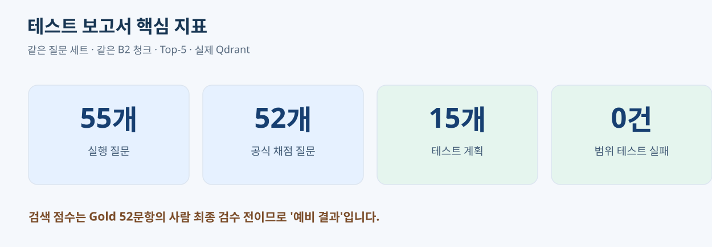
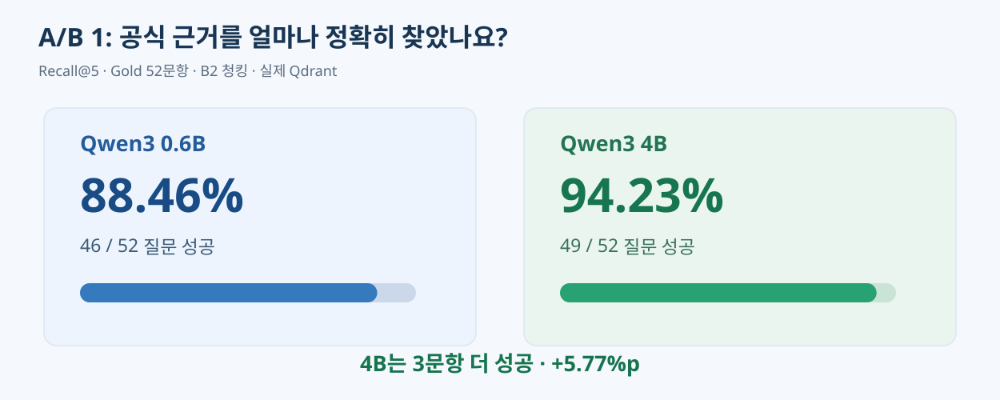
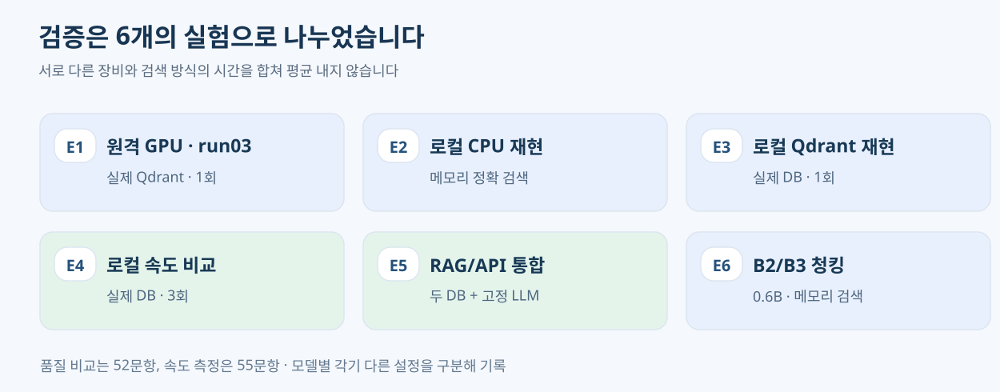
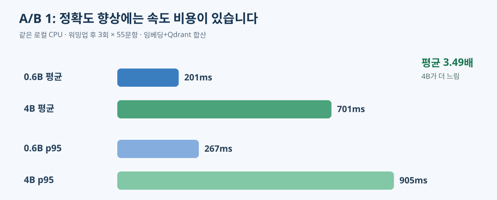
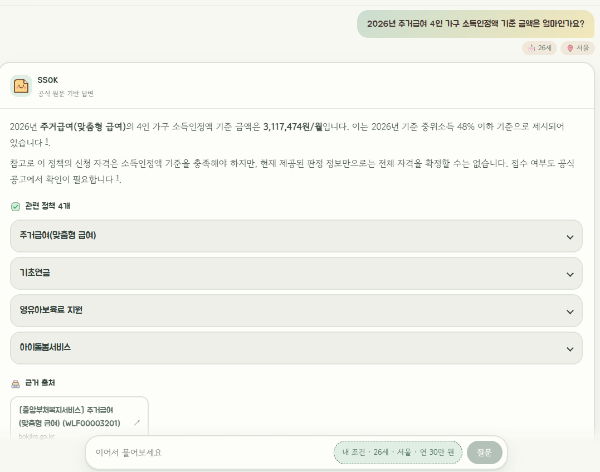
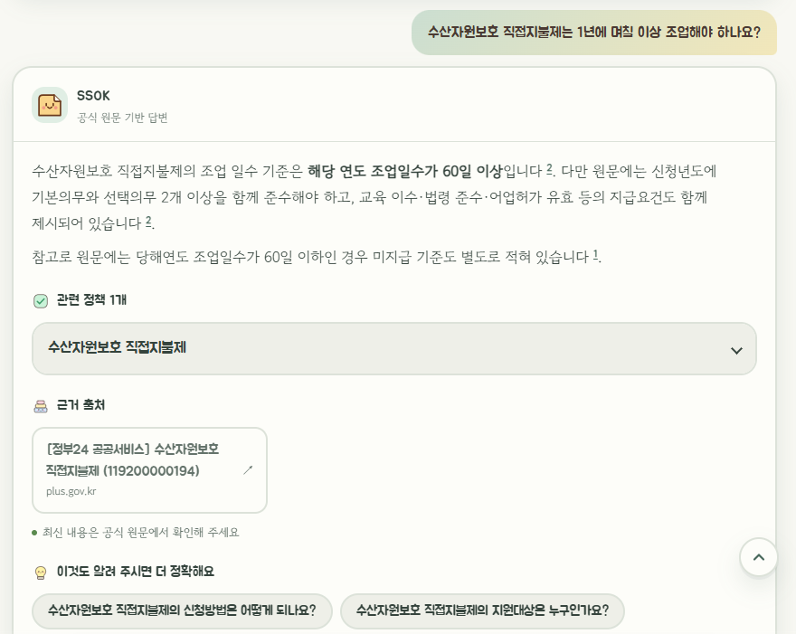
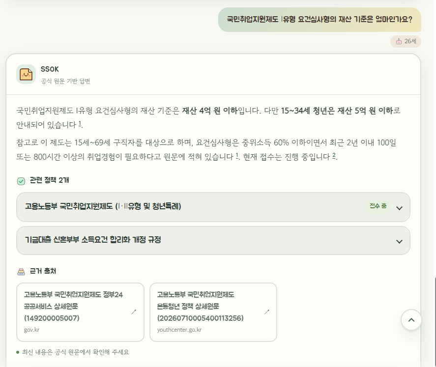
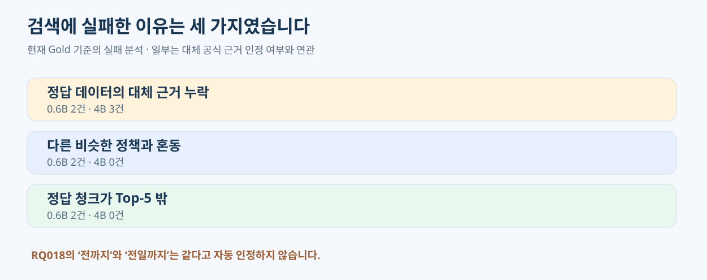
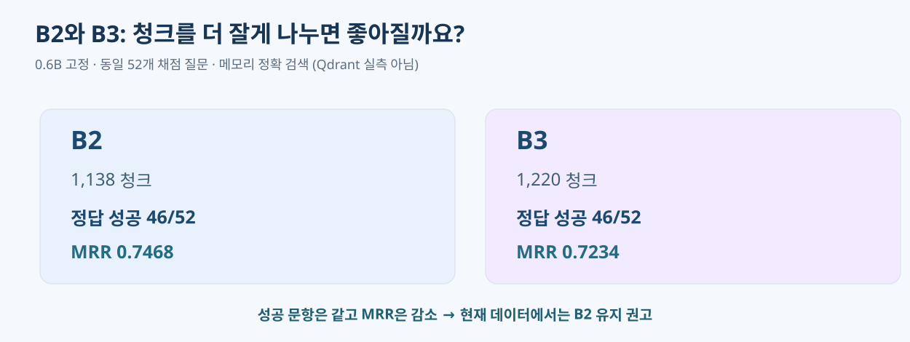

# 🧪 산출물 05 · 테스트 계획 및 결과 보고서

<callout icon="📊" color="blue_bg">
<b>SSOK · 산출물 05 — 테스트 계획 및 결과 보고서</b>

먼저 <b>평가 결과를 그림으로 확인</b>하고, 구체적인 코드·질문별 결과는 각 <b>접기(▶)</b> 안에서 확인하세요.

<b>나지인 담당:</b> RAG/API 검증 · 검색 A/B 1 · B2/B3 청킹 비교

<b>박소희 담당:</b> Checker/LLM 답변 품질 · A/B 2(Vector vs Vector+Graph) · 조건 근거 포함률 — 별도 구역에서 합본
</callout>

<table header-row="true">
<colgroup>
<col />
<col width="577" />
</colgroup>
<tr>
<td>
프로젝트
</td>
<td>
AI 기반 생애주기 맞춤형 정부 지원 정책 추천 및 질의응답 서비스
</td>
</tr>
<tr>
<td>
소스 기준
</td>
<td>
[GitHub ](https://github.com/SKNETWORKS-FAMILY-AICAMP/SKN36-3rd-1Team/tree/c50b31b)[<code>c50b31b</code>](https://github.com/SKNETWORKS-FAMILY-AICAMP/SKN36-3rd-1Team/tree/c50b31b) (문서 소스 기준). 4B 컬렉션·평가 도구 출처는 [PR #51](https://github.com/SKNETWORKS-FAMILY-AICAMP/SKN36-3rd-1Team/pull/51). 최종 제출 커밋은 확정 후 기록(2026-11-12 현재 main은 <code>d63e3b3</code>)
</td>
</tr>
<tr>
<td>
평가 기록
</td>
<td>
2026-11-10 실험 / v1.4.0-candidate / 정책 246개·문서 261개
</td>
</tr>
<tr>
<td>
채점 상태
</td>
<td>
<b>55개 실행·52개 채점</b> · RQ001\~026 중 PASS 19 / REVIEW 7 · 전체 Gold 최종 확정 전
</td>
</tr>
<tr>
<td>
검증 범위
</td>
<td>
RAG/API 통합 검증은 실제 DB·Checker와 고정 Generator 사용. PR #56 모델 비교와 상담 화면 수동 검수는 별도 기록
</td>
</tr>
</table>

<callout icon="📎" color="yellow_bg">
<b>증빙 확인 상태 — </b><b><date start="2026-11-12" /></b>

E2\~E6 원본 ZIP, 검색 A/B 2 예비 결과 JSON, RAG/API 125 passed·415 subtests passed 및 Checker 171 PASS 로그는 §7에 첨부했습니다. Checker 연동 15건은 보고서 요약을 확인할 수 있으며 원본은 미첨부입니다.

PR #56의 Generator 단독 비교 원본은 §7에서 연결합니다. 화면 수동 검수 3문항의 캡처는 §4에 첨부했으며, 제출 커밋의 전체 E2E 완료와 구분합니다. Gold는 현재처럼 <b>최종 확정 전</b>으로 유지합니다.
</callout>

<table-of-contents />

## 🌟 0. 먼저 핵심 결과부터 보기





<b>결론:</b> 4B가 정답 근거를 <b>3문항 더 찾았지만</b>, 같은 로컬 CPU의 검색 평균 시간이 약 <b>3.5배</b>입니다. 현재 데이터에서는 <b>0.6B + B2</b>를 기본값으로 유지하는 것이 합리적입니다.

<table header-row="true">
<colgroup>
<col />
<col width="448.00001525878906" />
</colgroup>
<tr>
<td>
질문
</td>
<td>
결과
</td>
</tr>
<tr>
<td>
근거를 더 잘 찾는 모델
</td>
<td>
0.6B <b>46/52(88.46%)</b> vs 4B <b>49/52(94.23%)</b>
</td>
</tr>
<tr>
<td>
검색 평균 시간
</td>
<td>
0.6B <b>201ms</b> vs 4B <b>701ms</b>. E4 로컬 CPU에서 워밍업 후 모델 순서를 교대해 3회 측정한 질문 임베딩과 Qdrant 검색 시간입니다.
</td>
</tr>
<tr>
<td>
B2/B3 청킹
</td>
<td>
Recall 동일 <b>46/52</b>, MRR은 B2가 우세
</td>
</tr>
<tr>
<td>
RAG/API 연결
</td>
<td>
<b>125 passed</b>, 별도 <b>415 subtests passed</b> · 두 DB+고정 Generator 검증
</td>
</tr>
</table>

<callout icon="⚠️" color="yellow_bg">
<b>이것은 '검색 품질' 결과입니다.</b> 52문항 정답 검수가 끝나지 않아 예비 점수이며, 실제 LLM이 만든 답변의 정확도·생성 시간과는 구분해야 합니다.
</callout>

### 평가 항목별 문서 위치

<table header-row="true">
<colgroup>
<col width="319.00001525878906" />
<col width="373.0000305175781" />
</colgroup>
<tr>
<td>
평가 기준
</td>
<td>
해당 증거
</td>
</tr>
<tr>
<td>
① 기능·검색·답변 품질 테스트가 충분한가?
</td>
<td>
§3 기존 15개 테스트 계획 + Checker 단위 테스트 171 PASS, 실제 OpenAI 30건, Checker 연동 15건, SSOK 화면 3문항 검수
</td>
</tr>
<tr>
<td>
② 정답률·근거 적합성·응답 시간 지표가 명확한가?
</td>
<td>
§2 Recall@5·MRR@5·출처 검사·평균/p95, §4 실측
</td>
</tr>
<tr>
<td>
③ 같은 조건으로 재현 가능한가?
</td>
<td>
§1 실험 E1\~E6의 조건·버전·반복, §7 로그·명령·digest
</td>
</tr>
<tr>
<td>
④ 발견한 문제를 개선했는가?
</td>
<td>
§5 대표 실패 질문, §6 수정·재시험·채택 근거
</td>
</tr>
</table>

---

## 11/10 실제 검증 기록

| 사례 | 이번 재검증 결과 | 증빙 |
| --- | --- | --- |
| 마감 정책 신청 가능 오안내 | <code>POL_009</code>에 대해 고정 답변의 '신청 가능'을 <b>'접수가 마감됐어요'</b>로 교정 | <code>rag_api_final_db_e2e.json</code> / <code>closed_policy_claimed_open</code> |
| 정상 번호 <code>[1]</code>·<code>[0001]</code> | HTTP 200, 본문 <code>[1]</code>로 정규화 | <code>zero_padded_citation_0001</code> |
| 없는 번호 <code>[999]</code> | <b>502 LLM\_OUTPUT\_INVALID</b>로 차단 | <code>nonexistent_citation_999</code> |
| PR #46·#50 회귀 | 범위 <b>125 passed / 415 subtests passed</b>, 별도 인용 관련 11 passed 기록 | <code>logs/pytest_rag_api_scope.log</code> |
| 이전 React 확인 기록 | 당시 React에 마감·공식 URL 표시, 동일 정부24 URL 중복 카드 문제 관찰 | <b>이번 최종 DB E2E에서는 React 재시험 미실행</b> |
| 이전 테스트 수 70·407·30·4 | 당시 원본 로그 이번 재검증에서 미발견 | <b>합산하거나 최신 결과로 단정하지 않음</b> |

---

## 1. 🧪 테스트 범위·환경



<b>무엇을 검사하나요?</b> API 정상 동작, 공식 근거 검색, 출처 번호, 잘못된 신청 가능 문구, 오류 대응, 임베딩 모델·청킹 방식 비교입니다.

<callout icon="💡" color="blue_bg">
<b>실험을 공정하게 비교하려면 한 번에 한 가지 차이를 살펴봐야 합니다.</b>

<b>A/B 1:</b> 문서·청킹·질문을 같게 하고 <b>임베딩 모델(0.6B ↔ 4B)</b>을 비교합니다.

<b>B2/B3:</b> 모델을 0.6B로 고정하고 <b>문서를 자르는 방법</b>을 비교합니다.

<b>A/B 2:</b> Vector만 vs Vector+Graph — 26문항 비교 결과, Top-5 검색 순위 동일·근거 적중률 92.3%, Graph 추가에 따른 검색 성능 개선 미확인.
</callout>

<table header-row="true">
<colgroup>
<col />
<col width="536.0000152587891" />
</colgroup>
<tr>
<td>
고정 조건
</td>
<td>
실제 설정
</td>
</tr>
<tr>
<td>
평가 데이터
</td>
<td>
<code>v1.4.0-candidate</code> · <b>246개 정책 / 261개 문서</b>
</td>
</tr>
<tr>
<td>
검색 질문
</td>
<td>
<b>55문항</b> 실행, <b>52문항</b> Recall/MRR 채점; RQ053\~055 제외
</td>
</tr>
<tr>
<td>
B2 청크
</td>
<td>
<b>1,138개</b> · B3 비교 청크 <b>1,220개</b>
</td>
</tr>
<tr>
<td>
모델
</td>
<td>
Qwen3 <code>0.6b</code>(Q8\_0, 1,024차원) / <code>4b</code>(Q4\_K\_M, 2,560차원)
</td>
</tr>
<tr>
<td>
Qdrant 컬렉션
</td>
<td>
<code>exp_b2_qwen3emb06b_v140_v1</code> / <code>exp_b2_qwen3emb4b_v140_v1</code>
</td>
</tr>
<tr>
<td>
검색
</td>
<td>
<b>Vector Top-5, Cosine, 지역 필터 없음, 질문 지시문 없음</b>
</td>
</tr>
<tr>
<td>
점수 기준
</td>
<td>
필수 근거 원문 구간이 전부 들어있는지, 처음 발견한 정책명만으로는 성공 불인정
</td>
</tr>
<tr>
<td>
커밋·데이터 고정
</td>
<td>
<code>c50b31b</code>, manifest SHA-256 <code>49246d1b…c698389</code>
</td>
</tr>
</table>

### E1\~E6: 왜 같은 A/B인데 숫자가 다를까요?

| 실험 | 핵심 조건 | 어떤 결과를 해석할 때 쓰나요? |
| --- | --- | --- |
| <b>E1 run03</b> | 원격 <b>RTX 4090 GPU</b>, 실제 Qdrant, <b>1회·워밍업 없음</b> | 기존 팀의 공식 결과와 비교 |
| <b>E2 CPU 메모리</b> | 로컬 CPU, <b>메모리 정확 코사인</b> | Qdrant 없이 검색 품질 재현 |
| <b>E3 로컬 Qdrant</b> | 로컬 CPU, 4B 스냅샷 복원, <b>워밍업 없는 1회</b> | 실제 Qdrant가 run03과 같은 정답을 찾는지 |
| <b>E4 로컬 반복</b> | 로컬 CPU, 실제 Qdrant, <b>워밍업 후 3회·순서 교대</b> | 같은 장비의 속도 비교 <b>대표값</b> |
| <b>E5 RAG/API</b> | 실제 Qdrant·Neo4j·Checker, <b>OpenAI 호출만 고정 응답</b> | 출처·판정·오류까지 연결 검증 |
| <b>E6 B2/B3</b> | 0.6B 고정, <b>메모리 정확 검색</b> | 문서 분할 방식의 효과 |

<toggle heading="h3">
🧾 장비 버전·모델 순서·워밍업 기준 자세히 보기

| 실험 | 장비·버전 | 실행/반복 |
| --- | --- | --- |
| E1 | RunPod RTX 4090, SSH 터널, Ollama <b>0.40.16</b>, Python <b>3.13.15</b> | 0.6B → 4B, 워밍업 없이 각 55개 |
| E2 | 로컬 CPU, Ollama <b>0.40.15</b>, Python <b>3.12.13</b> | 품질 1회, 시간 3회 교대, 회차별 3문항 워밍업 |
| E3 | 로컬 CPU, 실제 Qdrant <b>1.12.4</b> | 워밍업 없이 0.6B→4B, 최초 모델 적재 포함 |
| E4 | 로컬 CPU, Qdrant <b>1.12.4</b> | <b>55질문 × 3회 × 2모델 = 총 330회</b>, 모델별 165표본 |
| E5 | 로컬 CPU, Qdrant <b>1.12.4</b>, Neo4j <b>5.26.32</b> | 통합 시나리오 8개 |
| E6 | 로컬 CPU, B2 벡터는 최종 DB에서 읽고 B3는 CPU 임베딩 | 품질 1회·동일 질의 벡터 |

<b>중요:</b> E1의 원격 GPU 시간과 E4의 로컬 CPU 시간을 직접적인 장비 성능 우열로 해석하면 안 됩니다. 실험 조건이 서로 다릅니다.

<b>4B 스냅샷 복원:</b> 30,572,032 bytes / SHA-256 <code>830b7ad2…aa9ed9</code>, Qdrant 신규 컬렉션 1,138개·2,560차원. 기존 0.6B 컬렉션의 digest는 변경되지 않았습니다.
</toggle>

---

## 2. 📏 평가 지표와 합격 조건 — 숫자 읽는 방법

<table header-row="true">
<colgroup>
<col />
<col width="299.00001525878906" />
<col width="281.00001525878906" />
</colgroup>
<tr>
<td>
지표
</td>
<td>
뜻
</td>
<td>
이 프로젝트에서 어떻게 계산하나요?
</td>
</tr>
<tr>
<td>
<b>Recall@5</b>
</td>
<td>
<b>상위 5개 안에 필요한 근거를 모두 찾았나요?</b>
</td>
<td>
52개 질문 중 <b>필수 원문 구간 전체를 Top-5 안에 찾은 질문 수 / 52</b>
</td>
</tr>
<tr>
<td>
<b>MRR@5</b>
</td>
<td>
<b>근거가 몇 번째에 나타났나요?</b>
</td>
<td>
필요한 근거가 모두 모인 <b>마지막 순위의 역수</b>를 52문항 평균
</td>
</tr>
<tr>
<td>
<b>근거 적합성</b>
</td>
<td>
<b>같은 정책이라도 정확한 내용을 찾았나요?</b>
</td>
<td>
정답 원문의 <code>char_start~char_end</code> 전체 구간을 검색 청크가 포함해야 성공
</td>
</tr>
<tr>
<td>
<b>평균 시간</b>
</td>
<td>
<b>평소 질문 하나에 걸리는 시간은?</b>
</td>
<td>
Ollama 질문 임베딩 시간 + Qdrant 검색 시간
</td>
</tr>
<tr>
<td>
<b>p95</b>
</td>
<td>
<b>느린 요청도 어느 정도 걸리나요?</b>
</td>
<td>
시간 표본 중 95%가 이 값 이내인 지점(nearest-rank)
</td>
</tr>
<tr>
<td>
<b>인용 정확성</b>
</td>
<td>
<b>본문 \[1\]이 올바른 원문인가요?</b>
</td>
<td>
답변 인용 번호와 <code>citations</code>, 정책이 일치
</td>
</tr>
<tr>
<td>
<b>오안내 차단</b>
</td>
<td>
<b>마감 정책을 신청 가능하다고 말하지 않나요?</b>
</td>
<td>
Checker <code>closed</code> 판정이면 LLM의 반대 문구 교정
</td>
</tr>
</table>

<callout icon="🧮" color="blue_bg">
<b>예시로 이해하는 Recall@5와 MRR@5</b>

52개 질문 중 46개에서 정답 근거를 상위 5개 안에 완전히 찾았다면 <b>Recall@5 = 46/52 = 88.46%</b>입니다.

정답 근거가 <b>1위</b>면 MRR 기여도 <b>1</b>, <b>2위</b>면 <b>0.5</b>, <b>5위</b>면 <b>0.2</b>입니다. 필수 근거가 여러 곳이면 마지막 필수 근거가 확보된 순위를 씁니다. Top-5에 완성되지 않으면 <b>0</b>입니다.
</callout>

<toggle heading="h3">
🔍 정확한 채점 계약 · 정답 구간을 왜 검사할까요?

- 같은 <code>policy_id</code>나 <code>document_id</code>만 찾으면 성공이 아닙니다. 정답으로 지정한 <b>문장 위치 구간</b>을 청크가 포함해야 합니다.
- 기준 구간은 <code>[char_start, char_end)</code>이며 끝점은 포함하지 않습니다.
- 동등 근거(<code>alternatives</code>)는 현재 Gold에서 <b>같은 문자열의 다른 위치</b> 등을 정해진 계약에 따라 인정합니다. <b>문구가 다르지만 같은 의미라고 추측해 임의 점수화하지 않습니다.</b>
- <code>doc_only</code>: 같은 공식 문서는 찾았어도 필요한 정답 근거 구간은 못 찾은 상태입니다.
- 평균·p95의 시간 표본은 <code>perf_counter</code>로 임베딩과 Qdrant 검색을 나눠 측정합니다. 사전 검증·채점·로그 저장 시간은 제외합니다.
- <b>실제 API 서비스의 Top-10/Context 최대 5개</b>와 <b>평가의 Top-5</b>는 다른 개념입니다.
</toggle>

### 합격 기준: ‘팀 확정’과 ‘보고서 제안’을 구별

<table header-row="true">
<colgroup>
<col />
<col width="304.00001525878906" />
<col />
</colgroup>
<tr>
<td>
테스트
</td>
<td>
기준
</td>
<td>
어느 수준의 약속인가요?
</td>
</tr>
<tr>
<td>
유효하지 않은 인용
</td>
<td>
<code>[999]</code> → HTTP 502, 정상 인용은 순서대로
</td>
<td>
<b>팀 확정 API 계약</b>
</td>
</tr>
<tr>
<td>
API 오류 처리
</td>
<td>
422·502·503·504·500 응답 계약
</td>
<td>
<b>팀 확정 계약</b>
</td>
</tr>
<tr>
<td>
마감 정책 오안내
</td>
<td>
Checker가 <code>closed</code>면 ‘지금 신청 가능’ 단정 <b>0건</b>
</td>
<td>
<b>PR #46 리뷰 요구</b>
</td>
</tr>
<tr>
<td>
담당 범위 자동 테스트
</td>
<td>
실패 <b>0건</b>
</td>
<td>
<b>이번 보고서 권장 기준</b>
</td>
</tr>
<tr>
<td>
Recall@5·MRR@5
</td>
<td>
<b>정해진 합격 수치 없음</b>, 비교 결과 기록
</td>
<td>
팀 합격 수치 없음
</td>
</tr>
<tr>
<td>
시간 측정
</td>
<td>
같은 장비에서 3회·순서 교대·평균/p95
</td>
<td>
<b>이번 보고서 권장 방식</b>
</td>
</tr>
<tr>
<td>
최종 답변 품질
</td>
<td>
Checker 판정·공식 근거 일치, 오류 여부 검증
</td>
<td>
실제 LLM·상담 화면 검수 기준
</td>
</tr>
</table>

<callout color="gray_bg">
## ① — Checker·LLM 답변 품질 채점 기준

검색 결과의 적합성뿐 아니라 Checker의 조건 판정 정확성, LLM 답변의 사실성, 출처 인용 및 응답 시간을 평가하였다.

검색 A/B 2, Generator 단독 비교, Checker 연동 비교, SSOK 상담 화면 검수는 서로 다른 실험이므로 결과를 구분하여 기록하였다.

### 평가 항목 및 실제 결과

<table header-row="true">
<colgroup>
<col width="153.16964721679688" />
<col />
<col />
<col />
</colgroup>
<tr>
<td>
평가 항목
</td>
<td>
판정·측정 방법
</td>
<td>
합격 기준
</td>
<td>
실제 결과
</td>
</tr>
<tr>
<td>
Checker 조건 판정 정확성
</td>
<td>
사용자 프로필과 조건 트리의 기대 상태 비교
</td>
<td>
지원 조건의 올바른 판정 및 불확실 조건 보류
</td>
<td>
단위 테스트 171 PASS, 실제 DB 판정 보류 사례 확인
</td>
</tr>
<tr>
<td>
LLM 답변의 사실·근거 일치
</td>
<td>
공식 Context와 생성 답변을 문항별 수동 비교
</td>
<td>
무근거 단정·조건 누락·상충 설명 없음
</td>
<td>
실제 정책 5문항×3모델 15건 예비 채점(산출물 04 §5, AI 보조·팀 확정 전): 핵심 사실 일치 13/15(86.7%), 중요 조건 누락 1/15(6.7%), 핵심 주장 인용 적합 14/15(93.3%). 전체 평가 세트 정확도는 미산출
</td>
</tr>
<tr>
<td>
조건 근거 포함률
</td>
<td>
Gold 필수 근거 구간의 Top-5 포함 여부
</td>
<td>
필수 근거 확보 및 조건 설명 가능성 확인
</td>
<td>
정확 구간 6/8(75%), 의미상 동등 근거 8/8(수동 검토)
</td>
</tr>
<tr>
<td>
출처·후속 질문 적절성
</td>
<td>
인용 번호의 Context 존재 여부 및 질문 내용 확인
</td>
<td>
허용된 출처 번호 사용, 불필요한 재질문 방지
</td>
<td>
Generator 단독 실제 정책 평가에서 인용 형식 15/15 통과
</td>
</tr>
<tr>
<td>
생성 답변 시간
</td>
<td>
모델별 실제 API 호출 시간 측정
</td>
<td>
동일 입력 조건에서 속도 비교
</td>
<td>
nano 2.862초 / mini 1.690초 / GPT-5.4 3.765초(평균)
</td>
</tr>
<tr>
<td>
생성 시간 p95
</td>
<td>
개별 호출 지연 시간 분포 평가
</td>
<td>
느린 요청의 지연 수준 기록
</td>
<td>
실제 정책 5문항 표본으로만 재계산(n=5, 최댓값과 같음): nano 4.467초 / mini 2.430초 / GPT-5.4 5.600초. 전체 평가 세트 p95는 미집계
</td>
</tr>
</table>

<b>평가 기준 해석</b>

- Checker의 <code>eligible</code>은 개별 조건의 충족을 의미하며, 전체 신청 자격을 보장하지 않는다.
- <code>needs_check</code>를 임의로 적격이나 부적격으로 바꾸면 안 된다.
- 인용 형식이 정상이어도 해당 출처가 답변의 모든 사실을 뒷받침한다는 의미는 아니다.
- 공식 근거가 부족한 경우 확정적 답변보다 추가 확인 안내를 우선한다.
- 답변 품질의 합격률은 문항별 오류가 발견되어 별도 확정하지 않았다.
</callout>

---

## 3. 📋 테스트 계획표 — 총 15개

<b>검증 방식:</b> 질문을 넣기 전에 기대 결과를 정하고, 실제 결과와 비교해 <b>PASS/FAIL</b>을 판정합니다. 정상 동작만 테스트하지 않고 <b>잘못된 인용·마감 오안내·DB 장애</b>도 포함했습니다.

<table header-row="true">
<colgroup>
<col />
<col />
<col width="364.00001525878906" />
</colgroup>
<tr>
<td>
종류
</td>
<td>
테스트 개수
</td>
<td>
확인하는 문제
</td>
</tr>
<tr>
<td>
API·RAG·Checker 연결
</td>
<td>
<b>3개</b>
</td>
<td>
준비 상태, 공식 출처 답변, Context와 판정 일치
</td>
</tr>
<tr>
<td>
출처·모집 상태·품질 경고
</td>
<td>
<b>5개</b>
</td>
<td>
인용 번호, 다른 정책 출처 오인용, 마감 상태, 조건 불확실
</td>
</tr>
<tr>
<td>
오류·회귀 테스트
</td>
<td>
<b>3개</b>
</td>
<td>
DB 연결 실패, 빈 근거/LLM 오류, 기존 기능 유지
</td>
</tr>
<tr>
<td>
검색 A/B 1
</td>
<td>
<b>3개</b>
</td>
<td>
모델별 검색 정답·속도·run03 재현
</td>
</tr>
<tr>
<td>
B2/B3 청킹
</td>
<td>
<b>1개</b>
</td>
<td>
청킹 변경에 따른 정답률·순위 차이
</td>
</tr>
<tr>
<td>
<b>합계</b>
</td>
<td>
<b>15개</b>
</td>
<td>
기능 + 검색 품질 + 예외 + 재현성
</td>
</tr>
</table>

<toggle heading="h3">
① 기능·API·출처·오류 — 테스트 계획 11개 모두 보기

| TC ID | 검증 목적 | 사전 조건 / 입력 | 기대 결과 | 합격 기준 |
| --- | --- | --- | --- | --- |
| <b>TC-API-01</b> | 서버·검색 준비 상태 | 최종 DB / <code>GET /health</code> 시작 직후·첫 검색 후 | HTTP 200, <code>ready=false</code> → <code>true</code> | 기대 상태 일치 |
| <b>TC-RAG-01</b> | 공식 문서 근거로 답변 | 최종 DB + 고정 LLM / 청년월세 외 2개 | 3개 모두 200 <code>answered</code>, 실제 Context 문서 출처 | 3/3 일치 |
| <b>TC-RAG-02</b> | Checker 호출 연결 | 위 3질문 / 실제 정책 Context | <code>policy_checks</code> 정책 순서가 Context와 동일 | 3/3 일치 |
| <b>TC-CITE-01</b> | 없는 출처 차단 | 고정 LLM이 <code>[999]</code> 반환 | HTTP 502 / <code>LLM_OUTPUT_INVALID</code> | 일치 |
| <b>TC-CITE-02</b> | 인용 번호 정규화 | 고정 LLM이 <code>[0001]</code> 반환 | HTTP 200, 최종 본문 <code>[1]</code> | 일치 |
| <b>TC-CITE-03</b> | 다른 정책의 출처 사용 금지 | A 마감, B 접수 중 / B의 출처로 A가 신청 가능 주장 | A 주장 제거, B 정상 문구·출처 유지 | 회귀 통과 |
| <b>TC-STAT-01</b> | 마감 안내 교정 | POL\_009 + LLM ‘신청 가능’ | 최종 ‘접수가 마감됐어요’ 및 <code>closed</code> | 일치 |
| <b>TC-DQ-01</b> | 불완전한 조건 안내 | 정답 조건이 부족한 정책 | <code>notice.kind=warn</code>, 확인 필요 메시지 | 안내 표시 |
| <b>TC-ERR-01</b> | DB가 멈췄을 때 | Qdrant를 닫힌 포트로 설정한 앱 | HTTP 503, <code>ready=false</code> | 일치 |
| <b>TC-ERR-02</b> | 근거 없음·LLM 오류 | Mock 빈 검색 / 시간 초과·서비스 연결 실패 | 200 <code>no_evidence</code>(Checker·LLM 생략), 504·502 | 회귀 통과 |
| <b>TC-REG-01</b> | PR #46/#50 기능 유지 | OpenAI 키 없는 Mock / 8개 테스트 파일 | RAG/API 범위 실패 0 | 실패 0 |
</toggle>

<toggle heading="h3">
② 검색 품질·시간·재현·청킹 — 실험 계획 4개 모두 보기

| TC ID | 비교 목적 | 고정 조건과 입력 | 기대·기록 항목 | 합격 기준 |
| --- | --- | --- | --- | --- |
| <b>TC-AB1-01</b> | 0.6B vs 4B 검색 품질 | 동일 B2 1,138청크, 55문항(52 채점) | Recall@5·MRR@5·질문별 순위·실패 사례 | <b>팀 합격 수치 없음</b>, 비교 기록 |
| <b>TC-AB1-02</b> | 같은 CPU의 평균/p95 | 실제 Qdrant, 55 × 3회 × 2모델 | 임베딩·검색·합산 시간, 오류 수 | 오류 0, 재현성·반복값 기록 |
| <b>TC-AB1-03</b> | run03와 실제 DB 재현 | 4B 스냅샷 별도 복원 | 성공/실패 질문 일치, digest | 결과 비교 기록 |
| <b>TC-B23-01</b> | B2와 B3 청킹 품질 | 0.6B·질문·Cosine 동일, 메모리 검색 | Recall@5·MRR@5·순위 변화 | <b>팀 합격 수치 없음</b>, 비교 기록 |
</toggle>

<callout color="gray_bg">
## ② — Checker·LLM·A/B 2 테스트 계획

Checker의 내부 판정, LLM 생성 품질, 검색 방법별 근거 회수 성능을 각각 평가하였다.

기존 Generator 단독 평가와 추가 Checker 연동 평가는 입력 구성 및 검증 목적이 다르므로 별도 테스트로 구분하였다.

### 테스트 계획 및 수행 결과

<i>아래 TC ID는 산출물에서 실험을 구분하기 위한 보고서용 식별자이다.</i>

| TC ID | 입력·사전 조건 | 기대 결과 | 채점 기준 | 실제 결과 |
| --- | --- | --- | --- | --- |
| TC-SH-CHK-01 | 나이·소득·지역 및 AND/OR 조건 | 조건별 적절한 상태 반환 | 기대 상태·보류 사유 일치 | Checker 단위 테스트 171 PASS |
| TC-SH-CHK-02 | 실제 Neo4j 조건 구조 및 데이터 품질 경고 | 불명확한 조건의 자동 판정 보류 | <code>needs_check</code> 및 사유 확인 | <code>POL_GOV_008</code> 보류 사례 확인 |
| TC-SH-LLM-01 | 가상 시나리오 5문항 × 3모델 | 근거 중심 답변 및 올바른 JSON | 응답 형식·내용·시간·비용 | 15개 응답 생성 및 비교 |
| TC-SH-LLM-02 | 실제 Gold 후보 5문항 × 3모델, Checker 미포함 | 공식 근거에 맞는 답변 | 인용 형식·사실성·환각 여부 | 15개 응답 생성, 일부 오류 확인 |
| TC-SH-LLM-03 | 동일 5문항 × 3모델, Checker 결과 포함 | 판정과 모순되지 않는 설명 | 자격·접수 상태·질문 범위 일치 | 추가 15개 응답 검수, 오류 확인 |
| TC-SH-UI-01 | SSOK 상담 화면 3문항 | 답변·출처·판정의 올바른 화면 표시 | 실제 화면의 안내 내용 | 3문항 검수, RQ031 문제 재현 |
| TC-SH-AB2-01 | RQ027\~052, Vector vs Vector+Graph | 동일 조건의 검색 품질 비교 | Gold 적중·순위·평균/p95 | 26문항 비교 완료 |
| TC-SH-GOLD-01 | RQ027\~052 Gold 후보 | 필수 근거 구간 확보 및 검수 | 정확 구간·동등 근거 구분 | 24/26 적중, 최종 Gold 확정 전 |

<b>테스트 구분</b>

1. <b>Generator 단독 비교:</b> 공식 검색 근거는 제공하지만 Checker 결과는 제외하여 모델 자체의 답변 생성 성능을 비교하였다.
2. <b>Checker 연동 비교:</b> 동일한 공식 근거와 실제 Checker 결과를 세 모델에 제공하여 조건 판정과 답변 사이의 정합성을 확인하였다.
3. <b>SSOK 화면 검수:</b> 사용자가 실제 상담 화면에서 보는 답변과 정책 카드 표시를 확인하였다.
4. <b>검색 A/B 2:</b> 생성 답변이 아닌 검색 근거와 Graph 결합 효과를 평가하였다.

RAG/API Mock 테스트와 위 실험 결과는 합산하지 않았다.
</callout>

---

## 4. 📈 테스트 결과표 — 실제 측정값과 근거

### 4-1. RAG/API 기능 검증 결과 (E5)

<callout icon="✅" color="green_bg">
<b>로컬 최종 DB 통합 검증:</b> 실제 Qdrant + Neo4j + Checker를 연결하고 <b>OpenAI 네트워크 호출만 고정 응답으로 대체</b>했습니다.

8개 통합 시나리오 확인 · RAG/API 범위 자동 테스트 <b>125 passed / 415 subtests passed</b> (기존 보고값, 별도 집계·합산하지 않음).

<b>증빙 상태:</b> §7 첨부 <code>ab1_qdrant_local_20261110.zip</code>의 <code>logs/pytest_rag_api_scope.log</code>에서 125 passed·415 subtests passed를 확인할 수 있습니다.
</callout>

<table header-row="true">
<colgroup>
<col />
<col />
<col width="285.00001525878906" />
</colgroup>
<tr>
<td>
점검
</td>
<td>
결과
</td>
<td>
뜻
</td>
</tr>
<tr>
<td>
<b>정상 질문</b>
</td>
<td>
3개 모두 HTTP 200
</td>
<td>
공식 근거를 받아 API 답변 생성
</td>
</tr>
<tr>
<td>
<b>Context↔Checker</b>
</td>
<td>
3개 정책 순서 일치
</td>
<td>
다른 정책의 조건을 잘못 연결하지 않음
</td>
</tr>
<tr>
<td>
<b>마감 오안내</b>
</td>
<td>
‘신청 가능’ → ‘마감’ 교정
</td>
<td>
Checker의 <code>closed</code> 판정 우선
</td>
</tr>
<tr>
<td>
<b>\[0001\]</b>
</td>
<td>
HTTP 200, <code>[1]</code>로 정리
</td>
<td>
인용 번호 정규화
</td>
</tr>
<tr>
<td>
<b>\[999\]</b>
</td>
<td>
HTTP 502
</td>
<td>
없는 출처 차단
</td>
</tr>
<tr>
<td>
<b>Qdrant 장애</b>
</td>
<td>
HTTP 503
</td>
<td>
장애를 ‘근거 없음’으로 숨기지 않음
</td>
</tr>
<tr>
<td>
<b>/health</b>
</td>
<td>
검색 성공 후 <code>ready=true</code>
</td>
<td>
실제 DB 준비 여부 확인
</td>
</tr>
</table>

<toggle heading="h3">
🧾 테스트 ID별 실제 결과·응답 시간·증빙 모두 보기

| TC ID | 실제 결과 | 근거·판정 | 시간 (초) | 증빙 |
| --- | --- | --- | --- | --- |
| <b>TC-API-01</b> | 시작 <code>ready=false</code> → 첫 검색 뒤 <code>true</code> | PASS | — | <code>rag_api_final_db_e2e.json</code> / <code>health*</code> |
| <b>TC-RAG-01</b> | 정상 질문 3개 모두 200 answered | <b>POL\_009 / DOC\_MOLIT\_001</b>, <b>POL\_GOV\_030 / DOC\_GOV\_030</b>, <b>POL\_GOV\_008 / DOC\_GOV\_008</b> / PASS | <b>1.083 / 0.235 / 0.166</b> | <code>normal_*</code> |
| <b>TC-RAG-02</b> | Context 정책·policy\_checks 정책 3/3 일치 | PASS | — | <code>check_set_matches_context_policies</code> |
| <b>TC-CITE-01</b> | <code>[999]</code> → 502 <code>LLM_OUTPUT_INVALID</code> | PASS | <b>0.170</b> | <code>nonexistent_citation_999</code> |
| <b>TC-CITE-02</b> | <code>[0001]</code> → 200, 본문 <code>[1]</code> | <b>POL\_009 / DOC\_MOLIT\_001</b> / PASS | <b>0.180</b> | <code>zero_padded_citation_0001</code> |
| <b>TC-CITE-03</b> | A의 잘못된 문구 제거, B의 정상 인용 유지 | Mock 회귀 PASS | — | <code>test_uncited_claim_about_other_policy_does_not_borrow_sentence_citation</code> 외 4개 |
| <b>TC-STAT-01</b> | POL\_009 ‘접수가 마감됐어요. \[1\]’ | <b>DOC\_MOLIT\_002</b> / PASS | <b>0.220</b> | <code>closed_policy_claimed_open</code> |
| <b>TC-DQ-01</b> | <code>notice.kind=warn</code> (정상 질문 3개) | PASS | — | <code>normal_*</code> / <code>notice</code> |
| <b>TC-ERR-01</b> | Qdrant 불가 → 503, ready=false | PASS | <b>2.047</b> | <code>qdrant_unreachable</code> |
| <b>TC-ERR-02</b> | 빈 검색 → no\_evidence; LLM 장애 → 502/504 | Mock PASS | — | <code>test_missing_evidence_skips_other_dependencies</code> / <code>test_llm_timeout_and_unavailable</code> |
| <b>TC-REG-01</b> | 125 passed / 415 subtests passed, 범위 실패 0 | PASS | <b>3.86</b> (테스트 전체) | <code>logs/pytest_rag_api_scope.log</code> |

<b>시간 해석:</b> 이 표는 실제 LLM 호출을 하지 않았으므로 <b>검색·Checker·검증·API 구간</b>이 중심입니다. 실제 OpenAI 생성 시간으로 해석하면 안 됩니다. 첫 정상 질문의 <b>1.083초</b>에는 초기 모델/연결 준비의 영향이 포함될 수 있습니다.

<b>전체 저장소 시험과의 차이:</b> 별도 전체 <code>tests/</code> 실행 기록은 <b>902 passed / 53 failed / 20 errors / 44 skipped</b>입니다. 레거시 데이터셋·원본 파일 및 환경 의존 오류가 포함된 결과이며 <b>전체 테스트가 통과했다는 주장은 하지 않습니다.</b>
</toggle>

### 4-2. 검색 A/B 1 — 정답 근거를 찾는 품질 비교

| 실험 | 0.6B Recall@5 | 4B Recall@5 | 0.6B MRR@5 | 4B MRR@5 |
| --- | --- | --- | --- | --- |
| <b>E1 run03 (GPU, 실제 Qdrant)</b> | <b>46/52</b> | <b>49/52</b> | 0.7458 | 0.7609 |
| <b>E2 CPU 메모리 정확 검색</b> | <b>46/52</b> | <b>49/52</b> | 0.7468 | 0.7561 |
| <b>E3·E4 CPU 실제 Qdrant</b> | <b>46/52</b> | <b>49/52</b> | 0.7468 | 0.7561 |

<b>재현성:</b> 세 환경에서 <b>성공·실패 질문이 모두 같았습니다.</b> run03과 로컬 사이 일부 청크 순위가 바뀌어 MRR만 조금 달랐습니다. E4는 세 회차 모두 질문별 순위와 점수가 일치했습니다.

<toggle heading="h3">
🔎 질문별 성공·실패 ID와 추가 지표

| 지표 | 0.6B | 4B |
| --- | --- | --- |
| 정답 근거 성공 질문 | <b>46/52</b> | <b>49/52</b> |
| 근거 1위 질문 | <b>34개</b> | <b>33개</b> |
| Recall@10 (E2·E3 참고) | 48/52 | 51/52 |
| 실패 문항 | <b>RQ006, 007, 018, 020, 031, 042</b> | <b>RQ017, 018, 020</b> |
| E3 Qdrant 검색 오류·타임아웃 | 0 | 0 |
| E4 3회 반복 오류·타임아웃 | 0 | 0 |

<b>정책 단위 Hit@5(E1/E2)는 양 모델 52/52</b>로 보고됐으나, 이는 ‘어느 정책인지 찾음’일 뿐 <b>정확한 원문 조건까지 찾은 Recall@5</b>와는 전혀 다릅니다.

<b>run03 대비 인접 청크 순위 차이:</b> 0.6B RQ040(5→4), 4B RQ002(2→3), RQ007(4→3), RQ013(2→3). 점수 차 0.001 미만의 인접 청크 교환입니다.
</toggle>

### 4-3. 검색 A/B 1 — 응답 시간 비교



| <b>E4: 같은 CPU, 3회 반복</b> | 0.6B 평균 | 0.6B p95 | 4B 평균 | 4B p95 |
| --- | --- | --- | --- | --- |
| 질문 임베딩 | <b>190.05ms</b> | 253.64ms | <b>687.37ms</b> | 873.11ms |
| Qdrant 검색 | 10.91ms | 27.41ms | 13.61ms | 32.49ms |
| <b>합산</b> | <b>200.96ms</b> | <b>266.89ms</b> | <b>700.98ms</b> | <b>905.40ms</b> |

<b>해석:</b> 4B가 느린 주된 이유는 <b>Qdrant가 아니라 질문을 숫자 벡터로 만드는 임베딩 단계</b>입니다(임베딩 평균 약 3.62배, 검색 단계 약 1.25배). 전체 합산 평균은 약 <b>3.49배</b>입니다.

<toggle heading="h3">
⏱️ run03 GPU·최초 로딩 포함·반복별 시간 원본 표

<b>E1 run03 — GPU, 1회, 워밍업 없음 (ms)</b>

| 구간 | 0.6B 평균 | 0.6B p95 | 4B 평균 | 4B p95 |
| --- | --- | --- | --- | --- |
| 임베딩 | 937.98 | 1125.10 | 982.86 | 966.56 |
| Qdrant | 16.48 | 32.46 | 14.89 | 29.16 |
| <b>합산</b> | <b>954.46</b> | <b>1133.03</b> | <b>997.75</b> | <b>996.37</b> |

<b>E3 로컬 실제 Qdrant — 최초 적재 포함, 1회 (ms)</b>

| 구간 | 0.6B 평균 | 0.6B p95 | 4B 평균 | 4B p95 |
| --- | --- | --- | --- | --- |
| 임베딩 | 217.25 | 264.99 | 900.92 | 984.50 |
| Qdrant | 8.98 | 27.64 | 20.80 | 30.76 |
| <b>합산</b> | <b>226.24</b> | <b>270.50</b> | <b>921.71</b> | <b>996.53</b> |

<b>첫 질문 임베딩(모델 적재 포함):</b> 0.6B <b>2522.4ms</b>, 4B <b>11041.5ms</b>. 이 값은 워밍업 후 평균과 분리해야 합니다.

<b>E4 반복별 임베딩 평균 (ms)</b>

| 회차·모델 순서 | 0.6B 임베딩 | 0.6B Qdrant | 4B 임베딩 | 4B Qdrant |
| --- | --- | --- | --- | --- |
| 1회차: 0.6B→4B | 174.52 | 8.23 | 676.08 | 11.57 |
| 2회차: 4B→0.6B | 201.16 | 12.73 | 687.26 | 16.04 |
| 3회차: 0.6B→4B | 194.47 | 11.77 | 698.77 | 13.22 |

<b>E2 메모리 재현의 질문 임베딩 평균</b>은 0.6B <b>291.94ms</b>, 4B <b>1105.35ms</b>였습니다. 같은 PC라도 실행 시점과 부하에 따라 절대 시간이 달라집니다. 따라서 동일 실험 내부의 상대 비율을 중심으로 비교합니다.

<b>주의:</b> 모든 위 검색 시간에는 실제 Checker·OpenAI·React 전체 시간은 포함되지 않습니다.
</toggle>

<callout color="gray_bg">
### ③ — Checker·LLM·A/B 2 실제 결과

### ③-1 Checker 자격 판정 검증

Checker는 Neo4j 조건 트리를 기반으로 AND·OR·NOT 조건을 평가하며, 확실하게 비교할 수 있는 조건에 한해 자동 판정한다.

지역·소득 기준이 불명확하거나 Graph 조건 구조에 데이터 품질 문제가 있는 경우 <code>needs_check</code>로 처리한다.

<b>실제 사례: </b><b><code>POL_GOV_008</code></b>

| 항목 | 실제 결과 |
| --- | --- |
| 사용자 프로필 | 만 25세, 서울특별시, 소득 1.5 |
| Graph 구조 | 가구 조건 AND + 소득 5구간 OR |
| 소득 조건 | <code>needs_check</code> |
| 소득 OR 그룹 | <code>needs_check</code> |
| 최상위 AND 그룹 | <code>needs_check</code> |
| 접수 상태 | <code>unknown</code> |

소득 5개 구간이 OR로 묶인 구조에서 의미상 문제가 의심되어 데이터 품질 경고가 발생하였다.

Checker는 이를 임의로 '소득 제한 없음'이라고 해석하지 않고 공식 공고 확인 대상으로 유지하였다.

<b>검증 결과</b>

- Checker·Eligibility 단위 테스트 <b>171 PASS</b> · §7 첨부 로그에서 통과 수 확인.
- 실제 Neo4j 조건 트리 조회 및 판정 보류 확인
- 불확실한 조건의 자동 적격 판정 방지

단위 테스트 통과는 구현된 규칙의 검증 결과이며, 전체 정책에 대한 자격 판정 정확도 100%를 의미하지 않는다.

### ③-2 LLM 모델 3종 단독 비교

GPT-5.4-nano, GPT-5.4-mini, GPT-5.4를 대상으로 가상 시나리오 15건과 실제 정책 15건, 총 30건의 실제 API 호출을 수행하였다.

실제 정책 질문은 동일한 Top-5 공식 근거를 고정하고 <code>policy_checks=[]</code>로 평가하였다.

<b>실제 정책 5문항 비교</b>

| 지표 | GPT-5.4-nano | GPT-5.4-mini | GPT-5.4 |
| --- | --- | --- | --- |
| 평균 응답 시간 | 2.862초 | <b>1.690초</b> | 3.765초 |
| 추정 비용 합계 | <b>\$0.00391</b> | \$0.02014 | \$0.06844 |
| 인용 형식 검사 | 5/5 | 5/5 | 5/5 |
| API 호출 오류 | 0건 | 0건 | 0건 |

<b>주요 발견 사항</b>

- 실제 정책 5문항에서 GPT-5.4-mini의 평균 응답 시간이 가장 짧았습니다. 추정 비용은 nano가 가장 낮았고, mini는 GPT-5.4보다 낮았습니다.
- GPT-5.4는 이번 소규모 평가에서 상대적으로 안정적인 답변 품질을 보였다.
- RQ040에서 GPT-5.4-mini의 긍정·부정 표현 충돌이 확인되었다.
- RQ042에서 GPT-5.4-mini의 자격 제외 조건 설명 누락이 확인되었다.

<b>MVP 기본 생성 모델은 GPT-5.4-mini로 선정하였다.</b>

다만 모델 선정은 속도·비용·품질 간 균형을 고려한 결정이며, 모든 질문에서 오류가 없다는 의미는 아니다.

### ③-3 실제 Checker 연동 LLM 추가 검수

Generator 단독 비교와 별도로, 동일한 실제 정책 5문항에 Checker 판정 결과를 추가하여 세 모델의 응답 15개를 검수하였다.

<b>증빙 상태:</b> 별도 Checker 연동 15건은 <b>보고서 요약만 확인 가능, 원본 미첨부</b>입니다. PR #56의 <code>policy_checks=[]</code> 원본으로 이 실험을 입증하지 않습니다.

<b>추가 평가 조건</b>

| 항목 | 내용 |
| --- | --- |
| 평가 문항 | RQ027, RQ031, RQ036, RQ040, RQ042 |
| 비교 모델 | GPT-5.4-nano / GPT-5.4-mini / GPT-5.4 |
| 응답 수 | 5문항 × 3모델 = 15개 |
| 검색 프로필 | <code>b2_06b_v140</code> |
| 평가 입력 | 동일 정책 검색 근거 + 실제 Checker 결과 |
| 실행 커밋·DB 적재본 | <code>0594815</code>는 Generator 단독 비교 기록 |
| 검증 목적 | 자격·접수 상태 설명의 정합성 및 과도한 자격 확정 방지 |

<b>문항별 추가 검수 결과</b>

| 문항 | 확인된 문제 | 해당 모델 |
| --- | --- | --- |
| RQ027 주거급여 | 질문과 무관한 장학금 기준액 추가 설명 | GPT-5.4 |
| RQ031 수산자원보호 직접지불제 | ‘60일 이상 지급’과 ‘60일 이하 미지급’을 함께 제시하면서 경계값 설명 누락 | GPT-5.4-mini, GPT-5.4 |
| RQ036 국민취업지원제도 | 프로필에 입력된 나이를 질문 본문에 적힌 정보처럼 표현 | GPT-5.4 |
| RQ040 | 신청 가능·불가능 안내가 하나의 답변에서 충돌 | GPT-5.4-mini |
| RQ042 | 마감 안내 누락 및 내부 소득 표현 노출 / 확인 필요 자격을 확정적으로 설명 | GPT-5.4-nano / GPT-5.4 |

<b>해석</b>

Checker 결과를 함께 제공하더라도 LLM이 모든 조건을 정확하게 설명한다고 보장할 수는 없었다.

특히 부정 조건, 날짜 경계값, 미확인 자격의 표현 방식에서 추가 검증 필요성이 확인되었다.

이 추가 검수는 문항별 오류 사례를 확인한 결과이며, 모든 응답을 일괄 PASS로 판정하거나 모델별 정답률을 산출한 실험은 아니다.

### ③-4 SSOK 실제 상담 화면 검수

실제 서비스에서 사용자에게 표시되는 답변과 정책 카드의 상태를 확인하기 위해 RQ027·RQ031·RQ036 세 문항을 SSOK 상담 화면에서 수동 검수하였다.

| 문항 | 보고된 화면 검수 결과 | 판정 범위 | 캡처 증빙·현재 상태 |
| --- | --- | --- | --- |
| RQ027 | 4인 가구 주거급여 기준과 출처 표시, 별도 장학금 언급 없음 | 해당 검수에서 오류 미재현 | 아래 캡처 참조 |
| RQ031 | 60일 이상·이하 기준 동시 표시, 정확히 60일일 때 설명 누락 | 해당 검수에서 문제 재현 | 아래 캡처 참조 |
| RQ036 | 일반·청년 재산 기준 구분, 프로필 나이를 질문 정보로 오표현하지 않음 | 해당 검수에서 오류 미재현 | 아래 캡처 참조 |

<b>RQ027</b>



<b>RQ031</b>



<b>RQ036</b>



<b>제출 커밋 E2E:</b> 2026-11-12 제출 코드(<code>d63e3b3</code>)로 React→API→DB→OpenAI 수동 확인 2건을 실행해 모두 PASS했습니다(산출물 03 §5, <code>docs/reports/ssok-deliverables/assets/3-14-e2e_20261112.json</code>). 전체 질문 세트 기준 E2E 정답률은 측정하지 않았습니다. 제출 커밋의 프론트 테스트 102개·타입 검사 통과와 화면 수동 검수 3문항은 전체 E2E 성공 증거로 합산하지 않습니다.

RQ036에서는 정책 카드의 <b>‘접수 중’</b>과 자격 상태의 <b>‘추가 확인 필요’</b>가 별도로 표시되는 것도 확인하였다.

<b>개선 필요 사항 — RQ031</b>

‘60일 이상’과 ‘60일 이하’ 조건은 정확히 60일인 경계에서 문구상 중복되는 문제가 있다.

따라서 두 기준을 그대로 나열해 결론을 단정하기보다, 경계값이 겹친다는 점을 설명하고 공식 공고에서 실제 적용 기준을 확인하도록 안내해야 한다.

<b>검증 범위</b>

SSOK 화면 테스트는 3문항에 대한 수동 검수이며, 당시 사용된 응답 모델은 확인되지 않았다. 따라서 특정 모델의 오류가 완전히 수정되었다거나 전체 React–API E2E 검증이 완료되었다고 해석하지 않는다.

### ③-5 검색 A/B 2 — Vector vs Vector+Graph

RQ027\~052 총 26문항을 대상으로 Vector 검색과 Vector+Graph 검색 결과를 비교하였다.

동일한 B2 청크, Qwen3 0.6B 검색 프로필 및 Top-5 조건에서 근거 적중률, 검색 순위, Graph 조건 정보와 응답 시간을 평가하였다.

<b>증빙 상태</b> §7에 Gold 검토 전 A/B 2 예비 결과 원본 JSON을 첨부했습니다.

<b>검색 성능 비교</b>

<table header-row="true">
<colgroup>
<col width="178.5" />
<col />
<col />
</colgroup>
<tr>
<td>
지표
</td>
<td>
Vector Only
</td>
<td>
Vector + Graph
</td>
</tr>
<tr>
<td>
평가 문항
</td>
<td>
26
</td>
<td>
26
</td>
</tr>
<tr>
<td>
Gold 정확 구간 적중
</td>
<td>
24/26 (92.3%)
</td>
<td>
24/26 (92.3%)
</td>
</tr>
<tr>
<td>
조건 문항 정확 근거 적중
</td>
<td>
6/8 (75%)
</td>
<td>
6/8 (75%)
</td>
</tr>
<tr>
<td>
평균 시간
</td>
<td>
<b>67.26ms</b>
</td>
<td>
111.64ms
</td>
</tr>
<tr>
<td>
p95 시간
</td>
<td>
<b>71.29ms</b>
</td>
<td>
286.07ms
</td>
</tr>
<tr>
<td>
Top-5 순위 변화
</td>
<td>
기준선
</td>
<td>
0/26
</td>
</tr>
</table>

<b>조건 근거 포함률 분석</b>

| 평가 기준 | 결과 |
| --- | --- |
| 정확 Gold 구간 기준 | 6/8 (75%) |
| 의미상 동등한 공식 원문 인정(수동 검토) | 8/8 (100%) |
| Graph에서 구조화 조건 확인 | 1/8 (12.5%) |

정확 Gold 구간 평가에서는 RQ031·RQ042가 <code>doc_only</code>로 분류되었다.

두 문항 모두 검색 결과에 의미상 동등한 공식 근거가 존재했지만, 원래 지정한 Gold 구간과 일치하지 않아 엄격한 채점에서는 미적중으로 처리되었다.

<b>결론</b>

- Vector+Graph에서 Top-5 검색 순위 개선은 확인되지 않았다.
- Graph 구조화 조건의 완전성은 제한적이었다.
- 공식 원문 검색 근거는 상당 부분 확보했지만, 자격 조건을 Graph만으로 확정하기에는 부족한 정책이 존재했다.
- 현재 검색 품질을 기준으로 Vector 검색을 유지하되, Graph는 추가 조건 정보와 데이터 품질 경고를 확인하는 보조 역할로 활용하는 방향이 적절하다.

평균·p95는 해당 검색 평가 스크립트의 측정값이며, 실제 OpenAI 생성 시간이나 React 화면 표시 시간은 포함하지 않는다.

### ③-6 RQ027\~052 Gold 검수 현황

<table header-row="true">
<colgroup>
<col width="189.38394165039062" />
<col />
</colgroup>
<tr>
<td>
항목
</td>
<td>
현재 상태
</td>
</tr>
<tr>
<td>
전체 Gold 후보
</td>
<td>
26문항
</td>
</tr>
<tr>
<td>
정확 구간 적중
</td>
<td>
24문항
</td>
</tr>
<tr>
<td>
<code>doc_only</code>
</td>
<td>
RQ031, RQ042
</td>
</tr>
<tr>
<td>
조건 관련 문항
</td>
<td>
8문항
</td>
</tr>
<tr>
<td>
의미상 동등 근거 수동 확인
</td>
<td>
8/8
</td>
</tr>
<tr>
<td>
최종 Gold 확정
</td>
<td>
팀 검토 전
</td>
</tr>
</table>

RQ031·RQ042는 단순 검색 실패로 확정하지 않고, 기존 Gold에 동등한 공식 근거를 추가할 수 있는지 검토가 필요한 사례로 분류하였다.

특히 RQ031은 공식 근거에 나타난 60일 경계 조건의 해석 자체도 검토해야 한다.

<b>주의:</b> 24/26은 검색된 정확 원문 구간에 대한 예비 적중 결과이지, 26문항의 Gold 검수가 최종 PASS 되었다는 의미는 아니다.
</callout>

---

## 5. 🧩 상세 실패 사례와 개선·재시험 기록



<b>왜 실패했을까요?</b> 실제 평가에서 <b>0.6B는 6문항, 4B는 3문항</b>의 필수 근거를 Top-5 안에서 완전히 찾지 못했습니다. 단, 일부는 <i>정답을 설명하는 다른 공식 원문을 찾았지만 Gold에 대체 근거가 없어서 실패 처리</i>된 경우입니다.

<table header-row="true">
<colgroup>
<col width="206.5178680419922" />
<col />
<col />
<col />
</colgroup>
<tr>
<td>
원인
</td>
<td>
0.6B 문항
</td>
<td>
4B 문항
</td>
<td>
개선 방향
</td>
</tr>
<tr>
<td>
<b>Gold에 동등 공식 근거 미등록</b>
</td>
<td>
<b>RQ018, RQ020</b>
</td>
<td>
<b>RQ017, RQ018, RQ020</b>
</td>
<td>
원문 대조·대체 근거 검수 후 Gold 제안
</td>
</tr>
<tr>
<td>
<b>비슷한 다른 정책을 더 높게 검색</b>
</td>
<td>
<b>RQ006, RQ007</b>
</td>
<td>
없음
</td>
<td>
정책명·대상 조건 활용, 4B 후보
</td>
</tr>
<tr>
<td>
<b>같은 문서의 정답 청크가 5위 밖</b>
</td>
<td>
<b>RQ031, RQ042</b>
</td>
<td>
없음
</td>
<td>
근거 청크 재정렬·섹션 기반 검색 후보
</td>
</tr>
</table>

<callout icon="⚠️" color="yellow_bg">
<b>‘검색 평가 실패’와 ‘잘못된 정책 답변’은 다릅니다.</b>

정책명이 맞아도 필요한 <b>정확한 문장</b>이 Top-5에 없으면 Recall 기준 실패입니다. 반대로 같은 뜻의 다른 공식 문서를 잘 찾았더라도 Gold의 인정 규칙에 없다면 <b>공식 점수에 자동 반영하지 않습니다.</b>
</callout>

### 대표 질문 ① RQ006 — 4B가 분명히 개선한 사례

<b>질문:</b> “중소기업에 취업한 청년은 병역 복무기간만큼 버팀목전세자금 나이 기준이 늘어나나요?”

<b>정답 근거:</b> <code>POL_004</code>, <code>NHUF_005</code>, <code>[1221,1251)</code> — “병역 복무기간을 연장하되 최대 만 39세까지”.

<table header-row="true">
<colgroup>
<col />
<col width="436.00001525878906" />
<col />
</colgroup>
<tr>
<td>
모델
</td>
<td>
실제 검색 결과
</td>
<td>
판정
</td>
</tr>
<tr>
<td>
0.6B
</td>
<td>
국세 법령·인천 조례 등 <b>다른 정책</b>이 상위, 4위 NHUF 청크도 필요한 근거 구간 없음; Top-10에 정답 청크 없음
</td>
<td>
<b>실패</b>
</td>
</tr>
<tr>
<td>
4B
</td>
<td>
정답 구간이 포함된 <code>NHUF_005_C003</code>을 <b>1위</b>로 검색
</td>
<td>
<b>성공</b>
</td>
</tr>
</table>

<b>분석:</b> 0.6B는 질문의 병역·나이 표현과 관련이 있어 보이는 다른 정책에 끌렸고, 4B는 정확한 조건 문장을 먼저 찾았습니다.

### 대표 질문 ② RQ017 — 4B가 실패한 이유를 자세히 봐야 하는 사례

<b>질문:</b> “매입임대 주택은 몇 년씩 살 수 있고 재계약은 몇 번 가능한가요?”

<b>원본 Gold:</b> LH 문서 <code>LH_001 [2061,2093)</code> — 2년, 재계약 9회, 최대 20년 거주 조건.

<table header-row="true">
<colgroup>
<col />
<col width="435.00001525878906" />
<col />
</colgroup>
<tr>
<td>
모델
</td>
<td>
실제 검색 결과
</td>
<td>
현재 Gold 판정
</td>
</tr>
<tr>
<td>
0.6B
</td>
<td>
지정된 정답 청크를 <b>4위</b>로 검색
</td>
<td>
<b>성공</b>
</td>
</tr>
<tr>
<td>
4B
</td>
<td>
공식 LH Q&A와 공고문에서 <b>같은 답을 설명하는 다른 절</b>을 1·2위로 검색. Gold 정답 청크는 Top-10 <b>7위</b>
</td>
<td>
<b>실패</b>
</td>
</tr>
</table>

<b>분석:</b> 4B가 꼭 무관한 문서를 찾은 것은 아닙니다. <b>정답으로 등록되지 않은 다른 공식 근거</b>를 앞에 찾았기 때문에 원본 Gold 규칙상 실패한 사례입니다. 대체 근거 인정 여부는 사람 검수가 필요합니다.

### 대표 질문 ③ RQ018 — 말이 비슷해도 날짜 의미가 다를 수 있어요

<b>질문:</b> 예비신혼부부가 혼인신고를 언제까지 해야 하는지.

- 원본 Gold: <b>“입주일 전일까지”</b> 혼인신고
- 검색된 Q&A: <b>“입주일 전까지”</b> 혼인신고 예정
- 두 모델 모두 Q&A를 Top-5에 찾았지만 원본 지정 구간은 회수하지 못함

<callout icon="🟠" color="orange_bg">
<b>RQ018은 자동으로 ‘같은 정답’이라고 처리하지 않습니다.</b>

‘전일까지’와 ‘전까지’는 기준일 포함 여부가 달라질 수 있으므로, 실제 공고의 규정과 팀 합의로 동등성을 확인하기 전까지 <b>엄격 기준에서는 실패</b>로 유지합니다.
</callout>

### 대표 질문 ④ RQ020 — 같은 공고의 다른 절에 답이 있었어요

<b>질문:</b> LH 매입임대의 서류를 우편으로 제출할 수 있는지.

- Gold 근거: <code>LH_001 [7790,7832)</code> — 온라인 제출만 가능, 우편 불가
- 실제 검색: 같은 공고문 <code>[9235,9278)</code> — “우편으로는 서류를 접수받지 않으니…온라인으로 제출”
- <b>0.6B 2위 / 4B 4위</b>로 해당 대체 문장 회수
- 원본 Gold에는 해당 위치가 등록되지 않아 두 모델 모두 공식 채점 실패

<b>분석:</b> RQ020은 문구의 조건이 같다는 근거가 확인된 <b>Gold 대체 근거 제안 후보</b>입니다. 하지만 원본 질문·Gold 파일은 수정하지 않았습니다.

<toggle heading="h3">
🔎 나머지 실패 사례: RQ007·031·042 및 Top-10 위치

| ID | 0.6B 문제 | 4B에서 관찰된 변화 |
| --- | --- | --- |
| <b>RQ007</b> | 유사한 다른 대상·정책이 앞에 나와 정확한 근거가 밀림 | <b>4B에서 성공</b> |
| <b>RQ031</b> | 정확한 청크가 Top-5 밖, <b>Top-10의 6위</b> | <b>4B에서 성공</b> |
| <b>RQ042</b> | 정확한 청크가 Top-5 밖, <b>Top-10의 8위</b> | <b>4B에서 성공</b> |

<b>순위 개선과 실패 원인 분석은 신규 실제 Qdrant 결과(E3)를 기준으로 했고, §7 첨부 ZIP의 원본 JSON과 <code>per_question_ranks.csv</code>에서 확인할 수 있습니다.</b>
</toggle>

### 🛡️ RAG/API 오류 수정 — 수정 전후가 명확한 회귀 사례

| 구분 | 잘못됐던 동작 | 수정·재시험 결과 |
| --- | --- | --- |
| <b>정책 A는 마감, B는 접수 중</b> | B의 출처 <code>[1]</code>을 붙여 <b>A도 신청 가능</b>이라고 단정 | <code>_align_answer_with_checks()</code>가 <b>정책·출처·Checker 판정</b>을 대조 |
| 한 문장에 A·B가 섞임 | 출처 없는 A 절이 문장 끝 B 출처를 빌림 | <b>A의 잘못된 단정 제거</b>, B 정상 절·출처는 보존 |
| 마감 정책 고정 답변 | LLM이 “지금 신청 가능”이라고 고정 응답 | 실제 DB <code>POL_009</code>에서 <b>“접수가 마감됐어요”</b>로 교정 |
| 서버 장애 | Qdrant에 연결되지 않는 상황 | <b>HTTP 503</b>으로 안내, <code>ready=false</code> |
| 공식 근거 없음 | Mock 검색 결과 빈 배열 | <b>200 no\_evidence</b>, Checker·Generator를 부르지 않음 |

<b>재시험 증거:</b> <code>test_rag_pipeline.py</code> 내 오인용 회귀 5종, <code>rag_api_final_db_e2e.json</code>의 <code>closed_policy_claimed_open</code>, <code>qdrant_unreachable</code> 및 <code>test_missing_evidence_skips_other_dependencies</code>.

<toggle heading="h3">
🧾 수정·재시험 상세 이력 / 원본 위치

<b>TC-AB1-03 — 스냅샷 재현</b>

- 스냅샷: <b>30,572,032 bytes</b>, SHA-256 <code>830b7ad2…aa9ed9</code>
- Qdrant <b>1.12.4</b>의 신규 4B 컬렉션에만 복원 (기존 0.6B 불변)
- 복원 후 <b>1,138 Point, 2,560차원, Cosine</b>
- 4B digest <code>67eb0a1f…098d0</code>이 run03 identity와 일치
- Qdrant 실제 재시험: <b>46/52 vs 49/52</b> 성공·실패 목록 일치
- run03과 인접 청크 순위 차이는 있으나 점수 차 <b>0.001 미만</b>. 질문 벡터(CPU/GPU Ollama 차이)가 원인이라는 설명은 <b>추정이며 직접 벡터 비교는 미실시</b>.
- 증빙: <code>restore_log.json</code>, <code>payload_verification.json</code>, <code>official_protocol/summary.json</code>, <code>per_question_ranks.csv</code>

<b>TC-STAT-01 — 정책 출처 오인용</b>

- 수정 전: A 마감·B 접수 중인데 A 신청 가능 주장에 B 출처 사용
- 수정 후: 문장·절 단위로 실제 정책과 Checker 결과 확인 (수정 기록 <code>86060e4</code>, <code>1b9fa52</code>)
- Mock 회귀 5종 및 최종 DB 고정 LLM 응답 테스트 확인
- <b>주의:</b> 실 OpenAI 답변 생성으로 검증한 것은 아님

<b>TC-ERR-01 — 검색 DB 장애</b>

- Qdrant 접속 대상을 닫힌 포트 <code>127.0.0.1:9</code>로 설정
- 실제: <b>503 SEARCH\_BACKEND\_UNAVAILABLE</b>, <code>/health</code> 200 + <code>ready=false</code>
- 기존 DB 데이터에 변경 없음

<b>TC-ERR-02 — 검색 근거 없음</b>

- Mock의 검색 결과를 비운 경우 200 <code>no_evidence</code>
- Checker·Generator 미호출. 실제 DB에서는 Top-K 결과가 있어 이 상황을 재현하지 않음
</toggle>

---

## 6. 🏁 개선 전후 비교와 최종 결론

### 6-1. A/B 1: 큰 모델이 항상 정답일까요?

| 비교 항목 | 기존 0.6B | 4B로 변경 | 해석 |
| --- | --- | --- | --- |
| Recall@5 | <b>46/52</b> | <b>49/52</b> | <b>+3문항 / +5.77%p</b> |
| MRR@5 | 0.7468 | 0.7561 | <b>+0.0093</b>, 작은 차이 |
| 근거 1위 질문 | <b>34개</b> | <b>33개</b> | 4B가 1위 검색까지 항상 우세하지 않음 |
| 로컬 평균 시간 | <b>200.96ms</b> | <b>700.98ms</b> | CPU에서 약 <b>3.49배</b> 느림 |
| 개선/악화 문항 | 기준선 | <b>4개 개선 / 1개 악화</b> | 품질 이득은 있으나 질문별 차이가 있음 |

<callout icon="💡" color="blue_bg">
<b>결론 — 현재 서비스 기본값은 0.6B 유지 권고</b>

4B가 정답 근거 3문항을 더 찾았지만, 같은 로컬 CPU의 속도 비용이 큽니다. 이번 표본의 비교 참고 검정값 <code>p=0.375</code>도 우위를 통계적으로 확정하는 근거는 아닙니다. <b>GPU가 있는 품질 우선 환경에서는 4B를 후보로 남깁니다.</b>
</callout>

### 6-2. B2/B3 청킹: 문서를 더 잘게 쪼갠 효과



| 비교 항목 | B2 | B3 |
| --- | --- | --- |
| 구조 | PDF/API/HTML의 기존 제목·필드 경계 | B2 + <b>HTML 제목 추가 인식 / 고아 소제목 처리</b> |
| 청크 수 | <b>1,138</b> | <b>1,220</b> |
| 청크 중앙값 길이 | <b>218자</b> | <b>209자</b> |
| 100자 미만 조각 | <b>105개</b> | <b>154개</b> |
| Recall@5 | <b>46/52</b> | <b>46/52</b> |
| MRR@5 | <b>0.7468</b> | <b>0.7234</b> |
| 실패 질문 | RQ006,007,018,020,031,042 | 동일 |

<b>왜 B3가 불리했나요?</b> B3는 HTML 제목을 새 경계로 인식하면서 짧은 도입 청크가 더 생겼고, 일부 질문에서 이 도입 문장이 금리·한도처럼 실제로 필요한 조건 문장보다 앞에 올라왔습니다.

<toggle heading="h3">
🧪 B2/B3의 실제 순위 변화·공정성·한계

<b>B3에서 개선된 순위(2개):</b>

- RQ017: 정답 근거 <b>4위 → 3위</b>
- RQ040: <b>4위 → 1위</b>

<b>B3에서 악화된 순위(5개):</b>

- RQ002: 1위 → 2위
- RQ003: 1위 → 4위
- RQ004: 1위 → 2위
- RQ019: 3위 → 5위
- RQ021: 2위 → 3위

동일 문서 261개, 55개 질문(52채점), 0.6B 질의 벡터, Cosine을 유지했습니다.

<b>제한:</b> B2는 최종 DB의 벡터를 이용한 <b>메모리 정확 검색</b>, B3는 CPU로 새로 임베딩한 벡터의 <b>메모리 정확 검색</b>입니다. <b>B3 Qdrant 컬렉션이 없었으므로 실제 Qdrant 실행 결과라고 쓰지 않습니다.</b> 이 조건에서 B2 유지가 합리적입니다.
</toggle>

### 6-3. Gold를 보완하면 점수가 어떻게 달라질까요?

<b>아래 표의 첫 열만 원본 Gold를 사용한 평가 점수입니다.</b> 오른쪽 두 열은 대체 근거를 인정한다는 <b>가정상의 민감도 분석</b>이며 공식·최종 점수가 아닙니다.

| 모델 | 원본 Gold 기준(예비) | 제안 근거 전부 인정(가정) | RQ018 엄격 기준(가정) |
| --- | --- | --- | --- |
| <b>0.6B</b> | <b>46/52</b>, MRR 0.7468 | 48/52, MRR 0.7933 | <b>47/52</b>, MRR 0.7837 |
| <b>4B</b> | <b>49/52</b>, MRR 0.7561 | 52/52, MRR 0.7962 | <b>51/52</b>, MRR 0.7897 |

<callout icon="⚠️" color="yellow_bg">
<b>RQ018 ‘입주일 전까지’와 ‘입주일 전일까지’는 동등하다고 자동 인정하지 않습니다.</b> 팀에서 원문 의미를 검토·합의해야 합니다. 원본 정답 파일·freeze 파일은 이번 실험에서 수정하지 않았습니다.
</callout>

<b>Gold 검수 현황</b>

- <b>나지인 · RQ001\~026</b> — 11/10 검색 A/B 결과서 기준 19 PASS / 7 REVIEW(RQ016\~022). REVIEW 7건의 대체 근거를 정답으로 인정할지는 팀 합의가 필요합니다. 특히 RQ018의 ‘입주일 전까지’와 ‘입주일 전일까지’는 의미 차이를 검토합니다.
- <b>박소희 · RQ027\~052</b> — 산출물 05의 검색 A/B 2 기록 기준 26문항 중 정확 구간 적중 24건, 동일 문서만 적중한 문항은 RQ031·RQ042입니다. 조건 관련 8문항의 의미상 동등 근거를 수동 확인했습니다(8/8). Gold는 팀 최종 검토 전이며, RQ031·RQ042는 대체 공식 근거를 검토할 사례입니다.

전체 Gold 합본은 팀 최종 확정 전입니다. 검색 실험은 55문항을 실행하고 당시 Gold로 52문항을 채점한 예비 결과입니다.

### 6-4. 개선 전후 전체 요약

| 문제 또는 실험 | 변경한 요소 | 실제 재시험 | 채택·향후 조치 |
| --- | --- | --- | --- |
| A/B 1 | 0.6B → 4B 임베딩(차원·양자화도 다름) | Recall <b>46→49</b>, 로컬 평균 <b>201→701ms</b> | <b>기본 0.6B 유지</b>, 4B는 품질 우선 후보 |
| B2/B3 | 청크 경계 개선 | Recall 동일, MRR <b>0.7468→0.7234</b> | <b>B2 유지</b> |
| 다른 정책 출처 오인용 | 문장·절별 정책+Checker 대조 | 회귀 5종 통과, 실제 DB 고정 응답에서 마감 교정 | <b>수정 유지</b> |
| 근거 누락 | 대체 공식 문장을 골드 후보로 분석 | 엄격 기준과 전부 인정 기준 분리 계산 | <b>사람 검수 후 Gold 제안</b>, 원본 미변경 |
| 인용 번호 오류 | <code>[0001]</code> 정규화·<code>[999]</code> 차단 | 200 / 502 확인 | <b>유지</b> |
| DB 장애 | 연결 실패 예외 매핑 | 503·<code>ready=false</code> 확인 | <b>유지</b> |

### 최종 판단

1. <b>서비스 기본 조합:</b> Qwen3 0.6B + B2 청킹 + GPT-5.4-mini.
2. <b>품질 개선 후보:</b> 조건 청크 재정렬 및 동등 공식 근거 Gold 보완.
3. <b>RAG/API 안전성:</b> 실제 DB·Checker·고정 Generator 기반 검색·출처·장애 처리 검증 완료.
4. <b>미확정 영역:</b> Gold 최종 확정, LLM 오류 개선·재검증, React 최종 E2E.

---

## 7. 🔁 다른 사람이 다시 실행하려면? — 재현 방법

<callout icon="📦" color="blue_bg">
<b>재현이 가능한 보고서란?</b>

<b>같은 코드 + 같은 데이터 + 같은 질문 + 같은 모델 + 같은 채점 규칙</b>으로 실행했을 때, 다른 사람도 수치와 실패 문항을 확인할 수 있게 <b>명령·원본 JSON·버전·해시</b>를 남긴 보고서입니다.
</callout>

<table header-row="true">
<colgroup>
<col />
<col width="424.00001525878906" />
</colgroup>
<tr>
<td>
재현에 필요한 요소
</td>
<td>
이번 실험의 고정값 / 확인 위치
</td>
</tr>
<tr>
<td>
기준 Git 코드
</td>
<td>
<code>c50b31b</code> ([GitHub 바로가기](https://github.com/SKNETWORKS-FAMILY-AICAMP/SKN36-3rd-1Team/tree/c50b31b))
</td>
</tr>
<tr>
<td>
평가 릴리스
</td>
<td>
<code>v1.4.0-candidate</code>, manifest SHA-256 <code>49246d1b…c698389</code>
</td>
</tr>
<tr>
<td>
모델
</td>
<td>
<code>qwen3-embedding:0.6b</code>(digest <code>ac6da0df…5621d</code>) / <code>qwen3-embedding:4b</code>(digest <code>df5bd2e3…ff907</code>)
</td>
</tr>
<tr>
<td>
Qdrant 컬렉션
</td>
<td>
<code>exp_b2_qwen3emb06b_v140_v1</code> / <code>exp_b2_qwen3emb4b_v140_v1</code>
</td>
</tr>
<tr>
<td>
컬렉션 digest
</td>
<td>
0.6B: <code>e1e424fb…079e475</code> / 4B: <code>67eb0a1f…098d0</code>
</td>
</tr>
<tr>
<td>
검색 조건
</td>
<td>
Top-5 · Cosine · 지역 필터 없음 · 질의 지시문 없음
</td>
</tr>
<tr>
<td>
채점 기준
</td>
<td>
고정 Gold 52문항 · 필수 정답 구간 완전 포함 · MRR@5
</td>
</tr>
<tr>
<td>
로컬 실행 환경
</td>
<td>
Windows 11 · Python 3.12.13 · Ollama 0.40.15 · Qdrant 1.12.4 · Neo4j 5.26.32
</td>
</tr>
</table>

### 📂 원본 결과는 어디에 있나요?

<b>Checker 단위 테스트 실행 로그</b>

[checker_pytest.txt](assets/5-27-checker_pytest.txt)

<b>검색 A/B 2 예비 결과 원본</b>

[lifepolicy_ab2_preview_20261111_011548.json](assets/5-28-lifepolicy_ab2_preview_20261111_011548.json)

<b>E2·E6 실험 원본</b>

[ab1_b2b3_20261110.zip](assets/5-29-ab1_b2b3_20261110.zip)

<b>E3\~E5 실험 원본 및 pytest 로그</b>

[ab1_qdrant_local_20261110.zip](assets/5-30-ab1_qdrant_local_20261110.zip)

문서 소스 기준은 <code>c50b31b</code>입니다. E1 run03 실행 기록은 <code>0529da4</code>이며 당시 추적 파일 변경이 있었습니다. E2\~E6 및 검색 A/B 2 원본은 §7에 첨부했으며 프론트 자동 검증은 당시 <code>89d21da</code>에서 93개와 타입 검사를 통과했습니다. 제출 커밋 <code>d63e3b3</code>의 기록은 102개와 타입 검사 통과입니다. [E1 run03 원본](https://github.com/SKNETWORKS-FAMILY-AICAMP/SKN36-3rd-1Team/blob/89d21da/docs/development/experiments/issue41_ab_run03/summary.json) · [산출물 03](https://app.notion.com/p/40c896a63872813e9f1dec7900e67dd5)

검색 Recall@5는 기존 정답 근거 구간의 검색 적중률입니다. 생성 답변 품질은 실제 정책 5문항×3모델 15건에 한해 핵심 사실 일치 13/15, 중요 조건 누락 1/15, 핵심 주장 인용 적합 14/15로 예비 집계했으며(산출물 04 §5, AI 보조 채점·팀 확정 전), 전체 평가 세트 기준 지표는 집계하지 않았습니다. 생성 시간 p95는 실제 정책 5문항 표본으로만 다시 계산했으며(산출물 04), 전체 평가 세트 기준으로는 집계하지 않았습니다.

| 자료·검증 범위 | 입력·결과·로그 확인 경로 | 실행 커밋·현재 증빙 상태 | 보완 담당 |
| --- | --- | --- | --- |
| E1 run03 | [요약 원본](https://github.com/SKNETWORKS-FAMILY-AICAMP/SKN36-3rd-1Team/blob/89d21dae27b2c8ac5e10c9706ae61d6d9866e928/docs/development/experiments/issue41_ab_run03/summary.json) · [실험 기록 폴더](https://github.com/SKNETWORKS-FAMILY-AICAMP/SKN36-3rd-1Team/tree/89d21dae27b2c8ac5e10c9706ae61d6d9866e928/docs/development/experiments/issue41_ab_run03) | 원본 확인. 실행 HEAD <code>0529da4</code>·<code>tracked_dirty=true</code>; 링크의 보관 커밋과 실행 HEAD는 구분 | 기존 기록 |
| E2 CPU 메모리 | <code>docs/development/experiments/ab1_b2b3_20261110/</code>의 결과·문항별 순위 | §7 ZIP 첨부 | 나지인 |
| E3 실제 Qdrant | <code>docs/development/experiments/ab1_qdrant_local_20261110/official_protocol/summary.json</code>·<code>per_question_ranks.csv</code>·<code>payload_verification.json</code> | §7 ZIP 첨부 | 나지인 |
| E4 CPU 3회 반복 | 같은 폴더의 <code>repeat_3rounds.json</code>·문항별 지연 기록 | §7 ZIP 첨부 | 나지인 |
| E5 DB·Checker·고정 Generator | 같은 폴더의 <code>rag_api_final_db_e2e.json</code>·<code>logs/pytest_rag_api_scope.log</code> | §7 ZIP 첨부. pytest 로그에서 125 passed·415 subtests passed 확인 | 나지인 |
| E6 B2/B3 | <code>docs/development/experiments/ab1_b2b3_20261110/</code>의 청킹 비교·문항별 결과 | §7 ZIP 첨부 | 나지인 |
| 검색 A/B 2 | <code>lifepolicy_ab2_preview_20261111_011548.json</code> | §7에 예비 결과 원본 첨부. 문항별 기록 26건과 조건 문항 8건 확인 | 박소희 |
| Checker 연동 15건 | RQ027·031·036·040·042 × 3모델의 질문·프로필·Context·Checker 결과·응답 원문 | <b>보고서 요약만 확인 가능, 원본 미첨부</b>. PR #56 단독 원본으로 대체하지 않음 | 박소희 |
| Checker 171 PASS | §7 첨부 파일 <code>checker_pytest.txt</code> | <code>171 passed in 0.28s</code> 확인 | 박소희 |
| Generator 단독 실제 정책 15건 | [입력 스냅샷](https://github.com/SKNETWORKS-FAMILY-AICAMP/SKN36-3rd-1Team/blob/05948151cc411dd1237d8bd1ed10082c68958d14/tests/evaluation/llm_comparison/results/real_gold_batch01/inputs.json) · [응답·지연·토큰·비용 원본](https://github.com/SKNETWORKS-FAMILY-AICAMP/SKN36-3rd-1Team/blob/05948151cc411dd1237d8bd1ed10082c68958d14/tests/evaluation/llm_comparison/results/20261111_015351/comparison.jsonl) · [CSV](https://github.com/SKNETWORKS-FAMILY-AICAMP/SKN36-3rd-1Team/blob/05948151cc411dd1237d8bd1ed10082c68958d14/tests/evaluation/llm_comparison/results/20261111_015351/comparison.csv) | 원본 연결. 보관 커밋 <code>0594815</code>·<code>policy_checks=[]</code>. 별도 Checker 연동 실험 아님 | 박소희 |
| Generator 단독 가상 15건 | [원본 응답](https://github.com/SKNETWORKS-FAMILY-AICAMP/SKN36-3rd-1Team/blob/05948151cc411dd1237d8bd1ed10082c68958d14/tests/evaluation/llm_comparison/results/20261110_203533/comparison.jsonl) · [평가 코드](https://github.com/SKNETWORKS-FAMILY-AICAMP/SKN36-3rd-1Team/blob/05948151cc411dd1237d8bd1ed10082c68958d14/tests/evaluation/llm_comparison/compare_models.py) | 원본 연결. 실제 정책 15건과 합쳐 API 호출 30건이며, 정답 건수 30건을 뜻하지 않음 | 박소희 |
| Gold RQ001\~026 검수·수정 제안 | <code>docs/development/retrieval_eval/RQ001_RQ026_GOLD_REVIEW_20261110.md</code>·<code>rq001_026_gold_revision_proposal_20261110.json</code> | <b>보고서 요약만 확인 가능, 원본 미첨부</b>. 19 PASS / 7 REVIEW는 기존 검수 보고, Gold 전체 최종 확정 전 | 나지인·팀 |

<b>경로 해석:</b> 코드 형식의 상대 경로는 파일 식별용이며, 팀원이 열 수 있는 공유 링크가 아닙니다. 초기 파일 경로를 대조한 저장소 기준은 당시 GitHub dev 커밋 <code>89d21dae27b2c8ac5e10c9706ae61d6d9866e928</code>입니다. 현재 제출 구현 기준은 GitHub main의 <code>d63e3b3</code>입니다. 미첨부 자료는 URL·실행 SHA·명령·DB/Gold 버전 확인 후 상태를 갱신합니다.

<toggle heading="h3">
🧑‍💻 PowerShell 재현 명령 — 보고서 기록 기준

<b>작업 경로:</b> 저장소 루트(<code>SKN36-3rd-1Team/</code>)

```powershell
# 1) 저장소 루트로 이동
cd SKN36-3rd-1Team

# 2) 변경 내용 확인: 자동 commit/push 하지 않음
git status --short

# 3) 기존 원본·freeze가 수정되지 않았는지 확인
git diff --stat HEAD -- docs/development/retrieval_eval/questions_candidates_v0.jsonl docs/development/retrieval_eval/retrieval_eval_v0.freeze.json

# 4) RAG/API 담당 범위 테스트 — 실제 OpenAI 호출 없이
python -m pytest tests/integration/test_rag_pipeline.py tests/integration/test_ask_api.py tests/integration/test_latest_generator_api.py tests/integration/test_hybrid_ask_fixture.py tests/integration/test_missing_age_notice_api.py tests/unit/test_context_builder.py tests/unit/test_eligibility.py tests/unit/test_llm_generator.py
```

<b>추가 평가 스크립트:</b> §7 첨부 <code>ab1_qdrant_local_20261110.zip</code>을 <code>docs/development/experiments/</code> 아래에 풀면 <code>scripts/</code> 폴더가 생깁니다.

```powershell
# §7 첨부 ZIP을 푼 경로
$eval = "docs/development/experiments/ab1_qdrant_local_20261110/scripts"

# 읽기 전용 검증 결과 생성
python "$eval/verify_4b_payload.py" "<출력.json>"

# 원본 run03과 새 결과 비교
python "$eval/ab1_compare_all.py" "."

# 같은 장비에서 Qdrant 반복 시간 재측정
python "$eval/qdrant_ab_repeat.py" "<출력.json>"
```

<b>주의:</b> 스냅샷 복원 명령 <code>restore_4b.py</code>는 <b>새 컬렉션에 데이터를 쓰는 작업</b>입니다. 이미 복원된 4B 컬렉션을 덮어쓰지 않도록 사전 검사 없이 재실행하지 마세요. 위 추가 스크립트의 실제 옵션·인자는 각 <code>README.md</code> 및 스크립트 도움말을 확인해야 합니다.
</toggle>

<toggle heading="h3">
🔐 컬렉션 보호·비밀정보·증거 체크

- 4B 스냅샷: <b>30,572,032 bytes</b>, SHA-256 <code>830b7ad29fda9c7aeda91e39f25be8de43406a35fd836b64163b9fad17aa9ed9</code>
- 4B 복원 대상이 이미 있으면 중단하고 0.6B 컬렉션은 수정하지 않았음
- 0.6B digest는 복원 전후·마지막 점검에서 동일
- <code>.env</code>와 DB 인증 정보는 스냅샷·로그·Git에 넣지 않음
- <code>restore_log.json</code>: 복원 방법·시간·결과
- <code>payload_verification.json</code>: 1,138 Point·메타데이터·모델/차원 검사
- <code>official_protocol/summary.json</code>: E3 공식 채점
- <code>repeat_3rounds.json</code>: E4 회차별 시간
- <code>per_question_ranks.csv</code>: 문항별 검색 순위·성공/실패
- <code>rag_api_final_db_e2e.json</code>: E5 실제 DB·고정 Generator 시나리오
- <code>logs/pytest_rag_api_scope.log</code>: 담당 범위 pytest 실행

<b>숫자와 문항별 판정은 요약표뿐 아니라 이 원본 JSON/CSV에서 재계산할 수 있도록 구성했습니다.</b>
</toggle>

---

## 8. 📌 미검증 사항과 최종 합본 체크리스트

| 항목 | 현재 검증 상태 | 완료로 바꾸기 위한 증빙 | 담당 |
| --- | --- | --- | --- |
| E2\~E6·125 passed·415 subtests | §7에 원본 ZIP 첨부. pytest 로그에서 통과 수 확인 | 실행 SHA 확인 | 나지인 |
| A/B 2·조건 근거 포함률·Graph 분석 | §7에 예비 결과 원본 첨부 | 실행 SHA 확인 | 박소희 |
| Checker 171 PASS·연동 15건 | 171건 실행 로그는 §7에 첨부. 연동 15건은 보고서 요약만 확인 가능 | 연동 15건 입력·응답·DB 적재본 및 실행 SHA 확인 | 박소희 |
| Generator 단독 30건 | PR #56 원본 연결 | 연동 15건과 구분 유지. 전체 정확도·통합 성공률로 합산하지 않음 | 박소희 |
| Gold 전체 | <b>최종 확정 전</b>. RQ001\~026: 19 PASS / 7 REVIEW, RQ027\~052 최종 판정 미확인 | 검수 원본·최종 판정·Gold 버전·확정 기록 | 나지인·박소희·팀 |
| RQ018 ‘전까지’·‘전일까지’ | 해석 검토 대기 | 공식 문구와 팀 합의 결과 기록 | 나지인·팀 |
| RQ031 정확히 60일 경계 | <b>공식 기준 확인 대기</b>. 화면에서도 문제 재현 보고 | 공식 공고·지침의 경계 적용 근거, 확인 결과, 수정 후 재시험 | 나지인·박소희 |
| RQ040 긍정·부정 충돌 | 오류 발견, <b>수정 후 재시험 미확인</b> | 수정 SHA·동일 입력의 전후 응답·회귀 로그 | 나지인·박소희 |
| RQ042 제외 조건·접수·표현 문제 | 오류 발견, <b>수정 후 재시험 미확인</b> | 단독/Checker 연동 오류를 구분한 수정 SHA·전후 응답·회귀 로그 | 나지인·박소희 |
| RQ027·031·036 화면 검수 | 수동 검수 보고, <b>캡처 3장 첨부</b> | §4 화면 검수표 아래 | 강민지 |
| 제출 SHA의 React–API E2E | 수동 확인 2건 PASS(산출물 03 §5). 질문 세트 기준 E2E는 미실행 | 질문 세트 기준 E2E 실행·결과 | 강민지·팀 |

<b>후속 기록 원칙:</b> 오류 발견, 개선 제안, 코드 수정, 수정 후 재시험을 각각 구분합니다. 새 증빙을 확인하기 전에는 Gold 확정, RQ031 공식 기준 확인, RQ040·RQ042 해결 완료로 바꾸지 않습니다.

<callout color="gray_bg">
### ④ — 최종 합본 및 발표용 자료

### 1. Checker·LLM 테스트 결과 종합

<table header-row="true">
<colgroup>
<col />
<col />
<col width="222.50894165039062" />
</colgroup>
<tr>
<td>
검증 항목
</td>
<td>
결과
</td>
<td>
판단
</td>
</tr>
<tr>
<td>
Checker 단위 테스트
</td>
<td>
171 PASS
</td>
<td>
구현된 판정 규칙 검증
</td>
</tr>
<tr>
<td>
실제 Graph 판정
</td>
<td>
조건 구조·품질 경고에 따른 보류 확인
</td>
<td>
보수적 판정 동작
</td>
</tr>
<tr>
<td>
Generator 단독 비교
</td>
<td>
실제 OpenAI 30건
</td>
<td>
모델별 속도·비용·품질 비교
</td>
</tr>
<tr>
<td>
Checker 연동 비교
</td>
<td>
추가 15개 응답 검수
</td>
<td>
조건 설명 오류 발견
</td>
</tr>
<tr>
<td>
SSOK 상담 화면
</td>
<td>
3문항 수동 검수
</td>
<td>
RQ031 문제 재현
</td>
</tr>
<tr>
<td>
검색 A/B 2
</td>
<td>
26문항, Top-5 순위 변화 없음
</td>
<td>
Graph 검색 순위 개선 미확인
</td>
</tr>
</table>

이 검증들은 각각 수행 조건이 달라 동일한 정답률이나 통합 성공률로 합산하지 않는다.

### 2. 대표 오류 및 후속 개선 방향

| 구분 | 발견한 문제 | 후속 조치 | 현재 상태 |
| --- | --- | --- | --- |
| Checker | 소득 OR 그룹의 의미가 불명확함 | 데이터 품질 경고 및 자동 판정 보류 | 보류 동작 확인 |
| RQ027 | 질문과 무관한 다른 정책 기준 추가 | 질문 범위 밖 정책 정보 억제 | 화면 검수에서는 미재현 |
| RQ031 | 60일 이상·이하 기준의 경계값 중복 | 공식 공고 확인 및 경계값 설명 보완 | 화면에서도 재현 |
| RQ036 | 프로필 나이를 질문에 적힌 값처럼 표현 | 프로필·질문 출처 구분 | 화면 검수에서는 미재현 |
| RQ040 | 신청 가능·불가능 문장 충돌 | 답변 내 긍정·부정 정합성 검사 강화 | 오류 확인, 수정 후 재시험 미확인 |
| RQ042 | 마감 누락·소득 내부 표현 노출·자격 확정 | 접수 상태·표현·불확실성 검증 강화 | 오류 확인, 수정 후 재시험 미확인 |
| Graph 검색 | 구조화 조건 부족 및 순위 개선 없음 | 조건 구조 보강·정합성 검토 | 추가 개선 필요 |

오류가 발견된 문항은 후속 회귀 테스트 대상으로 관리한다. <b>개선 방향을 제안한 것과 실제 수정·재시험을 완료한 것은 구분하였다.</b>

### 3. 최종 기술 선택

| 구성 요소 | MVP 선택 | 선정 근거 |
| --- | --- | --- |
| 임베딩 | Qwen3 0.6B | 4B 대비 검색 속도 우위 |
| 청킹 | B2 | B3 대비 동일 Recall·높은 MRR |
| 검색 | Vector 기반 + Graph 보조 | Graph 결합에 따른 Top-5 순위 개선 미확인 |
| Checker | 보수적 조건 판정 | 불확실한 자격의 자동 확정 방지 |
| 생성 LLM | <b>GPT-5.4-mini</b> | 평균 응답 시간 1.690초 및 운영 비용 고려 |

GPT-5.4-mini는 세 모델 중 가장 빠른 평균 응답 속도를 기록했으며, GPT-5.4보다 낮은 추정 비용으로 MVP 운영에 적합하다고 판단하였다.

다만 Checker 연동 평가에서도 일부 조건 누락과 상충 설명이 확인되어, 모델 선정 후에도 프롬프트 및 응답 검증을 지속적으로 개선할 필요가 있다.

### 4. 원본 결과 및 재현 정보

<b>최종 증빙 상태는 §7 ‘원본 결과는 어디에 있나요?’ 대장을 따릅니다.</b> 아래 상대 경로는 파일 식별자이며 공유 완료 링크가 아닙니다. E2\~E6 원본과 125건 실행 로그는 §7의 ZIP에 첨부했습니다. A/B 2 예비 결과 원본도 §7에 첨부했습니다. 171건 실행 로그는 §7에 첨부했습니다. Checker 연동 15건 원본은 미첨부입니다.

<table header-row="true">
<colgroup>
<col />
<col width="402.00001525878906" />
</colgroup>
<tr>
<td>
자료
</td>
<td>
확인 경로·식별자
</td>
</tr>
<tr>
<td>
LLM 모델 비교 코드
</td>
<td>
<code>tests/evaluation/llm_comparison/compare_models.py</code>
</td>
</tr>
<tr>
<td>
가상 시나리오 결과
</td>
<td>
<code>results/20261110_203533/</code>
</td>
</tr>
<tr>
<td>
실제 정책 Generator 단독 결과
</td>
<td>
커밋 <code>0594815</code> · <code>results/20261111_015351/</code>
</td>
</tr>
<tr>
<td>
실제 정책 입력 스냅샷
</td>
<td>
<code>results/real_gold_batch01/inputs.json</code>
</td>
</tr>
<tr>
<td>
Checker 연동 추가 검수
</td>
<td>
담당자 검수 결과 15건을 보고서 요약에 반영.
</td>
</tr>
<tr>
<td>
검색 A/B 2 원본
</td>
<td>
<code>lifepolicy_ab2_preview_20261111_011548.json</code>
</td>
</tr>
<tr>
<td>
Checker 실제 판정 사례
</td>
<td>
<code>checker_income_duplicate.json</code>(미첨부)
</td>
</tr>
<tr>
<td>
SSOK 상담 화면
</td>
<td>
실제 API 연동 수동 검수 3문항(RQ027·RQ031·RQ036) · §4에 캡처 첨부
</td>
</tr>
</table>

커밋 <code>0594815</code>에는 PR #56의 Generator 단독 비교 원본 30건(가상 15건, 실제 정책 15건)이 있습니다. 실제 정책 비교는 <code>policy_checks=[]</code>로 실행했습니다. 별도 Checker 연동 15건은 담당자 검수 기록이며 실행 커밋·DB 적재본·입력 및 응답 원본 확인이 필요합니다. [비교 원본](https://github.com/SKNETWORKS-FAMILY-AICAMP/SKN36-3rd-1Team/tree/0594815/tests/evaluation/llm_comparison/results)

따라서 추가 Checker 연동 결과를 완전히 동일한 조건으로 재현할 수 있다고 단정하지 않는다.

### 5. 최종 결과 및 한계

이번 프로젝트에서는 공식 원문 검색과 Graph 조건 판정, LLM 답변 생성 및 출처 검증을 연결하는 RAG 기반 복지 정책 질의응답 구조를 구현하였다.

검색 A/B 2에서는 26문항 중 24문항에서 정확 Gold 근거를 확보했으나, Graph 결합만으로는 검색 순위가 개선되지 않았다.

LLM 모델 3종의 실제 응답 성능을 비교하여 GPT-5.4-mini를 MVP 기본 모델로 선정하였다. 추가 Checker 연동 검수와 SSOK 화면 검수를 통해 실제 사용자에게 제공될 수 있는 답변의 조건 충돌 및 표현 오류도 확인하였다.

<b>남은 검증 과제</b>

- RQ027\~052 Gold 후보의 팀 최종 검토
- RQ031의 60일 경계 기준 공식 확인
- RQ040·RQ042 등 오류 문항의 수정 후 회귀 테스트
- 질문 세트 기준 React–API E2E 테스트(제출 코드 수동 확인 2건은 완료)
- Checker 연동 15건·Gold 검수 원본의 첨부

<b>최종 결론:</b> 검색 성능을 평가하고, 자격 판정의 보류 동작을 확인했다. 생성 답변은 검수 문항에서 조건 누락·상충 설명·표현 오류 사례를 확인했다. MVP는 Qwen3 0.6B·B2 청킹·GPT-5.4-mini 조합을 기본으로 유지하고, 발견된 오류 사례를 중심으로 후속 품질 개선을 진행한다.
</callout>

<b>참고:</b> [API 계약](https://github.com/SKNETWORKS-FAMILY-AICAMP/SKN36-3rd-1Team/blob/c50b31b/docs/api/ask_contract.md) · [검색 run03 분석](https://github.com/SKNETWORKS-FAMILY-AICAMP/SKN36-3rd-1Team/blob/c50b31b/docs/development/ISSUE41_AB_RUN03_ANALYSIS.md) · [PR #46](https://github.com/SKNETWORKS-FAMILY-AICAMP/SKN36-3rd-1Team/pull/46) · [PR #50](https://github.com/SKNETWORKS-FAMILY-AICAMP/SKN36-3rd-1Team/pull/50) · [PR #51](https://github.com/SKNETWORKS-FAMILY-AICAMP/SKN36-3rd-1Team/pull/51)

<p />

<p />

---

## 11/11 추가 검수 기록

- 검색 A/B 1은 55문항을 실행하고 당시 정답 근거로 52문항을 채점했습니다. Recall@5는 0.6B 46/52, 4B 49/52입니다. 정답 근거의 최종 검수·합본 상태는 별도로 기록합니다.
- [PR #56](https://github.com/SKNETWORKS-FAMILY-AICAMP/SKN36-3rd-1Team/pull/56)은 답변 생성 모델 3종 비교입니다. 실제 정책 문항에는 Checker 판정을 입력하지 않았습니다.
- SSOK 상담 화면 수동 검수에서 RQ027은 주거급여 기준과 출처를 표시했고, RQ036은 일반 재산 기준과 청년 기준을 구분했습니다. RQ031은 ‘60일 이상’과 ‘60일 이하’가 함께 표시됐으며, 정확히 60일일 때 적용 기준 설명이 빠졌습니다. 상담 화면의 응답 모델은 확인되지 않았습니다.
